# SaidSoft — Documentación técnica

| Campo | Valor |
|---|---|
| Fecha de generación | 26-oct-2026 |
| Commit analizado | `1fa16d6` (rama `master`) |
| Para quién | Desarrollador Full Stack que se incorpora para revisar, operar y evolucionar SaidSoft |
| Alcance | Repositorio completo: `config/`, `apps/` (16 apps), `deploy/`, `agente-prueba/`, `movil-campo/` (solo como consumidor de la API) |
| Método | Auditoría de solo lectura del código y la configuración del repositorio. No se ejecutaron pruebas, contenedores, migraciones ni consultas; no se leyó ningún `.env` ni secreto. |
| Evidencia de producción | Lo reportado por el responsable entre el 20 y el 26-oct-2026, marcado **[PROD, reportado]**. Nada de producción se midió directamente. |
| Estado de validación | Relaciones y comportamiento: **verificados en código**. Estado de producción: **parcial**; ver [Parte I §4](#4-lo-que-no-se-pudo-verificar). Revisión humana: **pendiente**. |

Este documento reemplaza a los anteriores de arquitectura y consolidación (`docs/modulos.md`,
`docs/auditoria/fase1-descubrimiento.md`, `docs/producto/SAIDSOFT_RMM_1_0_ALCANCE.md`,
`docs/consolidacion/*`), retirados el 26-oct-2026 (ver [RETIRADOS.md](RETIRADOS.md)).
Siguen vigentes y no se duplican aquí: [README.md](../README.md) (uso funcional del panel),
[CLAUDE.md](../CLAUDE.md) (reglas de trabajo), [PLAN_MODERNIZACION.md](../PLAN_MODERNIZACION.md)
(bitácora de decisiones), los runbooks de [deploy/](../deploy/) y [gobernanza/](gobernanza/).

**Convenciones.** **[código]** = verificado leyendo el repositorio · **[PROD, reportado]** =
dato de producción informado, no medido · **HIPÓTESIS** = deducción sin prueba ·
**ESTIMACIÓN** = cálculo con supuestos explícitos, nunca medición · **Pendiente de
verificar** = no confirmado, con el comando de solo lectura que lo resolvería.

## Cómo leer este documento

| Si necesitas… | Lee |
|---|---|
| Preparar la reunión (20 min) | Parte I completa |
| Entender el sistema | Parte II: §1 Arquitectura general → §2 Aplicaciones → §5 Workers → §7 MQTT → §8 Agente |
| Trabajar en el código | §19 Guía de instalación → §20 Guía de desarrollo → §15 Pruebas |
| Operar producción | §11 Docker y servicios → §12 Despliegue y configuración → §13 Operación y diagnóstico |
| Evaluar riesgos | Parte I §2 → §14 Seguridad → §18 Escalabilidad |
| Decidir el alcance 1.0 | §16 Alcance 1.0 → §9 Despliegues del POS → §17 Flujos de negocio |

**Parte I — Para la reunión**
1. [Resumen ejecutivo](#1-resumen-ejecutivo)
2. [Riesgos priorizados](#2-riesgos-priorizados)
3. [Preguntas técnicas para la reunión](#3-preguntas-técnicas-para-la-reunión)
4. [Lo que no se pudo verificar](#4-lo-que-no-se-pudo-verificar)
5. [Contradicciones entre documentación y código](#5-contradicciones-entre-documentación-y-código)

**Parte II — Referencia técnica** (índice detallado al inicio de la Parte II)

---

# Parte I — Para la reunión

## 1. Resumen ejecutivo

**Qué es.** SaidSoft es un RMM propio para las farmacias de CRESIO (SG, MIA, 7DIAS). Hace tres cosas:
- vigila la disponibilidad de los enlaces de cada farmacia, haciendo ping al router Mikrotik;
- recibe latidos, métricas y estado del POS de un agente Python instalado como servicio en cada PC Windows, a través de EMQX/MQTT con TLS;
- alerta por Telegram, distribuye software y actualizaciones del POS con aprobación de dos personas y lleva el inventario de estaciones y activos.

**Cómo corre.** Un solo servidor (NUC Linux, `10.111.6.20`) con Docker Compose y 12 servicios:
- PostgreSQL 16 con TimescaleDB (5 hypertables, 30 d de retención y compresión a los 7 d);
- EMQX, Redis y Nginx;
- `web` (Django 5.2);
- `worker`, el consumidor MQTT: un solo proceso y un solo hilo;
- `celery_worker` (concurrencia 2, una sola cola) y `celery_beat` (30 entradas, ~7.400 tareas/día);
- `telegram_bot`, `meshcentral_worker`, `netflow_collector` y `meshcentral`.

Además hay dos timers systemd en el host: respaldo y salud.

**Tamaño.** 16 apps Django, 109 modelos, 37 tareas Celery, unos 3.200 métodos de prueba. En producción: unas 92 estaciones con agente (versiones 0.29 a 0.38) y unas 700 farmacias modeladas **[PROD, reportado]**.

**Estado real.** El núcleo de monitoreo funciona: enlaces, latidos, métricas, panel NOC e historial. Pero tiene huecos que conviene conocer antes de tocar nada:

1. **Nadie vigila al vigilante.** La verificación de salud corre en el mismo NUC, dentro del contenedor `web` y sin `OnFailure`. En los cortes del 24–25-oct el NUC quedó ciego varias horas y el panel estuvo en 502 durante 7,5 h, sin ningún aviso. No hay UPS confirmada y los respaldos solo están en el NUC.
2. **Las alertas cubren poco.** En producción solo están activas las reglas de CPU, RAM y disco. Esas solo aplican a estaciones con `monitorear_recursos=True`, y ese flag solo llega al agente cuando se enrola. Una caja muda o un POS caído no generan aviso. Las caídas de enlace van por otro circuito, sin reconocimiento ni escalamiento.
3. **El freno de despliegues no frena.** Hay tres problemas:
   - pausar un despliegue solo cambia su estado y la cola sigue publicando;
   - un agente pausado igual instala;
   - el "ok" del POS solo significa que el proceso sigue vivo 15 s después.

   Los despliegues del POS no deben pasar de piloto mientras sigan así.
4. **Seguridad con deuda conocida.** Hay secretos que estuvieron expuestos sin rotación registrada. Además:
   - no hay MFA en ninguna cuenta;
   - la credencial MQTT compartida todavía puede leer las respuestas de enrolamiento;
   - `bootstrap-emqx.sh` revierte la ACL angostada;
   - los puertos del host no tienen firewall propio.
5. **Escala.** El cuello de botella es el worker MQTT de un solo hilo. ESTIMACIÓN: queda sin margen desde unas 2.500 estaciones y se satura hacia las 4.000–4.500. Con 1.300 farmacias serían unas 3.300 estaciones.

**Recomendación general.** No se justifica una reescritura. El orden sugerido es:
1. continuidad: UPS, respaldo fuera del NUC y vigilancia externa;
2. alertas confiables;
3. freno real de despliegues y seguridad de enrolamiento y ACL;
4. capacidad: paralelizar el worker MQTT y separar las colas de Celery.

## 2. Riesgos priorizados

| # | Riesgo | Evidencia | Prioridad | Detalle |
|---|---|---|---|---|
| R1 | Sin vigilancia externa: si el NUC cae, nadie avisa | `deploy/saidsoft-salud.service` sin `OnFailure=`, se ejecuta con `docker compose exec web`; cortes 24–25-oct **[PROD]** | P0 | §5, §13 |
| R2 | Respaldo solo local; puede estar fallando | `deploy/backup.sh` y `esperar-stack.sh` usan `docker-compose` v1 (el host pasó a v2 el 4-sep); no respalda MeshCentral, `.env` ni `certs`; 14 días en el mismo disco | P0 | §5, §12, §14 S-03 |
| R3 | Secretos expuestos sin rotación registrada | Zip del instalador con `COMANDO_HMAC_SECRET` y `MQTT_PASSWORD_AGENTE` (4-sep); copias del `.env` dentro de imágenes (13-oct); `.dockerignore` sigue sin excluir `Instalar-Saidsoft.ps1`, `*.sqlite3` ni `docs/*.xlsx` | P0 | §14 S-01, S-23 |
| R4 | Respuesta de enrolamiento legible con la credencial compartida | ACL `enrolamiento/respuesta/+/`; `apps/mqtt_worker/services.py::_respuesta_aceptado` envía token, `hmac_secret` y contraseña MQTT en claro | P0 | §7, §14 S-04 |
| R5 | `bootstrap-emqx.sh` reabre `allow all /saidsof/#` a la credencial compartida | `deploy/bootstrap-emqx.sh` (`definir_acl "$MQTT_USERNAME_AGENTE"`), presentado como "seguro de repetir" | P0 | §7, §14 S-05 |
| R6 | Pausa de despliegue y de agente no frenan | `ordenes.despachar`/`revisar_entregadas` no miran `Despliegue.estado`; `_manejar_software`/`_manejar_despliegue` no consultan `_pausado()` | P0 antes de cualquier campaña | §8, §9 |
| R7 | Cobertura de alertas mínima | Reglas activas: solo CPU/RAM/disco **[PROD]**; dependen de `monitorear_recursos`; `sin_heartbeat` y `servicio_pos_caido` inactivas | P1 | §16, §17 |
| R8 | Hypertables posiblemente no convertidas | Las migraciones capturan `Exception` y solo registran un warning (antecedente: 0002, 0006, 0021) | P0 a verificar | §4 |
| R9 | Sin MFA; 12 cuentas activas | `MFA_OBLIGATORIO=False` (`config/settings/base.py`) **[PROD]** | P1 | §14 S-02 |
| R10 | El latido sobrescribe la fila completa de la estación | `manejar_heartbeat`/`manejar_info_equipo` hacen `estacion.save()` sin `update_fields` | P1 | §4 |
| R11 | Pérdida de reportes en redespliegues del worker MQTT | Worker con sesión limpia y `client_id` fijo; latido y métricas en QoS 0 sin cola offline | P1 | §7 |
| R12 | Celery: sin reintentos, límites de tiempo ni colas separadas | Una cola, `--concurrency=2`; solo `procesar_ordenes_task` tiene cerrojo; los avisos compiten con barridos e IA | P1 | §6 |
| R13 | Healthchecks que no reinician nada; bucles de reinicio | Sin autoheal; `run_meshcentral_worker`/`run_telegram_bot` hacen `return` sin configuración con `restart: unless-stopped` | P2 | §5 |
| R14 | Se prueba sobre otro Python | Imagen `python:3.13-slim`; CI y local 3.14; dependencias con `>=`, sin lockfile; MeshCentral `:latest` | P1 | §11, §15 |
| R15 | Módulos "diferidos" solo ocultos en pantallas | Beat sigue ejecutando sus tareas; webhook `/whatsapp/webhook/` público; modelos editables en `/admin/` | P2 | §16 |
| R16 | Crecimiento sin purga | `evento_auditoria`, `orden_agente`, `mensaje_mqtt_fallido`, `alerta`, `django_session` | P2 | §4, §18 |
| R17 | Facturas de viáticos públicas en `/media/` | `apps/viaticos/models.py`; `config/urls.py` solo protege `mantenimiento/` | P2 | §14 S-08 |

## 3. Preguntas técnicas para la reunión

Son las dudas que el código no resuelve. Cada fila dice qué falta saber y qué pasa si no se resuelve.

### P0 — Seguridad, integridad o continuidad inmediata

| Área | Pregunta | Por qué importa / riesgo de no resolverla | Qué falta |
|---|---|---|---|
| Continuidad | ¿Qué avisa cuando el NUC cae (energía, red)? ¿UPS, vigilancia externa, `OnFailure`? | Los cortes del 24–25-oct pasaron sin aviso | Decisión e infraestructura |
| Continuidad | ¿El respaldo diario termina bien? ¿Existe `docker-compose` v1 en el NUC? ¿Cuándo habrá copia fuera del NUC? | Es el único respaldo de la base y de las credenciales EMQX | `command -v docker-compose`; `journalctl -u saidsoft-respaldo` |
| Seguridad | ¿Se rotaron los secretos expuestos el 4-sep y el 13-oct? ¿Quedan imágenes viejas con el `.env` dentro? | Esos secretos permiten controlar la flota | `docker image ls`; registro de rotación |
| MQTT | ¿Cuál es la ACL efectiva de la credencial compartida? ¿Se volvió a correr `bootstrap-emqx.sh` después del 12-oct? | Define si la flota está expuesta | Consulta a la API de EMQX (ver §4) |
| Seguridad | ¿Cuándo se corrige la lectura de respuestas de enrolamiento (P0-2)? | Cualquiera con la credencial compartida obtiene secretos por estación | Decisión de diseño |
| Despliegues POS | ¿Se corrigen la pausa del despliegue y la del agente antes de pedir autorización para una campaña? | Hoy el freno de emergencia no frena | Plan y pruebas |
| Base de datos | ¿Las 5 tablas son hypertables y sus jobs de retención y compresión corren? | Si una conversión falló en silencio, la tabla crece sin control | SQL de §4 |
| Pruebas | ¿La corrida del 25-oct (2.242 OK) fue la suite completa? | Hay unos 3.224 métodos `test*` y la diferencia no la explican las 13 que se saltan | Repetir la suite completa y comparar |

### P1 — Antes de cambios importantes o despliegues

| Área | Pregunta | Por qué importa |
|---|---|---|
| Alertas | ¿Cuántas estaciones tienen `monitorear_recursos=True`? ¿Se activan `sin_heartbeat` (por unidad de negocio) y `servicio_pos_caido`? | Define si las alertas activas cubren algo relevante |
| Alertas | ¿Están cargados `ENLACES_TELEGRAM_CHAT_ID` y `ENLACES_NOTIFICAR_A` en `celery_worker`? | Sin ellos las caídas de enlace no se avisan **[PROD: chat cargado]** |
| Agente | ¿Cómo se propagan `monitorear_recursos` y los intervalos sin re-enrolar? | Hoy depende de editar `identidad.json` a mano |
| Agente | ¿Qué pasa con las 12 estaciones mudas en 0.29–0.35: identidad en ceros, credencial rechazada o equipo apagado? | Las versiones < 0.36 caen tras un corte de luz (error 536870913) |
| MQTT | ¿Qué certificado sirve el puerto 8081 (SAN y vencimiento)? | Está fijado en cada caja; un cambio deja muda a la flota |
| Despliegues POS | ¿Alguien probó un despliegue con el POS real (sesión 0, `taskkill /F`)? | Riesgo directo sobre la venta en curso |
| Despliegues POS | ¿Quién tiene acceso al admin de despliegues? | La acción `aprobar_despliegues` del admin no exige el permiso `aprobar_despliegue`: elude los cuatro ojos |
| Seguridad | ¿Fecha para MFA obligatorio y baja de cuentas de prueba o compartidas? | Una contraseña filtrada da control total del RMM |
| Seguridad | ¿Hay firewall perimetral para 8080–8085? | El host no filtra (`DOCKER-USER` vacía, `ufw` inactivo) |
| Base de datos | ¿Se acepta pasar el `save()` del latido a `update_fields`? | Riesgo de perder cambios hechos desde el panel |
| DevOps | ¿Python 3.13 o 3.14 como objetivo? ¿Lockfile y versiones fijas (MeshCentral, Tailwind)? | Hoy se prueba algo distinto de lo que se despliega |
| DevOps | ¿El CI está en verde para `1fa16d6` y quién lo mira antes de desplegar? | Ningún paso bloquea un despliegue con CI rojo |
| DevOps | ¿Por qué `desplegar.sh` falla si se ejecuta desde `deploy/`? ¿Debe verificar `netflow_collector`? | Es la ruta de despliegue a producción |
| Workers | ¿`celery_beat` aparece `unhealthy` durante las cegueras de red? | Su healthcheck infiere la salud de `MuestraRedFarmacia`, no de su propio latido |
| Producto | ¿Entran los despliegues del POS en la 1.0 con los defectos abiertos? | Ver §9 |
| Enlaces | ¿Se usa la sonda externa (`deploy/sonda-enlaces`)? | No guarda `MuestraEnlaceFarmacia` ni detecta reanudaciones; si no se usa, es candidata a retiro |
| Producto | ¿Cuántos sitios activos tienen `ip_router`: unos 600 o unos 700? | Base del dimensionamiento y del SLA con proveedores |

### P2 — Calidad, mantenibilidad y escalabilidad

| Área | Pregunta | Por qué importa |
|---|---|---|
| Rendimiento | ¿Plan para el worker MQTT monohilo y para Celery con concurrencia 2 de cara a 1.300 farmacias? | Ver §18 |
| Workers | ¿Cuánto duran el barrido de enlaces y la espera de avisos? ¿Separar colas? | El barrido puede dejar sin ranura a los avisos |
| Base de datos | ¿Retención para `orden_agente`, `evento_auditoria` y `django_session`? ¿Se programa `clearsessions`? | Tablas que crecen sin purga |
| Base de datos | ¿Continuous aggregate para la tendencia, o recortarla a 4 semanas? | Pide 12 semanas con 30 días de retención |
| Producto | ¿`facturacion.registrar_actividad_mensual` sigue en cada latido si no hay cobro? | Una consulta por latido sin uso |
| Producto | ¿Se muestran `activos` y `mantenimiento` en la 1.0? ¿Se apaga el webhook de WhatsApp? | Visibles o activos sin uso |
| Operación | ¿Rotación de logs en `daemon.json`? ¿Hay facturas en `media/viaticos`? | Disco y exposición de datos |
| Pruebas | ¿Habrá staging con TLS y agente real? | Hoy el único entorno con TLS es producción |

### P3 — Mejoras futuras

- CSP y eliminación de JS inline.
- Medición de cobertura, convención de commits escrita y revisión por PR.
- Futuro del piloto NetFlow y del diagnóstico con IA (saca datos de operación a un servicio externo).
- Actualizar la SoA y la matriz de riesgos de [gobernanza/](gobernanza/).

## 4. Lo que no se pudo verificar

Nada de esto se comprobó en producción. Son comandos de **solo lectura** para correr en el
NUC, desde `~/Documentos/Said/saidsoft-core/deploy` salvo indicación. Ninguno reinicia ni
modifica nada.

| Qué verificar | Comando |
|---|---|
| Estado y salud de contenedores | `docker compose --env-file .env ps --format 'table {{.Service}}\t{{.State}}\t{{.Health}}'` |
| Reinicios por contenedor | `docker inspect --format '{{.Name}} {{.State.Health.Status}} {{.RestartCount}}' $(docker compose --env-file .env ps -q)` |
| Checkout = código desplegado | `cd .. && git status --short && git log -1 --oneline` |
| Tareas Celery registradas | `docker compose --env-file .env exec -T celery_worker celery -A config inspect registered` |
| Cola pendiente en Redis | `docker compose --env-file .env exec -T redis redis-cli llen celery` |
| Disparos de Beat en 24 h | `docker compose --env-file .env logs --since 24h celery_beat \| grep -o "Sending due task [^ ]*" \| sort \| uniq -c` |
| Latidos de los procesos | `docker compose --env-file .env exec -T web python manage.py verificar_salud` |
| Timers y `OnFailure` | `systemctl list-timers 'saidsoft-*'; systemctl cat saidsoft-salud.service` |
| Respaldo del 24–25-oct | `journalctl -u saidsoft-respaldo --since 2026-10-24; ls -lt /home/glpi/backups/saidsoft \| head` |
| Compose v1 instalado | `command -v docker-compose rclone; crontab -l` |
| Barridos de enlaces abortados | `docker compose --env-file .env logs --since 48h celery_worker \| grep -c "Barrido de enlaces abortado"` |
| Hypertables | `SELECT hypertable_name, num_chunks, compression_enabled FROM timescaledb_information.hypertables;` |
| Jobs de retención y compresión | `SELECT j.job_id, j.hypertable_name, j.proc_name, s.last_run_status, s.total_failures FROM timescaledb_information.jobs j LEFT JOIN timescaledb_information.job_stats s USING (job_id);` |
| Versiones de agente | `SELECT version_agente, hmac_propio_confirmado, count(*) FROM estacion WHERE estado_aprobacion='aprobada' GROUP BY 1,2;` |
| Cobertura de alertas | `SELECT monitorear_recursos, count(*) FROM estacion GROUP BY 1;` |
| Módulos diferidos efectivos | `docker compose --env-file .env exec -T web python manage.py shell -c "from django.conf import settings; print(settings.PANEL_MODULOS_DIFERIDOS)"` |
| Estado del MFA | `docker compose --env-file .env exec -T web python manage.py estado_mfa` |
| Credenciales por estación | `docker compose --env-file .env exec -T web python manage.py revisar_credenciales_mqtt` |
| Listeners y retenidos de EMQX | `docker compose --env-file .env exec -T emqx emqx ctl listeners; ... emqx ctl retainer info` |
| ACL de la credencial compartida | API de EMQX por túnel (`ssh -L 8082:127.0.0.1:8082 glpi@10.111.6.20`): `GET /api/v5/authorization/sources/built_in_database/rules/users/<usuario>` |
| Certificado del 8081 | `echo \| openssl s_client -connect 10.111.6.20:8081 2>/dev/null \| openssl x509 -noout -subject -dates -ext subjectAltName` |
| Firewall del host | `sudo iptables -S DOCKER-USER; sudo ufw status verbose; ss -tulnp` |
| Rotación de logs | `docker info --format '{{.LoggingDriver}}'; cat /etc/docker/daemon.json` |
| Imágenes viejas | `docker image ls` |
| Miembros del grupo docker | `getent group docker` |
| Recursos del NUC | `docker stats --no-stream; nproc; free -h` |
| Física | Auto-encendido tras corte en la BIOS; existencia de UPS |

Tampoco se verificó:
- el consumo de recursos del agente en las cajas;
- la compatibilidad con versiones viejas de Windows 10;
- los permisos de `identidad.json` (`icacls`);
- si el POS relanzado queda en la sesión 0 (HIPÓTESIS);
- si existe `Instalar-Saidsoft.ps1` u otros archivos ignorados en el checkout del NUC.

## 5. Contradicciones entre documentación y código

La documentación viva (README, CLAUDE.md, runbooks) tiene cifras desactualizadas. Manda el código.

| Tema | Documentación dice | Código / realidad |
|---|---|---|
| Apps | 15 (CLAUDE.md, README) | 16 en `INSTALLED_APPS` (falta `whatsapp`) |
| Modelos | 95 / 98 | 109 |
| Hypertables | 4; "compresión todavía no activada" (README) | 5 (`muestra_enlace_farmacia`, monitoreo 0052); compresión activa desde 0040 |
| Tareas Beat | 21 (`docs/modulos.md`); 4 (README-produccion) | 30 entradas, 28 tareas periódicas |
| Python | 3.14 (CLAUDE.md, README, CI) | Imagen de producción `python:3.13-slim` |
| Imágenes / servicios | 5, 6 o 7 imágenes; "diez servicios" | 7 imágenes de la app, 12 servicios; `desplegar.sh` verifica 11 y omite `netflow_collector` |
| Puerto de los agentes | `emqx:8883` (README-produccion) | 8081 publicado en el host |
| Respaldo | cron; `scheduler.sh` | Timer de systemd; `scheduler.sh` no existe |
| Agente | "agente C#" (README, docstring de `firmar_payload`) | Agente Python (`agente-prueba/`) |
| Latido | ~30 s (`apps/monitoreo/umbrales.py`) | 60 s (`CAMPOS_CONFIG` del agente) |
| `reiniciar` | "no implementado" (`agente-prueba/README.md`) | Implementado |
| Pausa del agente | "frena" (help_text de `Estacion.pausado`) | No frena software ni despliegues |
| Salud de Beat | "no registra latido propio" (`verificar_salud`) | Existe `latido_beat_task` desde el 10-oct |
| Cola offline del agente | Migración 0040 la presupone | No existe para mensajes QoS 0 |
| Estaciones con agente | 40 / 66 | ~92 **[PROD]** |
| Pruebas | ~800 / 2.135 / 2.447 / 2.717 | 3.224 métodos `test*`; última corrida reportada 2.242 OK (25-oct) |
| Arranque local | SQLite + `amqtt` (README) | PostgreSQL obligatorio (CLAUDE.md, README-local) |
| `PANEL_MODULOS_DIFERIDOS` | "sobrescribible por entorno" | `docker-compose.yml` no lo pasa a `web`: rige el valor por defecto de `produccion.py` |

Cada sección de la Parte II trae sus propias contradicciones, con más detalle.

---

# Parte II — Referencia técnica

Cada sección conserva su ficha (fecha, alcance, evidencias, supuestos, limitaciones,
pendientes y estado de validación) y cita rutas y símbolos del código.


**Índice de la Parte II**

1. [Arquitectura general de SaidSoft](#s1)
2. [Inventario de aplicaciones](#s2)
3. [Frontend (panel web)](#s3)
4. [Modelo de datos y persistencia](#s4)
5. [Inventario de workers y procesos en segundo plano de SaidSoft](#s5)
6. [Celery y tareas programadas](#s6)
7. [MQTT y EMQX: el canal entre las estaciones y SaidSoft](#s7)
8. [Agente Windows de SaidSoft (`agente-prueba`) y cola de órdenes](#s8)
9. [Despliegues del POS (`Zabyca.Pos.Desktop.exe`)](#s9)
10. [API y endpoints](#s10)
11. [Contenedores, servicios y persistencia](#s11)
12. [Despliegue, configuración y recuperación](#s12)
13. [Operación y diagnóstico](#s13)
14. [Auditoría técnica](#s14)
15. [Pruebas y calidad de SaidSoft](#s15)
16. [0: alcance real según el código](#s16)
17. [0: flujos de negocio de principio a fin](#s17)
18. [Escalabilidad y capacidad: 700, 1.300 y 2.000 farmacias](#s18)
19. [Guía de instalación del entorno de desarrollo](#s19)
20. [Guía de desarrollo](#s20)

---

<a id="s1"></a>

## 1. Arquitectura general de SaidSoft

### Ficha del documento

| Campo | Valor |
|---|---|
| Fecha de generación | 26-oct-2026 |
| Commit analizado | `1fa16d6` (rama `master`) |
| Alcance analizado | Backend Django (`config/`, `apps/`), stack de despliegue (`deploy/docker-compose.yml`, `deploy/Dockerfile`, `deploy/entrypoint.sh`, `deploy/nginx/nginx.conf`, unidades systemd de `deploy/`), agente Windows (`agente-prueba/agente_prueba.py`, solo lo que toca el contrato con el backend), sonda externa (`deploy/sonda-enlaces/sonda_enlaces.py`). La app Flutter (`movil-campo/`) solo como consumidor de la API. |
| Evidencias consultadas | Código fuente (rutas y símbolos citados en cada sección), `CLAUDE.md`, `README.md`, `docs/modulos.md`, `docs/auditoria/fase1-descubrimiento.md`, `docs/producto/SAIDSOFT_RMM_1_0_ALCANCE.md`, `deploy/.env.prod.example` (solo nombres de variables), evidencia de producción reportada por el usuario (24–26-oct-2026) y notas de sesión del 20–22-oct-2026. |
| Supuestos | El `deploy/docker-compose.yml` del repositorio es el que corre en el NUC (no se pudo comparar con el servidor). Las cifras de producción son las que reportó el usuario; no se midieron aquí. |
| Limitaciones | Análisis estático. No se ejecutó código, pruebas, Docker ni consultas a base de datos. No se leyó ningún `.env` ni secreto. No hubo acceso al NUC. |
| Hallazgos pendientes | Ver la sección [12. Pendiente de verificar](#12-pendiente-de-verificar). |
| Estado de validación | Relaciones entre componentes: **verificadas en código**. Comportamiento en producción: **no verificado** salvo donde se cita `[PROD, reportado …]`. |

Documentos relacionados (escritos en paralelo, no se duplica su contenido):
[03 · Inventario de aplicaciones](#s2) ·
[04 · Modelo de datos](#s4) ·
[05 · API y endpoints](#s10) ·
[06 · Frontend](#s3) ·
[07 · Escalabilidad y capacidad](#s18) ·
[Workers](#s5) ·
[Infraestructura](#s11) ·
[Auditoría de seguridad](#s14) ·
[Pruebas y calidad](#s15) ·
[Alcance 1.0](#s16).

Convención: **[código]** = verificado leyendo el repositorio; **[PROD, reportado dd-oct-2026]** = dato del servidor de producción informado por el usuario; **Pendiente de verificar** = no se pudo confirmar.

---

### 1. Qué es el sistema, en una página

SaidSoft es un **monolito Django modular** (16 apps en `INSTALLED_APPS`, `config/settings/base.py:21-55`) que hace RMM (monitoreo y gestión remota) de las estaciones Windows y de los enlaces de red de una cadena de farmacias. Tiene tres componentes de software:

| Componente | Dónde | Rol |
|---|---|---|
| Backend | este repositorio (`config/`, `apps/`) | Panel web (HTMX), API REST, ingesta MQTT, tareas periódicas, notificaciones |
| Agente Windows | `agente-prueba/agente_prueba.py` (`VERSION_AGENTE_PRUEBA = 'agente-prueba-0.38'`, línea 61) | Corre como servicio en cada PC/caja; publica latidos e inventario por MQTT y ejecuta órdenes firmadas |
| App móvil | `movil-campo/` (Flutter) | Cliente de la API de mantenimiento para técnicos. Según notas de sesión del 20-oct-2026, **todavía no se usa** |

Se despliega en **un único servidor físico** (Intel NUC, `10.111.6.20`) con Docker Compose: 12 contenedores, 7 de ellos construidos desde la misma imagen de la aplicación (`deploy/docker-compose.yml`, ancla `x-app`) [código] [PROD, reportado 20-oct-2026: "volvieron los 12 contenedores"].

**Resumen sencillo:** un solo servidor en la oficina recibe los "latidos" de ~92 computadoras de farmacia, hace ping a los routers de las ~700 farmacias, guarda todo en PostgreSQL y lo muestra en un panel web; cuando algo cruza un umbral, avisa por correo y Telegram.

#### Cifras de referencia

| Dato | Valor | Fuente |
|---|---|---|
| Estaciones con agente | ~92 (versiones 0.29–0.38); 22 offline el 26-oct | [PROD, reportado 26-oct-2026] |
| Farmacias modeladas | 701 (dato del 5-oct-2026) | `CLAUDE.md` |
| Apps Django | 16 (incluida `panel`, sin modelos) | `config/settings/base.py:38-54` [código] |
| Modelos | 109 clases `models.Model` | conteo de `class … (models.Model)` en `apps/*/models.py` [código] |
| Migraciones | 182 | `apps/*/migrations/0*.py` [código] |
| Comandos de gestión | 68 | `apps/*/management/commands/*.py` [código] |
| Entradas de Celery Beat | 30 | `CELERY_BEAT_SCHEDULE`, `config/settings/base.py:430-684` [código] |
| Métodos `test_` | 3.224 | `apps/*/tests*.py` [código] |
| Líneas de aplicación (sin pruebas ni migraciones) | ~52.000 | conteo de líneas [código] |

---

### 2. Arquitectura lógica

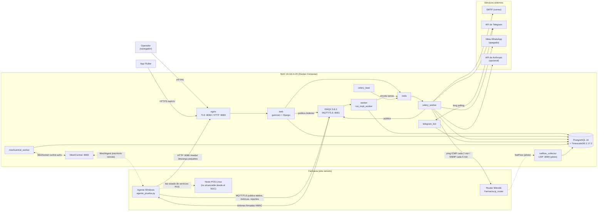

**Explicación técnica.** El sistema tiene cuatro puertas de entrada de datos: (1) MQTT, por donde el agente empuja latidos, métricas e inventario al broker EMQX, que el proceso `worker` consume (`apps/mqtt_worker/management/commands/run_mqtt_worker.py`, 15 tópicos, líneas 30-44); (2) *pull* desde el servidor: `celery_worker` hace ping ICMP a `Farmacia.ip_router` (`apps/monitoreo/enlaces.py`, `sondear_enlaces_farmacias`) y SNMP a los Mikrotik (`apps/monitoreo/mikrotik.py`, `sincronizar_ancho_banda_farmacias`); (3) HTTP: el panel HTMX y la API REST (`config/urls.py`); (4) WebSocket saliente a MeshCentral (`apps/monitoreo/adapters/meshcentral.py`). Toda la lógica de negocio vive en `apps/<app>/services.py` y módulos de dominio (`enlaces.py`, `salud.py`, `incidencias.py`); las vistas del panel solo presentan. Los avisos salen siempre desde Celery (`apps/monitoreo/tasks.py`, `notificar_alerta_task`), con caída a envío en línea si Redis no responde (`apps/monitoreo/services.py`, `encolar_notificacion_alerta`).

**Resumen sencillo.** Las computadoras de las farmacias "hablan" con el servidor por un canal de mensajería (MQTT). Además, el servidor "toca la puerta" de cada router de farmacia para ver si responde. Todo termina en una base de datos y se ve en el panel.

#### 2.1 Capas del backend

| Capa | Dónde | Notas |
|---|---|---|
| Presentación HTML | `apps/panel/views/*.py` (35 módulos), `templates/panel/*.html` | Ver [06 · Frontend](#s3) |
| API REST (DRF) | `apps/catalogo/api_views.py`, `apps/monitoreo/api_views.py`, `apps/monitoreo/api_rmm.py`, `apps/mantenimiento/api_views.py` | Ver [05 · API](#s10) |
| Ingesta MQTT | `apps/mqtt_worker/services.py` (`manejar_*`, ~1.060 líneas) | Un manejador por tópico |
| Dominio | `apps/<app>/services.py` + módulos temáticos | Transacciones y transiciones de estado |
| Tareas | `apps/<app>/tasks.py` + `CELERY_BEAT_SCHEDULE` | Ver [Workers](#s5) |
| Persistencia | `apps/<app>/models.py`, 5 hypertables TimescaleDB | Ver [04 · Modelo de datos](#s4) |

No hay **señales de Django** (`@receiver`, `post_save.connect`) en ninguna app: búsqueda sin resultados en `apps/` [código]. Todo efecto secundario se invoca explícitamente desde servicios, lo que facilita seguir el flujo pero obliga a buscar los llamadores a mano.

---

### 3. Arquitectura física y de despliegue

#### 3.1 Servidor

| Aspecto | Valor | Fuente |
|---|---|---|
| Hardware | Intel NUC en sitio, Linux | `CLAUDE.md` §Producción; [PROD, reportado 24-oct-2026] |
| IP | `10.111.6.20` | `CLAUDE.md` |
| Red de salida | WiFi `wlo1` con ruta por defecto, sin VPN dedicada (dato del 11-sep-2026) | `CLAUDE.md` §"Lo que bloquea de verdad" — Pendiente de verificar si sigue igual |
| Cortafuegos del host | No filtra (cadena `DOCKER-USER` vacía, `ufw` inactivo) | Notas de sesión 20-oct-2026 — Pendiente de verificar |
| Repositorio desplegado | `~/Documentos/Said/saidsoft-core`, usuario `glpi` | `CLAUDE.md`; `deploy/saidsoft-salud.service` (`WorkingDirectory`) |
| Orquestación | Docker Compose v2, `docker compose --env-file .env build && up -d` | `CLAUDE.md`; `deploy/desplegar.sh` |
| Alimentación | Sin UPS documentado. Cortes de luz del 24–25-oct dejaron el NUC ciego varias horas y el panel en 502 | [PROD, reportado 25-oct-2026] |

#### 3.2 Contenedores

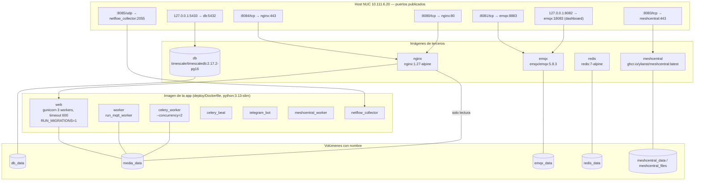

**Explicación técnica.** `deploy/docker-compose.yml` define 12 servicios. Siete (`web`, `worker`, `celery_worker`, `celery_beat`, `telegram_bot`, `meshcentral_worker`, `netflow_collector`) comparten `build: {context: .., dockerfile: deploy/Dockerfile}` mediante el ancla `x-app`, pero Compose genera **una imagen por servicio**; por eso `build web` no basta y hay que reconstruir todas (`CLAUDE.md`, §Producción). Solo `web` corre migraciones y `collectstatic` (`RUN_MIGRATIONS=1`; `deploy/entrypoint.sh`). `web` no publica puerto: solo lo alcanza `nginx` por la red interna (`expose: 8000`). `redis` no publica puerto. La base y el dashboard de EMQX solo escuchan en `127.0.0.1`. El listener MQTT sin TLS y el de WebSocket de EMQX están deshabilitados (`EMQX_LISTENERS__TCP__DEFAULT__ENABLE: "false"`, `…WSS…: "false"`). `media_data` lo comparten `web`, `worker`, `celery_worker` (lectura/escritura) y `nginx` (solo lectura).

**Resumen sencillo.** Hay 12 "cajas" corriendo en el mismo servidor. Siete son el mismo programa (SaidSoft) haciendo tareas distintas; las otras cinco son productos estándar (base de datos, mensajería, cola, servidor web y escritorio remoto). Desde fuera solo se ven unos pocos puertos.

#### 3.3 Tabla de servicios

| Servicio | Proceso | Healthcheck | Depende de |
|---|---|---|---|
| `db` | PostgreSQL 16 + TimescaleDB 2.17.2 | `pg_isready` | — |
| `emqx` | EMQX 5.8.3, auth y ACL en `built_in_database`, `no_match: deny`, retainer en disco, `MAX_CONNECTIONS 6000`, `nofile 65536` | `emqx ctl status` | — |
| `redis` | Redis 7, `--save 60 1` | `redis-cli ping` | — |
| `web` | `gunicorn config.wsgi:application --workers 3 --timeout 600` | GET `/login/` con `Host` de `ALLOWED_HOSTS` | `db` (healthy), `emqx`, `redis` |
| `nginx` | Proxy TLS (cert autofirmado), sirve `/media/` | `wget /media/` | `web` |
| `worker` | `manage.py run_mqtt_worker` | `verificar_salud --solo mqtt_worker` | `db`, `emqx`, `redis` |
| `celery_worker` | `celery -A config worker --concurrency=2` | `celery inspect ping` | `db`, `redis`, `emqx` (healthy) |
| `celery_beat` | `celery -A config beat` | `verificar_salud --solo 'celery beat'` | `db`, `redis` |
| `telegram_bot` | `manage.py run_telegram_bot` (long polling) | latido en `WorkerHeartbeat` < 3 min | `db`, `emqx` (healthy) |
| `meshcentral_worker` | `manage.py run_meshcentral_worker` | `verificar_salud --solo meshcentral_worker` | `db`, `meshcentral` |
| `netflow_collector` | `manage.py run_netflow_collector` (piloto) | ninguno | `db` |
| `meshcentral` | MeshCentral (imagen `latest`, sin versión fija) | ninguno | — |

Todos usan `restart: unless-stopped`. **Docker Compose no reinicia un contenedor por estar `unhealthy`**: solo lo reinicia si el proceso termina. Los healthchecks marcan estado, pero no curan (no hay `autoheal` ni equivalente en `deploy/`; búsqueda sin resultados) [código].

#### 3.4 Arranque y despliegue

- `deploy/entrypoint.sh`: espera a la base (30 intentos × 2 s), y en `web` corre `migrate`, descarta un `staticfiles.json` ilegible y corre `collectstatic`. El descarte se agregó tras el corte de luz del 25-oct-2026, que dejó el manifiesto a medio escribir y `web` en bucle de reinicio con 502 en todo el panel (commit `9c9405b`) [código] [PROD, reportado 25-oct-2026].
- `seed_permisos` **no** corre en el arranque: hay que ejecutarlo a mano tras desplegar si cambian permisos (`PLAN_MODERNIZACION.md`, fila de aperturas; `deploy/entrypoint.sh` no lo invoca) [código].
- Un cambio a `deploy/nginx/nginx.conf` exige **recrear** el contenedor (bind mount de un archivo suelto) (`CLAUDE.md`).
- El detalle operativo está en [Infraestructura](#s11) y en `deploy/README-produccion.md`.

---

### 4. Arquitectura de aplicaciones Django

El inventario completo (propósito, modelos, servicios, comandos, estado) está en [03 · Inventario de aplicaciones](#s2). Aquí va solo la estructura.

| Grupo | Apps | Clasificación en el alcance 1.0 (`docs/producto/SAIDSOFT_RMM_1_0_ALCANCE.md` §7) |
|---|---|---|
| Núcleo de flota | `catalogo`, `mqtt_worker`, `monitoreo`, `despliegues`, `software` | CORE |
| Transversales | `cuentas`, `auditoria`, `panel` | CORE |
| Compartidas con el núcleo | `activos`, `mantenimiento`, `scripts`, `aperturas`, `whatsapp` | DEPENDENCIA_COMPARTIDA |
| Secundaria | `facturacion` | SECUNDARIO |
| Diferidas | `viaticos`, `cumplimiento` | DIFERIDO → candidatas a retiro |

Las dependencias reales por importación (sin contar pruebas ni migraciones) se grafican en [03 · §4](#4-dependencias-entre-aplicaciones). Los ciclos `catalogo ↔ monitoreo`, `catalogo ↔ mqtt_worker`, `catalogo ↔ activos` y `catalogo ↔ cuentas` existen y se rompen con **importaciones diferidas** dentro de funciones (p. ej. `apps/catalogo/services.py:727-728`, `apps/catalogo/models.py:698`) [código].

---

### 5. Comunicaciones

| Canal | Origen → destino | Protocolo / puerto | Autenticación | Evidencia |
|---|---|---|---|---|
| Panel web | Navegador → `nginx` → `web` | HTTPS `:8084` (HTTP `:8080` redirige, salvo `/media/`) | Sesión Django + MFA TOTP opcional (`MFA_OBLIGATORIO`, por defecto `False`) + django-axes | `deploy/nginx/nginx.conf`; `config/settings/base.py:142-190` |
| API REST | App móvil, sonda, integraciones → `web` | HTTPS `/api/v1/…` | Token DRF con vencimiento (`TokenConVencimiento`, `API_TOKEN_DIAS=30`) | `config/settings/base.py:401-408`; `config/urls.py` |
| Telemetría | Agente → EMQX | MQTT 3.1.1/5 sobre TLS, `:8081` → `8883` | Usuario y contraseña por estación en EMQX (`emqx_admin.aprovisionar_credencial_estacion`) + `token` de enrolamiento en cada payload | `apps/mqtt_worker/emqx_admin.py`; `apps/mqtt_worker/services.py:393-395` |
| Órdenes al agente | `web`/`celery_worker` → EMQX → agente | MQTT/TLS | Firma HMAC-SHA256 (secreto por estación o compartido) + ventana de 120 s; catálogos firmados también con Ed25519 desde 0.38 | `apps/catalogo/services.py`; `apps/monitoreo/firma_catalogo.py`; `agente_prueba.py` (`VENTANA_TIMESTAMP_SEGUNDOS = 120`) |
| Descarga de paquetes | Agente → `nginx` | **HTTP** `:8080/media/` sin autenticación | Integridad por SHA-256 que viaja en la orden firmada | `config/urls.py` (`servir_media_publico`); `deploy/nginx/nginx.conf` |
| Sondeo de enlaces | `celery_worker` → router Mikrotik | ICMP (binario `ping`, 3 paquetes, timeout 2 s, 50 en paralelo) | — | `apps/monitoreo/enlaces.py` (`sondear_enlace`, `PAQUETES_POR_SONDEO`, `MAX_SONDEOS_CONCURRENTES`) |
| Ancho de banda e identidad del borde | `celery_worker` → Mikrotik | SNMP UDP `:161`, comunidad = código de farmacia en minúsculas | Comunidad SNMP | `config/settings/base.py:386-396`; `apps/monitoreo/mikrotik.py` |
| SNMP genérico (impresoras, UPS) | `celery_worker` → dispositivos | SNMP | Comunidad por `PerfilSnmp` | `apps/monitoreo/snmp/` |
| Escritorio remoto | Navegador → MeshCentral `:8083`; MeshAgent ↔ MeshCentral | HTTPS/WebSocket | Cuentas de MeshCentral | `deploy/docker-compose.yml` servicio `meshcentral` |
| Presencia MeshCentral | `meshcentral_worker` → MeshCentral | WebSocket `control.ashx` | Cuenta dedicada (`MESHCENTRAL_API_*`) | `apps/monitoreo/adapters/meshcentral.py` |
| Notificaciones | `celery_worker` → SMTP / Telegram / Teams | SMTP 587 TLS / HTTPS | Credenciales en `.env` | `apps/monitoreo/services.py` (`notificar_alerta`) |
| Bot de Telegram | `telegram_bot` → API de Telegram | HTTPS long polling (`getUpdates`, `timeout=30`) | Lista blanca `TELEGRAM_CHAT_IDS_AUTORIZADOS` o perfil de usuario | `apps/monitoreo/management/commands/run_telegram_bot.py` |
| Webhook WhatsApp | Meta → `web` | HTTPS `/whatsapp/webhook/` | Firma del cuerpo (`WHATSAPP_APP_SECRET`) | `config/urls.py`; `apps/whatsapp/views.py` (`_firma_valida`) |
| NetFlow (piloto) | Mikrotik → `netflow_collector` | UDP `:8085` → `2055` | Ninguna; se identifica por IP de origen | `apps/monitoreo/management/commands/run_netflow_collector.py` |
| Nodo POS Linux | — | **No hay comunicación** desde el NUC | — | [PROD, reportado 26-oct-2026]: el NUC no llega a los nodos POS por seguridad. El estado de los servicios del POS lo informa el agente (`/servicios_pos/`) |

---

### 6. Almacenamiento

| Almacén | Qué guarda | Persistencia | Respaldo |
|---|---|---|---|
| PostgreSQL 16 + TimescaleDB (`db_data`) | Todo el dominio. Series temporales en 5 hypertables: `muestra_metrica`, `muestra_servicio_pos`, `evento_monitoreo`, `muestra_red_farmacia` (migración `monitoreo/0035`) y `muestra_enlace_farmacia` (`monitoreo/0052`), con compresión (`0040`) y retención | Volumen Docker | `deploy/backup.sh` diario 02:00 (`saidsoft-respaldo.timer`), cifrado GPG, **en el mismo servidor** (`CLAUDE.md`, pendientes). Detalle en [Infraestructura](#s11) |
| `media_data` | Paquetes de despliegue, instaladores, ejecutable del agente, fotos e informes de mantenimiento | Volumen Docker | Pendiente de verificar si `backup.sh` lo incluye |
| `emqx_data` | Usuarios y ACL de EMQX (Mnesia), mensajes retenidos | Volumen Docker; el nombre del nodo está fijado (`EMQX_NODE__NAME: emqx@127.0.0.1`) porque si cambia EMQX arranca en blanco | Notas de sesión 20-oct: `backup.sh` respalda EMQX desde `68d0045` — Pendiente de verificar |
| `redis_data` | Cola de Celery y resultados | Snapshot cada 60 s si hubo escrituras | No se respalda (no es dato de negocio) |
| `meshcentral_data`/`_files` | Configuración y grabaciones de MeshCentral | Volumen Docker | Notas de sesión 22-oct: `backup.sh` **no** incluye MeshCentral — Pendiente de verificar |
| Estado de Celery Beat | `celerybeat-schedule` dentro del contenedor, **sin volumen** | Se pierde en cada recreación; por eso las tareas diarias usan `crontab` | `config/settings/base.py:458-476` |

No se usa el framework de caché de Django (`CACHES` no está definido en el repositorio; Redis es solo broker de Celery) [código].

---

### 7. Tareas asíncronas (resumen)

El detalle (cada tarea, colas, reintentos, idempotencia) está en [Workers](#s5).

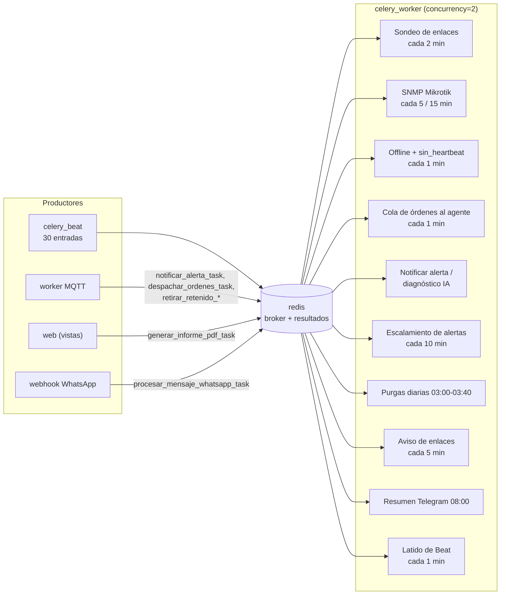

**Explicación técnica.** `config/celery.py` crea la app `saidsoft` con `autodiscover_tasks()`. `celery_beat` programa 30 entradas (`config/settings/base.py:430-684`); las de un día usan `crontab` porque el estado de Beat no tiene volumen y un intervalo de 86.400 s nunca dispara si se despliega antes (medido el 19-sep-2026, comentario en `base.py:458-476`). Productores fuera de Beat: el worker MQTT encola `notificar_alerta_task`, `diagnosticar_alerta_task`, `despachar_ordenes_task`, `limpiar_actualizacion_pendiente_task`, `retirar_retenido_despliegue_task` y `retirar_retenido_instalacion_task` (`apps/mqtt_worker/services.py`, `apps/monitoreo/services.py`); el panel encola `generar_informe_pdf_task` (`apps/panel/views/mantenimiento.py`); el webhook encola `procesar_mensaje_whatsapp_task` (`apps/whatsapp/views.py`). Hay un solo consumidor con concurrencia 2 y **una sola cola** (no hay `task_routes`) [código].

**Resumen sencillo.** Un "reloj" (Beat) dispara trabajos repetitivos —hacer ping a las farmacias, marcar equipos que dejaron de reportar, limpiar datos viejos— y los deja en una fila (Redis). Un solo "trabajador" con dos manos los va sacando de la fila y ejecutando.

---

### 8. Monitorización: cómo un dato de farmacia llega a la pantalla y a una alerta

Hay **dos señales independientes por farmacia** y conviene no confundirlas:

| Señal | Qué prueba | Quién la produce | Dónde se guarda | Qué dispara |
|---|---|---|---|---|
| **Sondeo de enlace** (ping al router Mikrotik) | Que el router de borde de la farmacia responde desde el NUC, es decir, que hay enlace WAN y ruta | `celery_worker`, tarea `sondear-enlaces-farmacias` cada 2 min | `EstadoEnlaceFarmacia` (estado actual), `EventoEnlaceFarmacia` (caídas), `MuestraEnlaceFarmacia` (latencia y pérdida por barrido) | Caída tras `ConfiguracionMonitoreo.fallas_consecutivas_enlace` sondeos fallidos (`default=3`, `apps/monitoreo/models.py:1857-1858`); aviso agrupado por correo/Telegram cada 5 min (`notificar_cambios_enlaces`). **No crea `Alerta`**. |
| **Heartbeat del agente** (latido MQTT) | Que el **agente de esa PC** está vivo y conectado al broker | Agente, tópico `/saidsof/agente/{código}/heartbeat/` cada 60 s (`agente_prueba.py:3509`) | `Estacion.ultimo_heartbeat`, `estado_conexion`; `EstadoDispositivo(fuente=MQTT)` | `marcar-estaciones-offline` (cada 60 s) la pasa a OFFLINE a los 5 min sin latido (`ALERTA_SIN_LATIDO_UMBRAL_MINUTOS`) y evalúa reglas `sin_heartbeat` (**inactiva en producción**) |

Una farmacia puede tener **enlace vivo y agente caído** (PC apagada, servicio colgado): esa combinación es la regla `agente_caido_red_viva`, que cruza MQTT con MeshCentral (`evaluar_cruce_monitoreo`, cada 7 min), también **inactiva en producción** [PROD, reportado 26-oct-2026].

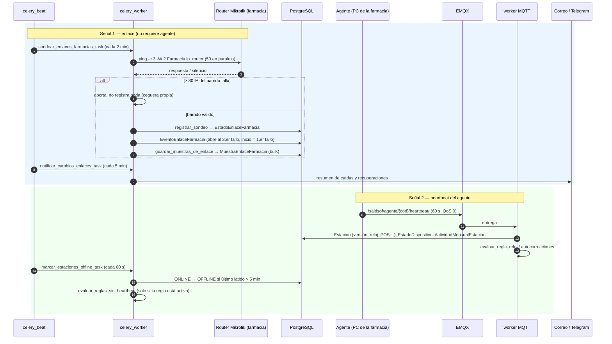

**Explicación técnica.** El sondeo de enlace usa el binario `ping` del sistema (instalado en la imagen con `iputils-ping`, `deploy/Dockerfile`) y considera vivo el sitio si responde cualquiera de 3 paquetes (`enlaces.py`, `PAQUETES_POR_SONDEO`). Si falla el 80 % o más del barrido, aborta sin escribir (`UMBRAL_BARRIDO_SOSPECHOSO_PCT`): se asume que quien perdió la ruta es el NUC. Ese aborto **no genera alerta ni aparece en el panel**; solo queda un `logger.error` (docstring de `sondear_enlaces_farmacias`). Tras un hueco, `_registrar_reanudacion_si_hubo_hueco` crea `ReanudacionMonitoreo` y `avisar_reanudacion_monitoreo` informa qué farmacias no volvieron. `clasificar_caidas_simultaneas` separa "corte de proveedor" de "ceguera propia" (dos o más ISP con ≥3 caídas cada uno en 10 min). El sistema **no distingue corte de luz de caída de enlace** en la farmacia (comentario en `enlaces.py:642-651`). La sonda externa por API (`deploy/sonda-enlaces/sonda_enlaces.py` → `SondeoEnlaceIngestaView`) llama a `registrar_sondeo` pero **no** a `guardar_muestras_de_enlace`, así que, si se usara, no produciría historial `MuestraEnlaceFarmacia` [código].

**Resumen sencillo.** "El router de la farmacia contesta" y "la computadora de la farmacia reporta" son dos preguntas distintas. La primera la hace el servidor cada 2 minutos y sirve aunque la farmacia no tenga agente; la segunda depende del agente instalado. Si se va la luz en la oficina del servidor, el servidor no ve a nadie y lo detecta como "ceguera propia" en vez de llenar la base de caídas falsas.

#### 8.1 Flujo agente ↔ MQTT ↔ backend

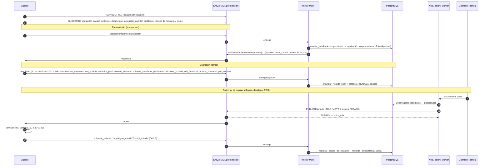

**Explicación técnica.** El worker se suscribe a 15 tópicos (`run_mqtt_worker.py:30-44`); los de resultado de despliegue, script e instalación usan QoS 1 y el resto QoS 0 (`_on_connect`). Cada manejador valida `codigo` del tópico + `token` del payload contra `Estacion.token_enrolamiento` y descarta si la estación no está `APROBADA` (`mqtt_worker/services.py:393-401`). Un payload que no es JSON o que lanza excepción se guarda en `MensajeMqttFallido` (`registrar_mensaje_fallido`). El worker procesa **un mensaje a la vez** en el hilo de `paho` (`loop_forever`) y su latido (`WorkerHeartbeat`, cada 30 s en hilo aparte) informa `conectado` y `mensajes_procesados`. Las órdenes salientes pasan por la cola persistente `OrdenAgente` (`apps/catalogo/ordenes.py`), con máquina de estados y reentrega, procesada cada minuto por `procesar-ordenes-agente`; según notas de sesión del 21-oct-2026 está en piloto en una estación. Los tópicos de comandos y la firma se detallan en [Workers](#s5) y [Seguridad](#s14).

**Resumen sencillo.** El agente se presenta una vez (enrolamiento), un humano lo aprueba, y desde ahí manda su estado cada minuto. Cuando alguien en el panel pide algo (instalar un programa, actualizar el POS), el servidor manda una orden firmada; el agente comprueba la firma, la ejecuta y contesta cómo le fue.

#### 8.2 Procesamiento de alertas

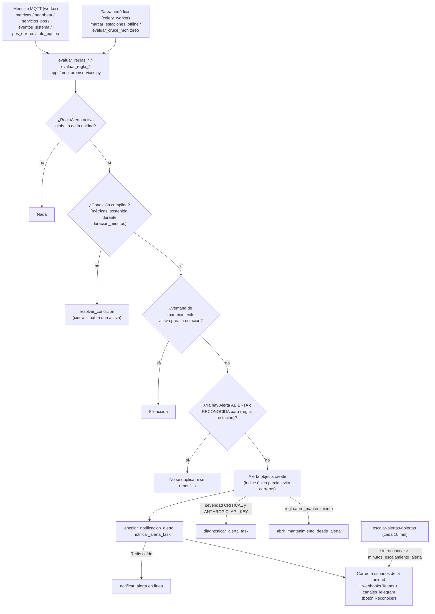

**Explicación técnica.** Toda apertura pasa por `abrir_o_mantener_alerta(regla, estacion, valor)` (`apps/monitoreo/services.py:135-166`): consulta `ventana_mantenimiento_activa`, evita duplicados con `_alerta_activa` y con el índice único parcial `una_alerta_activa_por_regla_y_estacion`, encola la notificación, pide diagnóstico IA solo si la regla es `CRITICAL` y hay `ANTHROPIC_API_KEY`, y abre un mantenimiento si `regla.abre_mantenimiento`. `notificar_alerta` (líneas 879-983) arma un correo a superusuarios, usuarios con `acceso_todas_unidades` y usuarios de esa unidad de negocio, más los `CanalNotificacion` de Teams y Telegram globales o de la unidad. Las métricas posibles están en `Metrica` (`apps/monitoreo/models.py:232-266`). **Las caídas de enlace no son `Alerta`**: van por `EventoEnlaceFarmacia` y su propio aviso agrupado (`ENLACES_TELEGRAM_CHAT_ID`, `ENLACES_NOTIFICAR_A`).

**Estado en producción [PROD, reportado 26-oct-2026]:** reglas activas solo de CPU, RAM y disco; inactivas `servicio_pos_caido`, `agente_caido_red_viva`, `sin_heartbeat`, `desfase_reloj`, `bitlocker`, `pos_errores`; canal global de Telegram activo. Consecuencia verificable en código: las métricas de CPU/RAM/disco solo las envía el agente si la estación tiene `monitorear_recursos=True` (`agente_prueba.py`, `bucle_metricas`; `monitoreo_lista` filtra por ese campo), así que **las únicas alertas activas solo cubren las estaciones marcadas para monitorear recursos**. Cuántas son: Pendiente de verificar.

**Resumen sencillo.** Cuando un dato cruza un límite configurado, se crea una alerta una sola vez y se avisa por correo y Telegram. Si nadie la reconoce, se vuelve a avisar. Hoy en producción solo están encendidas las alertas de CPU, memoria y disco.

---

### 9. Seguridad (resumen)

El análisis completo está en [Auditoría técnica de seguridad](#s14). Lo que esta vista de arquitectura necesita saber:

| Control | Estado | Evidencia |
|---|---|---|
| TLS del panel | Sí, certificado autofirmado en nginx (TLS 1.2/1.3) | `deploy/nginx/nginx.conf` |
| TLS de MQTT | Sí, `:8883` (publicado en `:8081`); sin TLS deshabilitado | `deploy/docker-compose.yml` servicio `emqx` |
| Autorización MQTT | ACL por estación, `no_match: deny` | idem; `apps/mqtt_worker/emqx_admin.py` |
| Firma de órdenes | HMAC-SHA256 + ventana de 120 s; catálogos también Ed25519 | `config/settings/base.py:237-245` |
| Login | django-axes (5 intentos, bloqueo 1 h por usuario), contraseña ≥ 12, sesión de 8 h por inactividad | `base.py:142-175` |
| MFA | Disponible, **apagado por defecto** (`MFA_OBLIGATORIO=False`); según notas del 22-oct ninguna cuenta lo tenía | `base.py:187`; notas de sesión |
| Cifrado en reposo | Fernet para clave de BitLocker y contraseña del POS | `apps/catalogo/crypto.py` |
| `/media/` | **Público por HTTP** salvo `mantenimiento/` (protegido en nginx con `internal` y en Django con `PREFIJOS_MEDIA_PROTEGIDOS`) | `config/urls.py`; `nginx.conf` |
| Cabeceras de seguridad | HSTS, cookies seguras; **sin Content-Security-Policy** (búsqueda sin resultados) | `config/settings/produccion.py` |
| Secretos | Solo en `deploy/.env` (fuera de git); 7 contenedores reciben `SECRET_KEY`, `COMANDO_HMAC_SECRET` y `BITLOCKER_ENCRYPTION_KEY` aunque no todos los usan | `deploy/docker-compose.yml` |

#### 9.1 Límites de confianza

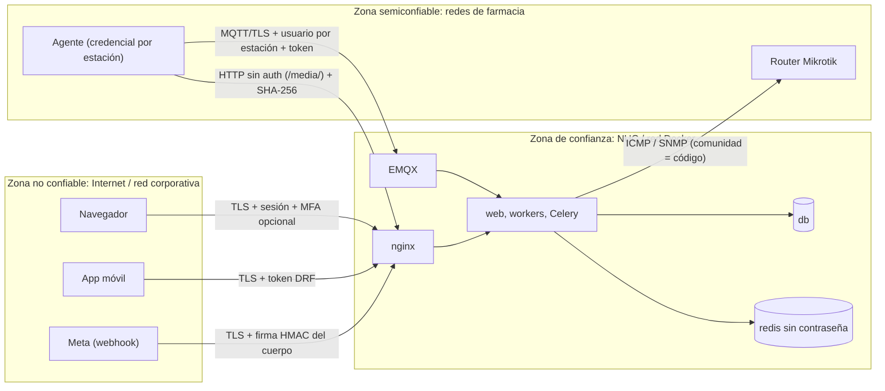

**Explicación técnica.** El límite fuerte está en nginx (TLS, sesión) y en EMQX (TLS, ACL). Dentro de la red Docker no hay autenticación entre `redis` y los procesos (URL `redis://redis:6379/0` sin contraseña) ni cifrado hacia `db`; la protección es que esos puertos no se publican. Según notas de sesión, el host no filtra tráfico, así que cualquier puerto publicado (8080–8085) queda expuesto a toda la red que llegue al NUC. La comunidad SNMP de cada Mikrotik se deduce del código de farmacia (`base.py:386-393`), lo que la hace adivinable.

**Resumen sencillo.** Lo que entra desde fuera pasa por dos "porteros" con cifrado: nginx (panel y API) y EMQX (agentes). Lo que está detrás de ellos confía entre sí. Las descargas de paquetes van sin cifrar, pero el agente comprueba su huella antes de usarlas.

---

### 10. Observabilidad de la propia plataforma

| Mecanismo | Qué mide | Dónde se ve | Evidencia |
|---|---|---|---|
| `WorkerHeartbeat` | Latido de `mqtt_worker` (con `conectado` y `mensajes_procesados`), `meshcentral_worker`, `telegram_bot`, `celery_beat` (tarea `latido-de-beat`), respaldo | Barra superior de todas las pantallas (`salud_plataforma_contexto`) y Zona 0 del tablero | `apps/monitoreo/salud.py` (`estado_latidos`) |
| `verificar_salud` | Latidos, respaldo, disco libre, Telegram | Healthchecks de `worker`, `meshcentral_worker`, `celery_beat`; timer systemd cada 15 min | `apps/monitoreo/management/commands/verificar_salud.py`; `deploy/saidsoft-salud.timer` |
| Temperatura del NUC | CPU y disco vía `/sys/class/thermal` y `hwmon` | Salud de la plataforma | `apps/monitoreo/temperatura.py`; `SALUD_LEER_TEMPERATURA` |
| Estaciones "sordas" | Conectadas a EMQX sin suscripciones | Zona 0 del tablero (consulta HTTP a la API de EMQX en cada refresco) | `apps/mqtt_worker/emqx_admin.py` (`estaciones_sin_suscripciones`); `apps/panel/views/dashboard.py:293` |
| `MensajeMqttFallido`, `EnrolamientoRechazado` | Mensajes no procesables y enrolamientos sin sitio | Tablero y bandeja de enrolamientos | `apps/mqtt_worker/models.py` |
| Logs | stdout de cada contenedor (`docker compose logs`) | Solo en el servidor | `config/settings/base.py:692-711` |

**Brechas verificadas en código:**

- La unidad `saidsoft-salud.service` no tiene `OnFailure=`; si `verificar_salud` falla, el resultado **solo queda en el journal** (comentario de la propia unidad). Además se ejecuta con `docker compose exec web`, así que con `web` caído no puede ni correr.
- No hay vigilancia externa al NUC: si el servidor se apaga (cortes del 24–25-oct-2026), ningún componente puede avisar, porque todos los avisos salen de él.
- `verificar_salud` todavía infiere la salud de Beat por la frescura de `MuestraRedFarmacia` (`BEAT_UMBRAL_MINUTOS = 20`), mientras el panel usa el latido propio de Beat; el docstring de `salud.py` lo declara como pendiente. El healthcheck del contenedor `celery_beat` usa el criterio viejo.
- Sin métricas de proceso (Prometheus, APM) ni agregación de logs.

---

### 11. Dependencias, puntos únicos de fallo y componentes críticos

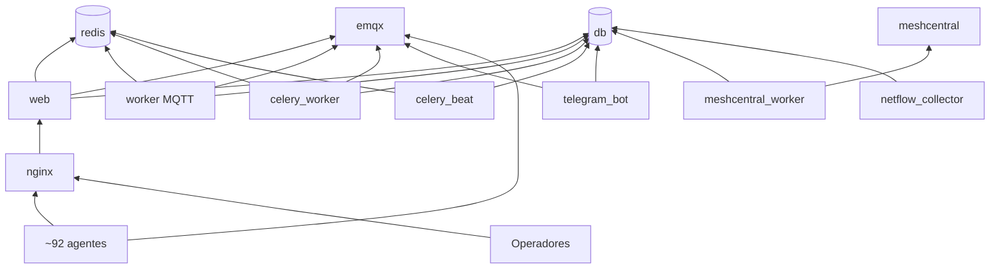

**Explicación técnica.** Es el grafo de `depends_on` de `deploy/docker-compose.yml` más los clientes externos. `db` es dependencia de los siete procesos de aplicación; `emqx` de cuatro y de toda la flota; `redis` de cuatro. `telegram_bot` y `celery_worker` esperan a `emqx` *healthy*.

**Resumen sencillo.** Si se cae la base de datos, se cae todo. Si se cae EMQX, las farmacias dejan de reportar y no se les puede mandar nada. Si se cae Redis, no corren las tareas periódicas (los avisos de alertas se mandan igual, en línea).

| Componente | Tipo de riesgo | Impacto si falla | Mitigación existente |
|---|---|---|---|
| **NUC (hardware, energía, red WiFi)** | Punto único de fallo físico | Todo el sistema ciego; nadie avisa | Ninguna en código. `ReanudacionMonitoreo` informa al volver. [PROD, reportado 24–25-oct-2026] |
| `db` | Punto único | Todo | Respaldo diario en el mismo disco; copia manual a disco externo (notas 21-oct) |
| `emqx` | Punto único | Sin telemetría ni órdenes | Retainer en disco; healthcheck |
| `worker` MQTT (un proceso, un hilo) | Punto único y cuello de botella | Telemetría acumulada en el broker y pérdida de QoS 0 | Avisos movidos a Celery; latido con `conectado` |
| `celery_worker` (concurrencia 2, una cola) | Cuello de botella | Sondeos, avisos, purgas y cola de órdenes compiten | Lotes SNMP repartidos; ver [07 · Escalabilidad](#s18) |
| `celery_beat` | Punto único | Nada periódico ocurre | Latido propio cada minuto |
| `nginx` + `web` | Punto único del panel y de las descargas | Panel 502; agentes sin paquetes | `entrypoint.sh` repara manifiesto dañado (9c9405b) |
| Certificado `deploy/certs/cert.pem` | Compartido por nginx, EMQX y agentes | Rotarlo mal deja fuera a la flota y a la app | `deploy/verificar-certificado.sh`; runbook |
| `COMANDO_HMAC_SECRET` compartido | Secreto de flota | Firmar órdenes válidas para estaciones sin secreto propio | Secreto por estación desde 0.21 |

**Componentes críticos para RMM 1.0:** `db`, `emqx`, `worker`, `celery_worker`, `celery_beat`, `web`/`nginx`. Secundarios: `telegram_bot` (hoy el canal de aviso efectivo, según el alcance 1.0 §3), `meshcentral` y `meshcentral_worker`. Prescindible: `netflow_collector` (piloto).

---

### 12. Pendiente de verificar

| # | Qué | Por qué importa | Comando de solo lectura sugerido en el NUC |
|---|---|---|---|
| 1 | Que el compose desplegado sea igual al del repositorio | Todo este documento lo asume | `cd ~/Documentos/Said/saidsoft-core && git status --short && git log -1 --oneline && docker compose -f deploy/docker-compose.yml config --services` |
| 2 | Imágenes con código viejo | Una imagen sin reconstruir corre lógica distinta | `docker exec deploy-worker-1 cat /app/apps/monitoreo/services.py \| diff -q - apps/monitoreo/services.py` (método de `CLAUDE.md`) |
| 3 | Cuántas estaciones tienen `monitorear_recursos=True` | Son las únicas cubiertas por las alertas activas | `docker compose exec -T db psql -U <usuario> -d <base> -c "select monitorear_recursos, count(*) from estacion group by 1;"` (`db_table = 'estacion'`, `apps/catalogo/models.py:559`) |
| 4 | Si el sondeo de enlaces aborta por ceguera | Aborta en silencio | `docker compose logs --since 48h celery_worker \| grep -c "Barrido de enlaces abortado"` |
| 5 | Si se usa la sonda externa (`deploy/sonda-enlaces/`) | No genera historial `MuestraEnlaceFarmacia` | `docker compose logs --since 7d web \| grep -c "/api/v1/monitoreo/enlaces/sondeo/"` |
| 6 | Si `saidsoft-salud.timer` está instalado y qué reporta | Es el único vigilante "externo" | `systemctl list-timers \| grep saidsoft; journalctl -u saidsoft-salud.service --since "3 days ago" \| tail -50` |
| 7 | Red de salida del NUC y reglas de cortafuegos | Límites de confianza y continuidad | `ip route; sudo iptables -S DOCKER-USER; sudo ufw status` |
| 8 | Qué respalda `backup.sh` (media, EMQX, MeshCentral) | Recuperación ante desastre | `grep -nE "media\|emqx\|meshcentral" deploy/backup.sh; ls -la ~/Documentos/Said/saidsoft-core/backups \| tail` |
| 9 | Versión real de MeshCentral (`latest`) | Una recreación puede actualizarla sin aviso | `docker inspect --format '{{.Image}} {{.Config.Image}}' deploy-meshcentral-1` |
| 10 | Si hay archivos no versionados en el checkout que entren a la imagen (p. ej. `Instalar-Saidsoft.ps1`) | `.dockerignore` no los excluye (ver [03 · §1.2](#12-archivos-sueltos-en-la-raíz)) | `git status --short --ignored` en el checkout del NUC |

---

<a id="s2"></a>

## 2. Inventario de aplicaciones

### Ficha del documento

| Campo | Valor |
|---|---|
| Fecha de generación | 26-oct-2026 |
| Commit analizado | `1fa16d6` (rama `master`) |
| Alcance analizado | Las 16 apps de `apps/`, el paquete `config/`, la estructura de la raíz del repositorio y las dependencias declaradas (`requirements*.txt`, `agente-prueba/requirements.txt`, `movil-campo/pubspec.yaml`, `static/`, `static_src/`, `tools/`). |
| Evidencias consultadas | `config/settings/{base,produccion,desarrollo}.py`, `config/urls.py`, `config/celery.py`, `apps/*/models.py`, `apps/*/services.py`, `apps/*/tasks.py`, `apps/*/management/commands/`, `apps/panel/urls.py`, `apps/panel/modulos.py`, `.gitignore`, `.dockerignore`, `git ls-files`, `git status --ignored`, `docs/producto/SAIDSOFT_RMM_1_0_ALCANCE.md`, `docs/modulos.md`, `docs/auditoria/fase1-descubrimiento.md`, `CLAUDE.md`, `README.md`. |
| Supuestos | Las importaciones en código de aplicación (excluidas pruebas y migraciones) reflejan las dependencias reales. El estado "en producción" se toma del alcance 1.0 y de lo reportado por el usuario. |
| Limitaciones | Análisis estático. No se ejecutaron pruebas ni comandos de gestión. Los conteos son de líneas de código, no mediciones de uso. No se abrieron archivos con secretos ni las planillas `.xlsx` con datos personales. |
| Hallazgos pendientes | Ver [§7](#7-pendiente-de-verificar). |
| Estado de validación | Estructura, modelos, comandos e importaciones: **verificados en código**. Uso real en producción: **pendiente** salvo lo marcado `[PROD, reportado …]`. |

El esquema de cada modelo (campos, índices, restricciones) está en [04 · Modelo de datos](#s4); los endpoints, en [05 · API y endpoints](#s10); las pantallas, en [06 · Frontend](#s3); los procesos de larga duración y Celery, en [Workers](#s5). Visión de conjunto: [02 · Arquitectura general](#s1).

#### Categorías de estado usadas

| Categoría | Significado en este documento |
|---|---|
| Implementado y comprobado | Hay código, pruebas y evidencia de uso en producción (reportada) |
| Implementado no comprobado en ejecución | Hay código y pruebas, pero no hay evidencia de uso real |
| Parcial | Falta una parte necesaria para que funcione de punta a punta |
| Configurado pero deshabilitado | Existe y está desplegado, pero un *flag* o configuración lo apaga |
| En desarrollo | Cambios recientes sin desplegar o en piloto |
| Obsoleto o candidato | Marcado para retiro o sin uso |
| Pendiente de verificar | No se pudo determinar |

---

### 1. Estructura de carpetas de la raíz

| Ruta | Versionado | Qué es |
|---|---|---|
| `apps/` | Sí | Las 16 apps Django (ver §3) |
| `config/` | Sí | Proyecto Django: settings, URLs, Celery, WSGI/ASGI, runner de pruebas (ver §2) |
| `templates/` | Sí | 109 plantillas: `templates/panel/` (panel) y `templates/admin/catalogo/` (3 personalizaciones del admin) |
| `static/` | Sí | Artefactos servidos: `css/app.css` (Tailwind compilado, ~64 KB) y `js/htmx.min.js` (htmx 2.0.10 vendorizado) |
| `static_src/` | Sí | Fuente de estilos: `input.css`, `tokens.css`, `components.css` |
| `tools/` | **No** (`.gitignore:14`) | `tailwindcss.exe` standalone (~110 MB) para compilar el CSS en Windows |
| `deploy/` | Sí (salvo `.env`, `certs/*.pem`, `meshcentral/config.json`) | Compose, Dockerfile, nginx, scripts de respaldo, salud, EMQX, sonda externa, laboratorio |
| `agente-prueba/` | Sí (salvo `build/`, `dist/`, `config.txt`, `identidad.json`) | Agente Windows (Python + PyInstaller). Ver [Workers](#s5) |
| `movil-campo/` | Sí (76 archivos) | App Flutter de técnicos |
| `docs/` | Sí (salvo `*.xlsx`, `*.csv`) | Documentación; `docs/RETIRADOS.md` lista lo retirado |
| `media/` | **No** | Copia local de archivos subidos (paquetes, instaladores, agente) |
| `.github/workflows/pruebas.yml` | Sí | CI: PostgreSQL/TimescaleDB, Python 3.14, `check`, `makemigrations --check`, `test`, y job Flutter |
| `.claude/` | Sí | Agentes y permisos de Claude Code |
| `manage.py`, `requirements.txt`, `requirements-dev.txt` | Sí | — |
| `CLAUDE.md`, `README.md` (~2.660 líneas), `PLAN_MODERNIZACION.md` (~7.900 líneas) | Sí | Documentación viva y bitácora de decisiones |

#### 1.2 Archivos sueltos en la raíz

| Archivo | Estado en git | Observación | Recomendación |
|---|---|---|---|
| `db.sqlite3` (1,9 MB, 6-sep) | Ignorado (`.gitignore:73`, `*.sqlite3`) | Base SQLite de desarrollo: es el *default* de `DATABASES` si no hay `DATABASE_URL` (`config/settings/base.py:117-119`). `CLAUDE.md` exige probar contra PostgreSQL. Puede contener datos de pruebas. | Borrar de la copia local si no se usa. No contiene nada que el sistema necesite. |
| `demo-local.sqlite3` (2,0 MB, 11-sep) | Ignorado | Base de una demo local. **No** está en `.dockerignore`, así que si existiera en el checkout del servidor entraría a las imágenes. | Borrar; añadir `*.sqlite3` a `.dockerignore`. |
| `t-act.sqlite3`, `t-pm3.sqlite3` (0 bytes, 12-sep) | Ignorados | Restos vacíos de corridas de prueba. | Borrar. |
| `probar_apertura.py` | **Versionado** | Script de demostración del enrolamiento con `TokenApertura`, para `manage.py shell < probar_apertura.py`; crea datos (farmacia `ML099`) en la base a la que apunte. | Ya marcado `RETIRADA_CANDIDATA` (`docs/producto/SAIDSOFT_RMM_1_0_ALCANCE.md` §5 y §9). Retirar. |
| `Instalar-Saidsoft.ps1` (14-oct) | Ignorado (`.gitignore:61`) | Lo genera `manage.py generar_script_instalacion` y, según el propio `.gitignore`, **lleva `MQTT_PASSWORD_AGENTE` escrita adentro**. No se abrió en esta auditoría. `.dockerignore` **no** lo excluye. | Borrar de la copia local tras usarlo (lo indica el `.gitignore`); añadir `Instalar-Saidsoft.ps1` a `.dockerignore`. Ver [Seguridad](#s14). |
| `docs/*.xlsx` (3 planillas) | Ignorados (`.gitignore`, datos personales) | Datos de RRHH/sucursales usados para importar. No se abrieron. `.dockerignore` no excluye `docs/`. | Mantener fuera del repositorio; excluir `docs/` del contexto de Docker. |
| `.env` (raíz) | Ignorado | Configuración local. No se leyó. | — |

**Hecho verificado:** `.dockerignore` excluye `.env*`, `deploy/.env*`, `deploy/certs/key.pem`, `db.sqlite3`, `.venv/`, `media/`, `staticfiles/`, `tools/` y respaldos, pero **no** `*.sqlite3` en general, `Instalar-Saidsoft.ps1`, `docs/`, `agente-prueba/config.txt` ni `movil-campo/`. El `Dockerfile` hace `COPY . .` (`deploy/Dockerfile`). Si alguno de esos archivos existe en el checkout del NUC, queda dentro de las siete imágenes. Si existen allí: Pendiente de verificar (`git status --short --ignored` en el servidor).

---

### 2. Paquete `config/`

| Archivo | Contenido | Evidencia |
|---|---|---|
| `settings/base.py` (717 líneas) | `INSTALLED_APPS` (16 propias + admin, DRF, `authtoken`, `axes`, `django_otp`), `MIDDLEWARE`, 5 *context processors* propios, base por `DATABASE_URL` con `CONN_MAX_AGE=60`, validadores de contraseña (mínimo 12), axes por usuario, sesión de 8 h, MFA, MQTT, EMQX, HMAC, Fernet, MeshCentral, Telegram, WhatsApp, Anthropic, SNMP, DRF, Celery y **30 entradas de `CELERY_BEAT_SCHEDULE`**, `LOGGING` a stdout, `PANEL_MODULOS_DIFERIDOS` vacío | `config/settings/base.py` |
| `settings/produccion.py` | `DEBUG=False`, WhiteNoise con `CompressedManifestStaticFilesStorage`, HSTS 7 días, cookies seguras, `SECURE_PROXY_SSL_HEADER`, `CONFIAR_X_REAL_IP=True`, `SERVIR_MEDIA_CON_NGINX=True`, SMTP con `EMAIL_TIMEOUT=10`, lectura de temperatura, **`PANEL_MODULOS_DIFERIDOS` por defecto `['viaticos','aperturas','cumplimiento','netflow','mesa','scripts']`** | `config/settings/produccion.py` |
| `settings/desarrollo.py` | `DEBUG=True`, `ALLOWED_HOSTS=['*']`, correo a consola, `CELERY_TASK_ALWAYS_EAGER=True` | `config/settings/desarrollo.py` |
| `urls.py` | `admin/` (login redirigido al del panel con MFA), `api/v1/auth/token/`, `api/v1/rmm/`, `api/v1/` (mantenimiento), `api/v1/monitoreo/`, `whatsapp/webhook/`, panel en `/`, y `servir_media_publico` para `/media/` con `PREFIJOS_MEDIA_PROTEGIDOS = ('mantenimiento/',)` | `config/urls.py` |
| `celery.py` | App `saidsoft`, `config_from_object(namespace='CELERY')`, `autodiscover_tasks()`. **Default `DJANGO_SETTINGS_MODULE=config.settings.desarrollo`** (en los contenedores lo fija la variable de entorno) | `config/celery.py` |
| `wsgi.py` / `asgi.py` | Default `config.settings.produccion`. ASGI existe pero no se usa (gunicorn WSGI) | — |
| `test_runner.py` | `RunnerSinJobsDeTimescale`: desagenda los jobs de retención y compresión de TimescaleDB en la base de pruebas para evitar *deadlocks* | `config/test_runner.py` |

**Middleware** (orden de `base.py:57-77`; en producción se inserta `WhiteNoiseMiddleware` en la posición 1): Security → Session → Common → CSRF → Authentication → Messages → XFrameOptions → `apps.cuentas.middleware.MFAObligatorioMiddleware` → `apps.panel.middleware.RedirectHtmxMiddleware` → `axes.middleware.AxesMiddleware` (último, a propósito).

**Context processors propios:** `cuentas.context_processors.unidad_negocio_contexto`, `mantenimiento.context_processors.notificaciones_contexto`, `panel.context_processors.htmx_contexto`, `panel.modulos.modulos_diferidos_contexto`, `panel.context_processors.salud_plataforma_contexto` (consulta `WorkerHeartbeat` en cada pantalla con sesión).

**Señales:** ninguna app registra señales de Django (búsqueda de `@receiver`, `.connect(` y `def ready` en `apps/` sin resultados). Todos los efectos secundarios son llamadas explícitas desde servicios.

---

### 3. Inventario por aplicación

Conteos: modelos = clases que heredan de `models.Model`; migraciones = archivos `0*.py`; comandos = `management/commands/*.py`. Total: **109 modelos, 182 migraciones, 68 comandos**.

#### 3.1 `catalogo` — sitios, estaciones y canal de órdenes (CORE)

| Aspecto | Detalle |
|---|---|
| Propósito | Eje del dominio: unidades de negocio (tenant), grupos, farmacias (sitios), estaciones (equipos con agente), versión del agente, enrolamiento y aprobación, órdenes firmadas al agente y su cola persistente |
| Modelos (9) | `UnidadNegocio`, `Grupo`, `Farmacia`, `Estacion` (con `EstacionQuerySet`), `VersionAgente`, `EnlaceInstalador`, `ClaveRecuperacionBitLocker`, `PerifericoDetectado`, `OrdenAgente` |
| Servicios clave | `services.py` (1.307 líneas): `firmar_payload`, `secreto_de`, `enviar_comando`, `enviar_script`, `enviar_actualizacion_agente`, `enviar_pausa`, `aprobar_estacion`, `rechazar_estacion`, `resolver_estaciones`, `marcar_estaciones_offline`, `guardar_clave_bitlocker`, `estado_flota`, `calcular_matriz_cumplimiento`, URLs de MeshCentral. `ordenes.py`: cola `OrdenAgente` con máquina de estados y PUBACK de MQTT 5. `crypto.py`: Fernet. `instalador.py`: enlace de instalación de un solo uso. `horarios.py`, `planilla_red.py`, `db.py` (`cerrar_conexiones_viejas`) |
| API | `api_views.py`, `serializers.py` (`FarmaciaRmmSerializer`, `EstacionRmmSerializer`, `EstacionRmmDetalleSerializer`, …), `api_urls.py` → `/api/v1/rmm/` (solo lectura) |
| Tareas | `marcar_estaciones_offline_task` (cada 60 s), `procesar_ordenes_task` (cada 60 s), `despachar_ordenes_task`, `limpiar_actualizacion_pendiente_task` |
| Comandos (18) | `actualizar_agente_flota`, `armar_paquete_agente`, `backfill_unidad_negocio`, `cargar_claves_nodos_planilla`, `cargar_nodos_planilla`, `cargar_version_agente`, `corregir_ip_router_proveedor`, `crear_sitios_administrativos`, `fijar_ancho_contratado`, `fijar_version_objetivo_pos`, `generar_script_instalacion`, `importar_circuitos_proveedor`, `importar_directorio_sucursales`, `importar_farmacias`, `importar_red_farmacias_xlsx`, `marcar_estaciones_offline`, `pausar_flota`, `seed_demo` |
| Admin | 6 registros; plantillas propias en `templates/admin/catalogo/` (importar farmacias, resolver orden) |
| Migraciones | 41 |
| Depende de | `activos` (FK `Farmacia.tecnico_asignado` → `Colaborador`), `cuentas`, `auditoria`, `monitoreo` y `mqtt_worker` (estas dos con importaciones diferidas) |
| Estado | **Implementado y comprobado** (enrolamiento, aprobación, latido, offline). Cola de órdenes: **En desarrollo** (piloto en una estación según notas de sesión del 21-oct-2026) |

#### 3.2 `mqtt_worker` — ingesta de la flota (CORE)

| Aspecto | Detalle |
|---|---|
| Propósito | Proceso de larga duración que consume MQTT y traduce cada tópico a escrituras de dominio; administración de credenciales por estación en EMQX |
| Modelos (3) | `WorkerHeartbeat` (latido genérico por `nombre`, lo usan también Beat, Telegram, MeshCentral y respaldo), `MensajeMqttFallido`, `EnrolamientoRechazado` |
| Servicios clave | `services.py`: `manejar_enrolamiento`, `manejar_heartbeat`, `manejar_metricas`, `manejar_estado_despliegue`, `manejar_estado_instalacion`, `manejar_estado_script`, `manejar_info_equipo`, `manejar_windows_update`, `manejar_software_instalado`, `manejar_perifericos`, `manejar_eventos_sistema`, `manejar_servicios_pos`, `manejar_activos_farmacia`, `manejar_red_farmacia`, `manejar_pos_errores`, `registrar_latido_worker`, `registrar_mensaje_fallido`. `emqx_admin.py`: API de EMQX (`aprovisionar_credencial_estacion`, `revocar_credencial_estacion`, ACL, `estaciones_sin_suscripciones`) |
| Comandos (5) | `run_mqtt_worker` (proceso del contenedor `worker`), `reaplicar_acls_mqtt`, `registrar_latido`, `revisar_credenciales_mqtt`, `simular_agente` |
| Migraciones | 3 |
| Depende de | `catalogo`, `monitoreo`, `despliegues`, `software`, `scripts`, `aperturas` (`consumir_token`), `facturacion` (`registrar_actividad_mensual` en cada latido) |
| Estado | **Implementado y comprobado** (~92 estaciones reportando [PROD, reportado 26-oct-2026]) |

#### 3.3 `monitoreo` — métricas, enlaces, alertas, salud (CORE)

| Aspecto | Detalle |
|---|---|
| Propósito | Todo lo que observa: métricas de recursos, servicios del POS, eventos de Windows, errores del POS, enlaces por ICMP, ancho de banda e identidad por SNMP, SNMP genérico, NetFlow (piloto), alertas y su notificación, ventanas de mantenimiento, salud de la plataforma, bot de Telegram, cruce con MeshCentral, diagnóstico con IA |
| Modelos (30) | Series: `MuestraMetrica`, `MuestraRedFarmacia`, `MuestraEnlaceFarmacia`, `MuestraServicioPos`, `EventoMonitoreo` (hypertables). Alertas: `ReglaAlerta`, `Alerta`, `CanalNotificacion`, `VentanaMantenimiento`, `ConfiguracionMonitoreo`. Enlaces: `EstadoEnlaceFarmacia`, `EventoEnlaceFarmacia`, `EventoSaturacionEnlace`, `ReanudacionMonitoreo`, `BarridoEnlaces`, `EquipoBordeFarmacia`, `ReinicioEquipoBorde`. Estación: `EstadoDispositivo`, `PosErrorDetectado`, `EventoSistemaVigilado`, `EventoSistemaDetectado`, `ServicioPosMonitoreado`, `EstadoServicioPos`. Red local: `DispositivoDetectado`, `EstadoRedActivo`. SNMP: `PerfilSnmp`, `ObjetivoSnmp`, `LecturaSnmpActual`. NetFlow: `VentanaNetflowFarmacia`, `FlujoNetflowAgregado` |
| Servicios clave | `services.py` (1.774 líneas): `abrir_o_mantener_alerta`, `evaluar_reglas_metricas`, `evaluar_reglas_sin_heartbeat`, `evaluar_regla_*`, `notificar_alerta`, `escalar_alertas_abiertas`, purgas, `resumen_operacion`. `enlaces.py` (1.206): `sondear_enlaces_farmacias`, `registrar_sondeo`, `guardar_muestras_de_enlace`, `notificar_cambios_enlaces`, `clasificar_caidas_simultaneas`. `mikrotik.py`, `snmp/` (7 módulos), `saturacion.py`, `historial_enlaces.py`, `incidencias.py`, `salud.py`, `umbrales.py`, `series.py`, `graficos.py` (SVG), `servicios_pos.py`, `firma_catalogo.py` (Ed25519), `telegram_bot.py` (1.197), `diagnostico_ia.py`, `netflow.py`, `temperatura.py`, `adapters/meshcentral.py` |
| API | `api_views.py` (`FarmaciasASondearView`, `SondeoEnlaceIngestaView` para la sonda externa), `api_rmm.py` (`AlertasRmmView`), `serializers.py`, `api_urls.py` |
| Forms | `ReglaAlertaForm`, `VentanaMantenimientoForm` |
| Tareas | 22 tareas en `tasks.py` (ver [Workers](#s5)) |
| Comandos (20) | `run_meshcentral_worker`, `run_netflow_collector`, `run_telegram_bot`, `verificar_salud`, `sondear_enlaces`, `sondear_identidad_mikrotik`, `seed_reglas_alerta`, `clave_firma_catalogos`, `estado_catalogos`, `publicar_catalogo_eventos_sistema`, `publicar_catalogo_servicios_pos`, `purgar_metricas`, `purgar_muestras_servicio_pos`, `descubrir_dispositivos_farmacia`, `probar_snmp_farmacia`, `probar_snmp_impresora`, `limpiar_enlaces_de_baja`, `revisar_caidas_duplicadas`, `reporte_netflow` |
| Migraciones | 52 |
| Depende de | `catalogo`, `activos` (FK `Activo` en `EstadoRedActivo` y `ObjetivoSnmp`), `mantenimiento` (FK `Alerta.mantenimiento`), `mqtt_worker`, `scripts`, `whatsapp`, `auditoria`, `cuentas` |
| Estado | Enlaces y alertas CPU/RAM/disco: **Implementado y comprobado**. Reglas `servicio_pos_caido`, `agente_caido_red_viva`, `sin_heartbeat`, `desfase_reloj`, `bitlocker`, `pos_errores`: **Configurado pero deshabilitado** (reglas inactivas [PROD, reportado 26-oct-2026]). NetFlow: **En desarrollo** (piloto, pantalla diferida). Diagnóstico IA: **Configurado pero deshabilitado** salvo que exista `ANTHROPIC_API_KEY` (Pendiente de verificar). SNMP genérico: **Implementado no comprobado en ejecución** |

#### 3.4 `despliegues` — actualización del POS (CORE)

| Aspecto | Detalle |
|---|---|
| Propósito | Publicar un paquete del POS Farmamia/Elipsys por MQTT con aprobación de cuatro ojos, progreso por estación, freno por % de error, pausa, promoción y *rollback* |
| Modelos (3) | `Despliegue`, `ResultadoDespliegue`, `EventoDespliegue` |
| Servicios clave | `aprobar_despliegue`, `publicar_despliegue`, `publicar_despliegue_a_estacion`, `pausar_despliegue`, `evaluar_freno_automatico`, `registrar_estado_de_estacion`, `cerrar_despliegue`, `reintentar_pendientes`, `retirar_retenido` |
| Tareas | `retirar_retenido_despliegue_task` |
| Migraciones | 8 |
| Depende de | `catalogo`, `cuentas`, `auditoria` |
| Estado | **Implementado no comprobado en ejecución** a escala: validado en una sola estación (ML016-A) y con cuatro defectos del agente pendientes antes del despliegue masivo (`SAIDSOFT_RMM_1_0_ALCANCE.md` §11). Según notas de sesión del 22-oct-2026 se borraron los 8 despliegues de prueba. Ver [Despliegues del POS](#s9) |

#### 3.5 `software` — catálogo e instalación de aplicaciones (CORE)

| Aspecto | Detalle |
|---|---|
| Propósito | Catálogo de aplicaciones y versiones, solicitudes de instalación por MQTT, inventario de lo instalado, escaneos programados |
| Modelos (7) | `AplicacionCatalogo`, `VersionAplicacion`, `SolicitudInstalacion`, `ResultadoInstalacion`, `EventoInstalacion`, `SoftwareInstaladoDetectado`, `InventarioProgramado` |
| Servicios clave | `publicar_solicitud`, `registrar_estado_de_estacion`, `registrar_software_instalado`, `estaciones_desactualizadas`, `generar_escaneos_vencidos`, `cerrar_solicitud`, `reintentar_pendientes`. `instaladores.py`: comandos silenciosos por tipo (MSI, EXE) |
| Forms | `AplicacionCatalogoForm`, `VersionAplicacionForm`, `SolicitudInstalacionForm` |
| Tareas / comandos | `generar_escaneos_programados_task` (06:30), `retirar_retenido_instalacion_task` / `generar_escaneos_programados` |
| Migraciones | 7 |
| Depende de | `catalogo`, `cuentas`, `auditoria` |
| Estado | **Implementado y comprobado** en piloto (Firefox 158 en ML006-A, notas de sesión 21-oct-2026). Campañas masivas no autorizadas a esa fecha |

#### 3.6 `cuentas` — usuarios, tenant y MFA (CORE)

| Aspecto | Detalle |
|---|---|
| Propósito | Perfil de usuario con alcance por unidad de negocio, MFA TOTP, tokens de API con vencimiento |
| Modelos (1) | `PerfilUsuario` (FK a `activos.Colaborador` y M2M a `catalogo.UnidadNegocio`) |
| Servicios clave | `services.py`: `scope_por_unidad_negocio`, `scope_opcional_por_unidad_negocio`, `scope_por_unidad_negocio_activa`, `unidades_negocio_visibles`, `usuario_puede_ver`, `verificar_acceso`, `scope_scripts_visibles`, `usuario_de_chat_telegram`, `enviar_push`. `mfa.py`, `api_auth.py` (`ObtenerTokenConMFA`), `autenticacion_api.py` (`TokenConVencimiento`), `api_permissions.py` (`PermisoDeclarado`) |
| Middleware | `MFAObligatorioMiddleware` |
| Context processor | `unidad_negocio_contexto` |
| Forms | `LoginConOTPForm` |
| Vistas | `views.py`: `login_admin_por_panel` (el `/admin/login/` pasa por el login con MFA) |
| Comandos | `estado_mfa` |
| Migraciones | 5 |
| Depende de | `catalogo` |
| Estado | Alcance por unidad: **Implementado y comprobado**. MFA obligatorio: **Configurado pero deshabilitado** (`MFA_OBLIGATORIO=False` por defecto; notas de sesión 22-oct-2026: 12 cuentas activas, ninguna con MFA) |

#### 3.7 `auditoria` — registro de acciones humanas (CORE)

| Aspecto | Detalle |
|---|---|
| Propósito | Bitácora inmutable de quién hizo qué |
| Modelos (1) | `EventoAuditoria` (`delete()` bloqueado) |
| Servicios clave | `registrar_evento(usuario, accion, objeto, detalle, request)` e `ip_cliente(request)` **viven en `models.py`** (`apps/auditoria/models.py:90-108`); se usan desde 38 archivos |
| Migraciones | 3 |
| Depende de | ninguna app propia en código; FK a `catalogo.UnidadNegocio` por cadena |
| Estado | **Implementado y comprobado** |

#### 3.8 `panel` — presentación (CORE)

| Aspecto | Detalle |
|---|---|
| Propósito | Panel HTMX de todo el sistema. Sin modelos (carpeta `migrations/` vacía) |
| Vistas | `views/` con 35 módulos; `urls.py` con 182 rutas, 39 envueltas en `diferido(...)` |
| Módulos de apoyo | `modulos.py` (diferidos), `paginacion.py`, `busqueda.py`, `ficha_estacion.py`, `indicadores.py`, `disponibilidad.py`, `series_rango.py`, `seguimiento.py`, `progreso.py`, `reportes.py`, `umbrales.py`, `mantenimiento_vista.py` |
| Middleware | `RedirectHtmxMiddleware` |
| Context processors | `htmx_contexto`, `salud_plataforma_contexto`, `modulos_diferidos_contexto` |
| Forms | `DespliegueForm`, `PromoverDespliegueForm`, `AperturaForm` |
| Templatetags | `panel_extras.py`, `form_extras.py` |
| Depende de | **todas** las demás apps |
| Estado | **Implementado y comprobado**. Detalle en [06 · Frontend](#s3) |

#### 3.9 `activos` — inventario físico (DEPENDENCIA_COMPARTIDA)

| Aspecto | Detalle |
|---|---|
| Propósito | ITAM: activos, bodegas, colaboradores, compras, recepción, movimientos, consumibles, trazabilidad |
| Modelos (15) | `CategoriaEquipo`, `Marca`, `Departamento`, `Cargo`, `Ubicacion`, `Bodega`, `Colaborador`, `TipoConsumible`, `StockBodega`, `OrdenCompra`, `OrdenCompraDetalle`, `RecepcionLote`, `MovimientoInventario`, `Activo` (no se elimina: `delete()` lanza `NotImplementedError`), `EventoActivo` |
| Servicios | `services.py` (1.695 líneas, 37 funciones) |
| Forms | 16 (`ActivoIngresoForm`, `AsignacionForm`, `BajaForm`, `OrdenCompraForm`, …) |
| Tareas | `vincular_activos_por_serie_task` (04:00) |
| Comandos (11) | `seed_permisos` (**define los roles de todo el sistema**, aunque vive aquí), `seed_activos`, `crear_activos_desde_rmm`, `crear_tecnicos_soporte`, `crear_topologia_farmacia`, `completar_topologia`, `corregir_activos_sin_codigo`, `corregir_unidad_negocio_activos`, `importar_planilla_ips`, `importar_ubicaciones`, `vincular_activos_por_serie` |
| Migraciones | 29 |
| Depende de | `catalogo`, `cuentas` |
| Estado | **Implementado no comprobado en ejecución** en el sentido de uso: 22 activos y 10 colaboradores medidos el 5-oct-2026 (`CLAUDE.md`). Decisión de llevarlo a otro proyecto (`SAIDSOFT_RMM_1_0_ALCANCE.md` §10). Pantallas **visibles** en producción (no es diferible) |

#### 3.10 `mantenimiento` — servicio en campo (DEPENDENCIA_COMPARTIDA)

| Aspecto | Detalle |
|---|---|
| Propósito | Mantenimientos correctivos y programados, checklist, firmas, fotos, repuestos, SLA, visitas técnicas, notificaciones internas, API de la app móvil, ubicación de técnicos |
| Modelos (18) | `MantenimientoProgramado`, `TipoMantenimiento`, `Mantenimiento`, `MantenimientoEquipo`, `ActividadChecklist`, `ActividadRealizada`, `EventoMantenimiento`, `AcuerdoNivelServicio`, `FirmaMantenimiento`, `ImagenMantenimiento`, `RepuestoUtilizado`, `ActividadPlanificada`, `Notificacion`, `ConsentimientoMonitoreo`, `UbicacionTecnico`, `VisitaTecnica`, `AccionOfflineAplicada`, `CierreEnConflicto` |
| Servicios | `services.py` (1.214 líneas): `abrir_mantenimiento_desde_alerta` (usado por `monitoreo`), `crear_mantenimiento_manual`, `cerrar_mantenimiento`, `generar_informe_pdf`, `registrar_cierre_en_conflicto`, `escalar_cierres_en_conflicto`, `crear_visita_tecnica`, … |
| API | `api_views.py`, 26 serializers, `api_urls.py` → `/api/v1/` (app móvil) |
| Forms | 12 |
| Context processor | `notificaciones_contexto` |
| Tareas | `generar_mantenimientos_programados_task` (06:15), `notificar_mantenimientos_vencimiento_task` (07:00), `generar_informe_pdf_task`, `escalar_cierres_en_conflicto_task` (15 min), `purgar_ubicaciones_task` (03:40) |
| Comandos (4) | `generar_mantenimientos_programados`, `notificar_mantenimientos_vencimiento`, `publicar_apk`, `seed_mantenimiento` |
| Migraciones | 23 |
| Depende de | `activos`, `catalogo`, `cuentas`, `auditoria` |
| Estado | **Implementado no comprobado en ejecución**: la app móvil no se usa todavía (notas de sesión 20-oct-2026); `ActividadPlanificada` marcada `RETIRADA_CANDIDATA`. Pantallas visibles en producción |

#### 3.11 `scripts` — ejecución remota PowerShell/BAT (DEPENDENCIA_COMPARTIDA, UI diferida)

| Aspecto | Detalle |
|---|---|
| Propósito | Biblioteca de scripts, ejecución ad hoc con aprobación, programados |
| Modelos (4) | `Script`, `EjecucionScript`, `ResultadoEjecucionScript`, `ScriptProgramado` |
| Servicios | `crear_script_adhoc`, `registrar_ejecucion_script`, `aprobar_ejecucion_script`, `recalcular_estado_ejecucion`, `generar_ejecuciones_vencidas`, `caducar_resultados_vencidos` |
| Forms | `ScriptForm`, `EjecutarScriptForm`, `EjecutarScriptAdhocForm`, `ScriptProgramadoForm` |
| Tareas | `generar_ejecuciones_programadas_task` (06:00), `caducar_resultados_vencidos_task` (10 min) |
| Comandos (5) | `cambiar_nodo_pos`, `generar_ejecuciones_programadas`, `seed_scripts_hora`, `seed_scripts_migracion_mqtt`, `seed_scripts_parcheo` |
| Migraciones | 6 |
| Usado por el núcleo | Bot de Telegram ("sincronizar hora"), `cambiar_nodo_pos`, `mqtt_worker` (`script_estado`), `aperturas` |
| Estado | **Configurado pero deshabilitado** en el panel (`scripts` en `PANEL_MODULOS_DIFERIDOS`); las tareas de Beat **siguen programadas** y el código sigue activo para los usos del núcleo |

#### 3.12 `aperturas` — alta "cero-touch" de farmacias (DEPENDENCIA_COMPARTIDA, UI diferida)

| Aspecto | Detalle |
|---|---|
| Propósito | Plantilla de apertura, tokens de un solo uso por estación, pasos que orquestan scripts, software, despliegues y activos |
| Modelos (7) | `PlantillaApertura`, `PerfilEstacionPlantilla`, `PasoPlantilla`, `Apertura`, `PasoApertura`, `EventoApertura`, `TokenApertura` |
| Servicios | `crear_apertura`, `aprobar_apertura`, `emitir_tokens`, `consumir_token` y `enrolar_estacion_de_apertura` (**llamados desde `mqtt_worker.manejar_enrolamiento`**), `sincronizar_apertura`, … |
| Comandos (3) | `generar_paquete_apertura`, `seed_plantilla_apertura`, `sincronizar_aperturas` |
| Migraciones | 1 |
| Depende de | `catalogo`, `scripts`, `software`, `despliegues`, `activos`, `auditoria` |
| Estado | **Configurado pero deshabilitado** (pantallas en 404); nunca se usó (0 aperturas, alcance 1.0 §4). La rama de enrolamiento con token sigue activa |

#### 3.13 `whatsapp` — chatbot con farmacias y mesa (DEPENDENCIA_COMPARTIDA, UI diferida)

| Aspecto | Detalle |
|---|---|
| Propósito | Preguntar a la farmacia por caídas de enlace o cajas sin reportar, escalar a la mesa por Telegram |
| Modelos (3) | `Novedad`, `MensajeWhatsApp`, `ConversacionWhatsApp` (FK a `monitoreo.EventoEnlaceFarmacia`) |
| Módulos | Sin `services.py`: `bot.py`, `cliente.py` (API de Meta), `mesa.py`, `reglas.py`, `servicios.py`, `views.py` (`webhook` con `_firma_valida`) |
| Tareas | `evaluar_whatsapp_task` (cada 5 min), `procesar_mensaje_whatsapp_task` |
| Migraciones | 1 |
| Usado por el núcleo | `monitoreo/telegram_bot.py` y `monitoreo/historial_enlaces.py` (causa "luz" fuera del SLA) importan sus modelos |
| Estado | **Configurado pero deshabilitado**: `WHATSAPP_MODO='apagado'` por defecto; pantalla `/mesa/` en 404. **El webhook `/whatsapp/webhook/` sigue expuesto** (`config/urls.py`) y la tarea `evaluar-whatsapp` sigue en Beat |

#### 3.14 `facturacion` — actividad mensual por estación (SECUNDARIO)

| Aspecto | Detalle |
|---|---|
| Modelos (1) | `ActividadMensualEstacion` |
| Servicios | `registrar_actividad_mensual` (**se ejecuta en cada latido y en cada estado de despliegue**), `estaciones_facturables`, `resumen_facturacion` |
| Migraciones | 1 |
| Depende de | `catalogo`, `cuentas` |
| Estado | **Obsoleto o candidato**: según notas de sesión del 20-oct-2026 no hay cobro entre unidades; aun así escribe en la ruta más caliente del sistema |

#### 3.15 `viaticos` — control de gastos de campo (DIFERIDO)

| Aspecto | Detalle |
|---|---|
| Modelos (3) | `ColaboradorZona`, `ReporteViatico`, `AlertaViatico` |
| Servicios | `registrar_reporte`, `aprobar_reporte`, `observar_reporte`, `rechazar_reporte`, `consolidado_mensual`, `evaluar_alertas`, … |
| Forms | `ReporteViaticoForm`, `RevisionReporteForm`, `ColaboradorZonaForm` |
| Comandos | `sembrar_escenarios_prueba` |
| Migraciones | 1 |
| Depende de | `activos`, `catalogo`, `cuentas`, `mantenimiento`, `monitoreo` |
| Estado | **Obsoleto o candidato** (`RETIRADA_CANDIDATA`; 0 zonas cargadas). Pantallas en 404; modelos visibles en `/admin/` |

#### 3.16 `cumplimiento` — campañas de cumplimiento (DIFERIDO)

| Aspecto | Detalle |
|---|---|
| Modelos (4) | `ActividadCumplimiento`, `ResultadoCumplimientoEstacion`, `ResultadoCumplimientoFarmacia`, `ResultadoCumplimientoColaborador` |
| Servicios | `resolver_objetivos`, `generar_resultados`, `marcar_completado`, `calcular_avance` |
| Forms | `ActividadCumplimientoForm` |
| Migraciones | 1 |
| Depende de | `activos`, `catalogo`, `cuentas`, `auditoria` |
| Acoplamiento residual | El permiso `cumplimiento.view_actividadcumplimiento` protege `reporte_cumplimiento_csv` (`apps/panel/views/reportes.py`), que mide la versión del POS, no campañas |
| Estado | **Obsoleto o candidato** (`RETIRADA_CANDIDATA`) |

---

### 4. Dependencias entre aplicaciones

Grafo de importaciones reales (`from apps.X` / `import apps.X`) en código de aplicación, excluidas pruebas y migraciones. Se omite `panel`, que importa de las 15 restantes.

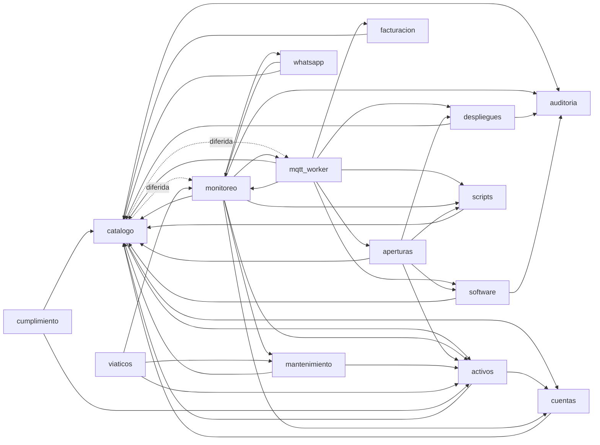

**Explicación técnica.** Generado con `grep -rhoE '(from|import) apps\.[a-z_]+'` por app. Hay ciclos `catalogo ↔ activos`, `catalogo ↔ cuentas`, `catalogo ↔ monitoreo`, `catalogo ↔ mqtt_worker`, `monitoreo ↔ mqtt_worker` y `monitoreo ↔ whatsapp`; se sostienen porque al menos un lado importa dentro de funciones (p. ej. `apps/catalogo/services.py:597,710,727`; `apps/catalogo/models.py:698`; `apps/activos/services.py:700`). `activos/models.py:8` importa `catalogo.models` a nivel de módulo y `catalogo` referencia `activos.Colaborador` por cadena en la FK, así que el ciclo de modelos lo resuelve Django. Las relaciones de base de datos entre apps se detallan en [04 · Modelo de datos](#s4).

**Resumen sencillo.** `catalogo` (farmacias y estaciones) es el centro: casi todo depende de él. `monitoreo` y `mqtt_worker` son los que más tiran de otras apps. Las apps que se quieren retirar (`viaticos`, `cumplimiento`) dependen de otras, pero nadie depende de ellas, lo que hace su retiro sencillo; `whatsapp`, `scripts` y `aperturas` en cambio están enganchadas al núcleo.

| Dependencia del núcleo hacia una app no núcleo | Dónde | Consecuencia para retirarla |
|---|---|---|
| `mqtt_worker` → `aperturas.consumir_token` | `apps/mqtt_worker/services.py` (`manejar_enrolamiento`) | Rompe el enrolamiento con token |
| `mqtt_worker` → `facturacion.registrar_actividad_mensual` | `apps/mqtt_worker/services.py:523,582` | Hay que quitar la escritura del latido |
| `mqtt_worker` → `scripts` | `manejar_estado_script` | Resultados de scripts |
| `monitoreo` → `mantenimiento.abrir_mantenimiento_desde_alerta`, FK `Alerta.mantenimiento` | `apps/monitoreo/services.py:161-163`; `models.py` | Migración de esquema |
| `monitoreo` → `whatsapp` (modelos) | `telegram_bot.py`, `historial_enlaces.py` | Rompe el bot y el SLA de enlaces |
| `monitoreo` → `activos.Activo` (FK) | `EstadoRedActivo`, `ObjetivoSnmp` | Paso 2 del plan de separación (alcance §10) |
| `catalogo` → `activos.Colaborador` (FK) | `Farmacia.tecnico_asignado` | idem |
| `cuentas` → `activos.Colaborador` (FK) | `PerfilUsuario.colaborador` | idem |

---

### 5. Dependencias de software

#### 5.1 Python del backend (`requirements.txt`)

| Paquete | Restricción | Uso | Observación |
|---|---|---|---|
| Django | `>=5.2.8,<6.0` | Framework | — |
| djangorestframework | `>=3.15` | API | Sin tope superior |
| django-environ | `>=0.11` | Configuración | — |
| paho-mqtt | `>=2.1` | Worker MQTT y publicación | — |
| websocket-client | `>=1.8` | MeshCentral | — |
| psycopg[binary] | `>=3.2` | PostgreSQL | — |
| gunicorn | `>=23.0` | Servidor WSGI | — |
| whitenoise | `>=6.7` | Estáticos | — |
| cryptography | `>=42` | Fernet, Ed25519 | — |
| celery | `>=5.4` | Tareas | — |
| redis | `>=5.0` | Cliente del broker | — |
| xhtml2pdf | `>=0.2.16` | Informes PDF de mantenimiento | — |
| pysnmp | `>=7.1` | SNMP | — |
| netflow | `==0.12.2` | Piloto NetFlow | Única versión fijada, a propósito |
| django-axes | `>=8.3` | Bloqueo de login | — |
| django-otp | `>=1.5` | MFA | — |
| qrcode[pil] | `>=8.0` | QR de MFA | — |
| openpyxl | `>=3.1` | Importación de planillas | — |
| anthropic | `>=0.40` | Diagnóstico IA (opcional) | Candidata a retiro si no se usa (alcance §9) |

`requirements-dev.txt` agrega `amqtt>=0.11` (broker MQTT embebido para desarrollo). **No hay archivo de bloqueo** (`pip freeze`, `pip-tools`, `poetry.lock`): cada `docker compose build` resuelve las versiones más nuevas dentro de los rangos, así que dos construcciones en días distintos pueden instalar versiones diferentes. No hay linter ni `pytest` declarados (coincide con `docs/auditoria/fase1-descubrimiento.md` §1).

**Versión de Python:** la imagen usa `python:3.13-slim` (`deploy/Dockerfile`), mientras el CI usa `python-version: "3.14"` (`.github/workflows/pruebas.yml:59`) y el entorno local tiene Python 3.14.6 (`.venv`). **Producción corre en una versión menor distinta de la que se prueba.**

#### 5.2 Agente Windows (`agente-prueba/requirements.txt`)

`paho-mqtt>=2.1`, `pyinstaller>=6.0`, `pywin32>=306`, `pysnmp>=7.1`, `psycopg2-binary>=2.9` (el agente hace `SELECT 1` contra la base del POS desde la propia estación, porque el NUC no alcanza esos nodos), `cryptography>=42` (verificación Ed25519 de catálogos). Se empaqueta con `agente_prueba.spec` y `build.ps1`.

#### 5.3 Frontend y JavaScript

| Elemento | Versión | Cómo se obtiene | Observación |
|---|---|---|---|
| htmx | 2.0.10 (cadena `version:"2.0.10"` en el archivo) | Vendorizado en `static/js/htmx.min.js` | Sin CDN; no hay `package.json` ni Node en el proyecto |
| Tailwind CSS | **Sin fijar**: `README.md:100` descarga `releases/latest` | `tools/tailwindcss.exe` (no versionado) | `static_src/input.css` usa la sintaxis de Tailwind v4 (`@import "tailwindcss"`, `@source`). Recompilar con otra versión puede cambiar el CSS sin aviso |
| CSS compilado | — | `static/css/app.css` versionado | Producción no necesita Node ni Tailwind |

Detalle en [06 · Frontend](#s3).

#### 5.4 App móvil (`movil-campo/pubspec.yaml`)

`http`, `provider`, `flutter_secure_storage`, `shared_preferences`, `sqflite` (cola offline), `connectivity_plus`, `geolocator`, `image_picker`, `signature`, `permission_handler`, `local_auth`, `intl`, `image`. Canal de Flutter sin fijar en CI (`subosito/flutter-action@v2`).

#### 5.5 Imágenes de contenedor

| Imagen | Etiqueta | Fijada |
|---|---|---|
| `timescale/timescaledb` | `2.17.2-pg16` | Sí |
| `emqx/emqx` | `5.8.3` | Sí |
| `nginx` | `1.27-alpine` | Parcial (menor fijada) |
| `redis` | `7-alpine` | Parcial (mayor fijada) |
| `python` (base de la app) | `3.13-slim` | Parcial |
| `ghcr.io/ylianst/meshcentral` | **`latest`** | **No** |

---

### 6. Contradicciones con la documentación existente

| # | Documento dice | El código dice | Evidencia |
|---|---|---|---|
| C-1 | "15 apps Django bajo `apps/`" (`CLAUDE.md`, `README.md:13`, `docs/modulos.md` "Los 15 módulos") | 16 apps en `INSTALLED_APPS`; `whatsapp` no aparece en `docs/modulos.md` | `config/settings/base.py:38-54` |
| C-2 | "95 modelos" (`CLAUDE.md` remite a fase 1) / "98 modelos" (`fase1-descubrimiento.md` §1, 10-oct) | 109 clases `models.Model` | `apps/*/models.py` |
| C-3 | "4 hypertables" (`fase1-descubrimiento.md` §2) | 5: se agregó `muestra_enlace_farmacia` | `apps/monitoreo/migrations/0052_hypertable_muestra_enlace_farmacia.py` |
| C-4 | "Seis imágenes desde un único Dockerfile" (`fase1-descubrimiento.md` §2) | Siete (se sumó `netflow_collector`); `CLAUDE.md` sí dice siete | `deploy/docker-compose.yml` |
| C-5 | "26 entradas en `CELERY_BEAT_SCHEDULE`" (`fase1-descubrimiento.md` §1) | 30 | `config/settings/base.py:430-684` |
| C-6 | "Python 3.14" como versión del stack (`CLAUDE.md`, `fase1-descubrimiento.md` §1) | La imagen de producción es `python:3.13-slim` | `deploy/Dockerfile` |
| C-7 | "`panel` — la cara (159 URLs)" (`docs/modulos.md`) | 182 llamadas `path(` en `apps/panel/urls.py` | `apps/panel/urls.py` |
| C-8 | "ESTACION … (40 aprobadas)" (`docs/modulos.md`); "66 equipos con agente" (`CLAUDE.md`, 5-oct) | ~92 estaciones con agente | [PROD, reportado 26-oct-2026] |
| C-9 | `PANEL_MODULOS_DIFERIDOS` "sobrescribible por variable de entorno sin tocar código" (`SAIDSOFT_RMM_1_0_ALCANCE.md`, anexo) | El servicio `web` de `docker-compose.yml` **no** pasa esa variable y `.dockerignore` excluye `.env`; en el contenedor solo rige el valor por defecto de `produccion.py`. Cambiarla exige editar el compose | `deploy/docker-compose.yml` (sección `web.environment`); `.dockerignore` |
| C-10 | `apps/monitoreo/salud.py` (docstring): "`WorkerHeartbeat` solo prueba que el proceso vive … sin consultar `client.is_connected()`" | `run_mqtt_worker._latir` sí envía `conectado=client.is_connected()` y `salud.py` lo usa más abajo | `run_mqtt_worker.py:113-132`; `salud.py:186-226` |
| C-11 | `verificar_salud.py`: "Celery Beat no registra latido propio; se infiere…" | Existe `latido_beat_task` (cada 60 s) que lo registra; el comando sigue usando la inferencia | `apps/monitoreo/tasks.py:393-415`; `verificar_salud.py:35-39,185-190` |
| C-12 | `SAIDSOFT_RMM_1_0_ALCANCE.md` cita `docs/prioridad-2030.md` | Ese documento fue retirado (`docs/RETIRADOS.md`) | `docs/RETIRADOS.md` |
| C-13 | Evidencia de usuario: "la sonda de enlaces … guarda `MuestraEnlaceFarmacia`" | Cierto para la tarea de Celery; la sonda externa por API (`deploy/sonda-enlaces/`) no escribe historial | `apps/monitoreo/enlaces.py` (`sondear_enlaces_farmacias` → `guardar_muestras_de_enlace`); `apps/monitoreo/api_views.py` (`SondeoEnlaceIngestaView`) |

---

### 7. Pendiente de verificar

| Qué | Comando de solo lectura en el NUC |
|---|---|
| Archivos no versionados en el checkout que entrarían a las imágenes | `cd ~/Documentos/Said/saidsoft-core && git status --short --ignored` |
| Valor efectivo de `PANEL_MODULOS_DIFERIDOS` en `web` | `docker compose -f deploy/docker-compose.yml exec -T web python -c "from django.conf import settings; import django; django.setup(); print(settings.PANEL_MODULOS_DIFERIDOS)"` (con `DJANGO_SETTINGS_MODULE` ya definido en el contenedor) |
| Versiones reales de dependencias instaladas en la imagen | `docker exec deploy-web-1 pip freeze` |
| Si `ANTHROPIC_API_KEY` y `WHATSAPP_MODO` están definidos (sin mostrar valores) | `docker exec deploy-celery_worker-1 sh -c 'test -n "$ANTHROPIC_API_KEY" && echo IA_ON \|\| echo IA_OFF; echo $WHATSAPP_MODO'` |
| Si `facturacion` tiene filas y alguien las consume | `SELECT count(*) FROM <tabla de ActividadMensualEstacion>;` vía `docker compose exec -T db psql` (nombre de tabla en [04](#s4)) |

---

<a id="s3"></a>

## 3. Frontend (panel web)

| Campo | Valor |
|---|---|
| Fecha / commit | 26-oct-2026 · `1fa16d6` (`master`) |
| Alcance | `templates/`, `static/`, `static_src/`, `apps/panel/` (urls, vistas, middleware, context processors, módulos diferidos), `config/settings/produccion.py` |
| Evidencias | Código citado en cada tabla; `docs/producto/SAIDSOFT_RMM_1_0_ALCANCE.md`; `README.md` §Tailwind |
| Supuestos / limitaciones | Análisis estático; no se abrió el panel en un navegador ni se midieron tiempos de respuesta. Las cifras de rendimiento citadas son las que dejaron los comentarios del código. |
| Estado de validación | Rutas, permisos, polling y ocultamiento: **verificados en código**. Comportamiento visual: **pendiente**. |

Relacionados: [02 · Arquitectura](#s1) · [03 · Inventario](#s2) · [05 · API](#s10) · [Seguridad](#s14).

---

### 1. Tecnología

| Pieza | Detalle | Evidencia |
|---|---|---|
| Renderizado | Plantillas Django en servidor (109 archivos en `templates/panel/` y `templates/admin/catalogo/`). Sin SPA, sin Node | `config/settings/base.py:81-104` |
| Interactividad | **htmx 2.0.10** vendorizado (`static/js/htmx.min.js`). Uso: 19 `hx-get`, 18 `hx-post`, 16 `hx-trigger`, 26 `hx-target`, 36 `hx-swap`, 5 `hx-confirm` | `grep` en `templates/` |
| JavaScript propio | Solo *inline* en plantillas: tema claro/oscuro (`localStorage 'saidsoft-theme'`), reloj, paleta de búsqueda Ctrl+K, controlador de modales (`<dialog>`) en `base.html`; scripts puntuales en 13 formularios | `templates/panel/base.html:12-20, 341-486` |
| Estilos | Tailwind CSS v4 (sintaxis `@import "tailwindcss"`, `@source "../templates"`, `@source "../apps"`) + `tokens.css` (144 líneas) y `components.css` (996) | `static_src/input.css` |
| Compilación | `./tools/tailwindcss.exe -i static_src/input.css -o static/css/app.css --minify`; binario no versionado y descargado de `releases/latest` (**versión no fijada**) | `README.md:95-111`; `.gitignore:14` |
| Gráficos | **SVG inline calculado en servidor** (sin librería JS): `apps/monitoreo/graficos.py` (`construir_grafico`), `apps/panel/series_rango.py` (24 h / 7 d / 30 d agregados por minuto u hora), `_sparkline.html` | docstrings de ambos módulos |
| Estáticos en producción | WhiteNoise con `CompressedManifestStaticFilesStorage` (`staticfiles.json`) | `config/settings/produccion.py` |
| Modales | Un alta (`accion_form.html`, 31 vistas) se sirve como página o dentro de `<dialog>` según `HX-Request`; `RedirectHtmxMiddleware` convierte el redirect de éxito en 204 + evento | `apps/panel/context_processors.py` (`htmx_contexto`); `apps/panel/middleware.py` |

Resumen sencillo: es una web "clásica" que arma el HTML en el servidor; htmx refresca trozos de página sin recargarla y los gráficos son dibujos SVG que ya llegan hechos.

### 2. Flujo de una pantalla con refresco automático

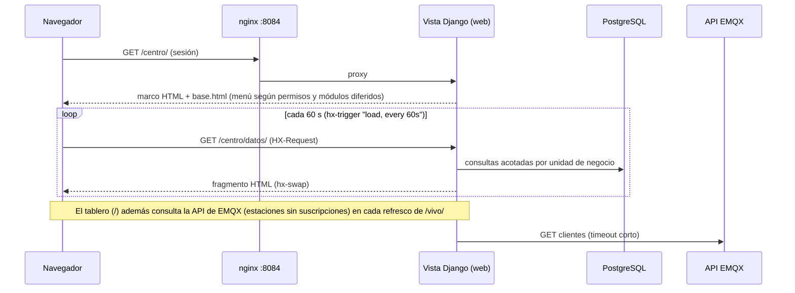

Explicación técnica: las pantallas de vigilancia se dividen en marco + parcial; el parcial se repide por polling (`centro_monitoreo_partial`, `dashboard_vivo_partial`). En cada respuesta con sesión, `salud_plataforma_contexto` consulta `WorkerHeartbeat` para la barra superior. Resumen: la página se pide una vez y luego solo su "interior" se actualiza solo.

### 3. Pantallas activas en producción (RMM 1.0)

| Pantalla | Ruta | Vista | Permiso | Filtros / paginación | Refresco |
|---|---|---|---|---|---|
| Tablero (NOC) | `/`, `/vivo/`, `/cumplimiento-tablero/` | `views/dashboard.py` | solo `login_required` (contenido acotado por unidad) | — | `every 60s` (`SEGUNDOS_REFRESCO_TABLERO`); zona de cumplimiento al abrirse (`toggle once`) |
| Centro de Monitoreo (cola de incidencias por impacto) | `/centro/`, `/centro/datos/` | `views/monitoreo.py`; `apps/monitoreo/incidencias.py` | `monitoreo.view_alerta` | máx. 15 filas por bloque | `every 60s` |
| Enlaces por farmacia | `/monitoreo/enlaces/` (+ modal `<pk>/`, `<pk>/solicitar/`) | `views/enlaces.py` | `monitoreo.view_estadoenlacefarmacia` | `q`, `estado`, `grupo`, `trafico`; paginado en servidor, KPI sobre el total | manual |
| Historial de enlaces (caídas, disponibilidad por farmacia y proveedor, CSV) | `/monitoreo/enlaces/historial/` | `views/enlaces_historial.py`; `apps/monitoreo/historial_enlaces.py` | `monitoreo.view_estadoenlacefarmacia` | `desde`, `hasta` (30 d por defecto, tope 400 d), `grupo`, `proveedor`, `minimo`, `q`, `vista`, `formato` | manual |
| Monitoreo de servidores (CPU/RAM/disco con umbral) | `/monitoreo/`, `/monitoreo/<pk>/` | `views/monitoreo.py` | `monitoreo.view_muestrametrica` | solo estaciones con `monitorear_recursos=True`; rango 24 h/7 d/30 d | detalle `every 10s` |
| Tendencia de flota | `/monitoreo/tendencia/` | `views/tendencia.py` | `monitoreo.view_muestrametrica` | — | — |
| Ventanas de mantenimiento | `/monitoreo/mantenimiento/` | `views/monitoreo.py` | `monitoreo.view_ventanamantenimiento` / `add_…` | — | — |
| Alertas y reglas | `/alertas/`, `/alertas/reglas/`, `/alertas/errores-pos/` | `views/alertas.py` | `monitoreo.view_alerta`, `change_alerta`, `view/add_reglaalerta`, `view_poserrordetectado` | `q`, `regla`, `todas`, `vista`; paginado | — |
| Estaciones (lista, aprobación, ficha, acciones) | `/estaciones/…` (≈30 rutas) | `views/estaciones.py`, `estacion_ficha.py`, `estaciones_aprobacion.py`, `agente_flota.py`, `instalador.py`, `enrolamientos.py` | `catalogo.view_estacion`, `aprobar_estacion`, `consultar_info_estacion`, `actualizar_agente_estacion`, `acceso_remoto_estacion`, `pausar_estacion`, `ver_clave_bitlocker`… | `q`, `estado_conexion`, `grupo`, `tipo`, `reloj`, `desactualizadas`; paginado | lista `every 15s` (se pausa con casillas marcadas); modal info `every 2s` |
| Agente de la flota (versiones, actualización por tandas) | `/estaciones/agente/` | `views/agente_flota.py` | `catalogo.actualizar_agente_estacion` | — | — |
| Instalador de un solo uso | `/instalador/<token>/` | `views/instalador.py` | **sin sesión**, autoriza el token (`never_cache`) | — | — |
| Despliegues del POS | `/despliegues/…` (10 rutas) | `views/despliegues.py` | `despliegues.view/add/change_despliegue` | — | progreso `every 4s` |
| Software (catálogo, versiones, solicitudes, desactualizados) | `/aplicaciones/…`, `/solicitudes-instalacion/…` | `views/software.py` | `software.view/add_aplicacioncatalogo`, `…solicitudinstalacion` | — | progreso `every 4s` |
| Auditoría | `/auditoria/` | `views/auditoria.py` | `auditoria.view_eventoauditoria` | búsqueda por acción, objeto, usuario, IP; paginado; acotado a la unidad activa | — |
| Reportes CSV | `/reportes/…` (9 rutas) | `views/reportes.py` | por reporte (p. ej. `reporte_cumplimiento_csv` exige `cumplimiento.view_actividadcumplimiento`) | — | — |
| Activos, bodegas, compras, colaboradores, visitas | `/activos/…`, `/bodegas/…`, `/ordenes-compra/…`, `/colaboradores/…`, `/visita-tecnica/…` | `views/activos*.py`, `bodegas.py`, `compras.py`, `personas.py` | `activos.*`, `mantenimiento.view_visitatecnica` | activos: `tipo`, `estado`, `bodega`, `farmacia`, `ubicacion`, `garantia` | — |
| Mantenimiento y notificaciones | `/mantenimientos/…`, `/actividades-planificadas/`, `/notificaciones/` | `views/mantenimiento.py`, `conflictos.py`, `actividades.py` | `mantenimiento.*` | — | — |
| MFA de la cuenta | `/cuenta/mfa/…` | `views/mfa.py` | `login_required` | — | — |
| Búsqueda global (Ctrl+K) | `/buscar/` | `views/paleta.py` | `login_required` (resultados acotados) | `q`, `delay:200ms` | — |

**Usuarios y roles:** no hay pantalla en el panel. Se gestionan en `/admin/` (usuarios, grupos, `PerfilUsuario.unidades_negocio`/`acceso_todas_unidades`); los roles se crean con `manage.py seed_permisos` (`apps/activos/management/commands/seed_permisos.py`: Administrador = todos los permisos, Técnico, Bodeguero, Auditor, Operador RMM, Mesa de Ayuda, Soporte Técnico, Coordinador de Viáticos). El login de `/admin/` pasa por el del panel con MFA (`config/urls.py`, `login_admin_por_panel`).

**Permisos por pantalla (patrón):** 180 vistas con `@login_required`; casi todas con `@permission_required(..., raise_exception=True)`. Excepciones verificadas (solo sesión): `dashboard*`, `red_farmacias_lista` (redirección), `notificaciones_*`, `mfa_*`, `paleta_resultados`, `reportes_index`, `unidad_negocio_activar`; `instalador_descargar` no exige sesión. El menú (`base.html:34-227`) se dibuja con `perms.<app>.<permiso>`. El alcance por cliente se aplica en cada vista con `apps.cuentas.services.scope_*`.

### 4. Módulos ocultos en producción (fuera de alcance 1.0)

| Mecanismo | Detalle |
|---|---|
| Lista | `PANEL_MODULOS_DIFERIDOS`: vacía en `base.py:716` (desarrollo y CI ven todo); en `produccion.py` por defecto `['viaticos','aperturas','cumplimiento','netflow','mesa','scripts']` |
| Rutas | `diferido(modulo, vista)` en `apps/panel/modulos.py` envuelve 39 rutas de `apps/panel/urls.py` y devuelve **404**; los nombres de ruta no cambian |
| Menú y enlaces | `modulos_diferidos_contexto` → `` en `base.html` (aperturas, mesa, scripts, viáticos, cumplimiento), botón NetFlow en Enlaces y "Instalar agente vía Scripts" en la ficha |
| No diferible | `despliegues` (núcleo); `MODULOS_DIFERIBLES` valida la clave |
| Pruebas | `apps/panel/tests_alcance_rmm.py` |

| Módulo | Rutas | Sigue activo por detrás |
|---|---|---|
| Viáticos | 11 | — |
| Aperturas | 10 | enrolamiento con token en `mqtt_worker` |
| Cumplimiento | 4 | permiso que protege `reporte_cumplimiento_csv` |
| NetFlow | 1 | contenedor `netflow_collector` |
| Mesa (WhatsApp) | 2 | webhook `/whatsapp/webhook/` y tarea `evaluar-whatsapp` |
| Scripts | 11 | tareas de Beat, bot de Telegram, `cambiar_nodo_pos` |

Brechas: los modelos de módulos diferidos **siguen visibles y editables en `/admin/`** (pendiente "tanda 2" del alcance §9); y el compose no pasa `PANEL_MODULOS_DIFERIDOS` a `web`, así que cambiar la lista exige editar `deploy/docker-compose.yml` (contradicción C-9 en [03](#6-contradicciones-con-la-documentación-existente)). Módulos **no diferidos pero fuera del foco 1.0**: activos, bodegas, compras, mantenimiento, visitas (clasificados `DEPENDENCIA_COMPARTIDA`) siguen visibles en el menú para quien tenga permisos.

### 5. Rendimiento (hechos del código, no mediciones nuevas)

| Aspecto | Hecho | Evidencia |
|---|---|---|
| Polling | Tablero y Centro cada 60 s (justificado: Beat marca offline cada 60 s); detalles 4–10 s; lista de estaciones 15 s | constantes `SEGUNDOS_REFRESCO_*`; `hx-trigger` |
| Paginación | 25 filas, parámetro `pagina`, en servidor; exige queryset ordenado | `apps/panel/paginacion.py` |
| Consultas de series | Agregadas en BD por minuto/hora (no `time_bucket`, para funcionar en SQLite) | `apps/panel/series_rango.py` |
| Llamada externa en render | `estaciones_sin_suscripciones` consulta la API de EMQX en cada refresco del tablero (comentario: 18 ms medidos; `urlopen` con timeout) | `apps/panel/views/dashboard.py:293`; `apps/mqtt_worker/emqx_admin.py:310-350` |
| Consulta global por request | `salud_plataforma_contexto` en todas las pantallas con sesión (tabla de pocas filas) | `config/settings/base.py:96-100` |
| Historial de enlaces | Carga en memoria todos los eventos del período (tope 400 días, ~36.000 objetos por año según el comentario) | `views/enlaces_historial.py` (`DIAS_MAXIMOS`) |
| Servidor | gunicorn 3 workers síncronos, timeout 600 s; cada pestaña abierta suma 1 request/min por pantalla con polling | `deploy/docker-compose.yml` |

### 6. Seguridad del frontend (resumen; detalle en [Seguridad](#s14))

- CSRF de Django en formularios (``); sesión de 8 h por inactividad; cookies seguras en producción.
- **Sin Content-Security-Policy** (ni en settings ni en nginx); además hay JS *inline* en `base.html`, lo que complicaría activar una CSP estricta.
- `X-Frame-Options` por `XFrameOptionsMiddleware`.

### 7. Pendiente de verificar

| Qué | Cómo (solo lectura) |
|---|---|
| Que el CSS servido corresponda a las plantillas actuales (compilado con qué versión de Tailwind) | Recompilar en una copia local y comparar con `git diff --stat static/css/app.css` (no en el NUC) |
| Latencia real del tablero con varias pestañas abiertas | En el NUC: `docker compose logs --since 1h nginx web \| grep -E '"GET /(vivo\|centro/datos)/'` (el access log de gunicorn está en `web`) |
| Lista efectiva de módulos diferidos en `web` | `docker exec deploy-web-1 python manage.py shell -c "from django.conf import settings; print(settings.PANEL_MODULOS_DIFERIDOS)"` |

---

<a id="s4"></a>

## 4. Modelo de datos y persistencia

| Campo | Valor |
|---|---|
| **Fecha de generación** | 26-oct-2026 |
| **Commit analizado** | `1fa16d6` (HEAD, 26-oct-2026 12:22 -05) |
| **Alcance analizado** | Persistencia de `saidsoft-core`: PostgreSQL + TimescaleDB, Redis, archivos SQLite sueltos, `MEDIA_ROOT`; los 109 modelos concretos de `apps/*/models.py`; las 182 migraciones de `apps/*/migrations/`; las rutas de escritura y lectura de las series de tiempo. |
| **Evidencias consultadas** | `config/settings/{base,desarrollo,produccion}.py`, `config/test_runner.py`, `deploy/docker-compose.yml`, `deploy/db/init-timescaledb.sql`, `apps/*/models.py`, `apps/monitoreo/migrations/0002, 0006, 0021, 0035, 0036, 0040, 0041, 0051, 0052`, `apps/catalogo/migrations/0039_orden_agente.py`, `apps/catalogo/ordenes.py`, `apps/mqtt_worker/services.py`, `apps/monitoreo/services.py`, `apps/monitoreo/series.py`, `apps/panel/series_rango.py`, `apps/panel/disponibilidad.py`, `apps/panel/views/{monitoreo,tendencia}.py`, `apps/facturacion/services.py`, `apps/auditoria/models.py`, `agente-prueba/agente_prueba.py`, `README.md`, `CLAUDE.md`. Inventario de modelos generado por análisis estático (AST) de los `models.py`, sin importar Django. |
| **Supuestos** | (1) Producción corre con `config.settings.produccion` y `DATABASE_URL` apuntando al servicio `db` de `deploy/docker-compose.yml` (imagen `timescale/timescaledb:2.17.2-pg16`). (2) Las migraciones de TimescaleDB corrieron sin caer en su rama de excepción (ver §5.5). (3) Para las proyecciones de crecimiento: 2,6 estaciones por farmacia (≈1.800 estaciones / 700 farmacias, cifra de `README.md` y de `config/settings/base.py`). Todo lo marcado **ESTIMACIÓN** es cálculo, no medición. |
| **Limitaciones** | No se consultó ninguna base de datos (ni producción ni local). No se ejecutaron migraciones ni pruebas. No se leyó `.env` ni `deploy/.env`. Los tamaños en bytes son órdenes de magnitud. |
| **Hallazgos pendientes** | Estado real de los *jobs* de TimescaleDB en producción; si alguna conversión a hypertable cayó en el `except` silencioso; planes de ejecución (`EXPLAIN`) de las consultas marcadas como costosas en §7. Consultas de verificación en §11. |
| **Estado de validación** | Validado contra código en `1fa16d6`. **No validado contra la base de producción.** |

Documentos relacionados (no se duplica su contenido): [02 — Arquitectura general](#s1), [03 — Inventario de aplicaciones](#s2), [05 — API y endpoints](#s10), [07 — Escalabilidad y capacidad](#s18), [Celery y tareas programadas](#s6), [MQTT y EMQX](#s7), [Agente Windows](#s8), [Auditoría de seguridad](#s14).

---

### 1. Resumen ejecutivo

**Hechos (verificados en código):**

1. **Una sola base relacional**: PostgreSQL 16 con la extensión TimescaleDB 2.17.2 (`deploy/docker-compose.yml`, servicio `db`). Django la recibe por `DATABASE_URL`; sin esa variable cae a SQLite (`config/settings/base.py:117-119`).
2. **Cinco hypertables**, todas con retención nativa de 30 días y compresión a los 7 días: `muestra_metrica`, `muestra_servicio_pos`, `evento_monitoreo`, `muestra_red_farmacia` (migraciones `monitoreo/0035` y `0040`) y `muestra_enlace_farmacia` (`monitoreo/0052`). **No hay *continuous aggregates*** (búsqueda de `continuous`/`materialized` en migraciones: sin resultados).
3. **Redis solo es broker y backend de resultados de Celery** (`CELERY_BROKER_URL`, `CELERY_RESULT_BACKEND`). No hay `CACHES` configurado ni uso de `django.core.cache` en `apps/`: Django usa la caché en memoria por proceso que trae por defecto.
4. **La cola persistente de órdenes al agente** (`OrdenAgente`, tabla `orden_agente`, migración `catalogo/0039`) usa un índice único parcial de PostgreSQL para garantizar «una orden publicada por ranura» y un *advisory lock* para serializar el procesamiento.
5. **Tablas sin política de retención** que crecen indefinidamente: `evento_auditoria`, `orden_agente`, `mensaje_mqtt_fallido`, `mensaje_whatsapp`, `evento_despliegue`, `evento_instalacion`, `evento_activo`, `actividad_mensual_estacion`, entre otras (§8.3).

**Hallazgos más relevantes (detalle en §9):**

- El latido del agente (la ruta de escritura más caliente) termina en `estacion.save()` **sin `update_fields`**: reescribe la fila completa de `estacion` cada minuto y puede pisar cambios hechos desde el panel entre la lectura y la escritura (`apps/mqtt_worker/services.py:505`).
- Las muestras de series **se fechan con la hora de llegada al servidor**, no con la del agente, y las métricas viajan con QoS 0 sin cola: el supuesto de la migración `0040` («el agente tiene cola offline [...] manda muestras viejas al volver») no se cumple para métricas ni servicios del POS.
- La pantalla de tendencia pide **12 semanas** de `muestra_metrica`, pero la retención es de **30 días**.
- `README.md` afirma que «la compresión de chunks todavía no está activada»; la migración `0040` la activó el 6-oct-2026.

---

### 2. Persistencia detectada

| Almacén | Para qué | Configuración | Evidencia |
|---|---|---|---|
| **PostgreSQL 16 + TimescaleDB 2.17.2** | Única base transaccional y de series de tiempo | Servicio `db`, volumen `db_data`; la extensión se crea en `deploy/db/init-timescaledb.sql` (`CREATE EXTENSION IF NOT EXISTS timescaledb`) | `deploy/docker-compose.yml:17-33` |
| Conexiones | Persistentes por proceso | `CONN_MAX_AGE` = 60 s por defecto; el comentario registra `max_connections` = 100 «con 16 en uso» | `config/settings/base.py:120-132` |
| **Redis 7** | Broker y backend de resultados de Celery | `redis-server --save 60 1` (snapshot RDB cada 60 s), volumen `redis_data` | `deploy/docker-compose.yml:477-487`; `config/settings/base.py:419-420` |
| Caché de Django | No configurada | Sin `CACHES` → `LocMemCache` por proceso (default de Django) | búsqueda de `CACHES`/`django.core.cache`: sin resultados |
| Sesiones | Base de datos (`django_session`) | `SESSION_COOKIE_AGE` 8 h, `SESSION_SAVE_EVERY_REQUEST=True` → un `UPDATE` de sesión por petición | `config/settings/base.py:169-175` |
| **`MEDIA_ROOT`** (`media/`, volumen `media_data`) | Paquetes de despliegue, instaladores de software, ejecutables del agente, imágenes/informes de mantenimiento, facturas de viáticos, APK | `FileField` en `Despliegue.archivo`, `VersionAplicacion.instalador`, `VersionAgente.ejecutable`, `ImagenMantenimiento.imagen`, `Mantenimiento.informe_pdf`, `ReporteViatico.factura_adjunta` | `config/settings/base.py:204-205`; `config/urls.py` (`servir_media_publico`) |
| Estado de Celery Beat | Archivo `celerybeat-schedule` dentro del contenedor, **sin volumen** | Por eso las tareas diarias usan `crontab` | comentario en `config/settings/base.py` (bloque `CELERY_BEAT_SCHEDULE`) |
| `identidad.json` / `config.json` del agente | Persistencia local en cada estación Windows | Escritura atómica (temporal + `fsync` + `os.replace`) | `agente-prueba/agente_prueba.py` `_guardar_identidad`, `_cargar_identidad` |

#### 2.1 Archivos SQLite sueltos en la raíz

| Archivo | Tamaño | Fecha | Para qué parece servir |
|---|---|---|---|
| `db.sqlite3` | 1,9 MB | 6-sep-2026 | Base por defecto de desarrollo: `env.db('DATABASE_URL', default=f'sqlite:///{BASE_DIR / "db.sqlite3"}')` (`config/settings/base.py:118`). Ignorado por `.gitignore:7` y `.dockerignore:26`. |
| `demo-local.sqlite3` | 2,0 MB | 11-sep-2026 | Base descartable de una prueba local con otro nombre. `.gitignore:71-72`: «Bases SQLite descartables de pruebas locales (demo-local.sqlite3, test-smoke.sqlite3...)». |
| `t-act.sqlite3`, `t-pm3.sqlite3` | 0 bytes | 12-sep-2026 | Vacíos. Por el nombre y la fecha, restos de corridas de prueba con `DATABASE_URL` apuntando a un archivo temporal. **Pendiente de verificar**; no hay referencias en código. |

Ninguno lo usa producción. `CLAUDE.md` y `docs/modulos.md` piden correr las pruebas contra PostgreSQL y no contra SQLite («125 pruebas que pasaban en SQLite fallaban en Postgres»). **Recomendación:** borrarlos del árbol de trabajo para que nadie los tome por datos reales; no contienen nada versionado.

---

### 3. Convenciones del esquema

- **Claves primarias:** `DEFAULT_AUTO_FIELD = BigAutoField` (`config/settings/base.py`). Todas las tablas usan `id bigint` salvo las cinco hypertables, cuya PK es **compuesta `(id, "timestamp")`** (la reescriben `monitoreo/0035` y `0052` con `ALTER TABLE ... ADD PRIMARY KEY (id, "timestamp")`). El ORM no se entera: los modelos siguen declarando `id` como PK.
- **Nombres de tabla explícitos:** los 109 modelos concretos declaran `Meta.db_table` en español y en singular (`estacion`, `farmacia`, `orden_agente`...).
- **Multiempresa (*tenant*):** por `UnidadNegocio`. Casi todo cuelga de ella directa o indirectamente (`Farmacia.unidad_negocio`, `ReglaAlerta.unidad_negocio`, etc.). El filtrado lo hacen `apps.cuentas.services.scope_por_unidad_negocio` y `scope_opcional_por_unidad_negocio`; no hay *row-level security* en la base.
- **Relaciones con el usuario:** `settings.AUTH_USER_MODEL` es el `User` estándar de Django (no hay modelo de usuario propio). El perfil extendido es `cuentas.PerfilUsuario` (O2O).
- **Fechas:** `USE_TZ=True`, `TIME_ZONE='America/Guayaquil'`. Las columnas son `timestamptz`.

---

### 4. Inventario de modelos por aplicación

Recuento de modelos concretos (con `db_table`) por app: `monitoreo` 30, `mantenimiento` 18, `activos` 15, `catalogo` 9, `aperturas` 7, `software` 7, `cumplimiento` 4, `scripts` 4, `despliegues` 3, `mqtt_worker` 3, `viaticos` 3, `whatsapp` 3, `auditoria` 1, `cuentas` 1, `facturacion` 1. **Total: 109.** A eso se suman las tablas de Django (`auth_*`, `django_*`), DRF (`authtoken_token`), `django-otp` (`otp_totp_totpdevice`) y `django-axes` (`axes_*`).

Notación: `FK→X (on_delete)`; `O2O` = `OneToOneField`; `M2M` = `ManyToManyField`; «null» = admite nulo. Solo se listan relaciones, claves y restricciones; los campos escalares están en cada `models.py`.

#### 4.1 `catalogo` — farmacias, estaciones y canal del agente

| Modelo / tabla | Relaciones | Restricciones e índices | Notas |
|---|---|---|---|
| `UnidadNegocio` / `unidad_negocio` | — | `codigo` único | Tenant raíz. |
| `Grupo` / `grupo` | — | `codigo` único | Guarda `pos_password_cifrada` (texto cifrado). |
| `Farmacia` / `farmacia` | FK→`Grupo` (PROTECT); FK→`UnidadNegocio` (PROTECT); FK→`activos.Colaborador` `tecnico_asignado` (SET_NULL, null) | `codigo` único | `ip_router` (`inet`), datos de enlace y ubicación. |
| `Estacion` / `estacion` | FK→`Farmacia` (PROTECT) | `codigo` único; `token_enrolamiento` único; índice `estacion_aprobacion_latido (estado_aprobacion, ultimo_heartbeat)` (`catalogo/0036`) | ~60 columnas: identidad del agente (`hardware_id`, `hmac_secret`, `hmac_propio_confirmado`), estado (`estado_conexion`, `ultimo_heartbeat`, `pausado`), inventario de hardware, Windows Update, BitLocker, reloj, MeshCentral. `apps/catalogo/models.py:293`. |
| `VersionAgente` / `version_agente` | FK→User `creado_por` (PROTECT) | `version` único | `ejecutable` (`FileField`), `sha256`. |
| `EnlaceInstalador` / `enlace_instalador` | FK→User `creado_por` (PROTECT) | `token_hash` único | Enlace de un solo uso (30 min) del instalador; se guarda el SHA-256 del token, no el token. |
| `ClaveRecuperacionBitLocker` / `clave_recuperacion_bitlocker` | O2O→`Estacion` (CASCADE) | O2O implica único | `clave_cifrada` (Fernet, `BITLOCKER_ENCRYPTION_KEY`). |
| `PerifericoDetectado` / `periferico_detectado` | FK→`Estacion` (CASCADE) | `unique_together (estacion, device_id)` | Snapshot: se reemplaza completo en cada escaneo. |
| `OrdenAgente` / `orden_agente` | FK→`Estacion` (CASCADE); FK→User `creada_por` (SET_NULL, null) | `uid` (UUID) único; **`orden_agente_idempotente`** UNIQUE `(estacion, clave_idempotencia)`; **`orden_agente_una_entregada_por_ranura`** UNIQUE parcial `(estacion, tipo) WHERE estado IN ('publicando','entregada') AND tipo IN ('software','despliegue')`; índices `orden_agente_estado_tipo (estado, tipo)` y `orden_agente_origen (estacion, tipo, origen_id)` | Ver §5.4. `apps/catalogo/models.py:850`. |

#### 4.2 `activos` — inventario físico

| Modelo / tabla | Relaciones | Restricciones |
|---|---|---|
| `CategoriaEquipo` / `categoria_equipo` | — | `codigo` único |
| `Marca` / `marca` | — | `nombre` único |
| `Departamento` / `departamento` | — | `nombre` único |
| `Cargo` / `cargo` | FK→`Departamento` (PROTECT) | `unique_together (nombre, departamento)` |
| `Ubicacion` / `ubicacion` | FK→`Departamento` (SET_NULL); FK→`Colaborador` `encargado` (SET_NULL) | — |
| `Bodega` / `bodega` | FK→User `custodio` (SET_NULL); FK→`UnidadNegocio` (PROTECT, null) | `codigo` único |
| `Colaborador` / `colaborador` | FK→`Cargo` (PROTECT, null); FK→`Ubicacion` (SET_NULL); FK→`UnidadNegocio` (PROTECT, null); **O2O→User `usuario` (SET_NULL, null)** | `cedula` único |
| `TipoConsumible` / `tipo_consumible` | — | `codigo` único |
| `StockBodega` / `stock_bodega` | FK→`Bodega` (CASCADE); FK→`TipoConsumible` (PROTECT) | `unique_together (bodega, tipo_consumible)` |
| `OrdenCompra` / `orden_compra` | FK→`UnidadNegocio` (PROTECT, null); M2M→`Bodega` `bodegas_destino`; FK→User `recibido_por` (PROTECT, null) | `numero_oc` único; columna `version` (bloqueo optimista) |
| `OrdenCompraDetalle` / `orden_compra_detalle` | FK→`OrdenCompra` (CASCADE); FK→`CategoriaEquipo`, `Marca`, `TipoConsumible` (PROTECT, null) | columna `version` |
| `RecepcionLote` / `recepcion_lote` | FK→`OrdenCompra`, `OrdenCompraDetalle`, `Bodega` (PROTECT); FK→`Colaborador` (SET_NULL); FK→User (SET_NULL) | `uuid` único |
| `MovimientoInventario` / `movimiento_inventario` | FK→`TipoConsumible`, `Bodega` origen/destino (PROTECT, null); FK→`OrdenCompra`, `RecepcionLote`, User (SET_NULL) | — |
| `Activo` / `activo` | FK→`Marca`, `CategoriaEquipo`, `OrdenCompra`, `Bodega`, `UnidadNegocio`, `Ubicacion` (PROTECT, null); **O2O→`catalogo.Estacion` (SET_NULL, null)**; FK→`Colaborador` (SET_NULL); FK→`Farmacia` (SET_NULL) | `codigo` único; **`un_slot_por_farmacia`** UNIQUE parcial `(farmacia, slot) WHERE slot <> '' AND estado <> 'dado_de_baja'` |
| `EventoActivo` / `evento_activo` | FK→`Activo` (CASCADE); FK→User (SET_NULL) | — (historial; `delete()` de instancia bloqueado) |

#### 4.3 `monitoreo` — series, estados y alertas (30 modelos)

**Series de tiempo (hypertables, ver §5):** `MuestraMetrica`, `MuestraServicioPos`, `EventoMonitoreo`, `MuestraRedFarmacia`, `MuestraEnlaceFarmacia`. Todas: FK→`Estacion` o `Farmacia` **(CASCADE, `db_index=False`)** — el índice simple de la FK se omite porque lo cubre el compuesto.

| Modelo / tabla | Relaciones | Restricciones e índices |
|---|---|---|
| `MuestraMetrica` / `muestra_metrica` | FK→`Estacion` (CASCADE) | índice `(estacion, -timestamp)`; `timestamp` indexado |
| `MuestraRedFarmacia` / `muestra_red_farmacia` | FK→`Farmacia` (CASCADE) | índice `(farmacia, -timestamp)`; `timestamp` indexado |
| `MuestraServicioPos` / `muestra_servicio_pos` | FK→`Estacion` (CASCADE) | índice `(estacion, servicio, -timestamp)`; `timestamp` indexado |
| `EventoMonitoreo` / `evento_monitoreo` | FK→`Estacion` (CASCADE) | índice `(estacion, -timestamp)`; `timestamp` indexado |
| `MuestraEnlaceFarmacia` / `muestra_enlace_farmacia` | FK→`Farmacia` (CASCADE) | índice `muestra_enl_farmaci_a5a651_idx (farmacia, -timestamp)`; `timestamp` indexado |
| `VentanaNetflowFarmacia` / `ventana_netflow_farmacia` | FK→`Farmacia` (CASCADE) | índice `(farmacia, -inicio)` |
| `FlujoNetflowAgregado` / `flujo_netflow_agregado` | FK→`VentanaNetflowFarmacia` (CASCADE) | — |
| `EstadoDispositivo` / `estado_dispositivo` | FK→`Estacion` (CASCADE) | `unique_together (estacion, fuente)` |
| `ReglaAlerta` / `regla_alerta` | FK→`UnidadNegocio` (PROTECT, null); FK→User (PROTECT) | — |
| `Alerta` / `alerta` | FK→`ReglaAlerta` (PROTECT); FK→`Estacion` (CASCADE); FK→User `reconocida_por` (SET_NULL); FK→`mantenimiento.Mantenimiento` (SET_NULL) | **`una_alerta_activa_por_regla_y_estacion`** UNIQUE parcial `(regla, estacion) WHERE estado IN ('abierta','reconocida')` (`monitoreo/0050`); índice `(estado, -abierta_en)` (`0039`) |
| `PosErrorDetectado` / `pos_error_detectado` | FK→`Estacion` (CASCADE) | `unique_together (estacion, mensaje)` |
| `VentanaMantenimiento` / `ventana_mantenimiento` | FK→`UnidadNegocio` (PROTECT); M2M→`Grupo`, `Farmacia`, `Estacion`; FK→User (PROTECT) | — |
| `CanalNotificacion` / `canal_notificacion` | FK→`UnidadNegocio` (PROTECT, null); FK→User (PROTECT) | — |
| `EquipoBordeFarmacia` / `equipo_borde_farmacia` | O2O→`Farmacia` (CASCADE) | — |
| `DispositivoDetectado` / `dispositivo_detectado` | FK→`Farmacia` (CASCADE) | **`un_dispositivo_por_mac_y_farmacia`** UNIQUE `(farmacia, mac)`; índice `(farmacia, ip)` |
| `EstadoEnlaceFarmacia` / `estado_enlace_farmacia` | O2O→`Farmacia` (CASCADE) | — |
| `ReinicioEquipoBorde` / `reinicio_equipo_borde` | FK→`Farmacia` (CASCADE) | índice `(farmacia, -detectado_en)` |
| `EventoEnlaceFarmacia` / `evento_enlace_farmacia` | FK→`Farmacia` **(PROTECT)** (`monitoreo/0029_proteger_historial`) | índice `(farmacia, -inicio)`; índice parcial `evento_enlace_abierto (farmacia) WHERE fin IS NULL` |
| `EventoSaturacionEnlace` / `evento_saturacion_enlace` | FK→`Farmacia` (CASCADE) | índice parcial `saturacion_enlace_abierta (farmacia) WHERE fin IS NULL` |
| `ReanudacionMonitoreo` / `reanudacion_monitoreo` | — | **`reanudacion_unica_por_hueco`** UNIQUE `(apagado_desde)`; **CHECK `reanudacion_despues_del_apagado`** `reanudado_en > apagado_desde` (única `CheckConstraint` del esquema) |
| `BarridoEnlaces` / `barrido_enlaces` | — | fila única de control |
| `EstadoRedActivo` / `estado_red_activo` | O2O→`activos.Activo` (CASCADE); FK→`Estacion` `estacion_que_sondeo` (SET_NULL) | — |
| `EventoSistemaVigilado` / `evento_sistema_vigilado` | — | **`un_evento_por_log_proveedor_e_id`** UNIQUE `(log, proveedor, identificador)` |
| `EventoSistemaDetectado` / `evento_sistema_detectado` | FK→`Estacion` (CASCADE) | **`un_evento_de_sistema_por_estacion_y_tipo`** UNIQUE `(estacion, log, origen, identificador)`; índice `(estacion, -ultima_vez)` |
| `ServicioPosMonitoreado` / `servicio_pos_monitoreado` | — | `clave` único |
| `EstadoServicioPos` / `estado_servicio_pos` | FK→`Estacion` (CASCADE) | **`un_estado_por_estacion_y_servicio`** UNIQUE `(estacion, servicio)` |
| `ConfiguracionMonitoreo` / `configuracion_monitoreo` | FK→User (SET_NULL) | fila única (incluye `enrolamiento_habilitado`) |
| `PerfilSnmp` / `perfil_snmp` | FK→`UnidadNegocio` (PROTECT, null) | `nombre` único; `comunidad_cifrada` |
| `ObjetivoSnmp` / `objetivo_snmp` | O2O→`activos.Activo` (CASCADE); FK→`PerfilSnmp` (PROTECT) | índices `objetivo_snmp_pend_rapida/lenta/ident (habilitado, ultima_lectura_*)` |
| `LecturaSnmpActual` / `lectura_snmp_actual` | FK→`ObjetivoSnmp` (CASCADE) | **`una_lectura_por_clave`** UNIQUE `(objetivo, clave)` |

#### 4.4 `mantenimiento` (18 modelos)

| Modelo / tabla | Relaciones | Restricciones |
|---|---|---|
| `MantenimientoProgramado` | FK→`Activo` (PROTECT); FK→User `tecnico` (PROTECT) | — |
| `TipoMantenimiento` | — | `codigo` único |
| `Mantenimiento` | FK→`Colaborador` `cliente` (PROTECT, null); FK→User `tecnico`, `cerrado_por` (SET_NULL); FK→`MantenimientoProgramado`, `VisitaTecnica` (SET_NULL); FK→`TipoMantenimiento` (PROTECT, null) | — |
| `MantenimientoEquipo` | FK→`Mantenimiento` (CASCADE); FK→`Activo` (PROTECT) | `unique_together (mantenimiento, equipo)` |
| `ActividadChecklist` | M2M→`CategoriaEquipo` | — |
| `ActividadRealizada` | FK→`Mantenimiento` (CASCADE); FK→`ActividadChecklist` (PROTECT) | `unique_together (mantenimiento, actividad)` |
| `EventoMantenimiento` | FK→`Mantenimiento` **(PROTECT)**; FK→User (SET_NULL) | — |
| `AcuerdoNivelServicio` | — | `prioridad` único |
| `FirmaMantenimiento` | FK→`Mantenimiento` (CASCADE); FK→User (SET_NULL) | **`firma_unica_por_tipo`** UNIQUE `(mantenimiento, tipo_firma)` |
| `ImagenMantenimiento` | FK→`Mantenimiento` (CASCADE) | — |
| `RepuestoUtilizado` | FK→`Mantenimiento` (CASCADE); FK→`TipoConsumible` (PROTECT); FK→`Bodega` (PROTECT, null); FK→User (SET_NULL) | — |
| `ActividadPlanificada` | FK→`UnidadNegocio` (PROTECT, null); FK→User ×2 (PROTECT); FK→`Mantenimiento`, `MantenimientoProgramado`, `Activo`, `Ubicacion` (SET_NULL) | — |
| `Notificacion` | FK→User (CASCADE); FK→`Mantenimiento`, `ActividadPlanificada`, `MantenimientoProgramado` (SET_NULL) | — |
| `ConsentimientoMonitoreo` | FK→User (CASCADE) | — (append-only) |
| `UbicacionTecnico` | FK→User (CASCADE) | — (retención 60 días, §8.3) |
| `VisitaTecnica` | FK→`Farmacia` (PROTECT); FK→User `tecnico` (PROTECT); FK→User `creado_por` (SET_NULL) | — |
| `AccionOfflineAplicada` | FK→User (CASCADE) | **`accion_offline_unica_por_dispositivo`** UNIQUE `(usuario, origen_id)` — idempotencia de la app móvil |
| `CierreEnConflicto` | FK→`Mantenimiento` (CASCADE); FK→User `tecnico` (PROTECT), `revisado_por` (SET_NULL) | — |

#### 4.5 Resto de las apps

| App | Modelo / tabla | Relaciones y restricciones |
|---|---|---|
| `aperturas` | `PlantillaApertura` / `plantilla_apertura` | FK→`UnidadNegocio` (PROTECT), `Grupo` (PROTECT, null), User (PROTECT); `unique_together (unidad_negocio, nombre, version)` |
| | `PerfilEstacionPlantilla` | FK→`PlantillaApertura` (CASCADE); `unique_together (plantilla, sufijo)`; lleva `monitorear_recursos` y `es_cache_farmacia` que se copian a la estación al enrolar |
| | `PasoPlantilla` / `paso_plantilla_apertura` | FK→`PlantillaApertura` (CASCADE); FK→`scripts.Script`, `software.VersionAplicacion`, `despliegues.Despliegue` (PROTECT, null); `unique_together (plantilla, orden)` |
| | `Apertura` / `apertura` | FK→`Farmacia`, `PlantillaApertura`, User ×2 (PROTECT); **`una_apertura_vigente_por_farmacia`** UNIQUE parcial `(farmacia) WHERE estado IN ('borrador','pendiente_aprobacion','aprobada','en_curso')` |
| | `PasoApertura` / `paso_apertura` | FK→`Apertura` (CASCADE), `PasoPlantilla` (PROTECT), `Estacion` (CASCADE, null), `EjecucionScript`/`SolicitudInstalacion` (SET_NULL); `unique_together (apertura, paso_plantilla, estacion)` |
| | `EventoApertura`, `TokenApertura` | `EventoApertura` FK→`PasoApertura` (CASCADE). `TokenApertura`: FK→`Apertura` (CASCADE), `PerfilEstacionPlantilla` (PROTECT), `Estacion` (SET_NULL), User (PROTECT); `token_hash` único |
| `auditoria` | `EventoAuditoria` / `evento_auditoria` | FK→User (SET_NULL); FK→`UnidadNegocio` (SET_NULL). Sin índices propios (solo los de las FK). `delete()` de instancia lanza `NotImplementedError` |
| `cuentas` | `PerfilUsuario` / `perfil_usuario` | **O2O→User (CASCADE)**; FK→`Colaborador` (SET_NULL); **M2M→`UnidadNegocio`**; `telegram_chat_id` indexado; **`un_chat_de_telegram_por_persona`** UNIQUE parcial `(telegram_chat_id) WHERE telegram_chat_id <> ''` |
| `cumplimiento` | `ActividadCumplimiento` + 3 `ResultadoCumplimiento*` | M2M→`UnidadNegocio`, `Cargo`; resultados FK→actividad (CASCADE) y FK→`Estacion`/`Farmacia`/`Colaborador` (CASCADE); `unique_together (actividad, X)` |
| `despliegues` | `Despliegue` / `despliegue` | FK→`UnidadNegocio` (PROTECT); M2M→`Grupo`, `Farmacia`, `Estacion`; FK→User `creado_por`/`aprobado_por` (PROTECT), `cerrado_por` (SET_NULL); FK→`self` `despliegue_origen` (SET_NULL) |
| | `ResultadoDespliegue` | FK→`Despliegue` (CASCADE), `Estacion` (PROTECT); `unique_together (despliegue, estacion)` |
| | `EventoDespliegue` | FK→`ResultadoDespliegue` (CASCADE) |
| `facturacion` | `ActividadMensualEstacion` / `actividad_mensual_estacion` | FK→`Estacion` (PROTECT); `unique_together (estacion, anio, mes)` |
| `mqtt_worker` | `WorkerHeartbeat` | `nombre` único |
| | `MensajeMqttFallido` | — |
| | `EnrolamientoRechazado` | FK→User (SET_NULL); **`enrolamiento_rechazado_unico`** UNIQUE `(codigo_recibido, hostname)` |
| `scripts` | `Script`, `EjecucionScript`, `ResultadoEjecucionScript`, `ScriptProgramado` | `EjecucionScript`: FK→`Script` (PROTECT), `UnidadNegocio` (PROTECT), `ScriptProgramado` (SET_NULL), M2M→`Grupo`/`Farmacia`/`Estacion`. `ResultadoEjecucionScript`: FK→`EjecucionScript`/`Estacion` (CASCADE); `unique_together (ejecucion, estacion)` |
| `software` | `AplicacionCatalogo`, `VersionAplicacion`, `SolicitudInstalacion`, `ResultadoInstalacion`, `EventoInstalacion`, `SoftwareInstaladoDetectado`, `InventarioProgramado` | `VersionAplicacion` `unique_together (aplicacion, version)`; `ResultadoInstalacion` FK→`Estacion` (PROTECT), `unique_together (solicitud, estacion)`; `SoftwareInstaladoDetectado` FK→`Estacion` (CASCADE), `unique_together (estacion, nombre)` |
| `viaticos` | `ColaboradorZona`, `ReporteViatico`, `AlertaViatico` | `ReporteViatico`: FK→`Colaborador`/`Farmacia` (PROTECT); índices `viatico_colab_fecha_idx (colaborador, fecha)`, `viatico_estado_idx (estado)`. `AlertaViatico`: **`alerta_viatico_unica_por_tipo`** UNIQUE `(reporte, tipo_alerta)` |
| `whatsapp` | `Novedad` / `novedad_farmacia` | FK→`Farmacia` (PROTECT); FK→`EventoEnlaceFarmacia`, `Estacion`, User (SET_NULL); **`una_pregunta_por_caida`** UNIQUE parcial `(evento_enlace) WHERE origen='sistema' AND motivo='enlace_caido'`; índice `(farmacia, -creado_en)` |
| | `MensajeWhatsApp` / `mensaje_whatsapp` | FK→`Farmacia`, `Novedad` (SET_NULL); `wa_id` único (null) — deduplica reintentos de Meta |
| | `ConversacionWhatsApp` | FK→`Farmacia` (CASCADE); `telefono` único |

#### 4.6 Observaciones sobre `on_delete` (hechos)

- **Borrar una `Estacion` está bloqueado en la práctica** por `PROTECT` desde `ResultadoDespliegue`, `ResultadoInstalacion` y `ActividadMensualEstacion`; si no hubiera esas filas, el `CASCADE` arrastraría series, alertas, órdenes y eventos. Lo mismo `Farmacia`: `PROTECT` desde `Estacion`, `EventoEnlaceFarmacia`, `Apertura`, `VisitaTecnica`, `Novedad`, `ReporteViatico`.
- **El historial «inmutable» no lo es a nivel de base:** `EventoAuditoria.delete()` y `EventoActivo.delete()` lanzan excepción solo al borrar **una instancia**. Un `QuerySet.delete()` o el `CASCADE` desde `Activo` (`EventoActivo.activo` es CASCADE) los borran igual. No hay *trigger* ni permisos de base que lo impidan.
- `EventoMantenimiento.mantenimiento` y `EventoEnlaceFarmacia.farmacia` son `PROTECT` a propósito (preservar historial).

---

### 5. Diagramas entidad-relación por dominio

Solo relaciones verificadas en `models.py`. Se omiten los campos escalares.

#### 5.1 Estaciones, farmacias y activos

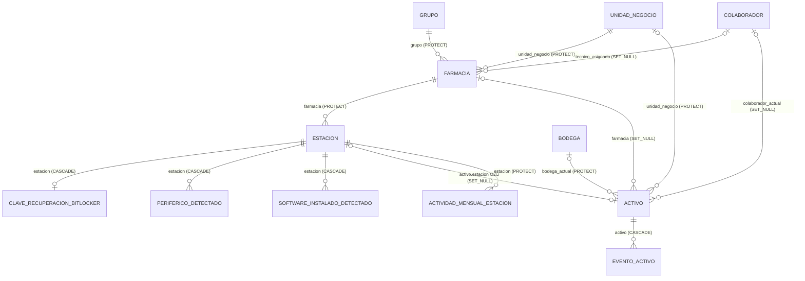

#### 5.2 Monitorización y alertas

```mermaid
erDiagram
    ESTACION ||--o{ MUESTRA_METRICA : "CASCADE"
    ESTACION ||--o{ MUESTRA_SERVICIO_POS : "CASCADE"
    ESTACION ||--o{ EVENTO_MONITOREO : "CASCADE"
    ESTACION ||--o{ ESTADO_DISPOSITIVO : "CASCADE, unico (estacion,fuente)"
    ESTACION ||--o{ ESTADO_SERVICIO_POS : "CASCADE, unico (estacion,servicio)"
    ESTACION ||--o{ POS_ERROR_DETECTADO : "CASCADE"
    ESTACION ||--o{ EVENTO_SISTEMA_DETECTADO : "CASCADE"
    FARMACIA ||--o{ MUESTRA_RED_FARMACIA : "CASCADE"
    FARMACIA ||--o{ MUESTRA_ENLACE_FARMACIA : "CASCADE"
    FARMACIA ||--o| ESTADO_ENLACE_FARMACIA : "O2O CASCADE"
    FARMACIA ||--o{ EVENTO_ENLACE_FARMACIA : "PROTECT"
    FARMACIA ||--o{ EVENTO_SATURACION_ENLACE : "CASCADE"
    FARMACIA ||--o{ VENTANA_NETFLOW_FARMACIA : "CASCADE"
    VENTANA_NETFLOW_FARMACIA ||--o{ FLUJO_NETFLOW_AGREGADO : "CASCADE"
    UNIDAD_NEGOCIO |o--o{ REGLA_ALERTA : "PROTECT"
    REGLA_ALERTA ||--o{ ALERTA : "regla (PROTECT)"
    ESTACION ||--o{ ALERTA : "estacion (CASCADE)"
    MANTENIMIENTO |o--o{ ALERTA : "mantenimiento (SET_NULL)"
    ACTIVO ||--o| OBJETIVO_SNMP : "O2O CASCADE"
    PERFIL_SNMP ||--o{ OBJETIVO_SNMP : "PROTECT"
    OBJETIVO_SNMP ||--o{ LECTURA_SNMP_ACTUAL : "CASCADE"
    ACTIVO ||--o| ESTADO_RED_ACTIVO : "O2O CASCADE"
```

#### 5.3 Órdenes al agente, despliegues, software y scripts

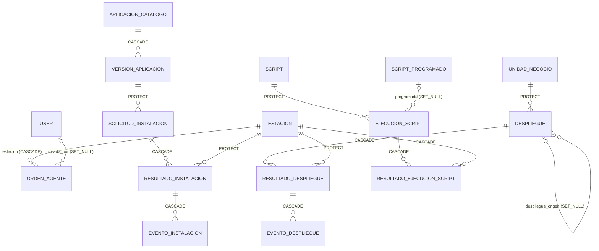

`OrdenAgente` **no tiene FK** hacia `Despliegue`, `SolicitudInstalacion` ni `ResultadoEjecucionScript`: los vincula por `(estacion, tipo, origen_id)` con un entero (`origen_id`), sin integridad referencial (`apps/catalogo/models.py:850`; índice `orden_agente_origen`).

#### 5.4 Usuarios, permisos y auditoría

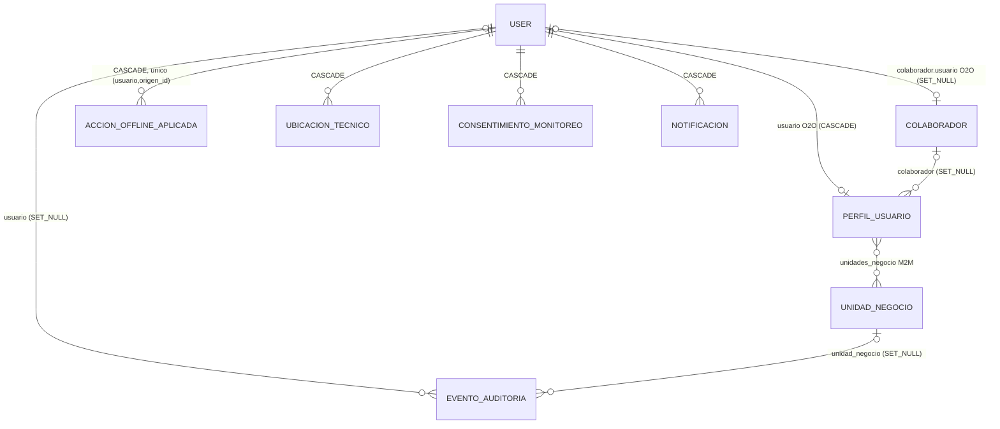

Permisos: se usan los `auth_permission` estándar (`view_/add_/change_/delete_` por modelo) más permisos propios declarados en `Meta.permissions`: `catalogo` (`acceso_remoto_estacion`, `supervision_auditoria_estacion`, `ver_clave_bitlocker`, `consultar_info_estacion`, `aprobar_estacion`, `reiniciar_estacion`, `escanear_actualizaciones_estacion`, `actualizar_agente_estacion`, `pausar_estacion`, `resolver_ordenagente`, entre otros), `aperturas.aprobar_apertura`, `monitoreo.registrar_sondeo_enlace`, `scripts.aprobar_ejecucionscript`. Los grupos los arma `apps/activos/management/commands/seed_permisos.py` (citado en `apps/catalogo/models.py:594`). El alcance por tenant **no** es un permiso: es el M2M `PerfilUsuario.unidades_negocio` + `acceso_todas_unidades`.

---

### 6. TimescaleDB

#### 6.1 Hypertables

| Tabla | Columna temporal | Chunk | Retención (job) | Compresión (job) | `segmentby` / `orderby` | Índices (sin comprimir) | Migración |
|---|---|---|---|---|---|---|---|
| `muestra_metrica` | `timestamp` | 1 día | 30 días | a los 7 días | `estacion_id` / `"timestamp" DESC` | PK `(id, timestamp)`; `(estacion_id, timestamp DESC)`; `(timestamp)` | `0035`, `0040` |
| `muestra_servicio_pos` | `timestamp` | 1 día | 30 días | a los 7 días | `estacion_id, servicio` / `"timestamp" DESC` | PK; `(estacion_id, servicio, timestamp DESC)`; `(timestamp)` | `0035`, `0040` |
| `evento_monitoreo` | `timestamp` | 7 días | 30 días | a los 7 días | `estacion_id, fuente` / `"timestamp" DESC` | PK; `(estacion_id, timestamp DESC)`; `(timestamp)` | `0035`, `0040` |
| `muestra_red_farmacia` | `timestamp` | 7 días | 30 días | a los 7 días | `farmacia_id` / `"timestamp" DESC` | PK; `(farmacia_id, timestamp DESC)`; `(timestamp)` | `0035`, `0040` |
| `muestra_enlace_farmacia` | `timestamp` | 1 día | 30 días | a los 7 días | `farmacia_id` / `"timestamp" DESC` | PK; `muestra_enl_farmaci_a5a651_idx (farmacia_id, timestamp DESC)`; `(timestamp)` | `0051`, `0052` |

- Los índices simples de FK que eran prefijo de otro índice se quitaron en `monitoreo/0041` (nueve tablas; ver la tabla de su docstring).
- Factores de compresión medidos por el autor el 6-oct-2026 en una base aparte, con datos sintéticos «realistas» (docstring de `0040`): `muestra_metrica` 10,7×; `muestra_servicio_pos` 42,5×; `evento_monitoreo` 110×. **No son mediciones de producción.**
- **Continuous aggregates: ninguno.** Las gráficas agregan en cada consulta con `__date`/`__hour`/`__minute` del ORM en lugar de `time_bucket`, para que funcione también en SQLite (`apps/panel/series_rango.py`, docstring).
- `VentanaNetflowFarmacia` y `FlujoNetflowAgregado` **no** son hypertables; los purga el propio colector con 14 días (`apps/monitoreo/netflow.py:44`, `purgar_netflow_antiguo`, llamado desde `run_netflow_collector`).

#### 6.2 Historia y riesgos de las migraciones de TimescaleDB (hechos)

1. `0002`, `0006` y `0021` intentaban `create_hypertable` y **fallaban siempre** («cannot create a unique index without the column timestamp»), en un *savepoint* que solo dejaba un `logger.warning`. Verificado por el autor el 16-sep-2026: cero hypertables en producción (`0035`, docstring).
2. `0035` cambia la PK a `(id, timestamp)` y convierte las cuatro tablas con `migrate_data => true`; **el `revertir` es un `pass`** (irreversible de hecho).
3. `0040` enciende la compresión. Su reversión (`apagar`) descomprime todos los chunks: «operación larga y que necesita el espacio en disco de la versión sin comprimir».
4. `0051`/`0052` crean `muestra_enlace_farmacia` en dos pasos porque «con la compresión ya encendida TimescaleDB rechaza cualquier cambio de esquema». **Consecuencia para el desarrollador:** cualquier `AddField`/`AlterField`/`AddIndex` futuro sobre una de las cinco hypertables puede fallar en producción y pasar en SQLite.
5. Todas las conversiones capturan `Exception` y siguen: **si una falló en producción, la migración figura como aplicada y la tabla quedó normal, sin aviso**. Hay que verificarlo con la consulta Q1 de §11.
6. `config/test_runner.py` desagenda en la base de pruebas los 8 jobs que crean `0035` y `0040` (`alter_job(..., scheduled => false)`) por *deadlocks* observados el 6-oct-2026. El job de `0052` (retención y compresión de `muestra_enlace_farmacia`) entra en el mismo filtro por `proc_name`, así que hoy son 10.

#### 6.3 Retención: doble mecanismo

Las purgas de Celery siguen programadas (`CELERY_BEAT_SCHEDULE`: `purgar-metricas-viejas` 03:00, `purgar-eventos-monitoreo-viejos` 03:10, `purgar-muestras-red-viejas` 03:20, `purgar-muestras-enlace-viejas` 03:25, `purgar-muestras-servicios-pos-viejas` 03:30). `apps/monitoreo/services.py:_purgar_serie` decide:

- si `es_hypertable(tabla)` → `SELECT drop_chunks(tabla, older_than => now() - 30 días)`;
- si no → `DELETE ... WHERE timestamp < umbral` (SQLite o PostgreSQL sin la extensión).

La ventana (30 días) está escrita **dos veces**: en las migraciones (`DIAS_RETENCION = 30`) y en los `dias=30` por defecto de `purgar_*`. El código lo advierte: si se cambia una, hay que cambiar la otra.

---

### 7. Flujo de escritura y lectura de métricas

#### 7.1 Escritura (quién escribe)

Todo entra por MQTT y lo procesa **un solo proceso**, `run_mqtt_worker` (servicio `worker`), que se suscribe a `/saidsof/agente/+/<tipo>/` y despacha a `apps/mqtt_worker/services.py`. Cada mensaje se autentica buscando `Estacion(codigo=<del tópico>, token_enrolamiento=payload['token'])` y exige `estado_aprobacion = aprobada`.

| Mensaje del agente (tópico) | Intervalo por defecto del agente | Handler | Escribe en | Tipo de escritura |
|---|---|---|---|---|
| `heartbeat` | 60 s (`intervalo_heartbeat`) | `manejar_heartbeat` | `estacion` (todas las columnas), `estado_dispositivo`, `actividad_mensual_estacion` (`get_or_create`), `evento_monitoreo` (solo si cambia `en_linea`), `alerta` | `UPDATE` + `SELECT`s; ~11 consultas por latido medido el 5-oct-2026 (comentario en `services.py:384-390`) |
| `metricas` | 300 s (`intervalo_metricas`), **solo si la estación tiene `monitorear_recursos`** | `manejar_metricas` → `monitoreo.services.registrar_muestra_metricas` | `muestra_metrica` (1 `INSERT`) + evaluación de reglas | `INSERT` + lecturas de la serie (§7.3) |
| `servicios_pos` | 300 s (`intervalo_servicios_pos`) | `registrar_servicios_pos` | `estado_servicio_pos` (`get_or_create` + `save` por servicio); `muestra_servicio_pos` (1 `INSERT` por servicio **que respondió**); `alerta` | por servicio, no en lote |
| `eventos_sistema` | 900 s | `registrar_eventos_sistema` | `evento_sistema_detectado` (`get_or_create`) | por evento |
| `pos_errores` | 300 s | `registrar_errores_pos` | `pos_error_detectado` (`get_or_create`) | por mensaje |
| `red_farmacia` | a pedido (comando firmado) | `registrar_muestra_red_farmacia` | `muestra_red_farmacia` | 1 `INSERT` |
| `activos_farmacia` | a pedido (tarea cada 15 min) | `registrar_estado_red_activos` | `estado_red_activo` | `get_or_create` por activo |
| `despliegue_estado`, `software_estado`, `script_estado` | por evento (QoS 1) | `manejar_estado_*` | `resultado_*`, `evento_*`, `orden_agente` | ver [05](#s10) §6 |
| `info_equipo`, `windows_update`, `software_instalado`, `perifericos` | a pedido | `manejar_*` | `estacion`, `clave_recuperacion_bitlocker`, `software_instalado_detectado`, `periferico_detectado` | snapshot (borra y reemplaza) |

Otros escritores de series:

- `muestra_enlace_farmacia` y `estado_enlace_farmacia`/`evento_enlace_farmacia`: `apps/monitoreo/enlaces.py` (`registrar_sondeo`; `bulk_create` en la línea 471), alimentado por el barrido ICMP local o por `POST /api/v1/monitoreo/enlaces/sondeo/` (ver [05](#s10)).
- `evento_monitoreo` con fuente MeshCentral: `run_meshcentral_worker` vía `registrar_estado_dispositivo`.
- Transición a fuera de línea: tarea `marcar-estaciones-offline` (cada minuto).

**Fechado de las muestras (hecho):** `MuestraMetrica`, `MuestraServicioPos`, etc. usan `timestamp = DateTimeField(default=timezone.now)` y `registrar_muestra_metricas` no pasa ninguna fecha del agente; el payload de métricas tampoco la trae (`agente_prueba.py`, `_reportar_metricas`). Además, el agente publica métricas, latidos y servicios con **QoS 0** y, sin conexión, `paho` los descarta (`agente_prueba.py`, `_publicar`, docstring). Solo los reportes de despliegue, software y scripts van con QoS 1 y cola en memoria. Por lo tanto **no hay relleno de huecos**: una estación que estuvo sin red tiene un hueco en sus series, no muestras atrasadas.

#### 7.2 Lectura (quién lee)

| Consumidor | Archivo / función | Tabla | Ventana | Consultas |
|---|---|---|---|---|
| Tarjetas de `/monitoreo/` | `apps/panel/series_rango.py:series_en_rango` | `muestra_metrica` | 24 h (por minuto), 7 d y 30 d (por hora) | 1 `GROUP BY estacion_id, date, hour[, minute]` para la página (25 estaciones) |
| Última muestra por estación (`/monitoreo/`) | `apps/panel/views/monitoreo.py:101-113` | `muestra_metrica` | **sin límite temporal** | `GROUP BY estacion_id` con `Max(timestamp)` + `IN` sobre esos instantes |
| Detalle de servidor | `monitoreo.py:203` | `muestra_metrica` | últimas 60 filas | `estacion.metricas.all()[:60]` |
| Ficha de estación | `apps/panel/views/estacion_ficha.py:66` | `muestra_metrica` | última | `order_by('-timestamp').first()` |
| Tendencia de flota | `apps/panel/views/tendencia.py:_series_semanales` | `muestra_metrica`, `alerta` | **12 semanas** | 3 `GROUP BY timestamp__date` |
| Curva de disponibilidad del tablero | `apps/monitoreo/series.py:serie_disponibilidad` | `evento_monitoreo`, `estado_dispositivo` | 24 h | 3 consultas, reconstrucción en memoria |
| Franja de 24 h de enlaces | `apps/panel/disponibilidad.py:intervalos_24h`, `muestras_24h` | `evento_enlace_farmacia`, `muestra_enlace_farmacia` | 24 h (~720 filas por farmacia) | 1 + 1 para la página |
| Historial de enlaces | `apps/monitoreo/historial_enlaces.py` | `evento_enlace_farmacia` | rango elegido | — |
| Evaluación de reglas | `apps/monitoreo/services.py:_condicion_sostenida` | `muestra_metrica` | `duracion_minutos` + la **primera muestra histórica** | 2 por regla y por muestra |
| API RMM | `apps/monitoreo/api_rmm.py` | `alerta` | paginada por `desde_id` | ver [05](#s10) |

#### 7.3 Consultas potencialmente costosas (análisis estático; pendiente `EXPLAIN` en producción)

| # | Dónde | Por qué puede costar | Escala con |
|---|---|---|---|
| C1 | `_condicion_sostenida` (`apps/monitoreo/services.py:94`): `estacion.metricas.order_by('timestamp').first()` | Busca la muestra **más vieja** de la estación en cada evaluación; en una hypertable eso apunta al chunk más antiguo, que está **comprimido**. Se ejecuta por cada muestra y por cada regla aplicable con duración. Además materializa instancias completas de `MuestraMetrica` de la ventana. | muestras/s × reglas |
| C2 | Última muestra en `/monitoreo/` (`views/monitoreo.py:101`) | `Max(timestamp) GROUP BY estacion_id` sin cota temporal: recorre los 30 días, incluidos chunks comprimidos. | estaciones de la página × 30 d |
| C3 | Tendencia (`views/tendencia.py:87-100`) | Filtra con `timestamp__date__gte`: Django lo traduce a una conversión de zona horaria sobre la columna, que en principio **impide la exclusión de chunks** por rango. Pide 12 semanas sobre una tabla con 30 días. | toda `muestra_metrica` |
| C4 | Series de 30 d (`series_rango.py`) | Agrupa por hora sobre 23 días comprimidos; la exclusión de chunks sí funciona (`timestamp__gte`). Costo acotado a 25 estaciones por página. | estaciones de la página |
| C5 | Latido (`manejar_heartbeat`) | No es una consulta cara sino frecuente: ~11 consultas × N_estaciones/60 por segundo, procesadas en serie por un único proceso. | N_estaciones |
| C6 | `registrar_servicios_pos` | `get_or_create` + `save` + `INSERT` + evaluación de regla **por servicio**, no en lote. | N_estaciones × servicios |
| C7 | `POST /api/v1/monitoreo/enlaces/sondeo/` | `registrar_sondeo` por farmacia dentro de la misma petición (hasta 2.000), y `validate_resultados` usa `codigos.count(c)` dentro de un bucle (O(n²), ~4 M comparaciones a 2.000). | N_farmacias |
| C8 | `/auditoria/` | `evento_auditoria` ordena por `(-timestamp, -pk)` y no tiene índice en `timestamp`. | filas de auditoría (sin retención) |

---

### 8. Crecimiento

#### 8.1 Supuestos (todos ESTIMACIÓN)

- `N_f` = farmacias: 700 → 1.300 → 2.000.
- `r` = estaciones por farmacia = **2,6** (≈1.800 / 700, cifra de `README.md` y `config/settings/base.py`). `N_e = r × N_f` → 1.820 → 3.380 → 5.200.
- `N_m` = estaciones con `monitorear_recursos`. En producción el código cita «2 de 10» (`apps/panel/views/estaciones.py:34`). Se dan dos escenarios: **uno por farmacia** (`N_m = N_f`) y **todas** (`N_m = N_e`).
- `S` = servicios del POS que responden por estación = 4 (docstring de `purgar_muestras_servicio_pos_antiguas`). En producción Odoo no responde (comentario en `evaluar_regla_servicio_pos`), así que el valor real podría ser 3.
- Intervalos: latido 60 s; métricas 300 s; servicios 300 s (defaults de `CAMPOS_CONFIG` del agente; **el `config.json` admite cambiarlos, [PROD, reportado 25-oct-2026]**). Enlace: 1 sondeo por farmacia cada 2 min (`0052`). Red de farmacia: 1 cada 5 min (docstring de `purgar_muestras_red_antiguas`; hoy depende de que la estación sondee su Mikrotik).
- Transiciones de `evento_monitoreo`: 103 filas en 24 h para 71 estaciones, medido el 13-oct-2026 (`apps/monitoreo/series.py`, docstring) → **≈1,45 por estación y día**.
- Retención: 30 días (series).

#### 8.2 Fórmulas y resultados (ESTIMACIÓN)

| Tabla | Fórmula filas/día | 700 farm. | 1.300 farm. | 2.000 farm. | Filas retenidas (×30) a 2.000 |
|---|---|---|---|---|---|
| `muestra_servicio_pos` | `N_e × S × 86 400/300` = `N_e × 1.152` | 2,10 M | 3,89 M | 5,99 M | ≈ 180 M |
| `muestra_enlace_farmacia` | `N_f × 720` | 0,50 M | 0,94 M | 1,44 M | ≈ 43 M |
| `muestra_metrica` (uno por farmacia) | `N_f × 288` | 0,20 M | 0,37 M | 0,58 M | ≈ 17 M |
| `muestra_metrica` (todas) | `N_e × 288` | 0,52 M | 0,97 M | 1,50 M | ≈ 45 M |
| `muestra_red_farmacia` | `N_f × 288` | 0,20 M | 0,37 M | 0,58 M | ≈ 17 M |
| `evento_monitoreo` | `N_e × 1,45` | 2,6 k | 4,9 k | 7,5 k | ≈ 0,23 M |
| `UPDATE estacion` por latido | `N_e / 60` por segundo | 30/s | 56/s | 87/s | — |
| Consultas por latido | `≈11 × N_e / 60` por segundo | ≈330/s | ≈620/s | ≈950/s | — |
| `INSERT` en series (total) | suma de las filas de arriba / 86 400 | ≈35/s | ≈65/s | ≈110/s | — |

Orden de magnitud de almacenamiento (ESTIMACIÓN): con ~200 bytes por fila sin comprimir (medido para `muestra_red_farmacia` el 16-sep-2026, docstring de `purgar_muestras_red_antiguas`), la semana caliente sin comprimir de `muestra_servicio_pos` a 2.000 farmacias son ≈ 42 M filas ≈ **8 GB** con índices; los 23 días restantes, comprimidos a ~40×, son del orden de **1 GB**. Antes de dimensionar el disco hay que medir con Q3 de §11.

#### 8.3 Tablas sin retención (crecen sin techo)

| Tabla | Qué la hace crecer | Comentario |
|---|---|---|
| `evento_auditoria` | Cada acción del panel y de la API móvil | Sin índice en `timestamp`; sin purga. Inmutable por diseño. |
| `orden_agente` | Cada orden de software, despliegue o script | `payload` es `TextField` (incluye el contenido completo de los scripts); `historial` JSON acotado a 50 entradas (`MAX_HISTORIAL`). Sin purga. |
| `evento_despliegue`, `evento_instalacion`, `evento_apertura` | Pasos reportados por cada estación | Proporcional a `N_e` × operaciones. |
| `resultado_*` (despliegue, instalación, script) | Una fila por estación y operación | `stdout`/`stderr` en `TextField`. |
| `actividad_mensual_estacion` | `N_e` filas por mes | Pequeña; es la base de facturación: no purgar. |
| `mensaje_mqtt_fallido`, `enrolamiento_rechazado` | Errores | Sin purga; el panel las marca como revisadas. |
| `mensaje_whatsapp`, `novedad_farmacia` | Conversaciones | Sin purga. |
| `alerta` | Alertas abiertas y resueltas | Sin purga; índice `(estado, -abierta_en)`. |
| `ubicacion_tecnico` | 1 fila cada 30 s por técnico en jornada | **Sí** se purga a 60 días (`purgar-ubicaciones-tecnico-viejas`, 03:40). |
| `django_session` | Sesiones | Django no las purga solo; requiere `clearsessions`. **Pendiente de verificar** si está programado. |

---

### 9. Hallazgos

#### 9.1 Hechos con impacto

| ID | Hallazgo | Evidencia | Impacto |
|---|---|---|---|
| BD-01 | `manejar_heartbeat` y `manejar_info_equipo` guardan la estación con `estacion.save()` **sin `update_fields`**. Leen la fila, la modifican en memoria y la reescriben entera. Un cambio hecho desde el panel en ese intervalo (por ejemplo `monitorear_recursos`, `estado_aprobacion` o `meshcentral_node_id`) puede perderse. | `apps/mqtt_worker/services.py:393-505` y `:669` | Pérdida de actualizaciones intermitente y difícil de reproducir; además reescribe ~60 columnas por latido (más WAL y *bloat*). |
| BD-02 | Las series se fechan al llegar y las métricas van por QoS 0 sin cola. El premisa de `0040` («una estación que estuvo caída manda muestras viejas al volver») no se cumple para métricas ni servicios. | `apps/monitoreo/services.py:401`; `agente_prueba.py:_publicar`, `_reportar_metricas` | Los huecos son huecos; el comportamiento «INSERT atrasado sobre chunk comprimido» probado en `0040` hoy no se ejercita. |
| BD-03 | La tendencia de flota pide 12 semanas de `muestra_metrica`, que retiene 30 días. | `apps/panel/views/tendencia.py:23` (`_semanas_recientes(n=12)`), `0035` | Ocho de las doce semanas de CPU/RAM/disco/red salen vacías. Las de alertas sí están completas (`alerta` no se purga). |
| BD-04 | Las conversiones a hypertable y la compresión fallan en silencio (`except Exception` → `logger.warning`). | `0035:121-125`, `0040:126-132`, `0052:61-62` | La migración consta como aplicada aunque la tabla no sea hypertable. Ya ocurrió una vez (`0002`/`0006`/`0021`). |
| BD-05 | La ventana de retención está duplicada (migración y `purgar_*`). | `0035` `DIAS_RETENCION`; `services.py:1126-1195` | Cambiar una sin la otra deja comportamientos distintos según haya o no TimescaleDB. |
| BD-06 | `OrdenAgente` referencia el objeto de dominio por un entero (`origen_id`) sin FK. | `apps/catalogo/models.py:850` | Sin integridad referencial: borrar un `Despliegue` deja órdenes huérfanas. Fue una decisión deliberada (tres tablas destino), pero conviene saberlo. |
| BD-07 | `EventoAuditoria` y `EventoActivo` son «inmutables» solo por `Model.delete()`. | `apps/auditoria/models.py:48-49`; `EventoActivo` CASCADE desde `Activo` | Un `QuerySet.delete()`, el admin en lote o un `CASCADE` los borran. |
| BD-08 | `muestra_metrica` cuenta con política de compresión, pero `_condicion_sostenida` consulta la muestra más vieja por estación en cada evaluación (C1). | `services.py:94` | Lectura de chunks comprimidos en la ruta de ingesta. |
| BD-09 | El `max_length=2000` del lote de sondeo coincide exactamente con el objetivo de 2.000 farmacias. | `apps/monitoreo/serializers.py` (`SondeoEnlaceLoteSerializer`) | Al pasar de 2.000 farmacias activas con IP, el barrido por API se rechaza con 400. |

#### 9.2 Contradicciones entre código y documentación

| Documento | Afirma | El código dice |
|---|---|---|
| `README.md` («Retención de las series de tiempo») | «La compresión de chunks todavía no está activada» y «cuatro tablas» | `monitoreo/0040` (6-oct-2026) la activó; hay cinco hypertables desde `0052`. |
| `README.md` | Purgas a las 3:00, 3:10, 3:20 y 3:30 | También 3:25 (`purgar-muestras-enlace-viejas`) y 3:40 (ubicaciones). |
| Docstring de `purgar_muestras_enlace_antiguas` | «retención nativa de la migración 0051» | La retención la crea `0052`; `0051` solo crea la tabla. |
| `config/test_runner.py` | «se desagendan los 8 jobs» | Con `0052` son 10 (el filtro es por `proc_name`, así que el código sí los desagenda todos). |
| `apps/panel/views/monitoreo.py:85-86` | «las pruebas corren sobre SQLite» | `CLAUDE.md`: las pruebas y el CI corren sobre PostgreSQL/TimescaleDB. |
| `monitoreo/0040`, punto 3 | El agente tiene cola offline y manda muestras viejas | Solo los reportes con QoS 1 (despliegue, software, script) se encolan, en memoria (BD-02). |
| Pedido de este análisis | `series_rango.py` en monitoreo | El archivo es `apps/panel/series_rango.py`; en `apps/monitoreo/` está `series.py` (otra cosa: disponibilidad horaria). |
| `CLAUDE.md` | «66 equipos con agente» | **[PROD, reportado 24-oct-2026]**: ~92 estaciones con agente (0.29–0.38). La documentación quedó atrás. |

---

### 10. Recomendaciones (separadas de los hechos)

Prioridad P0 (riesgo actual) → P3 (mejora).

| Prioridad | Recomendación | Motivo |
|---|---|---|
| P0 | Verificar en producción que las cinco tablas son hypertables con sus jobs activos (Q1 y Q2 de §11) y agregar ese chequeo a `apps/monitoreo/salud.py` o a un comando de verificación posterior al despliegue. | BD-04. |
| P1 | Cambiar `estacion.save()` del latido y de `info_equipo` por `save(update_fields=[...])` con la lista explícita de lo que el agente informa. | BD-01. |
| P1 | Reemplazar en `_condicion_sostenida` la búsqueda de la primera muestra por un `exists()` acotado (`timestamp < desde`, con límite inferior) y leer solo `values_list(regla.metrica)`. | C1 / BD-08. |
| P1 | Acotar en el tiempo la consulta de «última muestra» de `/monitoreo/` (p. ej. últimas 24 h) y, en PostgreSQL, usar `DISTINCT ON`. | C2. |
| P2 | Alinear la tendencia con la retención (4 semanas) o crear un *continuous aggregate* horario/diario de `muestra_metrica` con retención propia más larga. | BD-03, C3. |
| P2 | Definir retención o archivado para `orden_agente`, `evento_auditoria` (con índice en `timestamp`), `mensaje_mqtt_fallido` y `mensaje_whatsapp`. | §8.3. |
| P2 | Hacer que la ventana de retención salga de una sola constante compartida por migraciones y purgas, o que la purga lea la política real de `timescaledb_information.jobs`. | BD-05. |
| P2 | Si se quiere que una estación sin red no deje huecos, el agente tiene que fechar la muestra y encolarla; el servidor ya admite `INSERT` atrasados (probado en `0040`). | BD-02. |
| P3 | Procesar `servicios_pos` en lote (`bulk_create` de muestras; `update` por conjunto) y paralelizar el consumo MQTT (suscripciones compartidas de EMQX) antes de 1.300 farmacias. | C5, C6; ver [07](#s18). |
| P3 | Revisar `max_length=2000` del lote de sondeo antes de llegar a 2.000 farmacias. | BD-09. |
| P3 | Proteger el historial a nivel de base (permisos o *trigger* que niegue `DELETE` en `evento_auditoria`). | BD-07. |
| P3 | Borrar los SQLite sueltos de la raíz. | §2.1. |

---

### 11. Consultas de solo lectura para validar en producción

Ejecutar con un usuario de solo lectura. Ninguna modifica datos.

```sql
-- Q1. ¿Cuáles son hypertables y cuántos chunks tienen?
SELECT hypertable_name, num_chunks, compression_enabled
FROM timescaledb_information.hypertables
ORDER BY hypertable_name;

-- Q2. Jobs de retención y compresión: ¿existen, están agendados y terminan bien?
SELECT j.job_id, j.hypertable_name, j.proc_name, j.schedule_interval, j.scheduled, j.config,
       s.last_run_status, s.last_successful_finish, s.total_failures
FROM timescaledb_information.jobs j
LEFT JOIN timescaledb_information.job_stats s USING (job_id)
WHERE j.proc_name IN ('policy_retention', 'policy_compression')
ORDER BY j.hypertable_name, j.proc_name;

-- Q3. Tamaño real por hypertable, antes y después de comprimir.
SELECT h.hypertable_name,
       pg_size_pretty(hypertable_size(format('%I', h.hypertable_name)::regclass)) AS total,
       pg_size_pretty(c.before_compression_total_bytes) AS antes,
       pg_size_pretty(c.after_compression_total_bytes)  AS despues
FROM timescaledb_information.hypertables h
LEFT JOIN LATERAL hypertable_compression_stats(format('%I', h.hypertable_name)::regclass) c ON true;

-- Q4. Ajustes de compresión efectivos (segmentby / orderby).
SELECT hypertable_name, attname, segmentby_column_index, orderby_column_index, orderby_asc
FROM timescaledb_information.compression_settings
ORDER BY hypertable_name, segmentby_column_index NULLS LAST, orderby_column_index;

-- Q5. Tablas más grandes del esquema (incluye las que no tienen retención).
SELECT relname, n_live_tup, pg_size_pretty(pg_total_relation_size(relid)) AS total
FROM pg_stat_user_tables
ORDER BY pg_total_relation_size(relid) DESC
LIMIT 25;

-- Q6. Las PK de las hypertables incluyen timestamp (lo que hace 0035/0052).
SELECT conrelid::regclass AS tabla, pg_get_constraintdef(oid)
FROM pg_constraint
WHERE contype = 'p'
  AND conrelid::regclass::text IN ('muestra_metrica','muestra_servicio_pos','evento_monitoreo',
                                   'muestra_red_farmacia','muestra_enlace_farmacia');

-- Q7. Cuántas estaciones envían métricas y con qué frecuencia real (últimas 24 h).
SELECT count(DISTINCT estacion_id) AS estaciones, count(*) AS filas
FROM muestra_metrica
WHERE "timestamp" > now() - interval '24 hours';

-- Q8. Actualizaciones y tuplas muertas en estacion (efecto de BD-01).
SELECT relname, n_tup_upd, n_tup_hot_upd, n_dead_tup, last_autovacuum
FROM pg_stat_user_tables WHERE relname IN ('estacion', 'estado_dispositivo');

-- Q9. Plan de la consulta de tendencia (C3). EXPLAIN sin ANALYZE no ejecuta la consulta.
EXPLAIN SELECT ("timestamp" AT TIME ZONE 'America/Guayaquil')::date, sum(cpu_carga_pct)
FROM muestra_metrica
WHERE ("timestamp" AT TIME ZONE 'America/Guayaquil')::date >= current_date - 84
GROUP BY 1;

-- Q10. Crecimiento de las tablas sin retención.
SELECT 'evento_auditoria' AS t, count(*), min("timestamp") FROM evento_auditoria
UNION ALL SELECT 'orden_agente', count(*), min(creada_en) FROM orden_agente
UNION ALL SELECT 'mensaje_mqtt_fallido', count(*), min("timestamp") FROM mensaje_mqtt_fallido;
```

---

<a id="s5"></a>

## 5. Inventario de workers y procesos en segundo plano de SaidSoft

| Campo | Valor |
|---|---|
| **Fecha** | 26 de octubre de 2026 |
| **Versión del código revisada** | Copia de trabajo en `C:\Proyectos\saidsoft-core`. El usuario informa HEAD `1fa16d6`; la copia revisada no expone metadatos de git, así que el commit **no se pudo confirmar** desde aquí. |
| **Alcance** | Todo proceso que corre fuera del ciclo petición/respuesta del panel: servicios de `deploy/docker-compose.yml`, temporizadores de systemd del host, scripts de host, comandos de gestión que funcionan como proceso de larga duración y procesos externos opcionales. El agente Windows solo se referencia. El detalle de Celery (tareas, calendario, colas) está en [02-celery-y-tareas-programadas.md](#s6). |
| **Evidencias** | `deploy/docker-compose.yml`, `deploy/Dockerfile`, `deploy/entrypoint.sh`, `deploy/backup.sh`, `deploy/esperar-stack.sh`, `deploy/saidsoft-respaldo.{service,timer}`, `deploy/saidsoft-salud.{service,timer}`, `deploy/sonda-enlaces/sonda_enlaces.py`, `config/celery.py`, `config/settings/{base,produccion,desarrollo}.py`, `apps/mqtt_worker/management/commands/run_mqtt_worker.py`, `apps/monitoreo/management/commands/{run_meshcentral_worker,run_telegram_bot,run_netflow_collector,verificar_salud,sondear_enlaces}.py`, `apps/monitoreo/salud.py`, `apps/monitoreo/umbrales.py`, `apps/monitoreo/adapters/meshcentral.py`, `apps/mqtt_worker/services.py`, `apps/mqtt_worker/models.py`, `apps/catalogo/db.py`, `apps/catalogo/ordenes.py`, `apps/monitoreo/enlaces.py`, `CLAUDE.md`, `deploy/README-produccion.md`, `docs/modulos.md`, `PLAN_MODERNIZACION.md` (búsquedas puntuales). Evidencia de producción reportada por el usuario entre el 24 y el 26 de octubre de 2026, citada como **[PROD, reportado 2x-oct-2026]**. |
| **Supuestos** | (1) Producción corre exactamente el `docker-compose.yml` del repositorio, desde `~/Documentos/Said/saidsoft-core/deploy` (lo afirman `CLAUDE.md` y las unidades de systemd). (2) Las unidades de systemd del repo son las instaladas en `/etc/systemd/system/`. (3) Los comportamientos por defecto de Docker Engine, Celery 5.x y paho-mqtt se citan como tales, nunca como algo configurado en el repo. |
| **Limitaciones** | Auditoría de solo lectura del código. No se ejecutaron pruebas, contenedores, Celery ni comandos contra servicios. No se leyó `deploy/.env` (sí `deploy/.env.prod.example`). Nada de lo que depende del estado real del NUC (contenedores vivos, variables cargadas, temporizadores habilitados, crontab) está verificado salvo lo reportado por el usuario. |
| **Hallazgos pendientes** | Ver §9 (preguntas) y la columna «Pendiente de verificar» de las fichas. Los más importantes: si `docker-compose` (v1) existe en el NUC (lo usan `backup.sh` y `esperar-stack.sh`), si sigue en el crontab de `glpi` un respaldo antiguo, el estado de salud real de `celery_beat` durante las cegueras de red y si hay tareas encoladas acumuladas en Redis. |
| **Estado de validación** | **Validado contra código:** sí. **Validado contra producción:** parcial, solo lo marcado [PROD]. **Revisión humana:** pendiente. |

> **Cómo leer este documento.** Cada afirmación lleva su evidencia (ruta + símbolo). Las
> etiquetas son: **CONFIRMADO** (se ve en el código o la configuración del repo),
> **[PROD]** (reportado por el usuario), **HIPÓTESIS** (deducción razonable sin prueba) y
> **Pendiente de verificar** (con el comando de solo lectura que lo resolvería). Los hechos
> van separados de las recomendaciones (§5).

Documentos relacionados, escritos en paralelo por otros autores: MQTT y EMQX en
[03-mqtt-y-emqx.md](#s7); agente Windows en
[04-agente-windows.md](#s8); arquitectura en [../arquitectura/](#s1);
infraestructura en [../infraestructura/](#s11); seguridad en
[../seguridad/01-auditoria-tecnica.md](#s14); pruebas en
[../calidad/01-pruebas-y-calidad.md](#s15).

---

### 1. Mapa general

```
                    Agentes Windows (estaciones POS)          Mikrotik de farmacias
                       │ MQTT/TLS 8081→8883                    │ ICMP / SNMP / NetFlow UDP 8085
                       ▼                                       ▼
 ┌──────────── deploy/docker-compose.yml (NUC 10.111.6.20) ─────────────────────────────┐
 │  emqx ◄──────────── worker (run_mqtt_worker) ── escribe ──► db (TimescaleDB)          │
 │   ▲  ▲                    │ .delay()                           ▲  ▲  ▲  ▲               │
 │   │  │                    ▼                                    │  │  │  │               │
 │   │  └── publica ── celery_worker ◄── redis ◄── celery_beat    │  │  │  │               │
 │   │                 (2 procesos)      (broker   (30 entradas)  │  │  │  │               │
 │   │                    │  ping/SNMP    y backend)              │  │  │  │               │
 │   └── publica ── telegram_bot (long polling api.telegram.org) ─┘  │  │  │               │
 │                  meshcentral_worker ── WebSocket ──► meshcentral  │  │  │               │
 │                  netflow_collector  ── UDP 2055 ──────────────────┘  │  │               │
 │   nginx (8084 TLS / 8080 /media) ──► web (gunicorn, 3 workers) ──────┘  │               │
 └──────────────────────────────────────────────────────────────────────────┼─────────────┘
   Host (systemd, usuario glpi):  saidsoft-respaldo.timer → backup.sh ──────┘ (docker exec)
                                  saidsoft-salud.timer   → verificar_salud (docker compose exec web)
```

#### 1.1 Clasificación

| Grupo | Procesos | Número |
|---|---|---|
| Workers de aplicación (código Django, imagen propia, `restart: unless-stopped`) | `worker`, `celery_worker`, `celery_beat`, `meshcentral_worker`, `telegram_bot`, `netflow_collector` | 6 |
| Tareas programadas del host (systemd) | `saidsoft-respaldo` (`backup.sh`), `saidsoft-salud` (`verificar_salud`) | 2 |
| Procesos opcionales o manuales de larga duración | `manage.py sondear_enlaces --intervalo N`, `deploy/sonda-enlaces/sonda_enlaces.py --intervalo N` | 2 |
| Servicios de soporte de los que dependen los workers | `web` (incluye `entrypoint.sh`), `redis`, `db`, `emqx`, `nginx`, `meshcentral` | 6 |
| Proceso remoto (solo referencia) | Agente Windows en cada estación | 1 |

**Total de fichas: 17.** Procesos en segundo plano «reales» del sistema (los 6 workers + 2
temporizadores): **8**. Las tareas de Celery que esos procesos ejecutan son **37** (28 en el
calendario de Beat, 9 bajo demanda): ver [02-celery-y-tareas-programadas.md](#s6).

#### 1.2 Hechos transversales que aplican a todas las fichas

- **Reinicio automático.** Todos los servicios del compose tienen `restart: unless-stopped`
  (CONFIRMADO, `deploy/docker-compose.yml`). Con esa política Docker reinicia el contenedor
  cuando el proceso termina, **con cualquier código de salida**, incluido 0 (comportamiento
  documentado de Docker Engine).
- **Healthcheck no es auto-reparación.** Docker Engine (sin Swarm) marca un contenedor
  `unhealthy` pero **no lo reinicia** por eso. No hay en el repo ningún `autoheal` ni
  equivalente (CONFIRMADO: búsqueda de `autoheal` en `deploy/` sin resultados). Los
  healthchecks solo sirven para `docker compose ps`/`docker inspect` y para
  `depends_on: condition: service_healthy` al arrancar.
  > Contradicción: el comentario de `verificar_salud.handle` (función `revisar`) y el del
  > servicio `worker` en el compose dicen que, si el chequeo midiera otra cosa, «Docker lo
  > reiniciaría en loop». Con Docker Engine estándar eso no ocurre.
- **Una sola imagen, siete construcciones.** Los servicios con `<<: *app-build` comparten
  `deploy/Dockerfile`, pero Compose genera una imagen por servicio; `build web` deja a los
  demás con código viejo (CONFIRMADO, `CLAUDE.md` «Despliegue»).
- **Arranque.** `ENTRYPOINT ["/entrypoint.sh"]` (`deploy/Dockerfile`) aplica a todos los
  servicios de la imagen propia: espera hasta 30 intentos a PostgreSQL (`psycopg.connect`
  con `connect_timeout=3` y `sleep 2`, ≈150 s como máximo) y, si no responde, sale con
  error; Docker lo reinicia. Solo `web` (`RUN_MIGRATIONS=1`) migra y corre `collectstatic`
  (CONFIRMADO, `deploy/entrypoint.sh`).
- **Latidos.** `WorkerHeartbeat` (`apps/mqtt_worker/models.py`) es la tabla de latidos: una
  fila por `nombre`. Filas conocidas: `mqtt_worker`, `meshcentral_worker`, `telegram_bot`,
  `celery_beat`, `respaldo`, `respaldo_externo` (CONFIRMADO: `NOMBRE_WORKER_MQTT`,
  `NOMBRE_WORKER_MESHCENTRAL`, `NOMBRE_WORKER_TELEGRAM`, `NOMBRE_BEAT`, `NOMBRE_RESPALDO`,
  `NOMBRE_RESPALDO_EXTERNO`). El panel y `verificar_salud` leen las de `mqtt_worker`,
  `meshcentral_worker`, `celery_beat`, `respaldo` y `respaldo_externo`
  (`apps/monitoreo/salud.py::estado_latidos`). **La de `telegram_bot` no la lee nadie salvo
  el healthcheck de su propio contenedor** (CONFIRMADO: no aparece en `salud.py`).
- **Conexiones a la base en procesos largos.** Los workers llaman a
  `apps/catalogo/db.py::cerrar_conexiones_viejas()` antes de tocar la base;
  `CONN_MAX_AGE=60` por defecto (`config/settings/base.py`).
- **Registro.** Todo va a stdout/stderr (`LOGGING` en `config/settings/base.py`, nivel
  `INFO`), o sea a `docker compose logs <servicio>`. Las unidades de systemd van a journald.

---

### 2. Fichas de los workers de aplicación

#### 2.1 `worker` — worker MQTT (`run_mqtt_worker`)

**Identificación**

| Campo | Valor |
|---|---|
| Nombre técnico | `run_mqtt_worker` (comando de gestión) |
| Servicio / contenedor | `worker` / `deploy-worker-1` |
| Código | `apps/mqtt_worker/management/commands/run_mqtt_worker.py` (clase `Command`), lógica en `apps/mqtt_worker/services.py` (`manejar_*`) |
| App Django | `apps.mqtt_worker` |
| Función | Único consumidor de la telemetría de los agentes: enrolamiento, heartbeat, métricas, resultados de despliegues, scripts e instalaciones, inventario, red de farmacia, servicios POS, eventos del sistema, errores POS. |
| Estado de implementación | En producción. |
| Criticidad | **Crítica.** `docs/modulos.md` lo llama «el único oído»; si cae, no entra nada de la flota. |

**Funcionamiento**

- **Problema que resuelve:** convertir los mensajes MQTT de ~1.800 estaciones previstas en estado persistido (`Estacion`, estados de monitoreo, resultados de órdenes) y reaccionar (alertas, limpieza de retenidos, despacho de órdenes).
- **Disparador:** cada mensaje recibido del broker (`_on_message`). **Continuo.**
- **Entradas:** 15 suscripciones (CONFIRMADO, `_on_connect`): `/saidsof/enrolamiento/solicitar/` y `/saidsof/agente/+/{heartbeat, despliegue_estado, metricas, info_equipo, script_estado, software_estado, windows_update, software_instalado, perifericos, red_farmacia, activos_farmacia, servicios_pos, eventos_sistema, pos_errores}/`. QoS 1 solo en `despliegue_estado`, `script_estado` y `software_estado`; el resto QoS 0.
- **Salidas:** escrituras en PostgreSQL; publica `/saidsof/enrolamiento/respuesta/{codigo}/` (`_responder_enrolamiento`, `retain=False`); encola en Celery `limpiar_actualizacion_pendiente_task`, `retirar_retenido_despliegue_task`, `retirar_retenido_instalacion_task`, `despachar_ordenes_task` (`apps/mqtt_worker/services.py`), y `notificar_alerta_task`/`diagnosticar_alerta_task` cuando abre alertas (`apps/monitoreo/services.py::encolar_notificacion_alerta`, `_pedir_diagnostico_ia`).
- **Modelos que lee/escribe (vía servicios):** `Estacion`, `Farmacia`, `EstadoDispositivo`, `ResultadoEjecucionScript`, cola de órdenes (`apps.catalogo.ordenes.registrar_reporte`), muestras de métricas/red/servicios POS/eventos (`apps.monitoreo.services.registrar_*`), actividad mensual de facturación (`apps.facturacion.services.registrar_actividad_mensual`), `WorkerHeartbeat`, `MensajeMqttFallido`, `EnrolamientoRechazado`.
- **Servicios con los que habla:** EMQX (suscriptor), PostgreSQL, Redis (solo para encolar), API de administración de EMQX (`apps.mqtt_worker.emqx_admin`, aprovisionamiento de credenciales al enrolar), SMTP/Telegram/Teams solo si encolar a Celery falla (`encolar_notificacion_alerta` envía en línea).
- **Dependencias de arranque:** `db` sano, `emqx` y `redis` iniciados (`depends_on`).

**Ejecución y configuración**

| Campo | Valor |
|---|---|
| Comando | `["python", "manage.py", "run_mqtt_worker"]` (compose), precedido por `/entrypoint.sh` |
| Configuración | `MQTT_CONFIG` en `config/settings/base.py`; `client_id` fijo `MQTT_CLIENT_ID_WORKER` (por defecto `saidsoft-worker`) |
| Variables de entorno | `DJANGO_SETTINGS_MODULE`, `RUN_MIGRATIONS`, `DATABASE_URL`, `SECRET_KEY`, `ALLOWED_HOSTS`, `MQTT_HOST`, `MQTT_PORT`, `MQTT_USERNAME`, `MQTT_PASSWORD`, `MQTT_USE_TLS`, `MQTT_CA_CERT`, `COMANDO_HMAC_SECRET`, `BITLOCKER_ENCRYPTION_KEY`, `EMQX_API_URL`, `EMQX_API_KEY`, `EMQX_API_SECRET`, `EMAIL_HOST`, `EMAIL_HOST_USER`, `EMAIL_HOST_PASSWORD`, `EMAIL_PORT`, `TELEGRAM_BOT_TOKEN`, `ANTHROPIC_API_KEY`, `CELERY_BROKER_URL`, `CELERY_RESULT_BACKEND` |
| Colas Celery | Productor de la cola por defecto (`celery`); no consume |
| Reconexión | `reconnect_delay_set(min_delay=1, max_delay=30)` y `loop_forever()`; re-suscripción en cada `_on_connect` (CONFIRMADO). La **primera** conexión (`client.connect` en `handle`) no está protegida: si falla, la excepción termina el proceso y Docker lo reinicia (CONFIRMADO por estructura del código + política de reinicio). |
| Sesión MQTT | No pasa `clean_session=False` ni propiedades de sesión: usa el valor por defecto de paho (sesión limpia, MQTT 3.1.1). HIPÓTESIS fuerte: mientras el worker está desconectado, el broker no le guarda mensajes, ni siquiera los QoS 1. Detalle en [03-mqtt-y-emqx.md](#s7). |
| Reintentos por mensaje | Ninguno. Un mensaje que falla se registra en `MensajeMqttFallido` (`registrar_mensaje_fallido`) y se descarta; payload no JSON también (CONFIRMADO, `_on_message`). |
| Timeouts | `keepalive=60`. No hay límite de tiempo por mensaje. |
| Concurrencia | **Monohilo** para mensajes (un `loop_forever`), más un hilo daemon de latido cada 30 s (`_latido_periodico`, `LATIDO_INTERVALO_SEGUNDOS = 30`). |
| Apagado | Maneja `SIGTERM`/`SIGINT` (`_manejar_apagado`): desconecta y sale limpio. |
| Persistencia | Toda en PostgreSQL. Nada en memoria salvo el contador `_mensajes_procesados` (se reinicia en cada arranque). |
| Restart / healthcheck | `unless-stopped`; healthcheck `python manage.py verificar_salud --silencioso --solo mqtt_worker` cada 60 s, timeout 30 s, 3 reintentos, `start_period` 90 s. Mide la fila `mqtt_worker`: crítico si el latido tiene más de 90 s (`WORKER_MQTT_UMBRAL_SEGUNDOS`) o si `conectado=False` (`apps/monitoreo/salud.py::estado_latidos`). |

**Operación**

- **Comprobar que funciona:** fila `mqtt_worker` de `WorkerHeartbeat` con `ultimo_latido` reciente, `conectado=True` y `mensajes_procesados` creciendo entre dos lecturas; panel (Zona 0 / componente «Worker MQTT» y «Broker MQTT»); `docker compose ps worker` en `healthy`.
- **Logs:** `docker compose logs --tail=200 worker`. Mensajes clave: `[MQTT] Conectado al broker`, `[MQTT] Falló la conexión: <código>`, `[MQTT] Desconectado (...), reintentando...`, `Error procesando mensaje de <tópico>`, `Mensaje no-JSON descartado`.
- **Indicadores de salud:** latido < 90 s; `conectado`; avance de `mensajes_procesados`; crecimiento de `MensajeMqttFallido` (bandeja de triage).
- **Fallos probables:** credenciales o ACL de EMQX perdidas (`Not authorized`, historia en el comentario del servicio `emqx`); base caída; un mensaje lento que bloquea el hilo único; certificado TLS ausente.
- **Consecuencias de caída:** ver §7. En resumen: las estaciones dejan de actualizarse, y al minuto 5 `marcar_estaciones_offline_task` empieza a marcarlas fuera de línea (`ALERTA_SIN_LATIDO_UMBRAL_MINUTOS = 5`), aunque estén vivas.
- **Diagnóstico:** `docker compose logs worker`; `verificar_salud --solo mqtt_worker`; en EMQX, que el cliente `saidsoft-worker` esté conectado y suscrito (ver [03-mqtt-y-emqx.md](#s7)).
- **Recuperación:** el propio reintento de paho; si el proceso muere, Docker lo reinicia. Lo perdido durante la caída no se recupera por este canal (los agentes vuelven a reportar su estado en el siguiente heartbeat; los resultados QoS 1 perdidos dependen del agente).
- **Pruebas automatizadas:** `apps/mqtt_worker/tests.py` (`OnConnectTests`, `OnMessageTests`, `ApagadoOrdenadoTests`, `LatidoPeriodicoTests`, `OnMessageDispatchTests`, `ManejarHeartbeatTests`, `AclDelWorkerCubreSusTopicosTests`, entre otras), `apps/mqtt_worker/tests_retiro_retenidos.py`, `apps/monitoreo/tests_salud.py`.

**Riesgos**

| Riesgo | Evaluación |
|---|---|
| Duplicación | Un segundo proceso con el mismo `client_id` (`saidsoft-worker`) expulsaría al primero en EMQX y ambos se reconectarían en bucle. HIPÓTESIS basada en el comportamiento estándar de MQTT con `client_id` repetido; el código no lo impide (no hay cerrojo de instancia única). |
| Pérdida de mensajes | Alta en QoS 0 por diseño (comentario en `_on_connect`); también QoS 1 durante desconexiones si la sesión es limpia (HIPÓTESIS, ver arriba). Un error de procesamiento descarta el mensaje tras registrarlo. |
| Fuera de orden | No hay control de orden ni de marcas de tiempo a nivel de worker; depende de cada `manejar_*`. Pendiente de verificar por manejador. |
| Bloqueos | Hilo único: cualquier llamada lenta (base, API de EMQX al enrolar, `.delay()` con Redis caído, envío de notificación en línea cuando falla el encolado) frena toda la ingesta. HIPÓTESIS sobre `.delay()`: kombu reintenta publicar por defecto, lo que puede retener el hilo varios segundos por llamada. |
| Recursos | Una conexión a PostgreSQL; memoria estable (no acumula estado). |
| Idempotencia | Por manejador; no hay deduplicación global. `EnrolamientoRechazado` cuenta intentos en vez de duplicar filas (restricción `enrolamiento_rechazado_unico`). |
| Concurrencia | Sin concurrencia interna; sí concurrencia con `celery_worker` y `web` sobre las mismas filas (`Estacion`). |
| Fallos silenciosos | Mitigado desde el 10-oct-2026 con `conectado` y `mensajes_procesados` (hallazgo D-05 citado en `salud.py`). Persiste: los errores por mensaje solo se ven si alguien mira `MensajeMqttFallido`. |
| Seguridad | Recibe `EMQX_API_*` (la API Key salta las ACL, comentario R-8 del compose). Detalle en [../seguridad/01-auditoria-tecnica.md](#s14). |

---

#### 2.2 `celery_worker` — ejecutor de tareas Celery

**Identificación**

| Campo | Valor |
|---|---|
| Nombre técnico | Worker Celery de la app `saidsoft` |
| Servicio / contenedor | `celery_worker` / `deploy-celery_worker-1` |
| Código | `config/celery.py` (`app = Celery('saidsoft')`, `autodiscover_tasks()`); tareas en `apps/*/tasks.py` |
| App Django | Transversal (activos, catalogo, despliegues, mantenimiento, monitoreo, scripts, software, whatsapp) |
| Función | Ejecuta las 37 tareas: las periódicas que dispara Beat y las bajo demanda que encolan `web`, `worker` y otras tareas. |
| Estado | En producción. |
| Criticidad | **Alta.** Sin él no hay sondeo de enlaces, notificaciones de alertas, marcado de estaciones fuera de línea, cola de órdenes ni purgas. |

**Funcionamiento**

- **Disparador:** mensajes en Redis (`redis://redis:6379/0`). **Continuo**, consume a demanda.
- **Frecuencia efectiva:** ≈7.400 tareas periódicas al día más los lotes SNMP y las bajo demanda (cálculo en [02 §5](#5-calendario-de-celery-beat)).
- **Entradas:** cola por defecto de Celery; no hay `CELERY_TASK_ROUTES` ni colas propias (CONFIRMADO, búsqueda en `config/` y `apps/`).
- **Salidas:** escrituras en PostgreSQL; publicaciones MQTT con la credencial del **panel** (`apps/catalogo/services.py::resultado_publicacion`, MQTT 5 QoS 1 con `client_id` único por publicación); ICMP y SNMP hacia los routers de farmacias; correo (SMTP), Telegram, Teams, WhatsApp (API de Meta), Anthropic (diagnóstico IA), WebSocket a MeshCentral (`sincronizar_meshcentral_task`).
- **Modelos:** ver el inventario de tareas en [02 §6](#6-inventario-completo-de-tareas).
- **Dependencias:** `db` sano, `redis` iniciado, `emqx` sano (`depends_on`).

**Ejecución y configuración**

| Campo | Valor |
|---|---|
| Comando | `["celery", "-A", "config", "worker", "--loglevel=INFO", "--concurrency=2"]` |
| Configuración | `CELERY_*` en `config/settings/base.py` (broker, backend, `json`, `CELERY_TIMEZONE = TIME_ZONE`, `CELERY_TASK_TRACK_STARTED = True`) |
| Variables de entorno | `DJANGO_SETTINGS_MODULE`, `RUN_MIGRATIONS`, `DATABASE_URL`, `SECRET_KEY`, `ALLOWED_HOSTS`, `COMANDO_HMAC_SECRET`, `BITLOCKER_ENCRYPTION_KEY`, `MESHCENTRAL_API_WS_URL`, `MESHCENTRAL_API_USUARIO`, `MESHCENTRAL_API_PASSWORD`, `MESHCENTRAL_API_CA_CERT`, `MESHCENTRAL_API_VERIFICAR_TLS`, `MQTT_HOST`, `MQTT_PORT`, `MQTT_USERNAME`, `MQTT_PASSWORD`, `MQTT_USE_TLS`, `MQTT_CA_CERT`, `EMAIL_HOST`, `EMAIL_HOST_USER`, `EMAIL_HOST_PASSWORD`, `EMAIL_PORT`, `ENLACES_NOTIFICAR_A`, `TELEGRAM_BOT_TOKEN`, `ENLACES_TELEGRAM_CHAT_ID`, `WHATSAPP_TOKEN`, `WHATSAPP_PHONE_NUMBER_ID`, `WHATSAPP_MODO`, `WHATSAPP_FARMACIAS_PILOTO`, `WHATSAPP_REDIRIGIR_A`, `WHATSAPP_PLANTILLA_CAIDA`, `WHATSAPP_PLANTILLA_ESTACION`, `MESA_AYUDA_TELEGRAM_CHAT_ID`, `TELEGRAM_CHAT_IDS_AUTORIZADOS`, `ANTHROPIC_API_KEY`, `CELERY_BROKER_URL`, `CELERY_RESULT_BACKEND`. [PROD, reportado 24-oct-2026]: `ENLACES_TELEGRAM_CHAT_ID` está cargada en `celery_worker` y no en `web` (coherente con el compose). |
| Colas | Solo la cola por defecto. |
| Reintentos, límites de tiempo, `acks_late`, expiración | **Ninguno configurado** (CONFIRMADO: no hay `autoretry_for`, `self.retry`, `max_retries`, `time_limit`, `soft_time_limit`, `acks_late` ni `expires` en el repo). Rigen los valores por defecto de Celery. Ver [02 §4](#4-fiabilidad-reintentos-límites-y-confirmación). |
| Manejo de errores | Por tarea. Varias «nunca lanzan» a propósito (`notificar_alerta_task`, `diagnosticar_alerta_task`, `sondear_lote_snmp_task`); `procesar_ordenes_task` atrapa `OperationalError`/`InterfaceError`, cierra la conexión y deja la recuperación a la siguiente pasada. |
| Exclusión mutua | Solo `procesar_ordenes_task` (`pg_try_advisory_lock(CERROJO_PROCESAR)` en `apps/catalogo/ordenes.py::procesar`). El resto puede solaparse. |
| Persistencia | Resultados en Redis (backend). Mensajes pendientes en Redis, que guarda instantánea cada 60 s si hubo escrituras (`redis-server --save 60 1`). |
| Restart / healthcheck | `unless-stopped`; `celery -A config inspect ping -d celery@$$HOSTNAME` cada 60 s, timeout 30 s, 3 reintentos, `start_period` 60 s. |

**Operación**

- **Comprobar:** `docker compose ps celery_worker` en `healthy`; `celery -A config inspect ping`; latido `celery_beat` avanzando (lo escribe una tarea que ejecuta este worker, así que también prueba el consumo: `latido_beat_task`).
- **Logs:** `docker compose logs --tail=300 celery_worker`. Buscar `Task ... succeeded`, `raised unexpected`, `Barrido de enlaces abortado`, `0 nodo(s) de MeshCentral sincronizado(s)`, `0 estación(es) recibieron el pedido de sondeo de red` (estas dos últimas son las «firmas» de variables de entorno faltantes documentadas en el compose).
- **Fallos probables:** variable de entorno ausente (fallo silencioso, ya ocurrió con `MESHCENTRAL_*` el 17-sep y con `MQTT_*` el 19-sep, según comentarios del compose); saturación de los dos procesos por tareas largas; Redis caído; SMTP colgado (mitigado por `EMAIL_TIMEOUT=10`, `config/settings/produccion.py`).
- **Consecuencias de caída:** §7.
- **Diagnóstico:** [02 §12](#12-procedimiento-de-diagnóstico).
- **Recuperación:** Docker reinicia el proceso si muere. Las tareas que estaban ejecutándose cuando murió **no se reintentan** (confirmación temprana por defecto; HIPÓTESIS basada en el default de Celery, no configurado). Las periódicas se recuperan en la siguiente corrida.
- **Pruebas:** pruebas por tarea en modo «eager» (`CELERY_TASK_ALWAYS_EAGER`, p. ej. `apps/monitoreo/tests.py` clase en línea 1120, `apps/catalogo/tests.py` línea 194, `apps/mantenimiento/tests.py` línea 378, `apps/scripts/tests.py` línea 152); pruebas que atan variables de entorno al servicio que las usa (`apps/monitoreo/tests.py::test_celery_worker_recibe_la_configuracion_de_meshcentral`, `test_celery_worker_recibe_a_quien_avisarle_de_enlaces`, `test_el_chat_de_enlaces_esta_en_celery_worker`); concurrencia de la cola de órdenes (`apps/catalogo/tests_ordenes_concurrencia.py::PasadaPeriodicaTests`). Ninguna prueba ejecuta un worker Celery real contra Redis (todas son eager).

**Riesgos**

| Riesgo | Evaluación |
|---|---|
| Duplicación | Un segundo `celery_worker` duplicaría capacidad, no tareas (cada mensaje lo consume uno). Seguro para `procesar_ordenes_task` (cerrojo). |
| Pérdida | Tarea en ejecución perdida si el proceso muere (sin `acks_late`). Hasta 60 s de cola perdidos si Redis se apaga de golpe (`--save 60 1`). |
| Fuera de orden | Con dos procesos y sin colas separadas, dos tareas encoladas en orden pueden ejecutarse en paralelo o invertidas. |
| Bloqueos / inanición | **Una sola cola y dos procesos** para todo: `sondear_enlaces_farmacias_task` (cada 2 min, hasta 50 pings en paralelo de 3 paquetes), `sincronizar_ancho_banda_farmacias_task`, los lotes SNMP y `diagnosticar_alerta_task` (llamada a Anthropic sin `timeout` explícito en `apps/monitoreo/diagnostico_ia.py`) compiten con `notificar_alerta_task`. HIPÓTESIS: en hora pico la notificación de una alerta puede esperar detrás de sondeos. Pendiente de medir con `inspect active`/`reserved`. |
| Recursos | Fuga de descriptores ya ocurrida en el sondeo SNMP (comentario de `sincronizar-ancho-banda-farmacias` en `CELERY_BEAT_SCHEDULE`, ~8.400 descriptores por hora, corregida según el mismo comentario). |
| Idempotencia | Declarada en docstrings de varias tareas (filtros por fecha, marcas `notificado_en`, `escalada_en`, `diagnostico_generado_en`, `UPDATE` condicional en WhatsApp). Varias usan «leer y después marcar» sin `select_for_update` (p. ej. `escalar_alertas_abiertas` en `apps/monitoreo/services.py`): dos ejecuciones simultáneas podrían avisar dos veces (HIPÓTESIS). |
| Fallos silenciosos | Patrón repetido en el proyecto: la tarea «tiene éxito» con resultado 0 cuando falta configuración. |
| Seguridad | Recibe muchos secretos (MeshCentral, MQTT panel, SMTP, Telegram, WhatsApp, Anthropic). No recibe `EMQX_API_*` (R-8). |

---

#### 2.3 `celery_beat` — planificador

**Identificación**

| Campo | Valor |
|---|---|
| Nombre técnico | Celery Beat, planificador por defecto (`PersistentScheduler`, archivo `celerybeat-schedule`) |
| Servicio / contenedor | `celery_beat` / `deploy-celery_beat-1` |
| Código / config | `CELERY_BEAT_SCHEDULE` en `config/settings/base.py` (30 entradas, 28 tareas distintas) |
| App Django | Ninguna propia; no se usa `django_celery_beat` (CONFIRMADO: no está en `INSTALLED_APPS`) |
| Función | Encolar las tareas periódicas a su hora. |
| Estado | En producción. |
| Criticidad | **Alta y silenciosa:** «nada falla, simplemente las cosas dejan de pasar» (comentario del servicio en el compose). |

**Funcionamiento**

- **Disparador:** reloj interno. **Continuo**; intervalos de 60 s a diarios (crontab en hora de Guayaquil, `CELERY_TIMEZONE = TIME_ZONE`).
- **Entradas:** `CELERY_BEAT_SCHEDULE`. **Salidas:** mensajes en Redis.
- **Modelos:** ninguno directo. Su latido lo escribe `latido_beat_task` (ejecutada por `celery_worker`) en `WorkerHeartbeat` fila `celery_beat`.
- **Dependencias:** `db` sano (solo por el `entrypoint.sh`), `redis` iniciado.

**Ejecución y configuración**

| Campo | Valor |
|---|---|
| Comando | `["celery", "-A", "config", "beat", "--loglevel=INFO"]` |
| Estado del planificador | Archivo `celerybeat-schedule` en el directorio de trabajo del contenedor (`/app`), **sin volumen**: se pierde al recrear el contenedor (CONFIRMADO por el comentario «Diarias: crontab y NO un intervalo» en `config/settings/base.py`). Por eso las diarias usan `crontab`. |
| Variables de entorno | `DJANGO_SETTINGS_MODULE`, `RUN_MIGRATIONS`, `DATABASE_URL`, `SECRET_KEY`, `ALLOWED_HOSTS`, `COMANDO_HMAC_SECRET`, `BITLOCKER_ENCRYPTION_KEY`, `CELERY_BROKER_URL`, `CELERY_RESULT_BACKEND` |
| Exclusión entre instancias | **Ninguna.** Ni `django_celery_beat`, ni cerrojo en Redis. Dos Beat duplican todo el calendario. |
| Restart / healthcheck | `unless-stopped`; healthcheck `python manage.py verificar_salud --silencioso --solo 'celery beat'` cada 120 s, timeout 30 s, 3 reintentos, `start_period` 120 s. |

> **Hallazgo (CONFIRMADO): el healthcheck de `celery_beat` mide otra cosa que el panel.**
> `--solo 'celery beat'` (con espacio) selecciona `verificar_salud._revisar_beat`, que
> **infiere** la salud de Beat de que `MuestraRedFarmacia` tenga una fila de menos de 20 min
> (`BEAT_UMBRAL_MINUTOS = 20`). El latido propio de Beat (fila `celery_beat`, con guion bajo,
> desde el 10-oct-2026) lo evalúa `estado_latidos()` bajo la clave `celery_beat`. El
> comentario de `verificar_salud` («Celery Beat no registra latido propio») quedó
> desactualizado. Consecuencias: (a) cuando el NUC pierde la ruta a las farmacias, no hay
> muestras SNMP y el contenedor se marcará `unhealthy` aunque Beat esté sano (HIPÓTESIS
> derivada del código; en la ceguera del 24–25 oct es plausible —[PROD, reportado
> 25-oct-2026]: NUC ciego 22:04–23:50, 23:56–00:36 y 02:24–04:21—, Pendiente de verificar);
> (b) `verificar_salud` completo informa dos componentes casi homónimos, `celery_beat` y
> `celery beat`.

**Operación**

- **Comprobar:** fila `celery_beat` con latido < 90 s; `docker compose logs --since 10m celery_beat | grep "Sending due task"`.
- **Logs:** `docker compose logs celery_beat` (una línea `Scheduler: Sending due task <entrada> (<tarea>)` por disparo).
- **Fallos probables:** Redis caído (no puede encolar); contenedor recreado (se reinician los intervalos numéricos); dos instancias.
- **Consecuencias de caída:** §7.
- **Recuperación:** Docker lo reinicia si muere. Tras un reinicio **sin** recrear el contenedor el archivo de estado sobrevive; tras recrearlo, no. Si Beat ejecuta o no una corrida diaria perdida al volver es comportamiento interno de Celery que depende del estado del archivo: Pendiente de verificar en los logs del 25-oct-2026 (ver §8).
- **Pruebas:** `apps/monitoreo/tests_salud.py::test_beat_tiene_latido_propio_en_vez_de_inferirse`, `test_la_tarea_de_latido_de_beat_escribe_la_fila`, `test_sin_beat_todavia_queda_sin_verificar`; varias `test_esta_agendada_en_beat` en `apps/monitoreo/tests.py` y `test_las_tres_cadencias_estan_agendadas_en_beat`.

**Riesgos:** duplicación total si hay dos Beat; las tareas no tienen `expires`, así que si
`celery_worker` está caído y Beat vivo, los mensajes se acumulan en Redis y se ejecutan todos
de golpe al volver (HIPÓTESIS basada en la ausencia de `expires`; ver [02 §8](#8-solapes-acumulación-y-exclusión-mutua));
fallo silencioso por diseño; el healthcheck da falsos positivos y negativos (arriba).

---

#### 2.4 `meshcentral_worker` — eventos de MeshCentral

**Identificación**

| Campo | Valor |
|---|---|
| Nombre técnico | `run_meshcentral_worker` |
| Servicio / contenedor | `meshcentral_worker` / `deploy-meshcentral_worker-1` |
| Código | `apps/monitoreo/management/commands/run_meshcentral_worker.py`; protocolo en `apps/monitoreo/adapters/meshcentral.py::AdaptadorMeshCentral.escuchar_eventos` |
| App Django | `apps.monitoreo` |
| Función | Mantener abierto el canal de control de MeshCentral (`control.ashx`) y actualizar `EstadoDispositivo` (fuente MeshCentral) en tiempo real con los eventos `nodeconnect`, para el cruce MQTT × MeshCentral (regla `agente_caido_red_viva`). |
| Estado | Implementado. **Valor operativo actual reducido:** [PROD, reportado 24-oct-2026] la regla `agente_caido_red_viva` está inactiva; `evaluar_cruce_monitoreo` sale con 0 si no hay reglas activas (CONFIRMADO, `apps/monitoreo/services.py::evaluar_cruce_monitoreo`). |
| Criticidad | Media-baja hoy. |

**Funcionamiento:** continuo; entrada: WebSocket a MeshCentral (`MESHCENTRAL_API_WS_URL`); al
(re)conectar pide la lista completa de nodos (`_solicitar_nodes`); salida: `EstadoDispositivo`
y `WorkerHeartbeat` (`meshcentral_worker`, con `conectado`). Dependencias: `db` sano,
`meshcentral` iniciado. No declara dependencia de `redis` aunque recibe `CELERY_BROKER_URL`.

**Ejecución y configuración**

| Campo | Valor |
|---|---|
| Comando | `["python", "manage.py", "run_meshcentral_worker"]` |
| Variables | `DJANGO_SETTINGS_MODULE`, `RUN_MIGRATIONS`, `DATABASE_URL`, `SECRET_KEY`, `ALLOWED_HOSTS`, `COMANDO_HMAC_SECRET`, `BITLOCKER_ENCRYPTION_KEY`, `MESHCENTRAL_API_WS_URL`, `MESHCENTRAL_API_USUARIO`, `MESHCENTRAL_API_PASSWORD`, `MESHCENTRAL_API_CA_CERT`, `MESHCENTRAL_API_VERIFICAR_TLS`, `CELERY_BROKER_URL`, `CELERY_RESULT_BACKEND` |
| Reintentos | Reconexión con espera exponencial 1, 2, 4… hasta 60 s ante excepción; el timeout de `recv` (30 s) no cuenta como caída (CONFIRMADO, `escuchar_eventos`). Conexión inicial con `timeout=15`. |
| Latido | Hilo cada 30 s + al conectar/desconectar (`_registrar_latido`). |
| Apagado | `SIGTERM`/`SIGINT` → `_manejar_apagado` cierra el WebSocket. |
| Restart / healthcheck | `unless-stopped`; `verificar_salud --silencioso --solo meshcentral_worker` cada 60 s. |

> **Hallazgo (CONFIRMADO por código + política de Docker): sin configuración, el servicio
> entra en bucle de reinicio.** Si `MESHCENTRAL_API_*` está incompleto, `handle()` imprime
> un aviso y **retorna** (proceso termina con 0). Con `restart: unless-stopped` Docker lo
> vuelve a arrancar indefinidamente, y como nunca escribe latido el panel lo marca crítico
> («nunca registró un latido»). El comentario del compose dice que «se queda quieto». En
> producción las variables existen según el propio compose (comentario del 17-sep-2026), así
> que hoy probablemente no ocurre: Pendiente de verificar con `docker compose ps meshcentral_worker`.

**Operación:** logs `docker compose logs meshcentral_worker` (`[MeshCentral] Conectado`,
`MeshCentral: conexión perdida, reintentando en Ns`); salud por la fila `meshcentral_worker`.
Caída: los estados de MeshCentral envejecen; `sincronizar_meshcentral_task` (cada 15 min, en
`celery_worker`) actúa de red de seguridad. Pruebas: `apps/monitoreo/tests_salud.py::WorkerMeshCentralConexionTests`.

**Riesgos:** imagen `ghcr.io/ylianst/meshcentral:latest` sin versión fija en el servicio del
que depende; contraseña de MeshCentral en el entorno; si el servidor cierra limpio (`recv`
vacío), el bucle reconecta sin espera (CONFIRMADO: `break` sin `wait`) — riesgo de bucle
rápido de reconexión ante cierres repetidos (HIPÓTESIS).

---

#### 2.5 `telegram_bot` — bot de consultas por Telegram

**Identificación**

| Campo | Valor |
|---|---|
| Nombre técnico | `run_telegram_bot` |
| Servicio / contenedor | `telegram_bot` / `deploy-telegram_bot-1` |
| Código | `apps/monitoreo/management/commands/run_telegram_bot.py`; lógica en `apps/monitoreo/telegram_bot.py::procesar_actualizacion` |
| App Django | `apps.monitoreo` |
| Función | Responder comandos y botones (`/estado`, `/enlaces`, `/alertas`, `/farmacia`, `/sincronizar`, reconocimiento de alertas) por long polling a `api.telegram.org`. |
| Estado | En producción. [PROD, reportado 24-oct-2026]: canal global de Telegram activo. |
| Criticidad | Media (canal de operación y de acciones: `/sincronizar` publica comandos MQTT). |

**Funcionamiento:** continuo; `getUpdates` con `timeout=30` (socket 45 s); entradas: updates
`message` y `callback_query`; salidas: mensajes a Telegram, lecturas de la base y, para
comandos que actúan, publicaciones MQTT con la credencial del **panel**. Autorización: lista
`TELEGRAM_CHAT_IDS_AUTORIZADOS` o `PerfilUsuario.telegram_chat_id` de usuarios activos.
Dependencias: `db` sano y `emqx` sano.

**Ejecución y configuración**

| Campo | Valor |
|---|---|
| Comando | `["python", "manage.py", "run_telegram_bot"]` |
| Variables | `DJANGO_SETTINGS_MODULE`, `RUN_MIGRATIONS`, `DATABASE_URL`, `SECRET_KEY`, `ALLOWED_HOSTS`, `COMANDO_HMAC_SECRET`, `BITLOCKER_ENCRYPTION_KEY`, `TELEGRAM_BOT_TOKEN`, `TELEGRAM_CHAT_IDS_AUTORIZADOS`, `MQTT_HOST`, `MQTT_PORT`, `MQTT_USERNAME`, `MQTT_PASSWORD`, `MQTT_USE_TLS`, `MQTT_CA_CERT`, `CELERY_BROKER_URL`, `CELERY_RESULT_BACKEND` |
| Reintentos | Ante fallo de `getUpdates`: espera 2 s duplicando hasta 60 s (`ESPERA_MINIMA_TRAS_ERROR`, `ESPERA_MAXIMA_TRAS_ERROR`). |
| Confirmación de updates | Por `offset` en la siguiente llamada (`_bucle`). Un update se procesa antes de confirmarse. |
| Manejo de errores | `procesar_actualizacion` «nunca lanza» (bloque `try` propio, según su docstring). |
| Latido | Fila `telegram_bot` cada 30 s, **sin** `conectado`. |
| Restart / healthcheck | `unless-stopped`; healthcheck en línea (Python) que exige latido de menos de 3 min, cada 60 s. |

**Hallazgos (CONFIRMADO):**
- Igual que `meshcentral_worker`: sin token o sin ningún chat autorizado, `handle()` retorna
  y Docker lo reinicia en bucle (el compose dice «avisa y sale sin tumbar el stack»).
- El latido lo escribe un hilo aparte, así que prueba que el proceso vive, no que
  `api.telegram.org` responda: con Telegram inaccesible el contenedor sigue `healthy`.
- La fila `telegram_bot` no la mira ni el panel ni `saidsoft-salud`.

**Operación:** logs `docker compose logs telegram_bot` (`Telegram: fallo consultando updates`,
`consulta de un chat no autorizado`); prueba funcional: enviar `/estado` desde un chat
autorizado. **Riesgos:** si dos instancias usan el mismo token, Telegram rechaza el segundo
`getUpdates` concurrente (comportamiento de la API de Telegram; HIPÓTESIS en este contexto);
un update que hiciera colgar `procesar_actualizacion` bloquea el bot (sin timeout por update);
chats del `.env` que sobreviven a la baja del usuario (lo vigila `verificar_salud._revisar_telegram`).

---

#### 2.6 `netflow_collector` — colector NetFlow (piloto)

**Identificación**

| Campo | Valor |
|---|---|
| Nombre técnico | `run_netflow_collector` |
| Servicio / contenedor | `netflow_collector` / `deploy-netflow_collector-1` |
| Código | `apps/monitoreo/management/commands/run_netflow_collector.py`; `apps/monitoreo/netflow.py` (`AgregadorNetflow`, `volcar`, `purgar_netflow_antiguo`) |
| App Django | `apps.monitoreo` |
| Función | Recibir NetFlow v5/v9/IPFIX de los Mikrotik y guardar un resumen por farmacia cada 5 min. |
| Estado | **Piloto** (18-oct-2026, ML001/ML004/MH001, §10-CQ). El módulo `netflow` del panel está diferido en producción (`PANEL_MODULOS_DIFERIDOS` en `config/settings/produccion.py`). |
| Criticidad | Baja. |

**Funcionamiento:** continuo; UDP 2055 en el contenedor publicado como `8085/udp` en el host;
socket con `settimeout(1.0)`; acumula en memoria y vuelca cada `VENTANA_SEGUNDOS`; relee el
mapa IP→farmacia en cada ventana; purga datos de más de 14 días cada hora
(`PURGA_CADA_SEGUNDOS = 3600`). Al recibir `SIGTERM` vuelca la ventana en curso (`finally`).
Variables: `DJANGO_SETTINGS_MODULE`, `RUN_MIGRATIONS`, `DATABASE_URL`, `SECRET_KEY`,
`ALLOWED_HOSTS`, `COMANDO_HMAC_SECRET`, `BITLOCKER_ENCRYPTION_KEY`, `NETFLOW_EXPORTADORES`.
Dependencia: `db` sano.

**Hallazgos (CONFIRMADO):** no tiene healthcheck ni latido; es el único worker de aplicación
sin forma automática de detectar que dejó de procesar. Una excepción de base en `_volcar`
dentro del bucle no está atrapada: termina el proceso (el `finally` intentaría volcar otra
vez) y Docker lo reinicia, perdiendo la ventana en memoria (HIPÓTESIS sobre el efecto,
CONFIRMADO que no hay `try` alrededor de `_volcar` en el bucle). UDP sin autenticación:
cualquier host que llegue al puerto 8085/udp puede inyectar datagramas (se descartan los de IP
no reconocida, pero se cuentan en `exportadores_desconocidos`).

**Operación:** `docker compose logs netflow_collector` (una línea por volcado con
datagramas/bytes/flujos y la lista de exportadores desconocidos). Caída: se pierde la ventana
en curso y no hay alerta.

---

### 3. Tareas programadas del host

#### 3.1 `saidsoft-respaldo` — respaldo diario (`backup.sh`)

| Campo | Valor |
|---|---|
| Nombre técnico / ubicación | `deploy/saidsoft-respaldo.timer` → `deploy/saidsoft-respaldo.service` → `deploy/esperar-stack.sh` + `deploy/backup.sh /home/glpi/backups/saidsoft` |
| Función | `pg_dump` de la base, `tar` de `/app/media`, exportación de EMQX (`emqx ctl data export`), cifrado GPG AES256, retención local 14 días, copia externa opcional por `rsync` y a OneDrive con `rclone`, latidos `respaldo` y `respaldo_externo`. |
| Estado | En producción según `deploy/README-produccion.md`; instalación real Pendiente de verificar. |
| Criticidad | **Alta** (es la única copia de la base y de las credenciales MQTT de cada estación, guardadas en Mnesia de EMQX). |
| Disparador / frecuencia | `OnCalendar=*-*-* 02:00:00`, `Persistent=true` (corre al arrancar si se perdió la de las 02:00). |
| Usuario | `glpi` (`User=glpi`, `Group=glpi`). |
| Dependencias | `Requires=docker.service`; `ExecStartPre` espera hasta 60×5 s a que `db` esté `healthy`. Usa `docker-compose exec` contra `db`, `web` y `emqx`. |
| Variables (de `deploy/.env`, solo nombres) | `POSTGRES_USER`, `POSTGRES_DB`, `BACKUP_ENCRYPTION_PASSPHRASE`, `BACKUP_OFFSITE_DESTINO`, `BACKUP_ONEDRIVE_REMOTO`, `BACKUP_ONEDRIVE_RETENCION_DIAS` |
| Timeout | `TimeoutStartSec=2h`. `rsync --timeout=120`; `rclone --retries 3 --low-level-retries 10`. |
| Manejo de errores | `set -eu`: cualquier fallo de base, media o EMQX aborta **sin** registrar el latido `respaldo` (el panel lo marca tras 26 h, `RESPALDO_UMBRAL_HORAS`). Las copias externas no abortan. |
| Logs | `journalctl -u saidsoft-respaldo`. |
| Salud | Latidos `respaldo` y `respaldo_externo` (panel y `verificar_salud`). |

**Hallazgos:**
- **`docker-compose` (v1) en scripts de un host que usa Compose v2** (CONFIRMADO en el repo,
  efecto Pendiente de verificar). `backup.sh` y `esperar-stack.sh` invocan `docker-compose`;
  `CLAUDE.md` y `saidsoft-salud.service` usan `docker compose` (v2), y el comentario del
  servicio `emqx` relata la migración a v2 el 4-sep-2026. Si el binario v1 ya no existe,
  `esperar-stack.sh` nunca ve la base sana (el error se oculta con `|| true`) y el respaldo
  abortaría todos los días. Comando: `command -v docker-compose && docker-compose version`.
- **El respaldo de media depende de `web`.** `tar` se hace con `docker-compose exec -T web`.
  Si `web` está caído o en bucle de reinicio, el respaldo aborta. [PROD, reportado
  25-oct-2026]: el panel dio 502 de 04:21 a 11:53 por `staticfiles.json` corrupto (bucle de
  reinicio de `web`, arreglado en `entrypoint.sh`, commit `9c9405b`). Si el respaldo atrasado
  corrió en esa ventana, probablemente falló: Pendiente de verificar con
  `journalctl -u saidsoft-respaldo --since "2026-10-24"`.
- `deploy/README-produccion.md` (paso 7) todavía indica instalar el respaldo por **cron**;
  `backup.sh` dice que ahora va por systemd. Si quedó la línea de cron, hay dos respaldos
  diarios (Pendiente: `crontab -l -u glpi`).
- `backup.sh` cita `deploy/scheduler.sh`, que ya no existe en el repo.
- `BACKUP_OFFSITE_DESTINO` no figura en `deploy/.env.prod.example`.

#### 3.2 `saidsoft-salud` — verificación externa de salud

| Campo | Valor |
|---|---|
| Ubicación | `deploy/saidsoft-salud.timer` → `deploy/saidsoft-salud.service` → `docker compose --env-file .env exec -T web python manage.py verificar_salud --silencioso` |
| Función | Revisar base, latidos (`mqtt_worker`, `meshcentral_worker`, `broker_mqtt`, `celery_beat`, temperatura y otros de `estado_latidos`), «celery beat» inferido, sondeo de enlaces, chats de Telegram dados de baja, disco (≥ 10 % libre), respaldo. Sale con 1 si algo está crítico. |
| Disparador / frecuencia | `OnBootSec=10min`, `OnUnitActiveSec=15min`; sin `Persistent`. |
| Usuario | `glpi`. |
| Criticidad | Media: es el único vigilante que no depende de Celery. |

**Hallazgos (CONFIRMADO):**
- **No avisa a nadie.** La unidad no tiene `OnFailure=`; el propio comentario dice «si no,
  queda en el journal». Hoy su salida solo existe en `journalctl -u saidsoft-salud`.
- **Corre dentro de `web`.** Si `web` está caído, el chequeo falla por no poder ejecutarse, no
  por diagnosticar; y lo que se ve en el journal es un error de `docker compose exec`. En la
  ventana 04:21–11:53 del 25-oct-2026 [PROD] este vigilante estuvo ciego (HIPÓTESIS, Pendiente
  de verificar en el journal).
- No revisa `telegram_bot` ni `netflow_collector`, ni `celery_worker` de forma directa (solo
  a través del latido de Beat, que exige que el worker consuma).

---

### 4. Procesos opcionales o manuales y servicios de soporte

#### 4.1 `manage.py sondear_enlaces --intervalo N` (manual)

`apps/monitoreo/management/commands/sondear_enlaces.py`. Con `--intervalo` «queda sondeando
(como un servicio)» hasta `Ctrl+C` o `SIGTERM`. Es la vía manual del mismo barrido que corre
cada 2 min en Beat (`sondear_enlaces_farmacias_task`). **No está en el compose ni en systemd**
(CONFIRMADO). Si alguien lo deja corriendo en el NUC además de Beat, duplica sondeos y
escrituras de estado de enlace (HIPÓTESIS). Criticidad: ninguna mientras no se use.

#### 4.2 `deploy/sonda-enlaces/sonda_enlaces.py` (sonda externa)

Script de biblioteca estándar para correr en otra máquina con ruta a las farmacias: pide la
lista a `/api/v1/monitoreo/enlaces/farmacias/`, hace ping (3 paquetes, 50 en paralelo) y
reporta a `/api/v1/monitoreo/enlaces/sondeo/` con un token DRF (servidor responde 409 si el
barrido es sospechoso). Bucle `while True` con `--intervalo`. Admite `--inseguro` (sin
verificar TLS). Estado: **redundante y propuesto para retiro** (`docs/producto/SAIDSOFT_RMM_1_0_ALCANCE.md`
líneas 103 y 152; `docs/auditoria/producto-v1.md` línea 218). Que no esté corriendo en
ninguna máquina es Pendiente de verificar (no hay forma de saberlo desde el repo; un token
DRF con permiso `monitoreo.registrar_sondeo_enlace` activo sería la pista).

#### 4.3 `web` — panel (gunicorn) y tareas de arranque

Proceso de primer plano, incluido porque (a) encola tareas (`generar_informe_pdf_task` desde
`apps/panel/views/mantenimiento.py`, `procesar_mensaje_whatsapp_task` desde
`apps/whatsapp/views.py` con `transaction.on_commit`, notificaciones de alertas abiertas desde
el panel), (b) es el contenedor donde corren `verificar_salud` (systemd) y parte del respaldo,
y (c) su `entrypoint.sh` migra y recolecta estáticos. Comando:
`gunicorn config.wsgi:application --bind 0.0.0.0:8000 --workers 3 --timeout 600 --access-logfile -`
(el `CMD` del Dockerfile dice `--timeout 120`, el compose lo pisa). Healthcheck: `GET /login/`
con cabeceras `Host` y `X-Forwarded-Proto`. [PROD, reportado 25-oct-2026]: bucle de reinicio
por `staticfiles.json` corrupto tras corte de luz; corregido en `entrypoint.sh` (descarta el
manifiesto ilegible antes de `collectstatic`, commit `9c9405b`).

#### 4.4 Servicios de infraestructura

| Servicio | Rol para los workers | Arranque / salud | Riesgo principal para los workers |
|---|---|---|---|
| `redis` (`redis:7-alpine`) | Broker y backend de resultados de Celery (`redis://redis:6379/0`) | `redis-server --save 60 1`, volumen `redis_data`, healthcheck `redis-cli ping` | Sin contraseña ni ACL (CONFIRMADO en el compose); solo alcanzable en la red interna de Docker (no publica puerto). Hasta 60 s de mensajes perdidos ante corte de luz. Ningún servicio declara `condition: service_healthy` sobre Redis. |
| `db` (`timescale/timescaledb:2.17.2-pg16`) | Fuente de verdad de todos | Healthcheck `pg_isready`; puerto `127.0.0.1:5433` | Caída = todos los workers fallan; [PROD, reportado 25-oct-2026]: `pg_central` caído 00:36–01:09 y 01:32–02:19. |
| `emqx` (`emqx/emqx:5.8.3`) | Broker de `worker`; destino de publicaciones de `celery_worker`, `telegram_bot` y `web` | Healthcheck `emqx ctl status`; nombre de nodo fijo; retenidos en disco | Ver [03-mqtt-y-emqx.md](#s7). |
| `nginx` (`nginx:1.27-alpine`) | Entrada TLS al panel y `/media/` para agentes | Healthcheck `wget /media/` | No afecta a los workers salvo a la sonda externa (que entra por 8084). |
| `meshcentral` (`ghcr.io/ylianst/meshcentral:latest`) | Origen de eventos de `meshcentral_worker` y de `sincronizar_meshcentral_task` | Sin healthcheck | Etiqueta `latest`: una recreación puede cambiar de versión sin aviso. |

#### 4.5 Agente Windows (referencia)

Proceso en segundo plano en cada estación POS (servicio de Windows, código de referencia en
`agente-prueba/`). Produce todo lo que consume `worker` y ejecuta lo que publican
`celery_worker`, `web` y `telegram_bot`. Ver [04-agente-windows.md](#s8).

---

### 5. Recomendaciones (separadas de los hechos)

Ordenadas por impacto. Ninguna se aplicó.

1. **Alinear el healthcheck de `celery_beat` con el latido propio**: usar `--solo celery_beat`
   (clave de `estado_latidos`) en vez de `'celery beat'`, y actualizar el comentario de
   `verificar_salud`.
2. **Dar a `saidsoft-salud` un canal de aviso** (`OnFailure=` con correo o Telegram desde el
   host) y ejecutarlo desde un contenedor que no sea `web` (p. ej. `docker compose run --rm`
   con la misma imagen), para que una caída de `web` no lo ciegue.
3. **Verificar y unificar `docker-compose`/`docker compose`** en `backup.sh` y
   `esperar-stack.sh`; tomar la media del volumen `media_data` sin depender de `web`.
4. **Separar colas**: una para notificaciones (`notificar_alerta_task`,
   `diagnosticar_alerta_task`, WhatsApp) y otra para sondeos masivos, con procesos dedicados.
5. **Agregar `expires`** a las entradas periódicas (p. ej. igual a su intervalo) para evitar la
   avalancha tras una caída de `celery_worker`.
6. **Evitar bucles de reinicio por configuración**: en `run_meshcentral_worker` y
   `run_telegram_bot`, quedarse esperando (o usar `restart: on-failure` y salir con 0) en vez
   de retornar.
7. Añadir latido y healthcheck a `netflow_collector`, y `conectado` al latido de `telegram_bot`;
   incluir ambos en `estado_latidos`.
8. Fijar la versión de `meshcentral` y acotar `celery>=5.4` en `requirements.txt`.

---

### 6. Matriz de workers

| Worker | Función | Disparador | Frecuencia | Entradas | Salidas | Dependencias | Criticidad | Estado | Evidencia |
|---|---|---|---|---|---|---|---|---|---|
| `worker` (`run_mqtt_worker`) | Ingesta de telemetría y resultados de agentes | Mensaje MQTT | Continuo | 15 tópicos `/saidsof/...` | PostgreSQL; respuesta de enrolamiento; tareas Celery | db, emqx, redis | Crítica | Producción | `apps/mqtt_worker/management/commands/run_mqtt_worker.py::Command._on_connect` |
| `celery_worker` | Ejecuta 37 tareas | Mensaje en Redis | Continuo (≈7.400 periódicas/día) | Cola `celery` | PostgreSQL, MQTT (panel), ICMP/SNMP, SMTP, Telegram, Teams, WhatsApp, Anthropic, MeshCentral | db, redis, emqx | Alta | Producción | `deploy/docker-compose.yml` servicio `celery_worker`; `config/celery.py` |
| `celery_beat` | Encola tareas periódicas | Reloj | 60 s a diaria (30 entradas) | `CELERY_BEAT_SCHEDULE` | Mensajes en Redis | redis | Alta | Producción | `config/settings/base.py::CELERY_BEAT_SCHEDULE` |
| `meshcentral_worker` | Estado de conectividad desde MeshCentral | Evento WebSocket | Continuo | `control.ashx` | `EstadoDispositivo`, latido | db, meshcentral | Media-baja | Producción, regla consumidora inactiva [PROD] | `apps/monitoreo/adapters/meshcentral.py::escuchar_eventos` |
| `telegram_bot` | Consultas y acciones por Telegram | Update de Telegram | Continuo (long polling 30 s) | `getUpdates` | Mensajes Telegram; comandos MQTT | db, emqx, Internet | Media | Producción | `apps/monitoreo/management/commands/run_telegram_bot.py::_bucle` |
| `netflow_collector` | Resumen NetFlow por farmacia | Datagrama UDP | Continuo; volcado cada 5 min; purga cada hora | UDP 2055 (8085/udp) | Tablas NetFlow | db | Baja | Piloto | `apps/monitoreo/management/commands/run_netflow_collector.py` |
| `saidsoft-respaldo` | Respaldo cifrado base+media+EMQX | Timer systemd | Diario 02:00, `Persistent` | Contenedores db/web/emqx | `.gpg` locales, rsync, OneDrive, latidos | Docker, db, web, emqx, `docker-compose` | Alta | Producción (instalación Pendiente de verificar) | `deploy/backup.sh`, `deploy/saidsoft-respaldo.timer` |
| `saidsoft-salud` | Chequeo externo de salud | Timer systemd | Cada 15 min | Base, `WorkerHeartbeat`, disco | Journal (código 0/1) | Docker, web | Media | Producción (instalación Pendiente de verificar) | `deploy/saidsoft-salud.service`, `verificar_salud.py` |
| `sondear_enlaces --intervalo` | Barrido manual de enlaces | Manual | N s | Farmacias con `ip_router` | Estados de enlace | db, ruta a farmacias | Ninguna | Manual, no desplegado | `apps/monitoreo/management/commands/sondear_enlaces.py` |
| `sonda_enlaces.py` | Sonda externa por API | Manual | N s | API `/enlaces/farmacias/` | API `/enlaces/sondeo/` | nginx, web, token DRF | Ninguna | Redundante, a retirar | `deploy/sonda-enlaces/sonda_enlaces.py` |
| Agente Windows | Telemetría y ejecución en estación | Servicio Windows | Continuo | Tópicos de comando | Tópicos de reporte | emqx | Crítica | Producción | [04-agente-windows.md](#s8) |

---

### 7. Matriz de impacto si un worker se detiene

**C** = CONFIRMADO por código/configuración; **H** = HIPÓTESIS. Los tiempos asumen que el
resto del stack sigue sano. Durante la caída, Docker reinicia el proceso si **termina**; si
queda colgado, nadie lo reinicia (§1.2).

#### 7.1 `worker` (MQTT)

| Duración | Efectos confirmados (C) | Hipótesis (H) |
|---|---|---|
| 5 min | Ninguna estación actualiza `ultimo_heartbeat`; al pasar 5 min `marcar_estaciones_offline_task` (cada 60 s) empieza a marcarlas fuera de línea (`ALERTA_SIN_LATIDO_UMBRAL_MINUTOS = 5`). Panel: «Worker MQTT» crítico a los 90 s. Enrolamientos sin respuesta. | Pérdida definitiva de métricas y heartbeats (QoS 0) y de resultados QoS 1 publicados mientras no hay sesión. |
| 30 min | Toda la flota con agente aparece fuera de línea. Resultados de despliegues/scripts/instalaciones no se registran; la cola de órdenes (`procesar_ordenes_task`) seguirá reentregando o caducando según sus plazos. | Con `sin_heartbeat` inactiva [PROD], no se abren alertas por esto: nadie recibe aviso salvo que mire el panel o `saidsoft-salud` (que solo escribe en el journal). |
| 2 h | Huecos de 2 h en series de métricas y servicios POS. | Órdenes caducadas que en realidad se aplicaron; retenidos de actualización no limpiados (`limpiar_actualizacion_pendiente_task` no se encola). |
| 1 día | Facturación mensual por actividad no registra el día (`registrar_actividad_mensual` se llama desde `manejar_heartbeat`). | Inventario y estado de la flota obsoletos; decisiones operativas sobre datos falsos. |

#### 7.2 `celery_worker`

| Duración | C | H |
|---|---|---|
| 5 min | No se ejecuta nada encolado: ni `marcar_estaciones_offline`, ni `procesar_ordenes`, ni `latido_beat` (el panel marca «Tareas periódicas» crítico a los 90 s), ni el barrido de enlaces (2 corridas perdidas). `notificar_alerta_task` encolada queda esperando: **la notificación no sale** (el fallback en línea solo se activa si falla el *encolado*, no si nadie consume; `encolar_notificacion_alerta`). | Los mensajes se acumulan en Redis (sin `expires`). |
| 30 min | Sin detección de caídas de enlace (~15 barridos perdidos); sin despachos de órdenes ni limpieza de retenidos; sin escalamiento de alertas. Healthcheck `unhealthy` (sin reinicio automático). | Al volver: ráfaga de ≈30 `marcar_estaciones_offline`, ≈30 `procesar_ordenes` (las sobrantes se omiten por el cerrojo), ≈15 barridos de enlace seguidos. |
| 2 h | Estados de enlace con 2 h de antigüedad; `verificar_salud` marca «sondeo de enlaces» vencido. Purgas y diarias de esa franja no corren hasta que vuelva. | Avalancha mayor al volver (≈120 tareas por minuto acumuladas de cada entrada de 60 s). |
| 1 día | Ninguna purga, ninguna generación de mantenimientos/ejecuciones/escaneos, sin resumen diario por Telegram, sin vinculación de activos. | Crecimiento de tablas de series sin purga (mitigado por la retención nativa de TimescaleDB desde la migración 0035, según `purgar_metricas_task`). |

#### 7.3 `celery_beat`

| Duración | C | H |
|---|---|---|
| 5 min | No se encola nada periódico. Latido `celery_beat` crítico a los 90 s en el panel. Las tareas bajo demanda siguen funcionando (notificaciones de alertas que abre el worker MQTT, PDF, WhatsApp entrante). | — |
| 30 min | Igual que la caída de `celery_worker` para todo lo periódico; el healthcheck propio de `celery_beat` (inferido de `MuestraRedFarmacia`, umbral 20 min) se pondrá `unhealthy` **solo si** tampoco llegan muestras por la vía del agente. | Sin avalancha al volver (Beat no encola lo que no disparó). |
| 2 h | Sin sondeo de enlaces ni marcado offline: el panel muestra estados viejos como actuales. | Si la franja incluye 03:00–05:00, las purgas y la identidad SNMP de ese día pueden perderse o ejecutarse al volver, según el estado del archivo `celerybeat-schedule` (Pendiente de verificar). |
| 1 día | Ninguna tarea diaria. | — |

#### 7.4 Resto de workers

| Worker | 5 min | 30 min | 2 h | 1 día |
|---|---|---|---|---|
| `meshcentral_worker` | C: estados MeshCentral sin actualizar en vivo; latido crítico a los 90 s. | C: `sincronizar_meshcentral_task` (cada 15 min) refresca igual si `celery_worker` tiene las variables. | H: sin efecto en alertas mientras `agente_caido_red_viva` siga inactiva [PROD]. | H: ídem. |
| `telegram_bot` | C: comandos sin respuesta; las notificaciones salientes **no** dependen de él (las envía `celery_worker`). | C: ídem. H: los updates quedan en Telegram y se procesan al volver (la API los guarda un tiempo). | H: comandos viejos ejecutados tarde al volver (p. ej. `/sincronizar`). | Ídem. |
| `netflow_collector` | C: se pierde la ventana en memoria si el proceso murió; sin datagramas registrados. | C: huecos en el piloto; sin alerta. | Ídem. | Ídem; sin purga horaria (la retoma al volver). |
| `saidsoft-respaldo` | — | — | — | C: sin respaldo del día; panel «Respaldo» crítico a las 26 h. |
| `saidsoft-salud` | C: nadie externo revisa (de todos modos solo escribe en el journal). | Ídem. | Ídem. | Ídem. |

#### 7.5 Caso real: cortes de luz del 24–25 de octubre de 2026

[PROD, reportado 25/26-oct-2026]: NUC ciego 22:04–23:50, 23:56–00:36 y 02:24–04:21;
`pg_central` caído 00:36–01:09 y 01:32–02:19; panel 502 de 04:21 a 11:53 por
`staticfiles.json` corrupto. Lectura desde el código:

- **C:** durante la ceguera de red, `sondear_enlaces_farmacias` aborta (≥ 80 % sin respuesta,
  `UMBRAL_BARRIDO_SOSPECHOSO_PCT = 80`) y **no guarda estados ni muestras**; coincide con lo
  reportado («el barrido de enlaces no guarda muestras si aborta»). El hueco queda sin datos,
  no con caídas falsas.
- **C:** con la base caída, `entrypoint.sh` de cualquier contenedor que se reinicie espera
  ≈150 s y sale; los procesos ya vivos fallan en cada consulta (el worker MQTT registra
  `MensajeMqttFallido`… que tampoco puede escribir sin base: el error queda solo en el log).
- **C:** el bucle de reinicio de `web` no afecta a `worker`, `celery_worker` ni `celery_beat`
  (no ejecutan `collectstatic`, `RUN_MIGRATIONS=0`), pero sí a `saidsoft-salud` y al
  respaldo (ambos ejecutan comandos dentro de `web`).
- **H, Pendiente de verificar:** si el respaldo del 25-oct se completó; si `celery_beat` quedó
  `unhealthy`; si hubo avalancha de tareas tras la vuelta de la base.

---

### 8. Comandos de verificación de solo lectura en el NUC

Ejecutar en `~/Documentos/Said/saidsoft-core/deploy` como `glpi`. Ninguno modifica estado.

```sh
docker compose --env-file .env ps                          # estado y salud de cada servicio
docker compose --env-file .env logs --since 30m worker | tail -50
docker compose --env-file .env logs --since 30m celery_beat | grep "Sending due task" | tail -20
docker compose --env-file .env logs --since 2h celery_worker | grep -E "abortado|0 nodo|0 estaci|raised" | tail -50
docker compose --env-file .env exec -T web python manage.py verificar_salud
docker compose --env-file .env exec -T web python manage.py shell -c "from apps.mqtt_worker.models import WorkerHeartbeat as W; [print(w.nombre, w.ultimo_latido, w.conectado, w.mensajes_procesados) for w in W.objects.all()]"
docker inspect --format '{{.Name}} {{.State.Health.Status}} reinicios={{.RestartCount}}' $(docker compose --env-file .env ps -q)
docker compose --env-file .env exec -T redis redis-cli llen celery     # mensajes pendientes en la cola por defecto
systemctl list-timers 'saidsoft-*'
journalctl -u saidsoft-respaldo --since "2026-10-24" --no-pager | tail -60
journalctl -u saidsoft-salud --since "2026-10-24" --no-pager | tail -60
command -v docker-compose && docker-compose version
crontab -l                                                 # ¿quedó el respaldo por cron?
```

---

### 9. Preguntas abiertas

| Prioridad | Pregunta | Por qué importa |
|---|---|---|
| P0 | ¿Existe `docker-compose` (v1) en el NUC y el respaldo diario termina bien? | Si no, no hay respaldo de base, media ni credenciales EMQX, y el único aviso es el latido del panel. |
| P0 | ¿Quién recibe hoy la salida de `saidsoft-salud`? | Sin `OnFailure=`, el vigilante externo no avisa a nadie. |
| P1 | ¿`celery_beat` aparece `unhealthy` en `docker compose ps` cuando hay ceguera de red? | Confirma el falso positivo del healthcheck inferido. |
| P1 | ¿Cuánto tarda un barrido de enlaces y cuánto esperan las notificaciones en la cola con `--concurrency=2`? | Decide si hace falta separar colas. |
| P2 | ¿Sigue la línea de respaldo en el crontab de `glpi`? | Posible doble respaldo. |
| P2 | ¿Hay alguna sonda externa (`sonda_enlaces.py`) o `sondear_enlaces --intervalo` corriendo fuera del stack? | Duplicaría escrituras de estado de enlace. |
| P3 | ¿Se piensa sacar `netflow_collector` de piloto? | Hoy no tiene salud ni latido. |

---

<a id="s6"></a>

## 6. Celery y tareas programadas

| Campo | Valor |
|---|---|
| **Fecha** | 26 de octubre de 2026 |
| **Alcance** | App Celery, broker, backend, colas, concurrencia, calendario de Beat, inventario de las 37 tareas, fiabilidad (reintentos, límites, confirmación, expiración), solapes, riesgo de dos Beat, diagnóstico y diferencias entre lo declarado y lo ejecutado en producción. Procesos y su operación: [01-inventario-workers.md](#s5). |
| **Evidencias** | `config/celery.py`; `config/settings/base.py` (bloque «Celery», `CELERY_BEAT_SCHEDULE`); `config/settings/desarrollo.py`; `config/settings/produccion.py`; `apps/*/tasks.py` (activos, catalogo, despliegues, mantenimiento, monitoreo, scripts, software, whatsapp); puntos de encolado (`apps/mqtt_worker/services.py`, `apps/monitoreo/services.py`, `apps/panel/views/mantenimiento.py`, `apps/whatsapp/views.py`); `apps/catalogo/ordenes.py::procesar`; `deploy/docker-compose.yml`; `requirements.txt`; `docs/modulos.md`; `deploy/README-produccion.md`. Producción: **[PROD, reportado 2x-oct-2026]**. |
| **Supuestos** | Producción corre el compose del repo. Los valores por defecto de Celery 5.x se citan como «default de Celery», nunca como configuración del proyecto. |
| **Limitaciones** | Solo lectura de código. No se ejecutó Celery, Redis ni `inspect`. Lo registrado y ejecutado en producción queda **Pendiente de verificar** (§11). No se leyó `deploy/.env`. |
| **Hallazgos pendientes** | Tareas realmente registradas en el worker de producción; versión instalada de Celery (`celery>=5.4` sin fijar); profundidad de la cola en Redis; duración real de los barridos; si Beat recuperó las diarias perdidas en los cortes del 24–25 oct. |
| **Estado de validación** | Código: validado. Producción: no validado (salvo [PROD]). Revisión humana: pendiente. |

Etiquetas: **C** = CONFIRMADO en código/configuración; **H** = HIPÓTESIS; **[PROD]** = reportado por el usuario.

### 1. Configuración de la app Celery

| Aspecto | Valor | Evidencia |
|---|---|---|
| App | `Celery('saidsoft')`, `config_from_object('django.conf:settings', namespace='CELERY')`, `autodiscover_tasks()` | `config/celery.py` |
| `DJANGO_SETTINGS_MODULE` por defecto | `config.settings.desarrollo` (el compose fija `produccion`) | `config/celery.py`; compose |
| Broker | `CELERY_BROKER_URL`, default `redis://localhost:6379/0`; compose: `redis://redis:6379/0` | `base.py`; compose |
| Backend de resultados | `CELERY_RESULT_BACKEND`, mismo Redis y misma base 0 | ídem |
| Serialización | `json` (tareas, resultados, `CELERY_ACCEPT_CONTENT`) | `base.py` |
| Zona horaria | `CELERY_TIMEZONE = TIME_ZONE` (`America/Guayaquil` según comentarios del calendario) | `base.py` |
| Seguimiento | `CELERY_TASK_TRACK_STARTED = True` | `base.py` |
| Desarrollo/pruebas | `CELERY_TASK_ALWAYS_EAGER = True`, `CELERY_TASK_EAGER_PROPAGATES = True` (sin Redis) | `desarrollo.py` |
| Scheduler | Default de Celery (`PersistentScheduler`, archivo `celerybeat-schedule` en `/app`, sin volumen). **No** se usa `django_celery_beat` (no está en `INSTALLED_APPS`) | `base.py` (comentario «Diarias: crontab…»), `INSTALLED_APPS` |
| Versión | `celery>=5.4`, `redis>=5.0` sin versión máxima | `requirements.txt` |
| Redis | `redis-server --save 60 1`, volumen `redis_data`, sin contraseña, sin puerto publicado | compose |

### 2. Procesos

| Proceso | Comando real | Concurrencia | Healthcheck |
|---|---|---|---|
| `celery_worker` | `celery -A config worker --loglevel=INFO --concurrency=2` | 2 procesos (pool por defecto: prefork) | `celery -A config inspect ping -d celery@$$HOSTNAME`, 60 s |
| `celery_beat` | `celery -A config beat --loglevel=INFO` | 1 | `verificar_salud --silencioso --solo 'celery beat'` (infiere por `MuestraRedFarmacia`, no por el latido propio: ver 01 §2.3) |

Productores de tareas además de Beat: `web`, `worker` (MQTT), y la propia `repartir_sondeo_snmp_task`. `meshcentral_worker` y `telegram_bot` reciben `CELERY_BROKER_URL` (compose).

### 3. Colas y routing

**C:** no existe `CELERY_TASK_ROUTES`, `task_queues` ni `queue=` en ninguna tarea; todo va a la cola por defecto `celery` y lo consumen los mismos 2 procesos. Consecuencia (**H**): notificaciones de alertas (`notificar_alerta_task`) esperan detrás de sondeos largos (barrido de enlaces cada 2 min, ancho de banda SNMP, lotes SNMP, diagnóstico IA sin `timeout` explícito en `apps/monitoreo/diagnostico_ia.py`). Pendiente de medir con `inspect active/reserved`.

### 4. Fiabilidad: reintentos, límites y confirmación

Búsqueda en `apps/` y `config/` de `autoretry_for`, `self.retry`, `max_retries`, `time_limit`, `soft_time_limit`, `acks_late`, `expires`, `visibility_timeout`, `prefetch`, `result_expires`: **sin resultados** (C). Rigen los defaults de Celery:

| Opción | Proyecto | Efecto con el default de Celery (H, confirmar con `inspect conf`) |
|---|---|---|
| Reintentos automáticos | Ninguno | Una tarea que lanza queda `FAILURE`; la periódica se reintenta sola en el siguiente ciclo. |
| `time_limit` / `soft_time_limit` | Ninguno | Una tarea colgada ocupa uno de los 2 procesos indefinidamente. |
| `acks_late` | No | Confirmación al recibir: si el proceso muere a mitad, la tarea se pierde. |
| `expires` en Beat | No | Con `celery_worker` caído y Beat vivo, los mensajes se acumulan y se ejecutan todos al volver. |
| `visibility_timeout` (Redis) | No configurado | Default 1 h; poco relevante sin `acks_late`. |
| Prefetch | No configurado | Default 4 × concurrencia = hasta 8 tareas reservadas por el worker. |
| `result_expires` | No configurado | Resultados en Redis con expiración por defecto (1 día). |
| Manejo de fallidas | No hay cola de fallidas ni `on_failure` | Solo logs. Varias tareas «nunca lanzan» a propósito: `notificar_alerta_task`, `diagnosticar_alerta_task`, `sondear_lote_snmp_task`; `procesar_ordenes_task` atrapa `OperationalError`/`InterfaceError` y cierra la conexión. |

Fallback ante broker caído al **encolar** (C): `encolar_notificacion_alerta` envía en línea; `_pedir_diagnostico_ia` desiste; las 4 tareas encoladas por el worker MQTT solo registran `logger.exception`. Si el broker está vivo pero nadie consume, **no hay fallback**.

### 5. Calendario de Celery Beat

30 entradas, 28 tareas distintas (`repartir_sondeo_snmp_task` aparece 3 veces). Fuente: `config/settings/base.py::CELERY_BEAT_SCHEDULE` (C). Horas locales.

| Entrada | Tarea | Programación |
|---|---|---|
| `marcar-estaciones-offline` | `catalogo.marcar_estaciones_offline_task` | 60 s |
| `procesar-ordenes-agente` | `catalogo.procesar_ordenes_task` | 60 s |
| `latido-de-beat` | `monitoreo.latido_beat_task` | 60 s |
| `sondear-enlaces-farmacias` | `monitoreo.sondear_enlaces_farmacias_task` | 120 s |
| `evaluar-whatsapp` | `whatsapp.evaluar_whatsapp_task` | 5 min |
| `sincronizar-ancho-banda-farmacias` | `monitoreo.sincronizar_ancho_banda_farmacias_task` | 5 min |
| `sondear-red-farmacias-via-agente` | `monitoreo.solicitar_sondeo_red_farmacias_via_agente_task` | 5 min |
| `notificar-cambios-enlaces` | `monitoreo.notificar_cambios_enlaces_task` | 5 min |
| `sondear-snmp-rapido` | `monitoreo.repartir_sondeo_snmp_task('rapida')` | 5 min |
| `evaluar-cruce-monitoreo` | `monitoreo.evaluar_cruce_monitoreo_task` | 7 min |
| `escalar-alertas-abiertas` | `monitoreo.escalar_alertas_task` | 10 min |
| `caducar-resultados-de-script` | `scripts.caducar_resultados_vencidos_task` | 10 min |
| `sondear-activos-sin-agente` | `monitoreo.solicitar_sondeo_activos_task` | 15 min |
| `sondear-identidad-equipos-borde` | `monitoreo.sondear_identidad_equipos_task` | 15 min |
| `sincronizar-meshcentral` | `monitoreo.sincronizar_meshcentral_task` | 15 min |
| `escalar-cierres-en-conflicto` | `mantenimiento.escalar_cierres_en_conflicto_task` | 15 min |
| `sondear-snmp-lento` | `monitoreo.repartir_sondeo_snmp_task('lenta')` | 60 min |
| `purgar-metricas-viejas` | `monitoreo.purgar_metricas_task` | 03:00 |
| `purgar-eventos-monitoreo-viejos` | `monitoreo.purgar_eventos_monitoreo_task` | 03:10 |
| `purgar-muestras-red-viejas` | `monitoreo.purgar_muestras_red_task` | 03:20 |
| `purgar-muestras-enlace-viejas` | `monitoreo.purgar_muestras_enlace_task` | 03:25 |
| `purgar-muestras-servicios-pos-viejas` | `monitoreo.purgar_muestras_servicio_pos_task` | 03:30 |
| `purgar-ubicaciones-tecnico-viejas` | `mantenimiento.purgar_ubicaciones_task` | 03:40 |
| `vincular-activos-por-serie` | `activos.vincular_activos_por_serie_task` | 04:00 |
| `sondear-snmp-identidad` | `monitoreo.repartir_sondeo_snmp_task('identidad')` | 05:00 |
| `generar-ejecuciones-programadas` | `scripts.generar_ejecuciones_programadas_task` | 06:00 |
| `generar-mantenimientos-programados` | `mantenimiento.generar_mantenimientos_programados_task` | 06:15 |
| `generar-escaneos-programados` | `software.generar_escaneos_programados_task` | 06:30 |
| `notificar-mantenimientos-vencimiento` | `mantenimiento.notificar_mantenimientos_vencimiento_task` | 07:00 |
| `resumen-diario-telegram` | `monitoreo.resumen_diario_telegram_task` | 08:00 |

Volumen calculado: ≈4.320 (60 s) + 720 (2 min) + 1.440 (5 min) + 206 (7 min) + 288 (10 min) + 384 (15 min) + 24 (60 min) + 13 diarias ≈ **7.400 disparos/día**, sin contar lotes SNMP ni tareas bajo demanda.

Notas (C): los intervalos numéricos se reinician en cada recreación del contenedor (estado sin volumen); por eso las diarias usan `crontab` (comentario en `base.py`, incidente del 19-sep-2026). El comentario sobre «Cada 10 min… ejecución colgada» está colocado sobre `escalar-cierres-en-conflicto` pero describe `caducar-resultados-de-script`.

### 6. Inventario completo de tareas

37 tareas `@shared_task` con `name=` explícito igual a la ruta del módulo (C). Prefijo omitido: `apps.<app>.tasks.`. Tipo: **P** periódica (Beat), **D** bajo demanda. Cola: todas `celery` (por defecto).

| Tarea | Archivo y función | Tipo | Frecuencia | Cola | Modelos afectados | Dependencias | Riesgos |
|---|---|---|---|---|---|---|---|
| `vincular_activos_por_serie_task` | `apps/activos/tasks.py` → `vincular_activos_por_numero_serie`, `resincronizar_farmacia_de_vinculados` | P | 04:00 | celery | `Activo`, `Estacion` | db | Declarada idempotente; corre con concurrencia de otras tareas sin cerrojo. |
| `marcar_estaciones_offline_task` | `apps/catalogo/tasks.py` → `services.marcar_estaciones_offline` | P | 60 s | celery | `Estacion`, `EstadoDispositivo`, `Alerta` (vía `evaluar_reglas_sin_heartbeat`) | db | Marca offline la flota entera si el worker MQTT cae; regla `sin_heartbeat` inactiva [PROD]. |
| `limpiar_actualizacion_pendiente_task` | `apps/catalogo/tasks.py` → `services.limpiar_actualizacion_pendiente` | D (worker MQTT, `manejar_heartbeat`) | Por cambio de versión | celery | `Estacion` (lectura); retenido MQTT | emqx (cred. panel) | Relee la versión al ejecutar (C); si no se encola, el retenido queda. |
| `despachar_ordenes_task` | `apps/catalogo/tasks.py` → `ordenes.despachar` | D (worker MQTT, `_registrar_en_cola`) | Al liberarse ranura | celery | Cola de órdenes (`apps/catalogo/ordenes.py`) | emqx, db | Sin cerrojo propio; la exclusión real es el índice único parcial `orden_agente_una_entregada_por_ranura` (C, docstring de `ordenes.py`). |
| `procesar_ordenes_task` | `apps/catalogo/tasks.py` → `ordenes.procesar` | P | 60 s | celery | Cola de órdenes | db, emqx | **Única con cerrojo** (`pg_try_advisory_lock(CERROJO_PROCESAR)`); tope de filas por fase. [Piloto según memoria del proyecto: commit 3a93a86.] |
| `retirar_retenido_despliegue_task` | `apps/despliegues/tasks.py` → `retenido_ya_entregado`, `retirar_retenido` | D (worker MQTT) | Por reporte | celery | Despliegues de la estación; retenido MQTT | emqx | Condición evaluada al ejecutar (C). |
| `generar_mantenimientos_programados_task` | `apps/mantenimiento/tasks.py` → `generar_mantenimientos_vencidos` | P | 06:15 | celery | `MantenimientoProgramado`, `Mantenimiento` y relacionados | db | «Segura de repetir» por avance de fecha (docstring). |
| `notificar_mantenimientos_vencimiento_task` | `apps/mantenimiento/tasks.py` → `notificar_mantenimientos_proximos_y_atrasados` | P | 07:00 | celery | `Mantenimiento`, `Notificacion` | db, SMTP | «Idempotente por día» (docstring). |
| `generar_informe_pdf_task` | `apps/mantenimiento/tasks.py` → `generar_informe_pdf` | D (`apps/panel/views/mantenimiento.py`) | Por pedido | celery | `Mantenimiento.informe_pdf`, `media_data` | db, volumen media | Sin control de permisos a propósito (docstring); `DoesNotExist` si se borró → FAILURE sin reintento. |
| `escalar_cierres_en_conflicto_task` | `apps/mantenimiento/tasks.py` → `escalar_cierres_en_conflicto` | P | 15 min | celery | `CierreEnConflicto` | db, notificación | Corta por `escalado_en`. |
| `purgar_ubicaciones_task` | `apps/mantenimiento/tasks.py` → `purgar_ubicaciones_antiguas` | P | 03:40 | celery | `UbicacionTecnico` (60 días) | db | DELETE masivo. |
| `purgar_metricas_task` | `apps/monitoreo/tasks.py` → `purgar_metricas_antiguas(30)` | P | 03:00 | celery | `muestra_metrica` | db | Respaldada por retención nativa TimescaleDB (migración 0035, docstring). |
| `purgar_eventos_monitoreo_task` | ídem → `purgar_eventos_monitoreo_antiguos(30)` | P | 03:10 | celery | `evento_monitoreo` | db | Ídem. |
| `purgar_muestras_red_task` | ídem → `purgar_muestras_red_antiguas(30)` | P | 03:20 | celery | `muestra_red_farmacia` | db | Ídem. |
| `purgar_muestras_enlace_task` | ídem → `purgar_muestras_enlace_antiguas(30)` | P | 03:25 | celery | `muestra_enlace_farmacia` | db | — |
| `purgar_muestras_servicio_pos_task` | ídem → `purgar_muestras_servicio_pos_antiguas(30)` | P | 03:30 | celery | `muestra_servicio_pos` | db | Serie más grande (docstring). |
| `solicitar_sondeo_activos_task` | ídem → `solicitar_sondeo_activos_via_agente` | P | 15 min | celery | `Activo`, `Estacion`, `EstadoRedActivo` | emqx (cred. panel) | Devuelve 0 en silencio si falta `MQTT_*` (compose, 19-sep). |
| `evaluar_cruce_monitoreo_task` | ídem → `evaluar_cruce_monitoreo` | P | 7 min | celery | `EstadoDispositivo`, `Alerta` | db | Sale con 0 si no hay regla activa (C); `agente_caido_red_viva` inactiva [PROD]. |
| `escalar_alertas_task` | ídem → `resolver_alertas_de_reglas_que_no_aplican`, `escalar_alertas_abiertas` | P | 10 min | celery | `Alerta` (`escalada_en`) | db, notificaciones | Leer-y-marcar sin `select_for_update` (H: doble aviso si se solapa). |
| `sincronizar_ancho_banda_farmacias_task` | ídem → `mikrotik.sincronizar_ancho_banda_farmacias` | P | 5 min | celery | `Farmacia`, `MuestraRedFarmacia` | SNMP a routers | Fuente del 93 % del ancho de banda (comentario 5-oct); historial de fuga de descriptores. |
| `solicitar_sondeo_red_farmacias_via_agente_task` | ídem → `mikrotik.solicitar_sondeo_red_farmacias_via_agente` | P | 5 min | celery | `Farmacia`, `Estacion` | emqx (cred. panel) | Respaldo del directo; 0 silencioso si falta `MQTT_*`. |
| `sincronizar_meshcentral_task` | ídem → `AdaptadorMeshCentral().sincronizar_todo` | P | 15 min | celery | `EstadoDispositivo` | MeshCentral | «0 nodos» silencioso si falta `MESHCENTRAL_API_*` (compose, 17-sep). |
| `sondear_enlaces_farmacias_task` | ídem → `enlaces.sondear_enlaces_farmacias` | P | 2 min | celery | `EstadoEnlaceFarmacia`, `EventoEnlaceFarmacia`, `MuestraEnlaceFarmacia` | ping (iputils), ruta a farmacias | Aborta sin escribir si ≥ 80 % falla (C; [PROD]: sin muestras en cegueras). Sin cerrojo: H, solape si un barrido supera 2 min (50 en paralelo × 3 paquetes). |
| `notificar_cambios_enlaces_task` | ídem → `avisar_reanudacion_monitoreo`, `notificar_cambios_enlaces`, `saturacion.*` | P | 5 min | celery | `EventoEnlaceFarmacia` (`notificado_en`, `recuperacion_notificada_en`) | SMTP, Telegram (`ENLACES_TELEGRAM_CHAT_ID` solo en `celery_worker` [PROD]) | Sin destinatarios no marca (no pierde avisos). |
| `sondear_identidad_equipos_task` | ídem → `mikrotik.sincronizar_identidad_equipos` | P | 15 min | celery | `EquipoBordeFarmacia`, `ReinicioEquipoBorde` | SNMP | — |
| `diagnosticar_alerta_task` | ídem → `diagnostico_ia.generar_diagnostico` | D (`_pedir_diagnostico_ia`) | Por alerta crítica | celery | `Alerta.diagnostico_ia` | Anthropic, Telegram | Idempotente por `diagnostico_generado_en`; sin timeout explícito (H: ocupa un proceso). |
| `notificar_alerta_task` | ídem → `services.notificar_alerta` | D (`encolar_notificacion_alerta`) | Por alerta/escalamiento | celery | `Alerta` (lectura) | SMTP (`EMAIL_TIMEOUT=10`), Teams/Telegram (timeout 5 s) | Nunca lanza; compite con sondeos en la misma cola. |
| `resumen_diario_telegram_task` | ídem → `telegram_bot._comando_estado` | P | 08:00 | celery | `CanalNotificacion` (lectura) | Telegram | Solo canales globales; no escribe. |
| `repartir_sondeo_snmp_task` | ídem → `snmp.sondeo.objetivos_pendientes`, `partir_en_lotes` | P | 5 min / 60 min / 05:00 | celery | `ObjetivoSnmp` (lectura) | redis | Encola lotes de 50 (`OBJETIVOS_POR_LOTE`); sin `expires`: lotes viejos se ejecutan tarde. |
| `sondear_lote_snmp_task` | ídem → `snmp.sondeo.sondear_lote` | D (por `repartir_…`) | Por lote | celery | `ObjetivoSnmp` y lecturas SNMP | SNMP | Nunca lanza; aborta lote si ≥ 80 % falla. |
| `latido_beat_task` | ídem → `registrar_latido_worker('celery_beat')` | P | 60 s | celery | `WorkerHeartbeat` | db | Prueba Beat **y** consumo del worker a la vez. |
| `generar_ejecuciones_programadas_task` | `apps/scripts/tasks.py` → `generar_ejecuciones_vencidas` | P | 06:00 | celery | `ScriptProgramado`, ejecuciones | db, emqx | Segura de repetir (docstring). |
| `caducar_resultados_vencidos_task` | `apps/scripts/tasks.py` → `caducar_resultados_vencidos` | P | 10 min | celery | `ResultadoEjecucionScript` | db | — |
| `generar_escaneos_programados_task` | `apps/software/tasks.py` → `generar_escaneos_vencidos` | P | 06:30 | celery | `InventarioProgramado` | db, emqx | Segura de repetir (docstring). |
| `retirar_retenido_instalacion_task` | `apps/software/tasks.py` → `retenido_ya_entregado`, `retirar_retenido` | D (worker MQTT) | Por reporte | celery | Instalaciones; retenido MQTT | emqx | Condición al ejecutar. |
| `procesar_mensaje_whatsapp_task` | `apps/whatsapp/tasks.py` → `bot.procesar` | D (`apps/whatsapp/views.py`, `on_commit`) | Por mensaje entrante | celery | `MensajeWhatsApp` (`UPDATE` condicional `procesado`) | API Meta | Idempotente (C); si falla tras marcar, el mensaje queda procesado sin respuesta (H). |
| `evaluar_whatsapp_task` | `apps/whatsapp/tasks.py` → `reglas.evaluar` | P | 5 min | celery | `Alerta`, `Novedad` y conversaciones | API Meta | Con `WHATSAPP_MODO=apagado` (default) solo cierra/escala, no pregunta (C). |

Resumen: **37 tareas = 28 periódicas + 9 bajo demanda.**

### 7. Tareas bajo demanda: quién encola

| Tarea | Encolador (evidencia) | Si Redis no acepta |
|---|---|---|
| `notificar_alerta_task` | `apps/monitoreo/services.py::encolar_notificacion_alerta` (web, worker MQTT, tareas) | Envía en línea |
| `diagnosticar_alerta_task` | `apps/monitoreo/services.py::_pedir_diagnostico_ia` (solo si `ANTHROPIC_API_KEY` en el proceso que abre la alerta) | Se descarta con aviso |
| `limpiar_actualizacion_pendiente_task`, `retirar_retenido_despliegue_task`, `retirar_retenido_instalacion_task`, `despachar_ordenes_task` | `apps/mqtt_worker/services.py` | `logger.exception`; la cola de órdenes se recupera por `procesar_ordenes_task` |
| `generar_informe_pdf_task` | `apps/panel/views/mantenimiento.py` (línea 478) | Error en la vista (H) |
| `procesar_mensaje_whatsapp_task` | `apps/whatsapp/views.py` (línea 67, `transaction.on_commit`) | H: el mensaje queda sin procesar |
| `sondear_lote_snmp_task` | `repartir_sondeo_snmp_task` | La tarea padre falla |

### 8. Solapes, acumulación y exclusión mutua

| Mecanismo | Dónde | Cubre |
|---|---|---|
| Advisory lock PostgreSQL | `apps/catalogo/ordenes.py::procesar` | Solo `procesar_ordenes_task` (entre procesos y entre workers) |
| `UPDATE` condicional | `procesar_mensaje_whatsapp_task` | Doble procesamiento de un mensaje |
| Marcas de tiempo (`notificado_en`, `escalada_en`, `diagnostico_generado_en`, filtros por fecha) | servicios varios | Repetición en corridas sucesivas, **no** corridas simultáneas (H) |

Sin cerrojo (C): el resto, incluido `sondear_enlaces_farmacias_task` (2 min). Con `--concurrency=2`, dos barridos pueden coincidir si uno tarda más de 2 min (H). Sin `expires` (C), una caída de `celery_worker` acumula mensajes: 2 h ≈ 360 disparos de las tareas de 60 s + 60 barridos de enlace + lotes SNMP, que se ejecutan en ráfaga al volver (H, cálculo).

### 9. Riesgo de dos Beat

C: no hay `django_celery_beat`, RedBeat ni cerrojo; el compose define un solo `celery_beat`. Una segunda instancia (`docker compose up --scale celery_beat=2`, un `celery beat` lanzado a mano, o un entorno de pruebas apuntando al mismo Redis) **duplicaría todo el calendario**. Efecto por tarea: `procesar_ordenes_task` protegida; purgas inocuas; notificaciones y escalamientos con riesgo de doble aviso (H); sondeos al doble de carga. Detección: dos líneas `Sending due task` por disparo en logs, o `latido-de-beat` encolado dos veces por minuto.

### 10. Fallos silenciosos conocidos (C, comentarios del compose y del código)

| Firma en el log | Causa real documentada |
|---|---|
| `0 nodo(s) de MeshCentral sincronizado(s)` cada 15 min | Faltan `MESHCENTRAL_API_*` en `celery_worker` (17-sep-2026) |
| `0 estación(es) recibieron el pedido de sondeo de red` | Faltan `MQTT_*` en `celery_worker` (19-sep-2026) |
| `Barrido abortado: X/Y sin responder` | Host sin ruta o fallo local (descriptores, falta `ping`) — [PROD] cegueras 24–25 oct |
| `… SIN avisar (revisar ENLACES_NOTIFICAR_A)` | Sin destinatarios de enlaces |
| Correo que nunca llega | `EMAIL_*` ausentes + `fail_silently=True` (17-sep-2026) |

Mitigación existente: pruebas que atan variables al servicio (`apps/monitoreo/tests.py::test_celery_worker_recibe_la_configuracion_de_meshcentral`, `test_celery_worker_recibe_a_quien_avisarle_de_enlaces`, `test_el_chat_de_enlaces_esta_en_celery_worker`). Todas las pruebas de tareas corren en modo eager; ninguna con Redis/worker reales.

### 11. Declarado en código vs registrado/ejecutado en producción

| Aspecto | Código (C) | Producción |
|---|---|---|
| Tareas registradas | 37 | **Pendiente de verificar**: `docker compose --env-file .env exec -T celery_worker celery -A config inspect registered` |
| Entradas de Beat | 30 | **Pendiente**: `docker compose --env-file .env logs --since 24h celery_beat \| grep -o "Sending due task [^ ]*" \| sort \| uniq -c` |
| Configuración efectiva | Defaults (§4) | **Pendiente**: `docker compose --env-file .env exec -T celery_worker celery -A config inspect conf` |
| Código de la imagen igual al checkout | — | **Pendiente**: `docker exec deploy-celery_worker-1 cat /app/config/settings/base.py \| diff -q - ../config/settings/base.py` (y lo mismo con `deploy-celery_beat-1`) |
| Cola pendiente | — | **Pendiente**: `docker compose --env-file .env exec -T redis redis-cli llen celery` |
| Versión Celery | `>=5.4` | **Pendiente**: `docker compose --env-file .env exec -T celery_worker celery --version` |
| Reglas que hacen útiles algunas tareas | — | [PROD, 24-oct]: activas solo CPU/RAM/disco; inactivas `servicio_pos_caido`, `agente_caido_red_viva`, `sin_heartbeat`, `desfase_reloj`, `bitlocker`, `pos_errores` → `evaluar_cruce_monitoreo_task` devuelve 0 siempre; `marcar_estaciones_offline_task` marca pero no alerta. |

Todos los comandos se ejecutan desde `~/Documentos/Said/saidsoft-core/deploy` y son de solo lectura.

### 12. Procedimiento de diagnóstico

1. `docker compose --env-file .env ps celery_worker celery_beat redis` → estado y salud.
2. Latido: `docker compose --env-file .env exec -T web python manage.py verificar_salud` (mirar `celery_beat`; si falla, Beat no encola **o** el worker no consume).
3. Beat dispara: `logs --since 10m celery_beat | grep "Sending due task"`. Si hay disparos y no hay latido → problema del worker.
4. Worker vivo: `exec -T celery_worker celery -A config inspect ping`; ocupado: `inspect active`, `inspect reserved`, `inspect stats`.
5. Cola: `exec -T redis redis-cli llen celery` (creciendo = el worker no da abasto o está detenido).
6. Errores: `logs --since 1h celery_worker | grep -E "raised|ERROR|abortado"` y las firmas de §10.
7. Variables: `docker compose --env-file .env exec -T celery_worker env | grep -E "^(MQTT_HOST|MESHCENTRAL_API_WS_URL|ENLACES_|TELEGRAM_BOT_TOKEN)=" | cut -d= -f1` (solo nombres, sin valores).

### 13. Contradicciones documentales

| Documento | Dice | Realidad (C) |
|---|---|---|
| `docs/modulos.md` (líneas 77 y 153) | «21 tareas periódicas»; monitoreo «16 de las 21» | 30 entradas / 28 tareas periódicas; 37 tareas en total |
| `deploy/README-produccion.md` (tabla Servicios) | `celery_worker` ejecuta «hoy: las 4 tareas periódicas» | 37 tareas; la tabla omite `meshcentral_worker`, `telegram_bot`, `netflow_collector`, `nginx` |
| `deploy/README-produccion.md` paso 7 | Respaldo por cron | `backup.sh` y `saidsoft-respaldo.timer`: systemd |
| `verificar_salud.py` (comentario `BEAT_UMBRAL_MINUTOS`, `_revisar_beat`) | «Celery Beat no registra latido propio» | Lo registra desde el 10-oct-2026 (`latido_beat_task`) |
| `config/celery.py` y comentario del compose de `celery_beat` | Reemplaza «4 tareas periódicas» | 28 |
| `deploy/backup.sh` | Cita `deploy/scheduler.sh` | Ya no existe |
| `deploy/Dockerfile` `CMD` | gunicorn `--timeout 120` | El compose usa 600 (el `CMD` no se usa en el compose) |

### 14. Recomendaciones (no aplicadas)

1. Colas separadas (`notificaciones`, `sondeos`, `default`) con un worker dedicado a notificaciones.
2. `expires` por entrada de Beat (≈ su intervalo) y `time_limit`/`soft_time_limit` en sondeos y diagnóstico IA.
3. Cerrojo (advisory lock o `cache.add` en Redis) en `sondear_enlaces_farmacias_task` y en las tareas que notifican.
4. Healthcheck de `celery_beat` sobre el latido `celery_beat`; corregir comentarios.
5. Fijar versiones de `celery`/`redis` y contraseña en Redis.
6. Una prueba de integración con Redis real (`inspect registered` contra `CELERY_BEAT_SCHEDULE`).

---

<a id="s7"></a>

## 7. MQTT y EMQX: el canal entre las estaciones y SaidSoft

| Campo | Valor |
|---|---|
| **Fecha** | 26-oct-2026 |
| **Código revisado** | `HEAD 1fa16d6` (rama local; incluye la cola de órdenes de `8c42efc` + `3a93a86`) |
| **Alcance** | Broker EMQX (despliegue, listeners, autenticación, ACL, TLS, retenidos, sesiones, límites, observabilidad, respaldo) y protocolo MQTT de la aplicación (tópicos, mensajes, QoS, correlación, duplicados, pérdidas). No cubre MeshCentral ni la sonda de enlaces, salvo para distinguirlas. |
| **Evidencias** | `deploy/docker-compose.yml` (servicio `emqx`, `web`, `worker`, `celery_worker`, `telegram_bot`), `deploy/bootstrap-emqx.sh`, `deploy/emqx-narrow-acl-agente.sh`, `deploy/emqx-acl-agente-sin-comandos.sh`, `deploy/verificar-certificado.sh`, `deploy/certs/generar-certs-dev.sh`, `deploy/backup.sh`, `config/settings/base.py` (`MQTT_CONFIG`, `EMQX_ADMIN_CONFIG`, `CELERY_BEAT_SCHEDULE`), `apps/mqtt_worker/` (`management/commands/run_mqtt_worker.py`, `services.py`, `emqx_admin.py`, `models.py`), `apps/catalogo/services.py`, `apps/catalogo/ordenes.py`, `apps/despliegues/services.py`, `apps/software/services.py`, `apps/scripts/services.py`, `apps/monitoreo/servicios_pos.py`, `agente-prueba/agente_prueba.py` (0.38), `CLAUDE.md`, `deploy/README-produccion.md`, `docs/consolidacion/PROPUESTA_AGENTE_HTTPS.md`. |
| **Supuestos** | El `docker-compose.yml` del repositorio es el que corre en el NUC (10.111.6.20). El agente desplegado en la flota se comporta como `agente-prueba/agente_prueba.py` de su versión; las versiones 0.29–0.37 pueden diferir en detalles (QoS de reportes, `orden_uid`). |
| **Limitaciones** | Solo lectura del repositorio. No se consultó el EMQX real, ni su configuración efectiva (`emqx ctl conf show`), ni los retenidos, ni las ACL vigentes. No se leyó `deploy/.env` ni `deploy/certs/key.pem`. El `cert.pem` local tiene SAN `IP:10.111.15.50` (máquina de desarrollo), **no** necesariamente el de producción. |
| **Hallazgos pendientes** | ACL vigente de la credencial compartida tras el angostamiento del 12-oct-2026; existencia de retenidos en tópicos obsoletos (`/saidsof/despliegue/global/`, etc.); límites efectivos (tamaño de paquete, expiración de sesión, cola por cliente); certificado real del listener 8883 (SAN y vencimiento). Ver §9. |
| **Estado de validación** | **Parcial.** Todo lo marcado [CÓDIGO] fue leído en el código con ruta y símbolo. Lo marcado [PROD] es evidencia reportada por el equipo el 26-oct-2026 o registrada en `CLAUDE.md`, no medida por este documento. [HIPÓTESIS] y "Pendiente de verificar" no están comprobados. |

Documentos relacionados (escritos en paralelo): [inventario de workers](#s5), [Celery y tareas programadas](#s6), [agente Windows](#s8), [despliegues del POS](#s9), [auditoría técnica de seguridad](#s14), [arquitectura](#s1), [infraestructura](#s11).

---

### 1. Resumen para la reunión

1. **EMQX 5.8.3 en un solo nodo**, dentro de Docker Compose en el NUC. Los agentes entran por **TLS en el puerto 8081 del host** (8883 dentro del contenedor). El TCP plano y el WebSocket TLS están deshabilitados. El dashboard/API (18083) solo se publica en `127.0.0.1:8082`. [CÓDIGO: `deploy/docker-compose.yml`, servicio `emqx`]
2. **Autenticación por usuario y contraseña** contra la base interna de EMQX (Mnesia). Hay tres usuarios de sistema (panel, worker, agente compartido) y **un usuario por estación**, creado por Django en cada enrolamiento mediante la API REST de EMQX. [CÓDIGO: `bootstrap-emqx.sh`, `apps/mqtt_worker/emqx_admin.py::aprovisionar_credencial_estacion`]
3. **Autorización por ACL con `no_match = deny`**. El estado vigente de la credencial compartida **no es el que siembra `bootstrap-emqx.sh`**: según `CLAUDE.md`, el 12-oct-2026 se corrió `emqx-narrow-acl-agente.sh` y quedó limitada al enrolamiento. **Volver a correr `bootstrap-emqx.sh` la reabriría a `/saidsof/#`** (ver §2.5, riesgo R-MQ-01).
4. **La seguridad de las órdenes no depende de MQTT**: cada orden servidor→agente va firmada con HMAC-SHA256 (secreto propio por estación o el compartido) y el agente la verifica. [CÓDIGO: `apps/catalogo/services.py::firmar_payload`, `agente_prueba.py::_firma_valida`]
5. **QoS real**: el agente **se suscribe con QoS 0 a todo** y publica con QoS 0 salvo los reportes de resultado (QoS 1 desde 0.38). El worker de Django usa sesión limpia: **los reportes publicados mientras el worker está caído se pierden aunque viajen con QoS 1** [CÓDIGO + HIPÓTESIS sobre la semántica de EMQX, ver §4.9].
6. **Los retenidos son parte del diseño**: despliegues, software, actualización del agente, pausa y catálogos viajan retenidos por estación (o globales para los catálogos). Desde el 22-oct-2026 se guardan en disco (`EMQX_RETAINER__BACKEND__STORAGE_TYPE=disc`). [CÓDIGO + PROD: `docker-compose.yml`; memoria del proyecto: "retainer en disco"]
7. **Correlación**: los reportes se asocian por `(estación, tipo, origen_id)` y, desde el agente 0.38, por `orden_uid`. Es la base de la cola de órdenes `OrdenAgente` (ver [04-agente-windows.md §12](#s8)).

---

### 2. EMQX: despliegue y configuración

#### 2.1 Imagen y servicio

| Aspecto | Valor | Evidencia |
|---|---|---|
| Imagen | `emqx/emqx:5.8.3` | `deploy/docker-compose.yml`, servicio `emqx` |
| Topología | Nodo único, sin clúster | `EMQX_NODE__NAME: emqx@127.0.0.1` (comentario: "nodo único, sin cluster") |
| Nombre de nodo | Fijo `emqx@127.0.0.1`. **No quitar**: sin él, el nodo toma el nombre de la IP del contenedor y arranca con usuarios y ACL vacíos (ocurrió varias veces hasta el 4-sep-2026) | comentarios en el compose; `deploy/README-produccion.md` |
| Cookie Erlang | `${EMQX_COOKIE}` (variable; valor no leído) | compose |
| Volúmenes | `emqx_data:/opt/emqx/data` (Mnesia: usuarios, ACL, retenidos en disco); `./certs:/opt/emqx/etc/certs:ro` | compose |
| Healthcheck | `emqx ctl status \| grep -q 'is started'` cada 30 s, 5 reintentos | compose |
| `ulimits.nofile` | 65536 (soft y hard). Antes heredaba 1024 y EMQX ajustaba `max_conns` a ese valor (medido 22-oct-2026) | compose |
| Reinicio | `restart: unless-stopped` | compose |
| Dependencias | `web` y `worker` declaran `depends_on: emqx (service_started)`; `celery_worker` espera `service_healthy` | compose |

#### 2.2 Listeners y puertos

| Listener | Dentro del contenedor | Publicado en el host | Estado | Uso |
|---|---|---|---|---|
| `ssl:default` (MQTT/TLS) | `0.0.0.0:8883` | `8081` (todas las interfaces) | Activo, `max_connections=6000` | Agentes (desde la VPN de farmacias), y por la red interna de Docker: `web`, `worker`, `celery_worker`, `telegram_bot` (`MQTT_HOST=emqx`, `MQTT_PORT=8883`) |
| `tcp:default` (MQTT plano, 1883) | — | — | **Deshabilitado** (`EMQX_LISTENERS__TCP__DEFAULT__ENABLE=false`) | — |
| `wss:default` (8084) | — | — | **Deshabilitado** (un fallo de certificado tumbaba el nodo entero) | — |
| `ws:default` (8083) | Pendiente de verificar | No publicado | El compose no lo deshabilita; el comentario dice que "ws:8083 sí arrancaba" | Ninguno conocido |
| Dashboard / API REST | `18083` | `127.0.0.1:8082` (R-1, 20-oct-2026) | Activo | `emqx_admin.py` (red interna, `EMQX_API_URL=http://emqx:18083/api/v5`), scripts del host por `127.0.0.1:8082`, personas por túnel SSH |

> Por qué 8081: el firewall del servidor solo abre 8080-8085 (comentario en `docker-compose.yml` y en `agente-prueba/instalar-servicio.ps1`, parámetro `MqttPuerto`).

#### 2.3 TLS y certificados

| Aspecto | Hecho | Evidencia |
|---|---|---|
| Certificado del listener | `deploy/certs/cert.pem` + `key.pem`, montados de solo lectura. **Ambos ignorados por git** (`.gitignore: /deploy/certs/*.pem`); solo `generar-certs-dev.sh` está versionado | `git ls-files deploy/certs`, `.gitignore` |
| Tipo | Autofirmado (RSA 2048, `CN=saidsof-mqtt`, 825 días) generado por `generar-certs-dev.sh`; el SAN debe incluir la IP real del servidor, si no los agentes rechazan el certificado | `deploy/certs/generar-certs-dev.sh` |
| Certificado de producción | **Pendiente de verificar** (SAN, vencimiento, huella). El `cert.pem` de esta máquina tiene SAN `DNS:emqx, DNS:localhost, DNS:mmorenos, IP:127.0.0.1, IP:10.111.15.50` y vence el 23-oct-2028: es de desarrollo | `openssl x509` sobre el archivo local (sin leer la clave) |
| Mismo certificado para todo | Lo comparten EMQX (8883), nginx (8084), el worker y Celery como CA (`MQTT_CA_CERT=/app/deploy/certs/cert.pem`), el instalador del agente (lo copia como `cert.pem`) y la app móvil (copia empaquetada en el APK) | `deploy/verificar-certificado.sh` (sección "POR QUÉ EXISTE") |
| Validación en el agente | `paho` `tls_set(ca_certs=<cert.pem>)`: valida la cadena y el nombre del host contra el SAN (comportamiento por defecto de `paho`) | `agente_prueba.py::AgentePrueba.__init__` |
| Validación en el servidor | `client.tls_set(ca_certs=MQTT_CA_CERT)` en worker, panel y Celery | `run_mqtt_worker.py::handle`, `catalogo/services.py::_enviar_mqtt_v5` |
| Versión mínima de TLS, suites | Pendiente de verificar (no se configuran; quedan los valores por defecto de EMQX) | — |
| mTLS (certificado de cliente) | No existe | — |
| Rotación | Rotar el certificado obliga a redistribuir `cert.pem` a **cada agente** (va en `C:\Program Files\Saidsoft\Agente\cert.pem`) y a recompilar el APK. `verificar-certificado.sh` solo compara el servidor (8084 por defecto) con la copia del APK y avisa 90 días antes del vencimiento | `deploy/verificar-certificado.sh` |

**Riesgo [CÓDIGO]:** como el agente fija la CA en un archivo local y no hay mecanismo de actualización de `cert.pem` en el agente (la actualización del agente solo reemplaza el `.exe`, ver `agente_prueba.py::_generar_script_swap`), **un cambio de certificado deja muda a toda la flota** hasta reinstalar. Esto aplica también al vencimiento.

#### 2.4 Autenticación

| Usuario MQTT | Quién lo usa | Origen de la credencial | Evidencia |
|---|---|---|---|
| `MQTT_USERNAME_PANEL` | `web`, `celery_worker`, `telegram_bot` (publican órdenes, catálogos, pausa, limpiezas de retenidos) | `deploy/.env` → `bootstrap-emqx.sh` | compose; `bootstrap-emqx.sh::crear_usuario` |
| `MQTT_USERNAME_WORKER` | `worker` (`run_mqtt_worker`) | ídem | compose |
| `MQTT_USERNAME_AGENTE` (por defecto `saidsof_agente`) | **Compartida**: cualquier estación sin credencial propia (primer enrolamiento o tras perder `identidad.json`) | ídem; se escribe en `config.json` de cada estación | `instalar-servicio.ps1` (`-MqttUsuario`), `apps/catalogo/instalador.py::PLANTILLA` |
| `<código de estación>` (ej. `ML001-A`) | Cada estación enrolada | Django la crea/rota en cada enrolamiento (`secrets.token_urlsafe(32)`), la entrega **una sola vez** en la respuesta de enrolamiento y **no la guarda en su base** | `emqx_admin.py::aprovisionar_credencial_estacion` |
| API Key `saidsoft-provisioning` | `web` y `worker` (no `celery_worker` ni `telegram_bot`, R-8) | Creada por `bootstrap-emqx.sh`; Basic auth sin vencimiento (`expired_at: infinity`) | `bootstrap-emqx.sh`; compose |

Detalles relevantes:

- **La API Key salta las ACL** de EMQX (comentario del compose, R-8): quien la tenga puede crear usuarios, cambiar ACL y publicar. Por eso solo la reciben `web` y `worker`.
- **Rotación de credencial por estación**: solo ocurre en el re-enrolamiento de una estación **sin latido fresco** (≤10 min, `ONLINE_UMBRAL_MINUTOS`). Una estación viva que se re-enrola recibe `hmac_secret` pero no credencial nueva (`mqtt_worker/services.py::manejar_enrolamiento`, comentario `B-2`).
- **Revocación**: al rechazar una estación en el panel se borran su ACL y su usuario en EMQX (`emqx_admin.py::revocar_credencial_estacion`, llamado desde `catalogo/services.py::rechazar_estacion`). Aprobarla de nuevo **no** le devuelve la credencial (`aprobar_estacion` devuelve `True` para avisar).
- **El agente no vuelve a la credencial compartida** si el broker rechaza la propia: queda reintentando "Not authorized". La salida operativa reportada es renombrar `identidad.json` y reiniciar el servicio [PROD, reportado 26-oct-2026].
- **Dónde quedan las credenciales en la estación**: compartida en `C:\Program Files\Saidsoft\Agente\config.json`; propia en `C:\ProgramData\Saidsoft\identidad.json`. El instalador **no restringe permisos** de esos archivos (no hay `icacls`) [CÓDIGO: `instalar-servicio.ps1`; permisos efectivos: HIPÓTESIS, ver `PROPUESTA_AGENTE_HTTPS.md` A-3].

#### 2.5 Autorización (ACL)

Configuración base: fuente única `built_in_database` y `EMQX_AUTHORIZATION__NO_MATCH=deny` (lo que no tiene regla se deniega). Declarar esa fuente reemplaza la fuente `file` por defecto, cuya última regla es `{allow, all}` [CÓDIGO: compose].

**Reglas que siembra `deploy/bootstrap-emqx.sh`** (función `definir_acl`, PUT por usuario: reemplaza todas sus reglas):

| Usuario | Reglas |
|---|---|
| Agente compartido | `allow all /saidsof/#` |
| Worker | `subscribe` a `/saidsof/enrolamiento/solicitar/` y a los 14 tópicos `/saidsof/agente/+/<reporte>/`; `publish` a `/saidsof/enrolamiento/respuesta/+/` |
| Panel | `publish` a `/saidsof/agente/+/{comando,actualizar_agente,pausa,software,despliegue}/`, a los dos catálogos y a los tópicos agregados obsoletos `/saidsof/{despliegue,software}/{global,grupo/+,farmacia/+}/` |

**Reglas por estación** (`emqx_admin.py::_reglas_para`): `allow all /saidsof/agente/<código>/#`; `subscribe` a su respuesta de enrolamiento; `publish` a `/saidsof/enrolamiento/solicitar/`; `subscribe` a los dos catálogos y a los tópicos agregados obsoletos de su farmacia, su grupo y global. Se pueden reescribir sin rotar contraseña con `reaplicar_acl_estacion` (comando `manage.py reaplicar_acls_mqtt`).

**Scripts de endurecimiento de la credencial compartida** (solo se documentan; no se propone ni se ejecuta ningún cambio de ACL en producción):

| Script | Qué deja | Cuándo | Estado según la documentación |
|---|---|---|---|
| `deploy/emqx-acl-agente-sin-comandos.sh` | `deny publish` en `comando/`, `actualizar_agente/`, `software/`, `despliegue/`, respuesta de enrolamiento y agregados; luego `allow all /saidsof/#` (las reglas se evalúan en orden) | "Seguro de correr en cualquier momento"; paso intermedio | Pendiente de verificar si se corrió (quedó superado por el siguiente) |
| `deploy/emqx-narrow-acl-agente.sh` | Solo `publish /saidsof/enrolamiento/solicitar/` y `subscribe /saidsof/enrolamiento/respuesta/+/` | Exige confirmar antes que **ninguna** estación depende de la compartida (`manage.py revisar_credenciales_mqtt`, de solo lectura) y pide escribir `si` | **Corrido el 12-oct-2026** [PROD: `CLAUDE.md`, "Pendientes concretos"]: 46 estaciones siguieron latiendo, cero clientes con el usuario compartido |

Hallazgos sobre la ACL:

- **R-MQ-01 (alto) [CÓDIGO]: `bootstrap-emqx.sh` deshace el angostamiento.** Vuelve a escribir `allow all /saidsof/#` para el usuario compartido. Y la documentación de operación lo presenta como "reentrante, seguro de repetir" para recuperar EMQX tras perder Mnesia (`deploy/README-produccion.md`). Quien lo corra para recuperar el broker reabre la lectura del tráfico de toda la flota con una credencial que está escrita en el `config.json` de cada caja.
- **R-MQ-02 (alto) [CÓDIGO + PROD]: la respuesta de enrolamiento sigue expuesta.** El angostamiento deja `subscribe /saidsof/enrolamiento/respuesta/+/` **con comodín**: quien tenga la credencial compartida puede leer la respuesta de enrolamiento de cualquier estación, que lleva `token`, `hmac_secret` y la contraseña MQTT nueva (`mqtt_worker/services.py::_respuesta_aceptado`, comentario extenso; `CLAUDE.md`).
- **R-MQ-03 (medio) [CÓDIGO]: una estación puede escribir retenidos en sus propios tópicos de órdenes.** `allow all /saidsof/agente/<código>/#` incluye `publish` (y retenido) en su `pausa/`, `despliegue/`, `software/` y `actualizar_agente/`. No puede forjar órdenes válidas (van firmadas), pero **sí puede borrar el retenido** que puso el panel (por ejemplo, la pausa) publicando un mensaje vacío retenido. El agente legítimo no lo hace; el riesgo es para una credencial de estación robada (ver lectura de `identidad.json` en §2.4).
- **Comentarios desactualizados [CÓDIGO]:** `armar_paquete_agente.py` (docstring y `LEEME`) y `emqx_admin.py` siguen diciendo que la credencial compartida "hoy" tiene ACL sobre `/saidsof/#`; `CLAUDE.md` dice que se angostó el 12-oct-2026. El estado real hay que leerlo del broker (§9).

#### 2.6 Sesiones, retención, QoS y límites

| Tema | Hecho | Evidencia |
|---|---|---|
| Protocolo de los clientes | Agente y worker: **MQTT 3.1.1** (valor por defecto de `paho.mqtt.client.Client`). Publicaciones del panel/Celery: **MQTT 5** (`protocol=mqtt.MQTTv5`) para leer el código de razón del PUBACK | `agente_prueba.py::__init__`; `run_mqtt_worker.py::handle`; `catalogo/services.py::_enviar_mqtt_v5`, `_enviar_lote_v5` |
| Sesión | **Limpia** en agente y worker (por defecto de `paho` 3.1.1). El propio código lo afirma: "La sesión MQTT es `clean_start=true`, así que el agente debe resuscribirse en cada reconexión" | `emqx_admin.py::estaciones_sin_suscripciones` (docstring) |
| `client_id` | Agente: `agente-prueba-<código>`. Worker: `MQTT_CLIENT_ID_WORKER` (por defecto `saidsoft-worker`, fijo). Panel/Celery: `<MQTT_CLIENT_ID_PANEL>-<8 hex aleatorios>` por publicación, para que dos procesos no se expulsen entre sí | ídem |
| Keepalive | Agente 60 s; worker 60 s; publicaciones del panel 30 s (conexión de corta vida) | `correr`, `handle`, `_enviar_mqtt_v5` |
| Reconexión | Agente: `loop_forever(retry_first_connection=True)` con el backoff por defecto de `paho`. Worker: `reconnect_delay_set(min_delay=1, max_delay=30)` y resuscripción en `_on_connect` | ídem |
| Retenidos | En disco (`EMQX_RETAINER__BACKEND__STORAGE_TYPE=disc`) desde el 22-oct-2026 [PROD: memoria del proyecto]. Se borran publicando un payload vacío retenido | compose; `catalogo/services.py::limpiar_actualizacion_pendiente`; `despliegues/services.py::retirar_retenido` |
| Tamaño máximo de paquete, cola por cliente (`mqueue`), expiración de sesión, `max_inflight`, límites de tasa, cantidad máxima de retenidos | **No se configuran**: rigen los valores por defecto de EMQX 5.8.3. **Pendiente de verificar** los valores efectivos en el NUC | ausencia en compose |
| Topes de tamaño en la aplicación | El agente recorta `stdout`/`stderr` de scripts a los últimos 4000 caracteres y la salida de instaladores a 2000 (`ejecutar_capturando`, `ejecutar_sin_tuberias`). No hay tope explícito para `software_instalado`, `perifericos` ni `eventos_sistema` | `agente_prueba.py` |
| Conexiones | `max_connections=6000` en el listener TLS; la flota actual es de ~92 estaciones con agente [PROD, reportado 26-oct-2026] | compose |

#### 2.7 Desconexiones, logs y métricas

- **Worker:** `_on_disconnect` solo escribe un aviso en la salida estándar; `paho` reconecta solo. El latido del worker (`WorkerHeartbeat`, fila `mqtt_worker`) se escribe cada 30 s desde un hilo aparte e incluye `conectado` (`client.is_connected()`) y `mensajes_procesados`. El panel lo considera vivo si el latido tiene menos de 90 s (`apps/monitoreo/umbrales.py::WORKER_MQTT_UMBRAL_SEGUNDOS`).
- **Mensajes que no se pudieron procesar:** van a `MensajeMqttFallido` (tópico, payload crudo, error), revisable en el panel/admin. Los mensajes con token inválido o de estación no aprobada **no** van ahí: solo dejan un `logger.warning` (`mqtt_worker/services.py`).
- **Enrolamientos rechazados:** `EnrolamientoRechazado` (por código + hostname, con contador de intentos y motivo).
- **Estaciones "sordas":** `emqx_admin.py::estaciones_sin_suscripciones` consulta `/clients` de la API de EMQX (`limit=1000`, timeout 3 s) para detectar estaciones conectadas con cero suscripciones (latido verde, pero no reciben órdenes). Advierte si la respuesta viene paginada.
- **Logs de EMQX:** no hay configuración de logs en el compose; quedan los de la consola del contenedor (`docker compose logs emqx`). Métricas: dashboard por túnel SSH. **No hay exportación a Prometheus ni alertas sobre el broker** [CÓDIGO: ausencia en compose]. Pendiente de verificar si hay algo fuera del repositorio.

#### 2.8 Exposición

| Superficie | Exposición | Comentario |
|---|---|---|
| 8081 (MQTT/TLS) | Todas las interfaces del NUC; alcanzable desde la VPN de farmacias | Requiere usuario y contraseña. El host no filtra (comentario del compose: "DOCKER-USER vacía, ufw inactivo") |
| 8082 (dashboard/API) | Solo `127.0.0.1` | Antes del 20-oct-2026 estaba en todas las interfaces (R-1) |
| Contraseña del dashboard | `EMQX_DASHBOARD_PASSWORD` (variable) | Usuario `admin` (`bootstrap-emqx.sh`) |

#### 2.9 Respaldo y recuperación

- `deploy/backup.sh` ejecuta `emqx ctl data export` (usuarios, credenciales por estación y ACL), copia el `.tar.gz` fuera del volumen, lo cifra con GPG y borra el export del volumen. Lo dispara `saidsoft-respaldo.timer` (02:00). **Las copias quedan en el mismo servidor** [PROD: `CLAUDE.md`, "Respaldos sin copia fuera del servidor"].
- Recuperación documentada: `emqx ctl data import` del export, o `bootstrap-emqx.sh` para recrear los usuarios de sistema. **Las credenciales por estación no están en la base de Django**: sin el export, cada estación tiene que re-enrolarse, y como el agente no vuelve solo a la credencial compartida, eso exige tocar cada equipo (renombrar `identidad.json`) [CÓDIGO + PROD].
- Si se restaura con `bootstrap-emqx.sh`, ver R-MQ-01.
- **Procedimiento de restauración de EMQX probado de punta a punta:** Pendiente de verificar (`restaurar-backup.sh` restaura la base de datos a `restore_test`; no se vio un procedimiento equivalente probado para EMQX).

---

### 3. Protocolo MQTT de la aplicación

#### 3.1 Convención de nombres

- Prefijo fijo **`/saidsof/`** (sin la "t" final; con barra inicial y final: `/saidsof/agente/ML001-A/heartbeat/`).
- Tópicos por estación: `/saidsof/agente/<código de estación>/<canal>/`. El **código de estación es la identidad en el tópico** y el worker lo extrae por posición (`run_mqtt_worker.py::_codigo_desde_topico`, tercer segmento).
- Tópicos globales: `/saidsof/enrolamiento/{solicitar,respuesta/<código>}/`, `/saidsof/catalogo/{servicios_pos,eventos_sistema}/`.
- Tópicos agregados **obsoletos**: `/saidsof/{despliegue,software}/{global,grupo/<g>,farmacia/<f>}/`. Ningún código de servidor publica ahí desde el *fan-out* por estación (`despliegues/services.py::_topico_de`, docstring), pero el agente **sigue suscribiéndose** y el panel **sigue teniendo ACL** para publicar.

#### 3.2 Tópicos agente → servidor

Publica el agente; se suscribe el `worker` (`run_mqtt_worker.py::_on_connect`). Ningún reporte va retenido.

| Tópico (`/saidsof/agente/<c>/…`) | QoS publicación (agente 0.38) | QoS suscripción (worker) | Frecuencia | Manejador (`apps/mqtt_worker/services.py`) |
|---|---|---|---|---|
| `/saidsof/enrolamiento/solicitar/` (global) | 0 | 0 | Al conectar si no hay token, o si hay token pero falta `hmac_secret` | `manejar_enrolamiento` (vía `_responder_enrolamiento`) |
| `heartbeat/` | 0 | 0 | 60 s | `manejar_heartbeat` |
| `metricas/` | 0 | 0 | 300 s, solo si `monitorear_recursos` | `manejar_metricas` |
| `servicios_pos/` | 0 | 0 | 300 s, solo con POS configurado | `manejar_servicios_pos` |
| `pos_errores/` | 0 | 0 | 300 s, solo con POS configurado | `manejar_pos_errores` |
| `eventos_sistema/` | 0 | 0 | 900 s | `manejar_eventos_sistema` |
| `info_equipo/` | 0 | 0 | A pedido (`consultar_info`) | `manejar_info_equipo` |
| `windows_update/` | 0 | 0 | A pedido | `manejar_windows_update` |
| `software_instalado/` | 0 | 0 | A pedido | `manejar_software_instalado` |
| `perifericos/` | 0 | 0 | A pedido | `manejar_perifericos` |
| `red_farmacia/` | 0 | 0 | A pedido | `manejar_red_farmacia` |
| `activos_farmacia/` | 0 | 0 | A pedido | `manejar_activos_farmacia` |
| `script_estado/` | **1** (0 antes de 0.38) | **1** | Por paso | `manejar_estado_script` |
| `software_estado/` | **1** (0 antes de 0.38) | **1** | Por paso | `manejar_estado_instalacion` |
| `despliegue_estado/` | **1** (0 antes de 0.38) | **1** | Por paso | `manejar_estado_despliegue` |

#### 3.3 Tópicos servidor → agente

Se suscribe el agente (`agente_prueba.py::_al_conectar`), **siempre con QoS 0** (llamadas a `client.subscribe(...)` sin `qos`). El QoS efectivo de entrega es el mínimo entre publicación y suscripción: **0**.

| Tópico | Publica | QoS pub. | Retenido | Firma | Manejador en el agente |
|---|---|---|---|---|---|
| `/saidsof/enrolamiento/respuesta/<c>/` | `worker` | 0 | No | No (lleva secretos en claro) | `_manejar_respuesta_enrolamiento` |
| `/saidsof/agente/<c>/comando/` | `web`/`celery_worker` (MQTT 5) | 1 | **No** (se pierde si la estación está apagada, a propósito) | HMAC con `estacion` + `timestamp`; ventana de 120 s | `_manejar_comando` |
| `/saidsof/agente/<c>/actualizar_agente/` | `web` (`enviar_actualizacion_agente`) | 1 | **Sí** | HMAC, sin ventana; integridad por SHA-256 | `_verificar_y_actualizar_agente` |
| `/saidsof/agente/<c>/pausa/` | `web`/comando `pausar_flota` | 1 | **Sí** | HMAC, sin ventana | `_verificar_y_aplicar_pausa` |
| `/saidsof/agente/<c>/software/` | Cola de órdenes (`publicar_lote`) | 1 | **Sí** | HMAC, sin ventana; dedup. por `(solicitud_id, timestamp)` | `_manejar_software` |
| `/saidsof/agente/<c>/despliegue/` | Cola de órdenes | 1 | **Sí** | HMAC, sin ventana; dedup. por `(despliegue_id, timestamp)` | `_manejar_despliegue` |
| `/saidsof/catalogo/servicios_pos/` | `publicar_catalogo_servicios_pos` | 1 | **Sí** (global) | HMAC compartido + Ed25519 (0.38) | `_aplicar_catalogo_servicios` |
| `/saidsof/catalogo/eventos_sistema/` | `publicar_catalogo_eventos_sistema` | 1 | **Sí** (global) | ídem | `_aplicar_catalogo_eventos` |
| `/saidsof/{software,despliegue}/{global,grupo/<g>,farmacia/<f>}/` | Nadie (obsoleto) | — | Pendiente de verificar si quedan retenidos viejos | HMAC compartido | `_manejar_software` / `_manejar_despliegue` |

Comandos que viajan por `comando/` (`_manejar_comando`): `ejecutar_script`, `consultar_info`, `reiniciar`, `escanear_actualizaciones`, `consultar_software_instalado`, `consultar_perifericos`, `consultar_red_farmacia`, `consultar_activos_farmacia`, `configurar_nodo_pos`, `actualizar_agente` (variante en vivo). Con la estación **pausada**, todo `comando/` se ignora.

#### 3.4 Estructura de los mensajes (ejemplos construidos solo a partir del código)

Los valores entre `<>` son ilustrativos; los nombres de campos son los del código.

**Solicitud de enrolamiento** (`agente_prueba.py::_enrolar`):

```json
{
  "codigo": "ML001-A",
  "hardware_id": "<MachineGuid o --hardware-id>",
  "hostname": "ML001-A",
  "numero_serie": "<serie BIOS>",
  "so_nombre": "Windows 10",
  "so_build": "<build>",
  "version_agente": "agente-prueba-0.38",
  "token_apertura": "<solo si se instaló con token de apertura>"
}
```

**Respuesta aceptada** (`mqtt_worker/services.py::_respuesta_aceptado`; rechazada: `{"aceptado": false, "motivo": "..."}`):

```json
{
  "aceptado": true,
  "token": "<token_enrolamiento, 64 hex>",
  "estado_aprobacion": "pendiente",
  "farmacia": "ML001",
  "grupo": "<código de grupo>",
  "monitorear_recursos": false,
  "soy_cache": false,
  "cache_url_base": null,
  "mqtt_username": "ML001-A",
  "mqtt_password": "<nueva, o null si no se rotó>",
  "hmac_secret": "<64 hex>"
}
```

**Latido** (`agente_prueba.py::_reportar_heartbeat`):

```json
{
  "token": "<token_enrolamiento>",
  "version_agente": "agente-prueba-0.38",
  "catalogos": {"servicios_pos": "<12 hex>", "eventos_sistema": "<12 hex>"},
  "hmac_propio": true,
  "pausado": false,
  "so_nombre": "Windows 10", "so_build": "<build>",
  "hostname": "ML001-A", "numero_serie": "<serie>",
  "reloj_epoch": 1793000000.123,
  "offset_utc_minutos": -300, "zona_horaria": "<TimeZoneKeyName>",
  "autocorrecciones_reloj": 0, "ultima_autocorreccion_reloj": "",
  "version_pos": "<ProductVersion del .exe del POS>",
  "pos_servidor": "<del .exe.Config>", "pos_bdd": "<…>", "pos_puerto": "<…>",
  "ip_lan": "192.168.x.x", "mac_lan": "<MAC>"
}
```

**Orden de despliegue** (retenida; `despliegues/services.py::_payload` + `ordenes.py::con_uid`):

```json
{
  "despliegue_id": 12,
  "version": "4.2.1",
  "url": "<ARCHIVOS_BASE_URL>/media/despliegues/4.2.1/<archivo>.zip",
  "sha256": "<64 hex>",
  "modo_aplicacion": "inmediato",
  "ventana_fecha_hora": null,
  "timestamp": 1793000000,
  "usar_cache": true,
  "firma": "<HMAC-SHA256 hex>",
  "orden_uid": "<uuid4>"
}
```

La firma cubre, en este orden y unidos con `|`: `desplegar|despliegue_id|version|url|sha256|modo_aplicacion|ventana_fecha_hora|timestamp`. `usar_cache` y `orden_uid` **no** están firmados (decisión documentada en `ordenes.py::con_uid`).

**Reporte de paso de despliegue** (QoS 1; `agente_prueba.py::_reportar_despliegue`):

```json
{
  "token": "<token_enrolamiento>",
  "despliegue_id": 12,
  "paso": "pos_cerrado",
  "detalle": "",
  "version_previa": "<versión antes de aplicar>",
  "orden_uid": "<uuid4 recibido en la orden>"
}
```

**Comando en vivo** (`catalogo/services.py::enviar_comando`): `{"comando": "consultar_info", "estacion": "ML001-A", "timestamp": 1793000000, "firma": "<hex>"}` con firma sobre `consultar_info|ML001-A|1793000000`.

#### 3.5 Identificadores

| Identificador | Dónde nace | Para qué |
|---|---|---|
| `Estacion.codigo` (`FARMACIA-SUFIJO`, único, ≤25) | Configuración de la estación (hostname o `-Codigo`) | Identidad en el tópico y usuario MQTT propio; el prefijo antes del guion debe ser una farmacia existente |
| `hardware_id` | `MachineGuid` del registro (o `--hardware-id`) | Anti-suplantación en el re-enrolamiento (debe coincidir) |
| `token_enrolamiento` (64 hex) | Django al crear la estación | Va **dentro de cada reporte**; el worker exige `codigo` + `token` |
| `hmac_secret` (64 hex) | Django al crear la estación | Firmar órdenes dirigidas a esa estación |
| `despliegue_id` / `solicitud_id` / `resultado_id` | Modelos de dominio | Origen de la orden; con `timestamp`, nonce de deduplicación en el agente |
| `OrdenAgente.uid` (`orden_uid`) | Cola de órdenes | Correlación exacta del reporte (agente ≥0.38) |
| `timestamp` (epoch, s) | Al firmar | Ventana anti-repetición de 120 s (solo comandos en vivo) y versión de la publicación |

#### 3.6 Validación en el servidor

1. JSON inválido → `MensajeMqttFallido` (`_on_message`).
2. Cada manejador busca `Estacion(codigo=<del tópico>, token_enrolamiento=payload.token)`. Si no existe → `warning` y se descarta.
3. Si la estación no está `APROBADA` → se descarta en silencio (salvo heartbeat, que tampoco actualiza nada).
4. Validación por tipo: `paso_valido` (despliegue/software), `Estado.values` (scripts), `_ip_lan_valida`, `_normalizar_mac`, versión de catálogo con regex de 12 hex, enteros en `info_equipo`.
5. Excepción en un manejador → `MensajeMqttFallido` con el error.

**No hay validación de esquema** (campos desconocidos se ignoran; campos faltantes conservan el valor anterior por diseño, para no borrar datos con agentes viejos).

#### 3.7 Correlación petición/respuesta

- **Enrolamiento:** petición en tópico global con `codigo` en el cuerpo; respuesta en `/saidsof/enrolamiento/respuesta/<codigo>/`. No hay identificador de petición: si dos equipos piden el mismo código, ambos oyen la respuesta (de ahí la guarda por `hardware_id`).
- **Órdenes con seguimiento (software, despliegue, script):** el reporte trae el `origen_id` y, desde 0.38, el `orden_uid`. `ordenes.py::registrar_reporte` busca la orden por `uid`; si no lo trae, por `(estación, tipo, origen_id)`, y si hay una orden anterior del mismo origen cerrada por el servidor que pudo llegar, **no aplica el reporte** y marca la orden viva para revisión humana.
- **Consultas (`consultar_info`, etc.):** sin correlación; la respuesta reemplaza el último dato conocido (semántica de foto).
- **Actualización del agente y pausa:** se confirman por el latido (`version_agente`, `pausado`), no por un acuse.

#### 3.8 Duplicados, confirmaciones y orden

| Situación | Qué pasa | Evidencia |
|---|---|---|
| Retenido que vuelve a llegar en cada reconexión | El agente lo descarta si ya procesó `(id, timestamp)`; guarda las últimas 200 marcas por tipo en `identidad.json` | `_ya_procesado`, `_marcar_procesado` |
| Reintento legítimo (mismo id, timestamp nuevo) | Se ejecuta de nuevo (desde 0.35) | `_ya_procesado` (docstring) |
| Reporte QoS 1 duplicado | La orden no cambia (`transicionar` ignora el mismo estado o transiciones no permitidas), pero **el dominio sí registra otro `EventoDespliegue`/`EventoInstalacion`** y reescribe `ResultadoDespliegue.estado` | `ordenes.py::transicionar`; `despliegues/services.py::registrar_estado_de_estacion` |
| Reporte fuera de orden | `OrdenAgente` está protegida por la tabla `TRANSICIONES`. **`ResultadoDespliegue` no**: un `descargado` tardío después de `ok` lo devolvería a "descargado" [CÓDIGO; ocurrencia real: HIPÓTESIS] | `registrar_estado_de_estacion` |
| Confirmación del broker | Panel/Celery publican con MQTT 5 y QoS 1 y leen el código de razón del PUBACK: `aceptado`, `rechazado` (ACL/credencial) o `incierto` (sin PUBACK en 10 s) | `catalogo/services.py::_enviar_lote_v5` |
| Confirmación de la estación | Primer reporte del agente (`recibido` o equivalente) → `OrdenAgente.recibida`; dispara el retiro del retenido por Celery | `manejar_estado_despliegue`, `despliegues/tasks.py::retirar_retenido_despliegue_task` |
| Comandos en vivo (`reiniciar`, consultas) | Sin acuse; "publicado" significa solo que EMQX lo aceptó | `enviar_comando` (docstring) |

#### 3.9 Desconexión, reconexión y riesgos de pérdida

| # | Escenario | Resultado | Severidad | Evidencia |
|---|---|---|---|---|
| P-1 | Estación apagada recibe un `comando/` | Se pierde (no retenido, sesión limpia). Para `reiniciar` es intencional | Baja | `enviar_comando` |
| P-2 | Estación apagada recibe software/despliegue/pausa/actualización | EMQX lo retiene y lo entrega al reconectar | — (diseño) | §3.3 |
| P-3 | Latido o métrica con el agente desconectado | `paho` descarta QoS 0 sin error; el agente lo registra en su log | Baja | `_publicar` |
| P-4 | Reporte de resultado con el agente desconectado | Agente 0.38: queda en memoria de `paho` y sale al reconectar; **se pierde si el servicio se reinicia antes**. Agentes <0.38 (QoS 0): se pierde | Media | `_publicar` (docstring) |
| P-5 | **Worker caído o reiniciándose** (redespliegue) | El worker no tiene sesión persistente ni hay suscripción compartida: EMQX acepta el PUBACK del agente y **no tiene a quién entregarlo**. Los reportes de esa ventana se pierden, incluidos los QoS 1 [CÓDIGO: sesión limpia + `client_id` fijo; semántica de EMQX: HIPÓTESIS a confirmar] | **Alta** para resultados | `run_mqtt_worker.py::handle` |
| P-6 | Respuesta de enrolamiento mientras el agente reconecta con su credencial nueva | QoS 0, no retenida: se pierde; el agente vuelve a pedir en el próximo `_on_connect` solo si no tiene token | Baja | `_al_conectar` |
| P-7 | Excepción en un manejador | Va a `MensajeMqttFallido`; no hay reproceso automático | Media | `_on_message` |
| P-8 | Worker lento (un hilo, ~11 consultas por latido) | Los mensajes se acumulan en EMQX hasta el tope de la cola del cliente (valor por defecto, pendiente de verificar); lo que exceda se descarta | Media a escala | `manejar_heartbeat` (comentario de rendimiento) |
| P-9 | Publicación del panel sin PUBACK | Queda `publicando` en la cola; Celery la republica con el **mismo** payload hasta 3 veces (software/despliegue). Scripts: nunca se republican | — (diseño) | `ordenes.py::revisar_publicando` |
| P-10 | Retenido en tópico obsoleto (`/saidsof/despliegue/global/`, …) | Si existiera, una estación nueva lo recibiría al suscribirse | Pendiente de verificar | §3.1 |

---

### 4. Diagrama de secuencia: agente ↔ EMQX ↔ mqtt_worker ↔ base de datos

```mermaid
sequenceDiagram
    autonumber
    participant A as Agente (estación)
    participant E as EMQX 5.8.3 (TLS 8081→8883)
    participant W as worker (run_mqtt_worker)
    participant DB as PostgreSQL/TimescaleDB
    participant C as celery_worker / web (credencial panel)

    Note over A,E: Primer arranque: credencial compartida (config.json)
    A->>E: CONNECT (MQTT 3.1.1, sesión limpia, keepalive 60)
    A->>E: SUBSCRIBE (QoS 0) respuesta/<c>/, comando/, pausa/, actualizar_agente/, software/, despliegue/, catálogos
    A->>E: PUBLISH QoS0 /saidsof/enrolamiento/solicitar/ {codigo, hardware_id, ...}
    E->>W: entrega
    W->>DB: buscar/crear Estacion (pendiente), validar hardware_id
    W->>E: API REST: crear/rotar usuario <c> + ACL (emqx_admin)
    W->>E: PUBLISH QoS0 /saidsof/enrolamiento/respuesta/<c>/ {token, hmac_secret, mqtt_password, ...}
    E->>A: respuesta
    A->>A: guardar identidad.json (escritura atómica)
    A->>E: reconectar con usuario <c>

    loop cada 60 s
        A->>E: PUBLISH QoS0 /saidsof/agente/<c>/heartbeat/ {token, version_agente, pausado, ...}
        E->>W: entrega
        W->>DB: Estacion: ONLINE, ultimo_heartbeat, versiones, reloj, IP/MAC
    end

    Note over C,A: Orden con seguimiento (ej. despliegue)
    C->>DB: OrdenAgente → publicando (ranura reservada)
    C->>E: PUBLISH QoS1 retain /saidsof/agente/<c>/despliegue/ (MQTT 5)
    E-->>C: PUBACK (código de razón)
    C->>DB: OrdenAgente → entregada + EventoDespliegue "publicado"
    E->>A: entrega (QoS efectivo 0; o al reconectar, por ser retenido)
    A->>A: verificar HMAC, deduplicar (id, timestamp)
    A->>E: PUBLISH QoS1 despliegue_estado/ {paso: recibido, orden_uid}
    E->>W: entrega
    W->>DB: ResultadoDespliegue + EventoDespliegue; OrdenAgente → recibida
    W->>C: encolar retirar_retenido_despliegue_task (Redis)
    C->>E: PUBLISH retain payload vacío (borra el retenido)
    A->>E: ... descargado, hash_verificado, pos_cerrado, aplicado, pos_relanzado, ok|error|rollback
    E->>W: entrega
    W->>DB: OrdenAgente → en_ejecucion → completada|fallida
```

---

### 5. Riesgos priorizados (hechos)

| ID | Riesgo | Prioridad | Evidencia |
|---|---|---|---|
| R-MQ-01 | `bootstrap-emqx.sh` reabre la credencial compartida a `/saidsof/#` si se vuelve a correr (y la documentación lo recomienda para recuperar EMQX) | P0 | `bootstrap-emqx.sh` (`definir_acl "$MQTT_USERNAME_AGENTE"`); `deploy/README-produccion.md` |
| R-MQ-02 | Respuesta de enrolamiento legible por cualquiera con la credencial compartida (lleva token, `hmac_secret` y contraseña MQTT) | P0 | `_respuesta_aceptado`; `emqx-narrow-acl-agente.sh` |
| R-MQ-03 | Reportes perdidos durante reinicios del worker (sesión limpia, sin suscripción persistente) | P1 | `run_mqtt_worker.py::handle` |
| R-MQ-04 | Certificado autofirmado fijado en cada estación, sin renovación remota: vencimiento o rotación = flota muda | P1 | §2.3 |
| R-MQ-05 | Worker de un solo hilo procesa ~11 consultas por latido; a 1.800 estaciones el comentario estima ~111 consultas/s solo de latidos | P2 (hoy ~92 estaciones) | `manejar_heartbeat` (comentario) |
| R-MQ-06 | Estación con `allow all` sobre sus tópicos puede borrar los retenidos del panel (pausa, órdenes) | P2 | `_reglas_para` |
| R-MQ-07 | Sin métricas ni alertas del broker; límites de EMQX sin fijar | P2 | ausencia en compose |
| R-MQ-08 | Tópicos agregados obsoletos aún suscritos y con ACL de publicación | P3 | §3.1 |

### 6. Recomendaciones (propuestas; no implementadas)

1. Cambiar en `bootstrap-emqx.sh` la regla del usuario compartido por las dos de enrolamiento, o hacer que el script se niegue a correr si detecta el angostamiento. Mientras tanto, anotar en el runbook de recuperación que hay que volver a correr `emqx-narrow-acl-agente.sh` después.
2. Cerrar R-MQ-02 con una de las dos opciones ya identificadas en el código: cifrar la respuesta contra un nonce que manda el agente, o credencial de *bootstrap* por instalación (el enlace de un solo uso ya genera un script por estación).
3. Para el worker: sesión persistente (`clean_session=False` / `clean_start=False` con expiración) o suscripción compartida (`$share/…`) con más de una instancia; medir antes de cambiar.
4. Suscribir el agente con QoS 1 a los tópicos de órdenes.
5. Fijar explícitamente en el compose los límites de EMQX (tamaño de paquete, cola por cliente, expiración de sesión) y exportar métricas (EMQX trae endpoint Prometheus).
6. Plan de rotación del certificado con margen (el agente debería poder recibir un `cert.pem` nuevo firmado antes del cambio).
7. Retirar las suscripciones y ACL de los tópicos agregados, previa verificación de que no hay retenidos.

### 7. Contradicciones detectadas entre fuentes

| Tema | Fuente A | Fuente B |
|---|---|---|
| ACL de la credencial compartida | `armar_paquete_agente.py` (docstring y `LEEME`), `emqx_admin.py`: "hoy" `/saidsof/#` | `CLAUDE.md`: angostada el 12-oct-2026 |
| QoS de los reportes | `PROPUESTA_AGENTE_HTTPS.md` §1: "QoS 0, sin reintento" (agente 0.36) | Agente 0.38: QoS 1 para resultados |
| Puerto de los agentes | `deploy/README-produccion.md`: "apuntan a `emqx:8883`" | Compose e instalador: 8081 en el host |
| Latido del agente | `apps/monitoreo/umbrales.py`: "latido del agente (~30 s)", "10 minutos son 20 latidos" | Agente: `intervalo_heartbeat=60` (10 min = 10 latidos) |

### 8. Preguntas abiertas

- **P0** ¿Cuál es hoy la ACL efectiva del usuario compartido? (Determina R-MQ-01 y R-MQ-02.)
- **P0** ¿Se volvió a correr `bootstrap-emqx.sh` después del 12-oct-2026 (por ejemplo, en la migración del retainer a disco del 22-oct)?
- **P1** ¿Qué certificado sirve hoy el 8081 (SAN, vencimiento) y coincide con el `cert.pem` distribuido en el paquete?
- **P1** ¿Hay retenidos en tópicos obsoletos o en `despliegue/` de estaciones que ya acusaron?
- **P2** ¿Cuánto dura un redespliegue del `worker` (ventana de pérdida de reportes)?

### 9. Verificación en el NUC (solo lectura)

Desde `~/Documentos/Said/saidsoft-core/deploy` en el NUC (`glpi@10.111.6.20`):

```sh
# Estado y versión del nodo
docker compose --env-file .env exec -T emqx emqx ctl status
# Listeners y conexiones actuales
docker compose --env-file .env exec -T emqx emqx ctl listeners
# Límites efectivos de MQTT (paquete, sesión, cola) y del retainer
docker compose --env-file .env exec -T emqx emqx ctl conf show mqtt
docker compose --env-file .env exec -T emqx emqx ctl conf show retainer
# Cantidad de retenidos y tópicos retenidos (revisar obsoletos)
docker compose --env-file .env exec -T emqx emqx ctl retainer info
docker compose --env-file .env exec -T emqx emqx ctl retainer topics
# ACL del usuario compartido (la API solo escucha en 127.0.0.1:8082; requiere token del dashboard o API Key, sin imprimirlos)
#   GET http://127.0.0.1:8082/api/v5/authorization/sources/built_in_database/rules/users/<MQTT_USERNAME_AGENTE>
# Credenciales por estación (solo lectura, dos GET por estación)
docker compose --env-file .env exec -T web python manage.py revisar_credenciales_mqtt
# Certificado servido a los agentes
echo | openssl s_client -connect 10.111.6.20:8081 2>/dev/null | openssl x509 -noout -subject -dates -ext subjectAltName
# Mensajes fallidos y latido del worker
docker compose --env-file .env exec -T web python manage.py shell -c "from apps.mqtt_worker.models import MensajeMqttFallido as M, WorkerHeartbeat as H; print(M.objects.filter(revisado=False).count()); print(list(H.objects.values('nombre','ultimo_latido','conectado','mensajes_procesados')))"
```

---

<a id="s8"></a>

## 8. Agente Windows de SaidSoft (`agente-prueba`) y cola de órdenes

| Campo | Valor |
|---|---|
| **Fecha** | 26-oct-2026 |
| **Código revisado** | `HEAD 1fa16d6`; agente `VERSION_AGENTE_PRUEBA = 'agente-prueba-0.38'` |
| **Alcance** | Arquitectura del agente, construcción, instalación, enrolamiento, identidad, autenticación, latido, métricas, monitoreo del POS, eventos, actualización del agente y de su configuración, errores, recuperación, recursos, compatibilidad, y el ciclo de vida de las órdenes (`OrdenAgente`). El protocolo MQTT y EMQX están en [03-mqtt-y-emqx.md](#s7); la distribución del POS en [../producto/03-despliegues-pos.md](#s9). |
| **Evidencias** | `agente-prueba/agente_prueba.py`, `servicio_windows.py`, `build.ps1`, `agente_prueba.spec`, `instalar-servicio.ps1`, `Instalar.bat`, `config.ejemplo.txt`, `requirements.txt`, `README.md`; `Instalar-Saidsoft.ps1` (raíz, ignorado por git); `apps/catalogo/instalador.py`, `management/commands/armar_paquete_agente.py`, `generar_script_instalacion.py`, `actualizar_agente_flota.py`; `apps/catalogo/models.py` (`Estacion`, `VersionAgente`, `OrdenAgente`), `migrations/0039_orden_agente.py`, `ordenes.py`, `services.py`, `tasks.py`; `apps/mqtt_worker/services.py`; `apps/panel/views/agente_flota.py`; `config/settings/base.py` (`CELERY_BEAT_SCHEDULE`); `apps/monitoreo/umbrales.py`; `deploy/sonda-enlaces/sonda_enlaces.py`; `docs/consolidacion/CHECKLIST_PILOTO_COLA.md`, `PROPUESTA_AGENTE_HTTPS.md`. |
| **Supuestos** | La flota corre ejecutables construidos con `build.ps1` a partir de este código, en su versión respectiva. El comportamiento de 0.29–0.37 se infiere de los comentarios del propio código ("desde 0.35", "hasta 0.36", etc.); no se leyeron esas versiones. |
| **Limitaciones** | No se ejecutó el agente ni se inspeccionó una estación. No se leyeron `agente-prueba/build`, `dist` ni `config.txt`. No hay mediciones de consumo de CPU/RAM del agente en el repositorio. Los valores de la flota vienen del equipo. |
| **Hallazgos pendientes** | Permisos efectivos de `identidad.json`/`config.json` en una caja; consumo de recursos; build mínimo de Windows; comportamiento del POS relanzado desde el servicio (sesión 0); resultado del piloto de la cola. |
| **Estado de validación** | **Parcial.** [CÓDIGO] = leído con ruta y símbolo. [PROD, reportado 26-oct-2026] = dato del equipo, no medido aquí. [HIPÓTESIS] = razonable sin comprobar. |

Relacionados: [inventario de workers](#s5), [Celery y tareas programadas](#s6), [auditoría técnica de seguridad](#s14).

---

### 1. Resumen para la reunión

1. **Un solo archivo Python** (`agente_prueba.py`, ~3.600 líneas, clase `AgentePrueba`) que reemplazó al agente C# original, cuyo código se perdió (docstring del módulo; `PLAN_MODERNIZACION.md` §10-K). Se empaqueta con PyInstaller como `Saidsoft.Agente.exe` y corre como **servicio de Windows `SaidsoftAgente` bajo LocalSystem**.
2. **Flota** [PROD, reportado 26-oct-2026]: ~92 estaciones con agente, versiones 0.29 a 0.38. Paquete actual armado con `armar_paquete_agente --agente agente-prueba-0.38`. El 26-oct había 22 offline: 12 mudas desde hace tiempo en 0.29–0.35 y 10 en 0.38 con latido reciente (probablemente PCs apagadas).
3. **Intervalos (§6):** **60 s = latido** (y también el vigilante del servicio); **300 s = métricas** (solo con `monitorear_recursos`), **log del POS** y **servicios del POS**; **900 s = eventos de Windows** (y el enfriamiento de la autocorrección de reloj); **3600 s = chequeo de reloj**. El latido del agente **no** es la disponibilidad del enlace: esa la mide la **sonda de enlaces con ping** desde el servidor o una PC de oficina.
4. **Identidad**: `identidad.json` en `C:\ProgramData\Saidsoft\` (token, `hmac_secret`, credencial MQTT propia, marcas de órdenes procesadas, pausa). Escritura atómica desde 0.36. Un archivo en ceros tras un corte de luz **tumbaba el servicio hasta 0.35** (error 0x20000001); desde 0.36 se aparta y la estación se re-enrola [CÓDIGO + PROD].
5. **Órdenes con seguimiento** (software, despliegue del POS, scripts) pasan por la **cola persistente `OrdenAgente`** (migración `catalogo/0039`, commits `8c42efc` y `3a93a86`), **en piloto con una sola PC** (`CHECKLIST_PILOTO_COLA.md`). Las consultas, el reinicio, la actualización del agente, la pausa y los catálogos **no** pasan por la cola.
6. **Hallazgos importantes [CÓDIGO]:** la pausa de emergencia del agente **no frena** instalaciones de software ni despliegues del POS; la actualización del agente **no tiene rollback ni reporta fallos**; el log del agente **no rota**; la configuración (`monitorear_recursos`, intervalos) **no se puede cambiar en remoto** sin re-enrolar o tocar el equipo.

---

### 2. Arquitectura

#### 2.1 Componentes

| Pieza | Archivo | Rol |
|---|---|---|
| Núcleo | `agente-prueba/agente_prueba.py` (`AgentePrueba`, funciones de módulo) | MQTT, enrolamiento, bucles periódicos, comandos, software, despliegues, actualización |
| Envoltorio de servicio | `agente-prueba/servicio_windows.py` (`ServicioAgenteSaidsoft`, pywin32) | Lee `config.json`, `chdir` a `C:\ProgramData\Saidsoft`, arranca el agente en un hilo y lo vigila cada 60 s |
| Empaquetado | `agente_prueba.spec`, `build.ps1` | Dos ejecutables: `agente_prueba.exe` (consola, pruebas) y `Saidsoft.Agente.exe` (servicio, *windowed*). `upx=True` |
| Instalación | `instalar-servicio.ps1`, `Instalar.bat`, `config.ejemplo.txt`; `Instalar-Saidsoft.ps1` generado por el servidor | §3 |
| Paquete público | `manage.py armar_paquete_agente` → `/media/agente-instalador/agente-instalador.zip` | §3 |

Dependencias (`agente-prueba/requirements.txt`): `paho-mqtt>=2.1`, `pyinstaller>=6.0`, `pywin32>=306`, `pysnmp>=7.1`, `psycopg2-binary>=2.9`, `cryptography>=42`. Compilado con **Python 3.12** (`agente-prueba/README.md`).

#### 2.2 Hilos en ejecución

`AgentePrueba.correr` arranca `connect_async(host, puerto, keepalive=60)` y estos hilos *daemon*:

| Hilo | Método | Ciclo |
|---|---|---|
| Red MQTT | `client.loop_forever(retry_first_connection=True)` | Continuo; callbacks `_on_connect`, `_on_message`, `_on_disconnect` |
| Latido | `bucle_heartbeat` | `intervalo_heartbeat` (60 s) |
| Métricas | `bucle_metricas` | `intervalo_metricas` (300 s) |
| Log del POS | `bucle_log_pos` | `intervalo_log_pos` (300 s) |
| Servicios del POS | `bucle_servicios_pos` | `intervalo_servicios_pos` (300 s) |
| Eventos de Windows | `bucle_eventos_sistema` | `intervalo_eventos_sistema` (900 s) |
| Reloj | `bucle_reloj` | 3600 s con fase aleatoria inicial |
| Bajo demanda | `_en_hilo(...)` | Software, despliegues, consultas, actualización del agente: hilos sueltos para no bloquear el hilo de red (si se bloquea, no salen los PINGREQ y el broker corta) |

Además, `servicio_windows.SvcDoRun` despierta cada `INTERVALO_VIGILANCIA_MS = 60_000` y, si `motivo_para_reiniciar` detecta que el hilo principal murió o que el ciclo de latido no avanza hace más de `max(600, 5 × intervalo_heartbeat)` s, termina el proceso con `os._exit(1)` para que Windows lo reinicie (`sc.exe failure … restart/30000/restart/60000/restart/120000`, reiniciado por día). Se agregó en 0.37 tras ML008-B (19 al 21-oct-2026: proceso vivo, cero actividad).

---

### 3. Construcción, paquete e instalación

#### 3.1 Construcción

`build.ps1` invoca `pyinstaller agente_prueba.spec --clean` desde el venv del proyecto. El spec incluye los *hidden imports* de pywin32 (`win32timezone`, `win32serviceutil`, `win32service`, `win32event`, `servicemanager`) y `encodings.oem`. **No hay firma de código (Authenticode)** [CÓDIGO: `codesign_identity=None`]. La subida del ejecutable al servidor es manual: Admin → Versiones de agente (`VersionAgente`: `version` única, `ejecutable`, `sha256` calculado, `tamanio_bytes`), o el comando `cargar_version_agente`.

#### 3.2 Tres caminos de instalación

| Camino | Cómo | Secretos | Evidencia |
|---|---|---|---|
| **A. Paquete + `Instalar.bat`** | `curl.exe` del zip público por HTTP (`:8080/media/agente-instalador/agente-instalador.zip`), copiar `config.ejemplo.txt` a `config.txt`, completar `MqttPassword` (y `ComandoHmacSecret` solo para agentes <0.21), doble clic en `Instalar.bat` (se autoeleva) | El zip **no** lleva `config.txt`; `armar_paquete_agente` aborta si lo detecta | `armar_paquete_agente.py`, `Instalar.bat` |
| **B. Enlace de un solo uso** | Desde `/estaciones/` se emite un `EnlaceInstalador` (token aleatorio, se guarda solo su hash, vence a los **30 min**, se consume con un UPDATE condicional). El técnico baja `Instalar-Saidsoft.ps1` por HTTPS; el script se arma en el momento con la contraseña MQTT compartida adentro, verifica el **SHA-256 del zip**, instala, instala MeshCentral y **se borra solo** (`try/finally`) | La contraseña compartida viaja dentro del script | `apps/catalogo/instalador.py` (`MINUTOS_VIGENCIA_ENLACE`, `emitir_enlace`, `consumir_enlace`, `PLANTILLA`) [PROD: es el camino actual] |
| **C. Script por canal privado** | `manage.py generar_script_instalacion` arma el mismo script para entregarlo a mano | Ídem | `generar_script_instalacion.py` |

`instalar-servicio.ps1` (común a los tres): exige Administrador; sincroniza la hora (`w32tm` y, si falla, `net time` contra `ServidorHora`, por defecto `farmaciasmia.int`); detiene y borra cualquier servicio `SaidsoftAgente` previo (incluido el C#) y mata procesos sueltos; copia `Saidsoft.Agente.exe` y `cert.pem` a `C:\Program Files\Saidsoft\Agente`; escribe `config.json` (código, host, puerto 8081, usuario `saidsof_agente`, contraseña, `tls=true`, `ca_cert`, `hmac_secret`, `token_apertura`, `intervalo_heartbeat`, rutas del POS, `espera_liveness_segundos=15`, `servidor_hora`); registra el servicio en arranque automático; configura la recuperación; lo inicia.

Valores por defecto del POS (`instalar-servicio.ps1`): carpeta `C:\Program Files (x86)\Farmamia Cia Ltda - Elipsys\Cliente`, proceso `Zabyca.Pos.Desktop`, ejecutable `…\Zabyca.Pos.Desktop.exe`, "mismo POS para las 3 unidades de negocio".

**Observaciones [CÓDIGO]:**

- El código de estación sale del hostname (`$env:COMPUTERNAME`) o de `-Codigo`/`Codigo=`; debe cumplir `^[A-Z0-9]+-[A-Z0-9]+$` (solo en el camino B/C) y su prefijo debe ser una farmacia existente, si no el enrolamiento se rechaza (bandeja `EnrolamientoRechazado`).
- `config.json` (con la contraseña compartida) y `identidad.json` (con token, `hmac_secret` y contraseña propia) quedan **sin permisos restringidos** (no hay `icacls`). Si los usuarios locales de la caja pueden leerlos, es una vía de robo de credenciales [permisos efectivos: HIPÓTESIS, `PROPUESTA_AGENTE_HTTPS.md` A-3].
- En la raíz del repositorio de esta máquina existe un `Instalar-Saidsoft.ps1` **generado** (ignorado por git, `.gitignore:61`) que **contiene la contraseña MQTT compartida en claro** y es de una plantilla anterior (sin verificación de SHA-256 ni autoborrado). No se reproduce su valor aquí. Recomendación: borrarlo y, si esa contraseña sigue vigente, considerarla expuesta en esta estación de trabajo.

---

### 4. Enrolamiento, identidad y autenticación

#### 4.1 Enrolamiento

1. `_al_conectar`: se suscribe a sus tópicos (ver [03 §3.3](#s7)). Si no tiene `token` → `_enrolar`. Si tiene `token` pero no `hmac_secret` → `_enrolar` igual (re-enrolamiento para pedir el secreto, introducido tras el incidente del 16-sep-2026).
2. `_enrolar` publica `codigo`, `hardware_id` (el ya fijado en `identidad.json`, o `--hardware-id`, o `MachineGuid`), hostname, serie, SO, versión y, si se instaló con él, `token_apertura`.
3. El servidor (`mqtt_worker/services.py::manejar_enrolamiento`):
   - **Estación existente:** rechaza si el `hardware_id` difiere (posible suplantación), si está `RECHAZADA`, o si no tiene `hardware_id` guardado y ya latió alguna vez. Si no, responde con su identidad; **rota la credencial MQTT solo si no tiene latido fresco** (≤10 min).
   - **Estación nueva:** requiere `ConfiguracionMonitoreo.enrolamiento_habilitado` (freno global de altas); con `token_apertura` válido entra **aprobada** (camino "cero-touch" de `apps.aperturas`); si no, se crea **pendiente de aprobación** si existe la farmacia del prefijo.
4. `_manejar_respuesta_enrolamiento` guarda `token`, `farmacia`, `grupo`, `cache_url_base`, **`monitorear_recursos`**, `hmac_secret` y la credencial MQTT propia, y reconecta con ella en un hilo aparte.

**Re-enrolamiento forzado** [PROD, reportado 26-oct-2026]: quitar `hmac_secret` de `identidad.json` fuerza un re-enrolamiento con la misma identidad (coincide con `_al_conectar`). Renombrar `identidad.json` obliga a un enrolamiento completo con la credencial compartida de `config.json` (posible porque el angostamiento de la ACL deja el enrolamiento abierto).

#### 4.2 `identidad.json`

Ubicación: `C:\ProgramData\Saidsoft\identidad.json` (el servicio hace `chdir` ahí; `servicio_windows.py::CARPETA_DATOS`). Claves usadas por el código:

| Grupo | Claves |
|---|---|
| Identidad y credenciales | `token`, `hardware_id`, `numero_serie`, `hmac_secret`, `mqtt_username`, `mqtt_password` |
| Contexto | `farmacia`, `grupo`, `cache_url_base`, `monitorear_recursos` |
| Estado operativo | `pausado`, `instalacion_procesados_ts`, `despliegue_procesados_ts` (y las listas heredadas `*_procesados` de ≤0.34), `pos_log_posicion`, `eventos_sistema_marca` |
| Catálogos | `catalogo_servicios_pos`, `catalogo_eventos_sistema`, sus `*_version`, `catalogo_exige_ed25519` |
| Reloj | `ultimo_intento_reloj`, `autocorrecciones_reloj`, `ultima_autocorreccion_reloj` |

- **Escritura atómica** (`_guardar_identidad`): temporal + `fsync` + `os.replace`.
- **Lectura tolerante** (`_cargar_identidad`): si el JSON es ilegible, lo renombra a `identidad.json.corrupto-<epoch>` y arranca sin identidad (se re-enrola). El docstring cita GSD13-ADM (18-oct-2026): 15 días sin latir con un archivo de 501 bytes en ceros y solo el error 0x20000001 del administrador de servicios como rastro.
- [PROD, reportado 26-oct-2026] Agentes <0.36 con `identidad.json` en ceros caen con error de servicio 536870913 (0x20000001); ≥0.36 se recuperan solos. Solución aplicada en los viejos: renombrar `identidad.json` y reiniciar el servicio.
- **Efecto secundario de perder `identidad.json`** [CÓDIGO]: se pierden las marcas de órdenes procesadas y la pausa local. Si en el broker quedara un retenido de software o despliegue sin retirar, se volvería a ejecutar; la pausa vuelve con su retenido al reconectar.

#### 4.3 Autenticación y validación de órdenes

| Capa | Mecanismo | Evidencia |
|---|---|---|
| Broker | Usuario/contraseña MQTT por estación (o compartido) sobre TLS con CA fijada (`cert.pem`) | `AgentePrueba.__init__` |
| Agente → servidor | `token_enrolamiento` dentro de cada reporte; el servidor exige `codigo` del tópico + `token` | `mqtt_worker/services.py` |
| Servidor → agente | HMAC-SHA256 sobre los valores unidos con `|` en orden fijo; se aceptan **dos secretos** (propio de `identidad.json` y compartido de `config.json`) | `firmar`, `_firma_valida` |
| Anti-repetición | Comandos en vivo: `estacion` debe coincidir y `timestamp` dentro de **120 s** (`VENTANA_TIMESTAMP_SEGUNDOS`). Retenidos (software, despliegue, pausa, actualización): sin ventana; dedup. por `(id, timestamp)` | `timestamp_en_ventana`, `_ya_procesado` |
| Catálogos | HMAC compartido + Ed25519 (0.38) con clave pública incrustada (`CLAVES_PUBLICAS_CATALOGO`); una vez visto un catálogo con Ed25519, se exige siempre | `_catalogo_verificado` |
| Integridad de archivos | SHA-256 comparado sin distinguir mayúsculas | `_manejar_software`, `_procesar_despliegue`, `_aplicar_actualizacion_agente` |

**Reloj y ventana de 120 s**: un reloj desviado deja a la estación "sorda" a los comandos en vivo. El agente se corrige solo con `net time \\<servidor_hora o dominio> /set /y`: al rechazar un comando por ventana (con enfriamiento de 900 s) y cada hora (`bucle_reloj`). El servidor calcula el desfase con `reloj_epoch` del latido.

---

### 5. Qué reporta y cada cuánto

#### 5.1 Latido (`bucle_heartbeat`, 60 s)

Contenido en [03 §3.4](#s7). En el servidor (`manejar_heartbeat`): marca `ONLINE` y `ultimo_heartbeat`, actualiza versiones (agente, POS), SO, hostname, serie, configuración del POS, IP/MAC (desde 0.35), reloj y zona, contador de autocorrecciones (0.30+), estado de pausa (0.29+), versiones de catálogo (0.38); registra actividad mensual (facturación) y estado de dispositivo; evalúa reglas de reloj. Si la versión del agente cambió, encola la limpieza del retenido `actualizar_agente`.

**Umbrales del lado servidor** (`apps/monitoreo/umbrales.py`): una estación se pinta **en línea** si latió en los últimos **10 min** (`ONLINE_UMBRAL_MINUTOS`); `marcar_estaciones_offline_task` (Celery, cada 60 s) la pasa a `OFFLINE` y abre la alerta `sin_heartbeat` a los **5 min** (`ALERTA_SIN_LATIDO_UMBRAL_MINUTOS`).

#### 5.2 Métricas y `monitorear_recursos`

`bucle_metricas` cada **300 s**, **solo si** `identidad['monitorear_recursos']` es verdadero y la estación no está pausada. Un PowerShell (`_medir_recursos`) mide CPU (`LoadPercentage`), RAM, disco `C:` y contadores de red del adaptador de la ruta por defecto; el agente convierte los contadores a kbps contra la muestra anterior en memoria (`_tasa_red_kbps`). Tópico `metricas/`.

**El flag solo llega al enrolar** [CÓDIGO: comentario en `_manejar_respuesta_enrolamiento`; PROD, reportado 26-oct-2026]: cambiarlo en el admin no tiene efecto hasta un re-enrolamiento (por ejemplo, quitando `hmac_secret`).

#### 5.3 Monitoreo de servicios del POS (`bucle_servicios_pos`, 300 s)

Solo si hay `pos_carpeta_instalacion` y no está pausada. Combina lo que descubre del `.exe.Config` del POS (Postgres local/central, URLs) con el catálogo `servicios_pos` que manda el servidor (destinos fijos). Chequea por `ping`, `SELECT 1` a Postgres (`psycopg2`) o HTTP, y reporta **datos crudos** (`disponible`, `latencia_ms`, `mensaje`, `endpoint`, `critico`); la decisión de alertar vive en `ReglaAlerta` del servidor. [PROD, reportado 26-oct-2026] Las reglas `servicio_pos_caido` están **inactivas** en producción: los datos llegan pero no generan alertas.

#### 5.4 Log del POS (`bucle_log_pos`, 300 s) y eventos de Windows (`bucle_eventos_sistema`, 900 s)

- Log del POS: lee desde la última posición `Logs\GeneraXML.txt` (log4net), agrupa líneas `ERROR`/`FATAL` por mensaje y publica en `pos_errores/`. La posición avanza **solo si** la publicación salió.
- Eventos de Windows: consulta `System`/`Application` según el catálogo `eventos_sistema` con un script PowerShell constante y los filtros por entrada estándar (corrige la inyección P0-1 de ≤0.36). Publica en `eventos_sistema/`; la marca avanza solo si salió.

#### 5.5 Tabla de intervalos y distinción con la sonda de enlaces

| Segundos | Qué es | Dónde | Configurable |
|---|---|---|---|
| **60** | **Latido del agente** (PC encendida y agente vivo) | `CAMPOS_CONFIG` `('intervalo_heartbeat', 60)`; `bucle_heartbeat` | `config.json` / `-IntervaloHeartbeat` |
| 60 | Vigilante del servicio (no publica nada) | `servicio_windows.INTERVALO_VIGILANCIA_MS` | No |
| 120 | Ventana de validez de comandos en vivo | `VENTANA_TIMESTAMP_SEGUNDOS` | No |
| **300** | **Métricas** CPU/RAM/disco/red (solo `monitorear_recursos`) | `('intervalo_metricas', 300)` | `config.json` |
| **300** | **Errores del log del POS** | `('intervalo_log_pos', 300)` | `config.json` |
| **300** | **Servicios externos del POS** | `('intervalo_servicios_pos', 300)` | `config.json` |
| 600 | Tolerancia mínima del vigilante antes de reiniciar | `TOLERANCIA_LATIDO_MINIMA_SEGUNDOS` | No |
| **900** | **Eventos de Windows** | `('intervalo_eventos_sistema', 900)` | `config.json` |
| 900 | Enfriamiento entre intentos de corregir el reloj | `COOLDOWN_CORRECCION_RELOJ_SEGUNDOS` | No |
| 3600 | Chequeo horario del reloj (fase aleatoria) y relectura de la MAC | `INTERVALO_CHEQUEO_RELOJ_SEGUNDOS`, `RELEER_MAC_SEGUNDOS` | No |

**No confundir con la disponibilidad del enlace.** La sonda de enlaces (`deploy/sonda-enlaces/sonda_enlaces.py` o `manage.py sondear_enlaces --intervalo 60`) hace **ping (3 paquetes, 2 s de espera) a las IP de las farmacias** desde un host con ruta hacia ellas y reporta por HTTPS con un token de DRF. Mide **si el enlace/router de la farmacia responde**, no si una PC o su agente están vivos. Una farmacia puede tener el enlace arriba con todas las cajas apagadas (latido ausente), y una caja puede latir mientras la sonda falla (por ejemplo, si la ruta del servidor de sondeo está caída). Que las dos usen 60 s es casualidad, no un acoplamiento.

---

### 6. Comandos, pausa y consultas

- **Comandos en vivo** (`comando/`, no retenidos, ventana de 120 s): `ejecutar_script`, `consultar_info` (hardware, BitLocker con clave de recuperación, plan de energía, fabricante/modelo), `reiniciar` (reinicia **el equipo** a los 10 s), `escanear_actualizaciones`, `consultar_software_instalado`, `consultar_perifericos`, `consultar_red_farmacia` (SNMP al Mikrotik local), `consultar_activos_farmacia` (ping a activos sin agente), `configurar_nodo_pos` (reescribe Servidor/Bdd/Puerto en el `.exe.Config` cuando el POS se cierra) y `actualizar_agente`.
- **Pausa de emergencia** (`pausa/`, retenida, sin ventana): persiste en `identidad.json`. Con la estación pausada: sigue latiendo (y reporta `pausado`), **ignora todo `comando/`** y deja de enviar métricas, servicios, log del POS, eventos y chequeo de reloj; acepta actualizaciones del agente. Comando masivo: `manage.py pausar_flota`.
- **Hallazgo H-AG-01 (alto) [CÓDIGO]: la pausa no frena software ni despliegues.** `_manejar_software` y `_manejar_despliegue` no consultan `_pausado()` (las únicas llamadas están en los bucles, en `_manejar_comando` y en el latido). El texto de ayuda del modelo (`Estacion.pausado`: "deja de ejecutar comandos") y el log del agente ("dejo de ejecutar comandos") pueden hacer creer lo contrario. Ya estaba señalado como C-8 en `docs/auditoria/gestion-remota-software.md` (documento no versionado, referencia histórica); sigue vigente en 0.38.
- `agente-prueba/README.md` dice que `reiniciar` "no está implementado"; el código sí lo implementa (`_verificar_y_reiniciar`). README desactualizado.

---

### 7. Actualización del agente

| Paso | Detalle | Evidencia |
|---|---|---|
| 1. Cargar versión | `VersionAgente` (admin) o `cargar_version_agente` | `catalogo/models.py::VersionAgente` |
| 2. Elegir estaciones | Panel `/estaciones/agente/`: **tanda máxima 15**; **canario de 3** mientras ninguna estación reporte la versión (`AGENTE_TANDA_MAXIMA`, `AGENTE_CANARIO_MAXIMO`). Comando `actualizar_agente_flota` con `--limite` | `catalogo/services.py`; `panel/views/agente_flota.py::_tope_de_tanda` |
| 3. Publicar | `enviar_actualizacion_agente`: retenido en `actualizar_agente/` con `version`, `url`, `sha256`, firmado | `catalogo/services.py` |
| 4. Aplicar | El agente ignora si ya está en esa versión o una mayor (**sin downgrade**) o si no corre empaquetado; descarga, verifica SHA-256 y lanza un `.bat` desacoplado que hace `net stop`, mueve el `.exe` actual a `.exe.bak`, pone el nuevo, `net start` y se autoborra. Log en `%TEMP%\saidsoft-agente-update.log` | `_aplicar_actualizacion_agente`, `_generar_script_swap` |
| 5. Confirmar | Solo por el latido: cuando `version_agente` cambia, el worker encola `limpiar_actualizacion_pendiente_task` (Celery) que borra el retenido | `manejar_heartbeat`; `catalogo/tasks.py` |

Riesgos [CÓDIGO]:

- **H-AG-02 (alto): sin rollback automático ni reporte de fallo.** Si el `.exe` nuevo no arranca, Windows lo reintenta (30/60/120 s) y la estación queda muda hasta que alguien restaure el `.bak` a mano. Si el SHA-256 no coincide o la descarga falla, solo queda en el log local; el retenido sigue y se reintenta en cada reconexión.
- **H-AG-03 (medio): el canario se puede saltar** con varios envíos seguidos de 3 estaciones (cada envío reevalúa "ninguna reporta la versión"). Señalado como C-15 en la auditoría histórica; confirmado en `panel/views/agente_flota.py::estaciones_agente_actualizar`.
- La actualización **no actualiza `config.json` ni `cert.pem`**: campos nuevos de configuración no llegan a las estaciones ya instaladas (caso documentado: `servidor_hora` en 0.30, resuelto leyendo el dominio del equipo).
- Tamaño del ejecutable: ~19 MB por estación (docstring de `agente_flota.py`).

### 8. Actualización de configuración

| Qué | ¿Remoto? | Cómo |
|---|---|---|
| Catálogos de servicios del POS y de eventos de Windows | **Sí** | Retenidos globales firmados; el agente los guarda en `identidad.json` |
| `monitorear_recursos`, `cache_url_base`, farmacia/grupo | Solo al **re-enrolar** | Respuesta de enrolamiento |
| Intervalos, rutas del POS, host/puerto, `servidor_hora`, `espera_liveness_segundos` | **No** | Editar `config.json` y reiniciar el servicio (MeshCentral o script) |
| Nodo del POS (`.exe.Config` del POS, no del agente) | Sí | Comando `configurar_nodo_pos` |

---

### 9. Errores, recuperación y operación sin conectividad

| Situación | Comportamiento | Evidencia |
|---|---|---|
| Broker inalcanzable al arrancar o después | `loop_forever(retry_first_connection=True)` reintenta solo; los bucles siguen | `correr` |
| Latidos y reportes QoS 0 sin conexión | Se descartan (quedan en el log local) | `_publicar` |
| Reportes de resultado sin conexión (0.38) | En memoria de `paho`, salen al reconectar; **se pierden si el servicio se reinicia** | `_publicar` (docstring) |
| Log del POS y eventos sin conexión | La marca no avanza; se reintenta el próximo ciclo (puede duplicar) | `bucle_log_pos`, `_reportar_eventos_sistema` |
| Órdenes retenidas mientras estuvo apagada | Llegan al reconectar | — |
| Excepción en un bucle | Capturada y registrada; el bucle sigue (latido y métricas tienen `try/except` desde 0.28) | `bucle_heartbeat` |
| Hilo colgado | El vigilante (0.37) termina el proceso y Windows lo reinicia | `motivo_para_reiniciar` |
| `identidad.json` ilegible | Se aparta y se re-enrola (≥0.36) | `_cargar_identidad` |
| Credencial propia rechazada por el broker | **No vuelve a la compartida**; reintenta para siempre. Hay que renombrar `identidad.json` | `__init__`; `catalogo/services.py::aprobar_estacion` (docstring) |
| Reloj fuera de ventana | Autocorrección con `net time` | §4.3 |
| Callback MQTT que lanza | `_on_connect` envuelto en `try/except` (en paho 2.x una excepción mata el hilo de red) | `_on_connect` |

**Logs** [CÓDIGO]: `C:\ProgramData\Saidsoft\agente_prueba.log` con `logging.FileHandler`, **sin rotación** (H-AG-04, medio): crece sin límite en cajas de disco chico. Errores de arranque del servicio también al Visor de eventos (`servicemanager.LogErrorMsg`).

### 10. Consumo de recursos y compatibilidad

- **Consumo de CPU/RAM/disco del agente: Desconocido / Pendiente de verificar.** No hay mediciones en el repositorio. Factores conocidos: cada ciclo de métricas, eventos y consultas lanza un `powershell.exe`; las descargas usan el temporal del sistema; el despliegue del POS copia **la carpeta completa del POS** como respaldo en `%TEMP%`.
- **Compatibilidad [CÓDIGO + documentación]:** Python 3.12 → "Windows 10 y más nuevo", **sin build mínimo garantizado**; puede faltar el Universal C Runtime en un Windows 10 viejo sin parches (`agente-prueba/README.md`, "Límite real de compatibilidad… sin verificar"). El parque es mixto Windows 10 (incluye builds viejos) y Windows 11 (`PLAN_MODERNIZACION.md`). El instalador usa `curl.exe` y `tar`, que vienen desde Windows 10 1803. Windows Server y 32 bits: Pendiente de verificar.

---

### 11. Riesgos y recomendaciones del agente

| ID | Hecho | Prioridad | Recomendación (propuesta) |
|---|---|---|---|
| H-AG-01 | La pausa no frena software ni despliegues | P0 antes de cualquier campaña | Consultar `_pausado()` en `_manejar_software` y `_manejar_despliegue` (sin marcar como procesado) |
| H-AG-02 | Actualización del agente sin rollback ni reporte | P1 | Que el `.bat` verifique que el servicio queda arriba y restaure el `.bak`; reportar el resultado |
| H-AG-03 | Canario de actualización eludible | P2 | Contar las estaciones con la orden pendiente, no solo las que ya reportan |
| H-AG-04 | Log sin rotación | P2 | `RotatingFileHandler` |
| H-AG-05 | Secretos en `config.json`/`identidad.json` sin ACL restringida | P1 | `icacls` en el instalador o DPAPI de máquina |
| H-AG-06 | Configuración no remota | P3 | Incluir en el latido la respuesta con configuración versionada |
| H-AG-07 | Latido sin jitter: tras un corte masivo, latidos sincronizados | P3 | Fase aleatoria como en `bucle_reloj` |

---

### 12. Flujo de órdenes al agente: `OrdenAgente`

#### 12.1 Qué es y qué cubre

`apps/catalogo/models.py::OrdenAgente` (tabla `orden_agente`, migración `catalogo/0039_orden_agente`, 21-oct-2026) es la **fuente de verdad de la entrega** de las órdenes con efecto real: **software** (instalar/desinstalar), **despliegue** del POS y **script**. MQTT sigue siendo el transporte. Los modelos de resultado de cada dominio (`ResultadoInstalacion`, `ResultadoDespliegue`, `ResultadoEjecucionScript`) se conservan y se siguen actualizando. Lógica en `apps/catalogo/ordenes.py`. Diseño: `PROPUESTA_AGENTE_HTTPS.md` §5.

**Quedan fuera de la cola:** consultas, `reiniciar`, actualización del agente, pausa y catálogos (no tienen acuse en el protocolo o son estado declarativo).

**Estado del despliegue** [PROD + documentación]: en piloto con **una PC de prueba que no atiende público**; **no están autorizadas campañas de software ni despliegues del POS a muchas farmacias** (`docs/consolidacion/CHECKLIST_PILOTO_COLA.md`, "Alcance autorizado"). El checklist pide agente 0.36 en la PC de prueba; la correlación exacta por `orden_uid` requiere 0.38.

#### 12.2 Campos clave

`uid` (UUID, viaja como `orden_uid`), `estacion`, `tipo`, `origen_id` (solicitud, despliegue o resultado de script), `clave_idempotencia` (`<tipo>:<origen_id>:<ronda>`, única por estación), `repetible`, `topico`, `payload` (JSON firmado **exacto**; vacío en scripts), `estado`, `entregas`, `ultima_entrega_en`, `recibida_en`, `iniciada_en`, `finalizada_en`, `ultimo_reporte_en`, `ultimo_paso`, `plazo_sin_avance_s`, `no_interrumpir_antes_de`, `expira_en`, `historial` (JSON, últimas 50 entradas), `requiere_revision`, `motivo_revision`, `pudo_llegar`, `creada_por`.

Restricciones: `orden_agente_idempotente` (estación + clave) y **`orden_agente_una_entregada_por_ranura`**: como máximo **una** orden `publicando` o `entregada` por estación y tipo para software y despliegue (el tópico retenido guarda solo el último mensaje). Permiso `catalogo.resolver_ordenagente`.

#### 12.3 Estados reales

| Estado | Significado exacto | Quién lo pone |
|---|---|---|
| `pendiente` | Creada; espera ranura libre (u otra pasada si no hubo conexión) | Cola |
| `publicando` | Ranura reservada e intento de publicación en curso **o sin confirmación** del broker. No afirma que EMQX la tenga | Cola |
| `entregada` | **EMQX aceptó** (PUBACK MQTT 5 con éxito). No dice que la estación la recibió | Cola, al leer el PUBACK |
| `recibida` | Primer reporte del agente (`recibido`) | Reporte |
| `en_ejecucion` | Pasos intermedios (`descargado`, `hash_verificado`, `instalando`, `pos_cerrado`, `aplicado`, `pos_relanzado`, `ejecutando`) | Reporte |
| `completada` | Final con éxito (`instalado`, `ok`, `completado`) o resolución humana | Reporte / persona |
| `fallida` | Final con error (`error`, `rollback`, `timeout`) o resolución humana | Reporte / persona |
| `interrumpida` | **Inferida**: recibida o en ejecución sin avance durante su plazo con la estación viva | Cola |
| `no_entregable` | **Incierta**: sin confirmación tras 3 publicaciones, o rechazo tras un intento dudoso, o script sin evidencia | Cola |
| `caducada` | Venció su vigencia (14 días) sin que la estación la recibiera; se retira del broker | Cola |
| `cancelada` | Reemplazada, rechazada con certeza por el broker, sin conexión al publicar, o cancelada por una persona antes de recibirse | Cola / persona |

`completada` y `fallida` son definitivos. `interrumpida`, `no_entregable`, `caducada` y `cancelada` son finales **por inferencia**: si después llega un reporte del agente, **manda la evidencia** (transición permitida y anotada como "evidencia tardía").

#### 12.4 Diagrama de estados

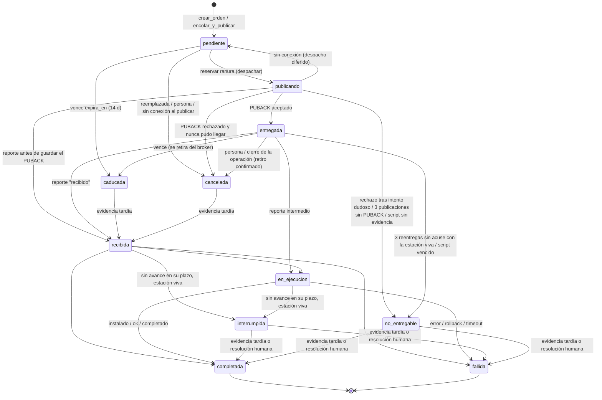

(Simplificado: desde `interrumpida`, `no_entregable`, `caducada` y `cancelada` también se puede pasar a `en_ejecucion`, `completada` o `fallida` por evidencia; ver `ordenes.py::TRANSICIONES`.)

#### 12.5 Publicación, confirmaciones y reintentos

1. **Publicación pedida por una persona** (`encolar_y_publicar`): por estación, si la última orden del mismo origen está **en curso** se omite; si está **incierta** (`interrumpida`, `no_entregable`) también se omite hasta que alguien la resuelva; si está `pendiente` se reemplaza. Se insertan todas de una vez (ranura libre → `publicando`), se publican en **una conexión MQTT 5** y se aplica el resultado por mensaje: `aceptado` → `entregada` y el dominio registra «publicado»; `rechazado` → `cancelada` (o `no_entregable` si un intento anterior pudo llegar); `incierto` → sigue `publicando`. Si no se pudo conectar o el broker rechazó **todo**, las órdenes quedan `cancelada` y la operación falla (contrato de siempre).
2. **Pasada periódica** `procesar_ordenes_task` (Celery Beat, **cada 60 s**; un solo proceso a la vez por *advisory lock* `0x53414901`; hasta 1000 filas por fase), en este orden:
   - `caducar`: pendientes vencidas → `caducada`; las que pueden estar en el broker se retiran primero (si el retiro no se confirma, se reintenta en la próxima pasada).
   - `revisar_publicando`: `publicando` hace más de **2 min**. Software/despliegue: se **republica el mismo payload firmado** (el agente lo deduplica) hasta **3** entregas; luego `no_entregable` y retiro. Scripts: nunca se republican; vencido su plazo → `no_entregable`.
   - `revisar_entregadas`: `entregada` sin acuse cuando la estación **latió más de 5 min después** de la entrega → se reentrega el mismo payload; a la tercera, `no_entregable` y retiro.
   - `detectar_interrumpidas`: `recibida`/`en_ejecucion` sin avance durante `plazo_sin_avance_s` con la estación viva (latido <10 min; para scripts no hace falta) → `interrumpida`. **Nunca se reintenta solo.**
   - `despachar`: por cada ranura libre, la pendiente más vieja.
3. **Liberación inmediata de ranura:** cuando un reporte saca una orden de `entregada`, el worker encola `despachar_ordenes_task` para esa estación.
4. **Retiro del retenido tras el acuse:** con `recibido` (o un final), el worker encola `retirar_retenido_despliegue_task` / `retirar_retenido_instalacion_task`, que borran el retenido solo si la estación no tiene otros resultados pendientes.

#### 12.6 Plazos (`ordenes.py`)

| Constante | Valor | Uso |
|---|---|---|
| `VIGENCIA` | 14 días | Software y despliegue sin recibir |
| `PLAZO_SIN_AVANCE` | 6 h | Software y despliegue "inmediato" |
| `PLAZO_SIN_AVANCE_CIERRE_POS` | 72 h | Despliegue que espera el cierre del POS |
| Modo ventana | No se evalúa interrupción antes de la ventana; vence `max(14 d, ventana + 2 d)` | `plazos_de` |
| `MARGEN_SCRIPT` | `timeout_segundos` (300 por defecto) + 10 min | Scripts |
| `ESPERA_CONFIRMACION` | 2 min | `publicando` sin resultado |
| `ESPERA_REENTREGA` | 5 min | Latido posterior a la entrega sin acuse |
| `ESTACION_VIVA` | 10 min | Para inferir interrupción |
| `MAX_ENTREGAS` | 3 | Publicaciones del mismo payload |

#### 12.7 Resultado incierto, resolución humana y cancelación

- Se marca `requiere_revision` en `interrumpida`, `no_entregable`, en scripts publicados sin confirmación y en reportes **ambiguos** (sin `orden_uid` y con una orden anterior del mismo origen cerrada por el servidor que pudo llegar: el reporte **no se aplica**).
- `resolver_orden` (admin, permiso `resolver_ordenagente`, **nota obligatoria**): `completada`, `fallida` o `desconocido` (no inventa resultado; sigue bloqueando reintentos). Si la orden aún puede estar retenida, primero la retira del broker; si no puede, no resuelve.
- `cancelar_orden`: solo antes de `recibida`; para `entregada` exige retirar el retenido con confirmación. Un script ya enviado no se puede retirar.
- `retirar_del_origen` (cierre de una operación): cancela pendientes y entregadas retiradas; informa cuántas no se pudieron garantizar y cuántas ya estaban en ejecución.

#### 12.8 Interacciones a tener en cuenta [CÓDIGO]

- El agente **marca la orden como procesada antes de ejecutarla** (`_marcar_procesado`). Si el servicio muere a mitad de un despliegue, el agente no la retoma y descarta las reentregas del mismo payload: la orden termina `interrumpida` y requiere revisión humana. Es conservador a propósito (evita reinstalar el POS dos veces).
- **La cola no consulta el estado del dominio**: pausar un despliegue (a mano o por el freno automático) **no impide** que `despachar` publique las órdenes `pendiente` de ese despliegue ni que `revisar_entregadas` reentregue las `entregada`. Ver [03-despliegues-pos.md](#s9) (H-DP-02).
- Una orden `caducada` **no avisa al dominio**: el `ResultadoDespliegue` queda `pendiente` y el despliegue no se completa solo (hay que cerrarlo).
- Un script recibido por una estación **pausada** se ignora sin reporte; la orden terminará `no_entregable` ("no se sabe si se ejecutó"), aunque en realidad no se ejecutó.

---

### 13. Contradicciones entre fuentes

| Tema | A | B |
|---|---|---|
| `reiniciar` | `agente-prueba/README.md`: "no implementado" | Código: implementado (`_verificar_y_reiniciar`) |
| QoS de los reportes | `PROPUESTA_AGENTE_HTTPS.md` §1 (0.36): QoS 0 | 0.38: QoS 1 para resultados |
| Intervalo de latido | `apps/monitoreo/umbrales.py`: "~30 s", "10 min = 20 latidos" | 60 s (`CAMPOS_CONFIG`, `instalar-servicio.ps1`) |
| Pausa | `Estacion.pausado` (help_text) y log: "deja de ejecutar comandos" | No bloquea software ni despliegues |
| Versión del agente en el piloto | `CHECKLIST_PILOTO_COLA.md`: agente 0.36 | La correlación por `orden_uid` y QoS 1 requieren 0.38 |

### 14. Preguntas abiertas

- **P0** ¿Se va a corregir H-AG-01 (pausa) antes de autorizar la primera campaña a farmacias? Sin eso, el freno de emergencia no frena despliegues.
- **P1** ¿Cuántas de las 12 estaciones mudas en 0.29–0.35 están en el caso de `identidad.json` en ceros, y cuántas simplemente apagadas o con credencial rechazada?
- **P1** ¿Cuál es el resultado del piloto de la cola (§9 del checklist) y con qué versión de agente se hizo?
- **P2** ¿Hay estaciones con Windows 10 anterior a 1803 o sin UCRT?
- **P3** ¿Se quiere poder cambiar `monitorear_recursos` e intervalos sin tocar el equipo?

### 15. Verificación en el NUC (solo lectura)

```sh
cd ~/Documentos/Said/saidsoft-core/deploy
# Versiones de agente en la flota y estaciones sin latido
docker compose --env-file .env exec -T web python manage.py shell -c "from collections import Counter; from apps.catalogo.models import Estacion as E; print(Counter(E.objects.filter(estado_aprobacion='aprobada').values_list('version_agente', flat=True)))"
# Órdenes por estado y las que piden revisión
docker compose --env-file .env exec -T web python manage.py shell -c "from collections import Counter; from apps.catalogo.models import OrdenAgente as O; print(Counter(O.objects.values_list('estado', flat=True))); print([(o.estacion.codigo, o.tipo, o.origen_id, o.estado, o.motivo_revision) for o in O.objects.filter(requiere_revision=True)])"
# Pasadas de la cola
docker compose --env-file .env logs --since 30m celery_worker | grep procesar_ordenes_task | tail -5
# Estaciones con monitorear_recursos y cuántas reportan métricas
docker compose --env-file .env exec -T web python manage.py shell -c "from apps.catalogo.models import Estacion as E; print(E.objects.filter(monitorear_recursos=True).values_list('codigo', flat=True)[:50])"
```

En una estación (MeshCentral, solo lectura): `sc qc SaidsoftAgente`, `sc qfailure SaidsoftAgente`, `icacls C:\ProgramData\Saidsoft\identidad.json`, `dir C:\ProgramData\Saidsoft\agente_prueba.log` (tamaño del log).

---

<a id="s9"></a>

## 9. Despliegues del POS (`Zabyca.Pos.Desktop.exe`)

| Campo | Valor |
|---|---|
| **Fecha** | 26-oct-2026 |
| **Código revisado** | `HEAD 1fa16d6`; agente 0.38 |
| **Alcance** | Distribución y actualización del POS a las estaciones: módulos, flujo, aprobación, transporte, ejecución en la caja, confirmación, resultados, reintentos, rollback, freno, seguridad, auditoría y estados. Software genérico y scripts solo donde comparten mecanismo. |
| **Evidencias** | `apps/despliegues/{models,services,tasks,admin}.py`; `apps/panel/views/despliegues.py`, `apps/panel/forms.py::DespliegueForm`, `apps/panel/seguimiento.py`; `apps/catalogo/{ordenes,services,models}.py`; `apps/mqtt_worker/services.py::manejar_estado_despliegue`; `apps/aperturas/services.py::_ejecutar_paso_despliegue`; `agente-prueba/agente_prueba.py` (`_manejar_despliegue` a `_reportar_despliegue`); `config/settings/base.py`; `deploy/nginx/*.conf`; `docs/consolidacion/CHECKLIST_PILOTO_COLA.md`. |
| **Supuestos** | La flota corre el agente de este repositorio en su versión respectiva; el POS es el mismo en las tres unidades de negocio (`instalar-servicio.ps1`). |
| **Limitaciones** | Sin acceso a producción ni a una caja con el POS real. No se ejecutó ningún despliegue ni prueba. |
| **Hallazgos pendientes** | Comportamiento del POS relanzado por el servicio (sesión 0); despliegue real contra el POS (paso 6.3 del checklist, opcional); quién tiene acceso al admin de despliegues. |
| **Estado de validación** | **Parcial.** [CÓDIGO] leído con ruta y símbolo; [PROD] reportado por el equipo; [HIPÓTESIS] sin comprobar. |

Relacionados: [MQTT y EMQX](#s7), [agente Windows y cola de órdenes](#s8), [auditoría técnica](#s14).

> **Contexto operativo [PROD].** El usuario **prohibió autorizar campañas a muchas farmacias** por ahora. La cola de órdenes (`8c42efc` + `3a93a86`) está **en piloto con una sola PC de prueba que no atiende público** (`CHECKLIST_PILOTO_COLA.md`, "Alcance autorizado"). El despliegue del POS en ese piloto es **opcional** (paso 6.3) y puede quedar "NO PROBADO".

> **"Publicada" ≠ "actualización completada".** «Publicado» (evento `publicado`, orden `entregada`) significa solo que **EMQX aceptó el mensaje**. La estación puede estar apagada, ignorarlo o fallar. El único "listo" es `ResultadoDespliegue.estado = aplicado` (paso `ok` del agente), y aun eso significa "el proceso del POS sigue vivo 15 s después de relanzarlo", no "el POS funciona con la versión nueva".

---

### 1. Módulos implicados

| Módulo | Papel |
|---|---|
| `apps/despliegues` | `Despliegue` (paquete `.zip`, versión, destino, modo, umbral de freno, aprobación), `ResultadoDespliegue` (uno por estación), `EventoDespliegue` (línea de tiempo inmutable); publicación, freno, cierre, reintento |
| `apps/catalogo` | `Estacion`, `resolver_estaciones`, firma HMAC (`firmar_payload`, `secreto_de`), transporte MQTT 5 (`publicar_lote`), **cola `OrdenAgente`** (`ordenes.py`) |
| `apps/mqtt_worker` | Ingesta de reportes `despliegue_estado/` → dominio + cola; actualiza `Estacion.version_pos` con `ok` |
| `apps/panel` | Vistas crear/aprobar/publicar/pausar/reanudar/cerrar/reintentar/promover; seguimiento en vivo |
| `apps/aperturas` | Publica un despliegue existente a una estación recién enrolada (`publicar_despliegue_a_estacion`) |
| `apps/software`, `apps/scripts` | Mismo patrón (cola, retenido por estación) para instaladores y scripts; no despliegan el POS |
| Agente | Descarga, verifica, aplica, relanza, hace rollback y reporta pasos |

### 2. Flujo de una orden

| # | Paso | Detalle | Evidencia |
|---|---|---|---|
| 1 | Crear | Panel (`despliegues.add_despliegue`): sube `.zip`, versión, modo (`inmediato`/`ventana`/`cierre_pos`), destino (cadena/grupos/farmacias/estaciones), `umbral_error_pct` (por defecto 10 %). Queda **`pendiente_aprobacion`**. `sha256` se calcula al guardar | `panel/views/despliegues.py::despliegue_crear`; `Despliegue.save` |
| 2 | Aprobar | Otra persona con `despliegues.aprobar_despliegue`; el servicio rechaza si `creado_por == usuario` (cuatro ojos) | `despliegue_aprobar`; `services.py::aprobar_despliegue` |
| 3 | Publicar | `despliegues.change_despliegue`, estado `aprobado`. Resuelve estaciones **aprobadas** de la unidad de negocio; crea `ResultadoDespliegue(pendiente)`; arma **un payload firmado por estación**; `ordenes.encolar_y_publicar` → MQTT 5, QoS 1, **retenido** en `/saidsof/agente/<c>/despliegue/` | `publicar_despliegue`, `_payload`, `_topico_de` |
| 4 | Confirmación del broker | PUBACK aceptado → orden `entregada` + evento `publicado`; despliegue → `publicando` | `ordenes.aplicar_resultados`; `orden_aceptada_por_el_broker` |
| 5 | Recepción | Agente valida HMAC, deduplica `(despliegue_id, timestamp)`, reporta `recibido` (QoS 1). Worker: resultado `descargando`, orden `recibida`, encola retiro del retenido | `_manejar_despliegue`; `manejar_estado_despliegue` |
| 6 | Ejecución | `descargado` → `hash_verificado` → (espera ventana o cierre del POS) → `pos_cerrado` → `aplicado` → `pos_relanzado` → `ok` / `rollback` / `error` | `_procesar_despliegue`, `_aplicar_despliegue` |
| 7 | Resultado | `ok`: resultado `aplicado`, `Estacion.version_pos = version_nueva`; cada reporte evalúa freno y completado | `registrar_estado_de_estacion`; worker |
| 8 | Cierre | `completado` cuando ningún resultado sigue fuera de `aplicado`/`error`/`rollback`; o cierre manual `cerrado` | `verificar_completado`, `cerrar_despliegue` |
| 9 | Anillos | Un despliegue `completado` se puede "promover" a un destino más amplio: nuevo despliegue, mismo paquete, **vuelve a pedir aprobación** | `despliegue_promover` |

### 3. Identificación de estaciones

`catalogo/services.py::resolver_estaciones`: siempre `estado_aprobacion = aprobada` y `farmacia__unidad_negocio = <la del despliegue>`; luego filtra por grupos, farmacias o estaciones. **No excluye estaciones pausadas, apagadas ni con agente viejo** [CÓDIGO]. Tópico por estación (`Estacion.codigo`) desde el *fan-out*; los tópicos de grupo/cadena quedaron obsoletos.

### 4. Archivo: validación, transferencia y ejecución

| Tema | Hecho [CÓDIGO] |
|---|---|
| Validación al subir | Solo campos del `ModelForm`; **no se vio validación de que sea un `.zip` válido ni de su contenido** (Pendiente de verificar `clean`) |
| Hash | SHA-256 calculado por el servidor al guardar; viaja **firmado** en el payload; el agente compara sin distinguir mayúsculas |
| Firma del payload | HMAC-SHA256 sobre `desplegar|despliegue_id|version|url|sha256|modo_aplicacion|ventana_fecha_hora|timestamp`, con el secreto propio de la estación (o el compartido si no confirmó el propio). `usar_cache` y `orden_uid` van **sin firmar** |
| Firma del paquete | **No hay** firma de código del `.zip` ni del POS |
| Descarga | `url = ARCHIVOS_BASE_URL + /media/despliegues/<versión>/<archivo>`, por **HTTP sin autenticación** (nginx `:8080/media/`, a propósito); 6 intentos con reanudación por `Range`, timeout de lectura 60 s; primero el caché de la farmacia si `DESPLIEGUE_USAR_CACHE` (no hay estaciones caché reales) |
| Modos | `inmediato`: aplica ya. `ventana`: duerme hasta `ventana_fecha_hora` en un hilo. `cierre_pos`: espera a que el proceso no esté (cada 10 s) |
| Aplicación | `taskkill /IM Zabyca.Pos.Desktop.exe /F` (**corta una venta en curso** en modo inmediato/ventana), respaldo **completo** de la carpeta del POS a `%TEMP%`, extracción del zip sobre la carpeta (saltea una carpeta raíz única), relanzamiento, espera `espera_liveness_segundos` (15) y comprueba que el proceso exista |
| Permisos | El agente corre como **LocalSystem**: escribe en `Program Files (x86)` y mata/lanza el POS |
| Riesgo de sesión | El POS se relanza con `subprocess.Popen` **desde un servicio**: [HIPÓTESIS] queda en la sesión 0, invisible para el cajero, y aun así cuenta como `ok`. Sin probar con el POS real |
| Zip-slip | La rama que quita la carpeta raíz arma rutas con `os.path.join(destino, nombre)` sin sanear `..` [CÓDIGO]; mitigado porque el paquete viene firmado por SHA-256 |

### 5. Rollback

`_rollback`: detiene el POS, **copia el respaldo encima** (`copytree(..., dirs_exist_ok=True)`), intenta relanzar y reporta `rollback`. Se dispara si el POS no queda corriendo tras 15 s o si hay una excepción al aplicar. Limitaciones [CÓDIGO]: **no borra archivos nuevos** que agregó el paquete; si falla el relanzamiento igual reporta `rollback`; no hay rollback a una versión anterior desde el panel (habría que publicar el paquete viejo como despliegue nuevo).

### 6. Aprobación, freno y canario

| Control | Hecho [CÓDIGO] | Debilidad |
|---|---|---|
| Cuatro ojos | `aprobar_despliegue` exige `pendiente_aprobacion` y otra persona; permiso `aprobar_despliegue` en la vista | **H-DP-01:** la acción del admin `aprobar_despliegues` no exige el permiso `aprobar_despliegue` (Django admin: solo acceso al listado). El admin además permite **editar destino, archivo, versión y umbral después de aprobar** (`readonly_fields` no los incluye) |
| Aperturas | `_ejecutar_paso_despliegue` solo rechaza `borrador` | **H-DP-03:** publica despliegues `pendiente_aprobacion`, `pausado` o `cerrado` a estaciones nuevas (C-5 de la auditoría histórica, vigente) |
| Freno automático | `evaluar_freno_automatico` en cada reporte: si `% error ≥ umbral` y `publicando` → `pausado`. % = `error` / resultados fuera de `pendiente` | Primer error con un solo reporte = 100 % → frena; **`rollback` no cuenta como error**; tras "Reanudar" `freno_omitido=True` y no vuelve a frenar; el umbral lo elige quien crea |
| Pausa del despliegue | Solo cambia el estado | **H-DP-02:** no retira retenidos, la cola sigue despachando `pendiente` y reentregando `entregada` (`ordenes.py` no consulta el estado del dominio), y el agente pausado igual aplica despliegues (H-AG-01) |
| Canario | No existe para el POS: se hace a mano con anillos (despliegue a pocas estaciones y "promover"). Sí existe para el agente (3 / tanda 15) | — |
| Cancelar | `Despliegue.Estado.CANCELADO` **nunca se asigna** en código; el equivalente es `cerrar_despliegue` (retira lo no recibido; falla si no puede retirar algo) | — |

### 7. Estados reales

**`Despliegue.estado`:** `borrador` (por defecto del modelo; el panel no lo usa), `pendiente_aprobacion`, `aprobado`, `publicando`, `pausado`, `completado`, `cancelado` (sin uso), `cerrado` (cerrado sin terminar).

**`ResultadoDespliegue.estado`** (por estación) y su paso de origen (`_PASO_A_ESTADO`):

| Estado | Lo pone | Significado |
|---|---|---|
| `pendiente` | Creación / reintento | Sin reporte del agente (puede estar publicada o no) |
| `publicado` | **Nunca** (definido, no asignado) | — |
| `descargando` | paso `recibido` | El agente aceptó la orden |
| `descargado` | `descargado` | Archivo bajado |
| `verificado` | `hash_verificado` | SHA-256 correcto |
| `aplicando` | `pos_cerrado`, `aplicado`, `pos_relanzado` | En la caja |
| `aplicado` | `ok` | POS vivo 15 s después |
| `error` | `error` (incluye rechazo del broker y firma inválida) | Falló |
| `rollback` | `rollback` | Volvió atrás (no cuenta para el freno) |

**`EventoDespliegue.paso`:** `publicado` (lo escribe el servidor al recibir el PUBACK), `recibido`, `descargado`, `hash_verificado`, `pos_cerrado`, `aplicado`, `pos_relanzado`, `ok`, `error`, `rollback`.

**`OrdenAgente.estado`:** ver [04-agente-windows.md §12.3](#s8).

#### 7.1 Mapeo a estados canónicos

| Canónico | `OrdenAgente` | `ResultadoDespliegue` / evento | ¿Existe? |
|---|---|---|---|
| creada | `pendiente` | `pendiente` | Sí |
| en cola | `pendiente` (ranura ocupada) | `pendiente` | Sí (solo en la orden) |
| publicada | `entregada` (y `publicando` = en vuelo/incierta) | `pendiente` + evento `publicado` | Sí en orden/evento; **no en el resultado** → mejora: usar `publicado` |
| recibida | `recibida` | `descargando` (nombre engañoso) | Sí → mejora: estado `recibido` propio |
| ejecutada | `en_ejecucion` | `descargado`/`verificado`/`aplicando` | Sí |
| confirmada | `completada` | `aplicado` | Sí, con semántica débil (proceso vivo 15 s) → mejora: confirmar versión real en el siguiente latido (`version_pos` leída del `.exe`) |
| incierta | `interrumpida`, `no_entregable`, `requiere_revision` | **No existe**: queda en el último estado | Mejora propuesta |
| error | `fallida` | `error`, `rollback` | Sí |
| expirada | `caducada` (14 días) | **No existe**: queda `pendiente` y el despliegue no se completa solo | Mejora propuesta |

### 8. Confirmaciones, reintentos y errores

| Tema | Hecho [CÓDIGO] |
|---|---|
| Confirmación de publicación | PUBACK MQTT 5: `aceptado` / `rechazado` / `incierto`. El panel muestra verde solo si todo fue aceptado; si no, amarillo con conteos (`ResultadoPublicacion.resumen`) |
| Confirmación de recepción | Paso `recibido` (QoS 1 desde 0.38) → retiro del retenido por Celery |
| Confirmación de ejecución | Paso `ok` con `version_nueva` = **la versión declarada en el despliegue**, no la leída del ejecutable |
| Reintento automático | La cola republica el **mismo** payload (≤3) si no hubo PUBACK o si la estación latió sin acusar; nunca reaplica algo ya recibido |
| Reintento manual | "Reanudar" (pausado) y "Reintentar pendientes" (cerrado) → `reintentar_despliegue`: a estaciones no `aplicado`, **con timestamp nuevo** (el agente lo ejecuta de nuevo); omite órdenes en curso o inciertas |
| Incierto | Resolución humana en el admin (`resolver_orden`, permiso `catalogo.resolver_ordenagente`, nota obligatoria) |
| Errores típicos | Firma inválida (reloj/secreto), POS no configurado en el agente, descarga, hash, POS que no levanta → rollback |
| Pérdidas | Reportes perdidos si el worker está caído ([03 §3.9](#s7), P-5); duplicados QoS 1 generan eventos repetidos; un reporte fuera de orden puede hacer retroceder `ResultadoDespliegue` (la orden está protegida) |

### 9. Seguridad y auditoría

- **Seguridad:** firma HMAC por estación + SHA-256; TLS en MQTT; descarga por HTTP sin cifrar (integridad sí, confidencialidad no); sin firma de código; agente como LocalSystem; el despliegue lo ve y publica cualquier usuario con `change_despliegue` en su unidad de negocio (`verificar_acceso`).
- **Auditoría:** `registrar_evento` con usuario e IP para `despliegue.crear`, `aprobar`, `publicar` (con conteos), `pausar`, `reanudar`, `promover`; el admin registra sin IP. El freno automático **no** deja evento de auditoría (solo log). `EventoDespliegue` es inmutable (`delete` lanza). `OrdenAgente.historial` guarda las transiciones (últimas 50). `ResultadoDespliegue.estacion` es `PROTECT`.

### 10. Diagrama de secuencia

```mermaid
sequenceDiagram
    autonumber
    actor Op1 as Operador (crea)
    actor Op2 as Aprobador
    participant P as Panel (web)
    participant DB as PostgreSQL
    participant Q as Cola OrdenAgente / Celery
    participant E as EMQX
    participant A as Agente (caja)
    participant W as worker MQTT

    Op1->>P: crear despliegue (.zip, destino, modo)
    P->>DB: Despliegue pendiente_aprobacion (+sha256)
    Op2->>P: aprobar (otra persona, permiso)
    P->>DB: aprobado
    Op1->>P: publicar
    P->>DB: ResultadoDespliegue pendiente x N; OrdenAgente publicando
    P->>E: PUBLISH QoS1 retain /agente/<c>/despliegue/ (firmado)
    E-->>P: PUBACK
    P->>DB: orden entregada + evento "publicado" (≠ aplicado)
    E->>A: entrega (ahora o al reconectar)
    A->>A: HMAC, dedup (id, timestamp)
    A->>E: recibido (QoS1)
    E->>W: recibido
    W->>DB: resultado descargando; orden recibida
    W->>Q: retirar retenido
    Q->>E: retain vacío
    A->>A: descargar HTTP /media, verificar SHA-256, esperar modo
    A->>A: taskkill POS, respaldo, extraer, relanzar, esperar 15 s
    A->>E: ok | rollback | error
    E->>W: paso final
    W->>DB: resultado aplicado|rollback|error; orden completada|fallida; freno; completado
    loop cada 60 s
        Q->>DB: caducar, republicar sin PUBACK, reentregar sin acuse, interrumpidas, despachar
    end
```

### 11. Hallazgos priorizados

| ID | Hallazgo | Prioridad |
|---|---|---|
| H-AG-01 | Agente pausado igual aplica despliegues | P0 antes de campañas |
| H-DP-02 | Pausar/frenar un despliegue no detiene la cola ni retira retenidos | P0 antes de campañas |
| H-DP-01 | Admin: aprobar sin permiso específico y editar después de aprobar | P1 |
| H-DP-03 | Aperturas publican despliegues no aprobados o pausados | P1 |
| H-DP-04 | `ok` = proceso vivo 15 s; posible sesión 0; `taskkill /F` en venta | P1 (validar con POS real) |
| H-DP-05 | Freno: `rollback` no cuenta, se desactiva para siempre al reanudar, sin auditoría | P2 |
| H-DP-06 | Rollback no borra archivos nuevos; zip-slip en la rama sin carpeta raíz | P2 |
| H-DP-07 | Estados `incierta`/`expirada` sin reflejo en `ResultadoDespliegue`; `publicado` y `cancelado` sin uso | P2 |

### 12. Preguntas y verificación (solo lectura, NUC)

- **P0** ¿Se corrigen H-AG-01 y H-DP-02 antes de pedir la autorización de una campaña a pocas farmacias?
- **P1** ¿Quién tiene acceso al admin de despliegues y con qué permisos?
- **P1** ¿Se probó alguna vez un despliegue real con el POS en una caja (versión visible, POS en la sesión del cajero)?

```sh
docker compose --env-file .env exec -T web python manage.py shell -c "from collections import Counter; from apps.despliegues.models import Despliegue as D, ResultadoDespliegue as R; print(Counter(D.objects.values_list('estado', flat=True))); print(Counter(R.objects.values_list('estado', flat=True)))"
docker compose --env-file .env exec -T web python manage.py shell -c "from django.contrib.auth.models import Permission as P; p=P.objects.get(codename='aprobar_despliegue'); print(list(p.user_set.values_list('username', flat=True)), list(p.group_set.values_list('name', flat=True)))"
```

---

<a id="s10"></a>

## 10. API y endpoints

| Campo | Valor |
|---|---|
| **Fecha de generación** | 26-oct-2026 |
| **Commit analizado** | `1fa16d6` |
| **Alcance** | Todas las rutas HTTP (`config/urls.py`, `apps/panel/urls.py`, `apps/catalogo/api_urls.py`, `apps/mantenimiento/api_urls.py`, `apps/monitoreo/api_urls.py`, webhook de WhatsApp) y el canal MQTT del agente Windows (enrolamiento, latido, métricas, eventos, órdenes, despliegues), más la descarga del instalador. |
| **Evidencias** | Archivos de URLs y vistas citados en cada tabla; `apps/cuentas/{api_auth,autenticacion_api,api_permissions}.py`; `apps/*/serializers.py`; `apps/mqtt_worker/services.py`, `management/commands/run_mqtt_worker.py`, `emqx_admin.py`; `apps/catalogo/{services,ordenes,instalador}.py`; `agente-prueba/agente_prueba.py` (`agente-prueba-0.38`); pruebas `tests*.py`; `docs/consolidacion/PROPUESTA_AGENTE_HTTPS.md`. Decoradores del panel extraídos por AST de `apps/panel/views/*.py`. |
| **Supuestos** | Producción detrás de nginx con HTTPS (panel en `:8084` [PROD, reportado 24-oct-2026]); `config.settings.produccion`. |
| **Limitaciones** | Sin ejecutar servidor ni pruebas. Los ejemplos de *request/response* se armaron leyendo serializers y vistas, no capturando tráfico. No hay OpenAPI/Swagger en el proyecto. |
| **Pendientes** | Throttling (no hay `DEFAULT_THROTTLE_*`); comportamiento de nginx por ruta (ver [infraestructura](#s11)). |
| **Estado de validación** | Validado contra código. No validado contra producción. |

Relacionados: [04 — Modelo de datos](#s4), [MQTT y EMQX](#s7), [Agente Windows](#s8), [Seguridad](#s14), [Pruebas](#s15).

---

### 1. Mapa de superficies

| Prefijo | Origen | Autenticación | Consumidor |
|---|---|---|---|
| `/admin/` | `django.contrib.admin`; `admin.site.login` reemplazado por `login_admin_por_panel` (MFA) | Sesión + MFA | Administradores |
| `/api/v1/auth/token/` | `apps.cuentas.api_auth.ObtenerTokenConMFA` | Usuario + contraseña + TOTP | App móvil, integraciones |
| `/api/v1/rmm/` | `apps/catalogo/api_urls.py` | Token DRF con vencimiento | Sistemas externos (solo lectura) |
| `/api/v1/` | `apps/mantenimiento/api_urls.py` (router DRF) | Token DRF con vencimiento | App Flutter `movil-campo` |
| `/api/v1/monitoreo/` | `apps/monitoreo/api_urls.py` | Token + permiso `monitoreo.registrar_sondeo_enlace` | Sonda externa de enlaces |
| `/whatsapp/webhook/` | `apps.whatsapp.views.webhook` | Firma `X-Hub-Signature-256` (HMAC del cuerpo) | Meta |
| `/instalador/<token>/` | `apps.panel.views.instalador.instalador_descargar` | Token de un solo uso (sin sesión) | `curl.exe` en la estación |
| `/media/...` | `config.urls.servir_media_publico` | **Ninguna** salvo `mantenimiento/` (404) | Agentes (paquetes, instaladores, `.exe`) |
| `/` (resto) | `apps/panel/urls.py` (~170 rutas HTML/HTMX) | Sesión + `permission_required` | Mesa de ayuda / coordinación |
| MQTT `/saidsof/...` | `run_mqtt_worker` + publicadores en `apps/*/services.py` | Credencial EMQX + `token` en el payload (agente→servidor); HMAC-SHA256 (servidor→agente) | Agente Windows |

**No existe API HTTP para el agente.** `/api/agente/v1/` aparece solo como **[PROPUESTA]** en `docs/consolidacion/PROPUESTA_AGENTE_HTTPS.md` §4.

#### 1.1 Configuración DRF común (hecho)

- `DEFAULT_AUTHENTICATION_CLASSES = ['apps.cuentas.autenticacion_api.TokenConVencimiento']`: `TokenAuthentication` que devuelve 401 si `now - token.created > API_TOKEN_DIAS` (30 por defecto). Cabecera: `Authorization: Token <clave>`.
- `DEFAULT_PERMISSION_CLASSES = ['IsAuthenticated']`. Las vistas importantes usan `PermisoDeclarado` (`apps/cuentas/api_permissions.py`): exige los codenames declarados en `permisos_por_accion` / `permisos_por_metodo`; **lo no declarado se deniega** (fail-closed).
- Sin throttling, sin versionado de contrato más allá del prefijo `v1`, sin esquema OpenAPI. `docs/modulos.md` lo reconoce: «no hay versionado de API ni contrato compartido».
- Bloqueo por intentos: `django-axes` (`AXES_FAILURE_LIMIT=5`, 1 h, por `username`) también cuenta los fallos de `/api/v1/auth/token/` (comentario en `TokenConMFASerializer.validate`).

---

### 2. Autenticación de la API

#### `POST /api/v1/auth/token/`

| Aspecto | Detalle |
|---|---|
| Vista | `apps/cuentas/api_auth.py:ObtenerTokenConMFA` (hereda `ObtainAuthToken`) |
| Cuerpo | `username`, `password`, `otp_token` (opcional; obligatorio si la cuenta tiene dispositivo TOTP) |
| Respuesta 200 | `{"token": "<40 hex>"}` — crea el token si no existe; si venció, lo borra y crea otro |
| 400 | Credenciales inválidas; `otp_invalido`; `mfa_requerido` (con `MFA_OBLIGATORIO` y cuenta sin MFA) |
| Modelos | `authtoken_token` |
| Pruebas | `apps/cuentas/tests_api_token.py` (`PedirTokenTests`, `VencimientoTests`), `apps/cuentas/tests_mfa.py` |

Cuentas de servicio: el token se crea en Admin → Tokens y vence igual (docstring del módulo).

---

### 3. API RMM de integración (`/api/v1/rmm/`, solo lectura)

Paginación `PaginacionRmm`: `page_size=200`, `?por_pagina=` hasta 500, `?page=`. Filtros con valor inválido → 400 (`validar_opcion`). Objeto fuera del alcance de la unidad de negocio → **404** (no 403).

| Método y ruta | Vista | Permiso | Filtros | Respuesta (campos) |
|---|---|---|---|---|
| `GET /api/v1/rmm/estaciones/` | `catalogo/api_views.py:EstacionesRmmView` | `catalogo.view_estacion` | `farmacia`, `unidad_negocio`, `numero_serie`, `hostname` (exactos, sin mayúsculas), `estado_conexion` | `codigo, farmacia, unidad_negocio, hostname, numero_serie, so_nombre, so_build, version_agente, version_pos, procesador, ram_total_mb, almacenamiento_total_gb, info_equipo_fecha, bitlocker_habilitado, ip_lan, mac_lan, estado_conexion, ultimo_heartbeat, estado_aprobacion, fecha_creacion` |
| `GET /api/v1/rmm/estaciones/<codigo>/` | `EstacionRmmDetalleView` | `catalogo.view_estacion` | — | lo anterior + `perifericos[] {nombre,fabricante,clase}`, `software[] {nombre,version,fabricante}` y sus fechas de verificación |
| `GET /api/v1/rmm/farmacias/` | `FarmaciasRmmView` | `catalogo.view_farmacia` | `unidad_negocio`, `activa` (`true`/`false`) | `codigo, nombre, unidad_negocio, grupo, activa, ciudad, provincia, direccion, tipo_sucursal, latitud, longitud` |
| `GET /api/v1/rmm/alertas/` | `monitoreo/api_rmm.py:AlertasRmmView` | `monitoreo.view_alerta` | `desde_id` (entero, si no → 400), `estado`, `estacion`, `farmacia` | `id, estacion, farmacia, unidad_negocio, regla, metrica, severidad, abre_mantenimiento, estado, valor_disparador, abierta_en, reconocida_en, resuelta_en` (orden por `id`) |

Los serializers listan campos uno por uno a propósito: nunca exponen `token_enrolamiento`, `hmac_secret`, `meshcentral_node_id` ni la conexión al POS (`apps/catalogo/serializers.py`, docstring). Pruebas: `apps/catalogo/tests_api_rmm.py` (`EstacionesTests`, `AccesoTests`, `FarmaciasTests`, `AlertasTests`), `apps/panel/tests_alcance_rmm.py`.

Ejemplo (construido del código):

```http
GET /api/v1/rmm/alertas/?desde_id=1200&estado=abierta
Authorization: Token <clave>

200 OK
{"count": 1, "next": null, "previous": null,
 "results": [{"id": 1201, "estacion": "ML001-A", "farmacia": "ML001", "unidad_negocio": "<código>",
   "regla": "<nombre>", "metrica": "<métrica>", "severidad": "critical", "abre_mantenimiento": false,
   "estado": "abierta", "valor_disparador": 95.0, "abierta_en": "2026-10-26T10:00:00-05:00",
   "reconocida_en": null, "resuelta_en": null}]}
```

---

### 4. API de sondeo de enlaces (`/api/v1/monitoreo/`)

| Método y ruta | Vista | Permiso | Cuerpo / respuesta | Códigos |
|---|---|---|---|---|
| `GET /api/v1/monitoreo/enlaces/farmacias/` | `monitoreo/api_views.py:FarmaciasASondearView` | `IsAuthenticated` + chequeo manual `monitoreo.registrar_sondeo_enlace` | → `{"farmacias": [{"codigo", "ip"}]}` (activas con `ip_router`, del alcance del usuario) | 200, 401, 403 |
| `POST /api/v1/monitoreo/enlaces/sondeo/` | `SondeoEnlaceIngestaView` | ídem | ← `{"resultados": [{"farmacia": "ML001", "alcanzable": true, "latencia_ms": 23.5}]}` (1–2.000 ítems, sin farmacias repetidas) → `{"abortado": false, "registrados", "activas", "caidas", "desconocidas": [], "de_baja": []}` | 200; 400 (validación, o ninguna farmacia conocida/activa); 403; **409** si ≥ 80 % sin responder (`UMBRAL_BARRIDO_SOSPECHOSO_PCT`) → no escribe nada |

Modelos afectados: `estado_enlace_farmacia`, `evento_enlace_farmacia`, `muestra_enlace_farmacia` (vía `apps/monitoreo/enlaces.py:registrar_sondeo`). Pruebas: `apps/monitoreo/tests.py:SondeoEnlaceAPITests`. Riesgos: `max_length=2000` = objetivo de farmacias; validación O(n²); escritura farmacia por farmacia dentro de la petición (ver [04](#s4) §7.3 C7).

---

### 5. API móvil (`/api/v1/`, app Flutter)

Todas las acciones delegan en `apps.mantenimiento.services` (la misma lógica que el panel) y auditan en `evento_auditoria` con `detalle={'origen': 'app_movil'}` (`_auditar`). Las acciones que pueden venir de la cola offline del teléfono aceptan `origen_id` (idempotencia vía `accion_offline_aplicada`, se recuerdan respuestas 2xx y 409) y `ocurrido_en` (no más de 30 días atrás ni 5 min en el futuro: `ANTIGUEDAD_MAXIMA`, `TOLERANCIA_FUTURO` en `serializers.py`).

| Método y ruta | Vista (`apps/mantenimiento/api_views.py`) | Permiso | Cuerpo principal | Respuesta / códigos | Idempotente |
|---|---|---|---|---|---|
| `GET /mantenimientos/` | `MantenimientoViewSet.list` | `view_mantenimiento` | — | lista **sin paginar**, solo del técnico autenticado, ordenada por urgencia de SLA | — |
| `POST /mantenimientos/` | `.create` | `add_mantenimiento` | `equipos[]`, `estado_general`, `descripcion`, `cliente?`, `tipo_mantenimiento?`, `prioridad?`, `fecha_programada?`, `mantenimiento_programado?` (desplegables acotados por unidad: `AcotadoPorUnidadNegocioMixin`) | 201 detalle; 400 | No |
| `GET /mantenimientos/{id}/` | `.retrieve` | `view_mantenimiento` | — | detalle con firmas, imágenes, eventos | — |
| `GET /mantenimientos/{id}/checklist/` | `.checklist` | `view_mantenimiento` | — | `[{id, nombre, orden, realizada}]` | — |
| `POST /mantenimientos/{id}/iniciar/` | `.iniciar` | `change_mantenimiento` | `ocurrido_en?`, `origen_id?` | 200; 400 | Sí |
| `POST /mantenimientos/{id}/checklist/actualizar/` | `.actualizar_checklist` | `change_mantenimiento` | `actividad_id`, `realizada` | 204 | No |
| `POST /mantenimientos/{id}/cerrar/` | `.cerrar` | `change_mantenimiento` | `resultado_tecnico`, `tiempo_real_minutos?`, `estado_general?`, `ocurrido_en?`, `origen_id?` | 200; 400; **409** (`ConflictoDeEstado`: se guarda `cierre_en_conflicto` antes de responder) | Sí |
| `POST /mantenimientos/{id}/cancelar/` | `.cancelar` | `change_mantenimiento` | `motivo`, `origen_id?` | 200; 400; 409 | Sí |
| `POST /mantenimientos/{id}/repuestos/` | `.repuestos` | `change_mantenimiento` | `tipo_consumible`, `cantidad≥1`, `bodega?`, `costo_unitario?` | 200; 400 (stock insuficiente) | No |
| `POST /mantenimientos/{id}/firmar/` | `.firmar` | `change_mantenimiento` | `tipo_firma`, `firma_base64`, `ocurrido_en?`, `origen_id?` | 201 | Sí |
| `POST /mantenimientos/{id}/imagenes/` | `.adjuntar_imagen` | `change_mantenimiento` | multipart `archivo` | 201 | No |
| `GET /visitas/`, `GET /visitas/{id}/` | `VisitaTecnicaViewSet` | `view_visitatecnica` | — | solo las del técnico | — |
| `POST /visitas/{id}/iniciar/`, `/cerrar/` | `.iniciar`, `.cerrar` | `change_visitatecnica` | `observaciones?`, `ocurrido_en?`, `origen_id?` | 200; 400; 409 | Sí |
| `GET/POST /consentimiento-monitoreo/` | `ConsentimientoMonitoreoView` | `IsAuthenticated` (deliberado) | `aceptado`, `version_terminos` (revocar = `aceptado:false`) | 200 / 201 | — |
| `GET/POST /ubicaciones-tecnico/` | `UbicacionTecnicoView` | `view_/add_ubicaciontecnico` | `latitud`, `longitud`, `precision_metros?`, `timestamp_captura`, `origen_id?` | 201; **403 `codigo: sin_consentimiento`** | Sí |
| `GET /auth/yo/` | `UsuarioActualView` | `IsAuthenticated` | — | `id, username, nombre, email, es_staff, permisos, unidades_negocio` | — |
| `GET /actividades-checklist/` | `ActividadChecklistView` | `view_mantenimiento` | — | catálogo activo | — |
| `GET /equipos/` | `EquipoListView` | `activos.view_activo` | `?buscar=`, `?farmacia=<id>`, `?cliente=<id>` | sin paginar, excluye dados de baja | — |
| `POST /equipos/nuevo/` | `ActivoCrearView` | `IsAuthenticated` + chequeo manual `activos.add_activo` | `tipo`, `marca?`, `categoria?`, `modelo?`, `numero_serie?`, ... , `bodega`, `farmacia` | 201; 400; 403 | No |
| `GET /catalogos/` | `CatalogosView` | `view_mantenimiento` | — | tipos, marcas, categorías, farmacias, bodegas, colaboradores... | — |
| `GET /version-app/` | `VersionAppView` | `IsAuthenticated` | — | `{publicada, version, build, notas, publicado_en, url}` desde `media/movil/version.json` | — |
| `GET /notificaciones/`, `/notificaciones/count/`, `POST /notificaciones/{id}/leer/` | `Notificacion*View` | `IsAuthenticated` (bandeja propia) | — | lista; `{count}`; 204/404 | — |

Pruebas: `apps/mantenimiento/tests.py` (`UsuarioActualApiTests`, `MantenimientoApiMovilTests`, `EquiposYNotificacionesApiTests`, `VisitaTecnicaApiMovilTests`, `EquipoListApiScopeTests`, `MantenimientoApiCancelarYRepuestosTests`, `ApiExigeLosMismosPermisosQueElPanelTests`, `FirmaIdempotenteTests`), `apps/panel/tests.py:MantenimientoApiCrearTests`.

Ejemplo (construido del código):

```http
POST /api/v1/mantenimientos/57/cerrar/
Authorization: Token <clave>
Content-Type: application/json

{"resultado_tecnico": "<valor de ResultadoTecnico>", "tiempo_real_minutos": 40,
 "ocurrido_en": "2026-10-25T16:10:00-05:00", "origen_id": 812}

409 Conflict
{"detail": "<mensaje>", "codigo": "conflicto_de_estado", "estado_actual": "<estado>",
 "modificado_por": "<usuario o null>", ...}   -> apps/mantenimiento/services.py:ConflictoDeEstado.como_respuesta; la app deja de reintentar
```

---

### 6. Canal del agente Windows (MQTT)

#### 6.1 Tópicos y contratos (verificados contra servidor y `agente_prueba.py` 0.38)

**Agente → servidor** (suscripción en `apps/mqtt_worker/management/commands/run_mqtt_worker.py:30-44`). Todos llevan `token` (el `token_enrolamiento`); el servidor busca `Estacion(codigo=<tópico>, token_enrolamiento=token)` y descarta en silencio (solo log) si no coincide o la estación no está aprobada. **No llevan firma HMAC.**

| Tópico | QoS (sub/pub) | Frecuencia en el agente | Campos principales | Handler | Escribe |
|---|---|---|---|---|---|
| `/saidsof/enrolamiento/solicitar/` | 0 | al conectar sin identidad, o con token pero sin `hmac_secret` | `codigo, hardware_id, hostname, numero_serie, so_nombre, so_build, version_agente, token_apertura?` | `manejar_enrolamiento` | `estacion`, `enrolamiento_rechazado` |
| `/saidsof/agente/{codigo}/heartbeat/` | 0 | 60 s | `token, version_agente, catalogos{}, hmac_propio, pausado, so_*, hostname, numero_serie, reloj_epoch, offset_utc_minutos, zona_horaria, autocorrecciones_reloj, version_pos, pos_*, ip_lan, mac_lan` | `manejar_heartbeat` | `estacion`, `estado_dispositivo`, `evento_monitoreo`, `actividad_mensual_estacion`, `alerta` |
| `.../metricas/` | 0 | 300 s, solo con `monitorear_recursos` | `token, ram_*, cpu_carga_pct, disco_*, red_*_kbps` (sin fecha) | `manejar_metricas` | `muestra_metrica`, `alerta` |
| `.../servicios_pos/` | 0 | 300 s | `token, resultados[{servicio, disponible, latencia_ms, mensaje, endpoint, critico}]` | `manejar_servicios_pos` | `estado_servicio_pos`, `muestra_servicio_pos` |
| `.../eventos_sistema/` | 0 | 900 s | `token, eventos[]` | `manejar_eventos_sistema` | `evento_sistema_detectado` |
| `.../pos_errores/` | 0 | 300 s | `token, errores[]` | `manejar_pos_errores` | `pos_error_detectado` |
| `.../despliegue_estado/` | **1** | por paso | `token, despliegue_id, paso, detalle, version_previa?, version_nueva?, orden_uid?` | `manejar_estado_despliegue` | `resultado_despliegue`, `evento_despliegue`, `orden_agente` |
| `.../software_estado/` | **1** | por paso | `token, solicitud_id, paso, detalle, orden_uid?` | `manejar_estado_instalacion` | `resultado_instalacion`, `orden_agente` |
| `.../script_estado/` | **1** | por estado | `token, resultado_id, estado, exit_code, stdout, stderr, orden_uid?` | `manejar_estado_script` | `resultado_ejecucion_script`, `orden_agente` |
| `.../info_equipo/`, `.../windows_update/`, `.../software_instalado/`, `.../perifericos/`, `.../red_farmacia/`, `.../activos_farmacia/` | 0 | respuesta a un comando | según comando | `manejar_*` | `estacion`, snapshots |

**Servidor → agente** (publicadores en `apps/catalogo/services.py`, `apps/despliegues/services.py`, `apps/software/services.py`, `apps/monitoreo/servicios_pos.py`). Firma: `firmar_payload` = HMAC-SHA256 de los **valores** unidos con `|` en el orden de los kwargs (`apps/catalogo/services.py:30`); el agente reconstruye igual (`agente_prueba.py:firmar`) y acepta el secreto propio o el compartido. Ventana de `timestamp`: 120 s (`VENTANA_TIMESTAMP_SEGUNDOS`), excepto `actualizar_agente` retenido.

| Tópico | Retenido | Campos firmados (en orden) | Uso |
|---|---|---|---|
| `/saidsof/enrolamiento/respuesta/{codigo}/` | No | **sin firma** | `{aceptado, token, estado_aprobacion, farmacia, grupo, monitorear_recursos, soy_cache, cache_url_base, mqtt_username, mqtt_password, hmac_secret}` o `{aceptado:false, motivo}` (`_respuesta_aceptado`) |
| `/saidsof/agente/{codigo}/comando/` | No | `comando, estacion, timestamp` (comandos simples); `ejecutar_script`: `comando, ejecucion_id, resultado_id, tipo_script, timeout_segundos, contenido, estacion, timestamp`; `configurar_nodo_pos`: `comando, servidor, bdd, puerto, password, estacion, timestamp`; `consultar_red_farmacia`, `consultar_activos_farmacia` | Comandos puntuales |
| `/saidsof/agente/{codigo}/actualizar_agente/` | **Sí** | `comando, version, url, sha256, estacion, timestamp` | Autoactualización; se limpia cuando el latido trae la versión nueva |
| `/saidsof/agente/{codigo}/pausa/` | **Sí** | `comando, pausado, estacion, timestamp` | Freno de emergencia |
| `/saidsof/agente/{codigo}/despliegue/` y `/saidsof/despliegue/{global,farmacia/X,grupo/Y}/` | Sí (ranura por estación) | `comando='desplegar', despliegue_id, version, url, sha256, modo_aplicacion, ventana_fecha_hora, timestamp` (+ `usar_cache` sin firmar) | Despliegues del POS |
| `/saidsof/agente/{codigo}/software/` y `/saidsof/software/{...}/` | Sí (ranura) | `comando='instalar_software', ...campos, timestamp` | Instalación de software |
| `/saidsof/catalogo/servicios_pos/`, `/saidsof/catalogo/eventos_sistema/` | — | `comando, catalogo, timestamp` con secreto compartido + firma Ed25519 opcional (0.38) | Catálogos firmados |

Cola de órdenes (`OrdenAgente`): software, despliegue y script pasan por `apps/catalogo/ordenes.py` (estados `pendiente → publicando → entregada → recibida → en_ejecucion → completada|fallida`, más `interrumpida/caducada/cancelada/no_entregable`); los reportes se asocian por `orden_uid` o por `(estacion, tipo, origen_id)`. Procesamiento cada 60 s (`procesar-ordenes-agente`) con *advisory lock*. Pruebas: `apps/catalogo/tests_ordenes.py`, `tests_ordenes_concurrencia.py`, `tests_orden_uid.py`, `tests_carga_ordenes.py`, `tests_reportes_qos1.py`, `tests_reversion_0039.py`; worker: `apps/mqtt_worker/tests.py`, `tests_retiro_retenidos.py`.

#### 6.2 Descarga del instalador (HTTP, un solo uso)

| Paso | Ruta | Autenticación | Detalle |
|---|---|---|---|
| Emitir | `POST /estaciones/instalador/enlace/` (`instalador_enlace_emitir`) | Sesión + `catalogo.aprobar_estacion` | `secrets.token_urlsafe(32)`; se guarda solo el SHA-256 (`enlace_instalador.token_hash`); vence a los **30 min** (`MINUTOS_VIGENCIA_ENLACE`); audita `instalador.emitir`. Sin `MQTT_PASSWORD_AGENTE` → mensaje de error. |
| Descargar | `GET /instalador/<token>/` (`instalador_descargar`) | Token en la URL, sin sesión; `never_cache` | Arma el script **antes** de consumir (503 si falta paquete/versión, el enlace no se gasta); `UPDATE ... WHERE usado_en IS NULL AND expira_en > now()` atómico; 410 si vencido/usado/inexistente; 200 `Instalar-Saidsoft.ps1` con BOM UTF-8. Audita `instalador.descargar`. |

El `.ps1` lleva la clave MQTT compartida de enrolamiento (docstring de `apps/panel/views/instalador.py`). Pruebas: `apps/panel/tests.py:EnlaceInstaladorTests`.

Los binarios que descarga el agente (paquetes de despliegue, instaladores, `.exe` de actualización) salen de `/media/` **sin autenticación**; la integridad la da el SHA-256 firmado en la orden (`config/urls.py`, `servir_media_publico`).

#### 6.3 Incompatibilidades y riesgos agente ↔ servidor

| ID | Tema | Hecho (evidencia) | Consecuencia |
|---|---|---|---|
| AG-01 | **Configuración solo al enrolar** | `monitorear_recursos`, `soy_cache`, `cache_url_base`, `farmacia`, `grupo` viajan únicamente en la respuesta de enrolamiento (`_respuesta_aceptado`); el latido no tiene respuesta y no hay comando para cambiarlos (`agente_prueba.py:1011`). | Cambiar `monitorear_recursos` en el panel no llega al agente. **[PROD, reportado 25-oct-2026]**: quitar `hmac_secret` de `identidad.json` fuerza un re-enrolamiento con la misma identidad y así llega el flag (el agente se re-enrola si tiene token pero no secreto: `_on_connect`). |
| AG-02 | **Identidad corrupta tras cortes de luz** | Desde la escritura atómica y la carga tolerante (`_guardar_identidad`, `_cargar_identidad`), un `identidad.json` ilegible se aparta y el agente se re-enrola. | **[PROD, reportado 24-oct-2026]**: agentes < 0.36 caen con error de servicio 536870913 (0x20000001); ≥ 0.36 se recuperan. Requiere actualizar el parque < 0.36. |
| AG-03 | **Agente → servidor sin firma** | Los reportes se autentican solo con `token` en claro dentro del JSON + ACL de EMQX. | Quien obtenga el token de una estación puede reportar en su nombre (hasta donde lo permita la ACL). |
| AG-04 | **Respuesta de enrolamiento con secretos** | Lleva `token`, `hmac_secret` y `mqtt_password` sin cifrar; la credencial compartida conserva `subscribe` sobre `/saidsof/enrolamiento/respuesta/+/` (comentario en `services.py:156-170`). | Ventana abierta en cada re-enrolamiento. |
| AG-05 | **Versionado por cadena** | `_version_agente("agente-prueba-0.38") → (0, 38)`; secreto propio desde `(0, 21)`; formatos inesperados caen al secreto compartido. Las capacidades se detectan por campos presentes (`hmac_propio`, `pausado`, `catalogos`, `ip_lan`) con `.get(..., actual)`. | Compatibilidad hacia atrás razonable, pero sin negociación explícita ni versión de protocolo. Parque mixto 0.29–0.38 [PROD, reportado 24-oct-2026]. |
| AG-06 | **Contrato de firma por orden de kwargs** | `firmar_payload` firma valores en el orden de llamada; el docstring aún menciona «agente C#» y `System.Text.Json`, pero el agente vigente es Python. | Reordenar un kwarg rompe la verificación en toda la flota; la mención a C# confunde. |
| AG-07 | **Reloj** | Ventana de 120 s en comandos; el servidor calcula `desfase_reloj_segundos` con `reloj_epoch` y alerta. | Una estación con reloj corrido deja de aceptar comandos (no los reportes). |
| AG-08 | **Pérdida de telemetría** | Latido, métricas y servicios van con QoS 0; sin conexión se descartan (`_publicar`). Solo despliegue/software/script usan QoS 1 con cola en memoria. | Huecos en series; nada atrasado (ver [04](#s4) BD-02). |
| AG-09 | **Intervalos configurables en el agente** | `config.json` admite `intervalo_metricas`, `intervalo_servicios_pos` (y `intervalo_heartbeat`, `intervalo_eventos_sistema`, `intervalo_log_pos`) — `CAMPOS_CONFIG`; confirmado [PROD, reportado 25-oct-2026]. | El servidor no conoce el intervalo real: «sin datos» y la carga dependen de una configuración local no visible en el panel. |
| AG-10 | **Rechazos silenciosos** | Token inválido o estación no aprobada → solo `logger.warning`; ningún acuse al agente. | Un agente con token desfasado reporta indefinidamente sin enterarse. |
| AG-11 | **Comando `configurar_nodo_pos`** | Lleva `password` del POS en el payload MQTT (firmado, no cifrado). | Depende de TLS del broker y de la ACL. Ver [seguridad](#s14). |

---

### 7. Panel HTML (resumen)

Todas las vistas usan `@login_required` y, salvo las indicadas, `@permission_required(<codename>, raise_exception=True)`; las acciones de cambio de estado suelen llevar `@require_POST` (CSRF activo). Módulos «diferidos» (`aperturas`, `scripts`, `cumplimiento`, `viaticos`, `mesa`, `netflow`) devuelven 404 si están en `PANEL_MODULOS_DIFERIDOS` (`apps/panel/modulos.py:diferido`). El alcance por unidad de negocio se aplica dentro de cada vista.

| Área | Rutas | Permiso típico | Notas |
|---|---|---|---|
| Sesión y MFA | `login/`, `logout/`, `cuenta/mfa/{,estado/,desactivar/}` | — / login | Login con `LoginConOTPForm` |
| Tablero | `''`, `vivo/`, `cumplimiento-tablero/`, `unidad-negocio/activar/`, `buscar/` | solo login | Parciales HTMX |
| Estaciones | `estaciones/...` (lista, pendientes, aprobar/rechazar/aprobar-lote, ficha, info, solicitar info/WU/software/periféricos, reiniciar, pausar, actualizar agente, nodo POS, MeshCentral, BitLocker, enrolamientos rechazados) | `catalogo.view_estacion`, `aprobar_estacion`, `consultar_info_estacion`, `reiniciar_estacion`, `pausar_estacion`, `actualizar_agente_estacion`, `acceso_remoto_estacion`, `supervision_auditoria_estacion`, `ver_clave_bitlocker`, `change_farmacia` | Publican comandos MQTT firmados |
| Agente (flota) | `estaciones/agente/`, `estaciones/agente/actualizar/` | `catalogo.actualizar_agente_estacion` | |
| Instalador | `estaciones/instalador/enlace/`, `instalador/<token>/` | `aprobar_estacion` / ninguno | §6.2 |
| Despliegues | `despliegues/...` (crear, detalle, progreso, aprobar, publicar, pausar, reanudar, cerrar, reintentar, promover) | `despliegues.view/add/change_despliegue`, `aprobar_despliegue` | Regla de cuatro ojos en `aprobar_despliegue` (servicio) |
| Monitoreo | `centro/`, `monitoreo/...`, `monitoreo/enlaces/...`, `monitoreo/netflow/`, `monitoreo/mantenimiento/` | `monitoreo.view_muestrametrica`, `view_alerta`, `view_estadoenlacefarmacia`, `view/add_ventanamantenimiento` | `monitoreo/red-farmacias/` solo login (redirección) |
| Alertas | `alertas/...` (reconocer, resolver, abrir mantenimiento, reglas, errores POS) | `monitoreo.view/change_alerta`, `view/add_reglaalerta`, `mantenimiento.add_mantenimiento` | |
| Auditoría y reportes | `auditoria/`, `reportes/*.csv`, `reportes/cliente/` | `auditoria.view_eventoauditoria`, `view_*` del dominio, `facturacion.view_actividadmensualestacion` | CSV sin paginar |
| Activos e inventario | `activos/...`, `bodegas/...`, `ordenes-compra/...`, `recepciones-lote/...`, `movimientos-inventario/`, `colaboradores/...` | `activos.*` | |
| Mantenimiento | `mantenimientos/...`, `mantenimientos-programados/...`, `actividades-planificadas/...`, `visita-tecnica/...`, `notificaciones/...` | `mantenimiento.*` | Imágenes e informes por `X-Accel-Redirect` |
| Scripts, software | `scripts/...`, `ejecuciones/...`, `aplicaciones/...`, `solicitudes-instalacion/...` | `scripts.*` (`aprobar_ejecucionscript`), `software.*` | |
| Aperturas, cumplimiento, viáticos, mesa | `aperturas/...`, `cumplimiento/...`, `viaticos/...`, `mesa/...` | `aperturas.*`, `cumplimiento.*`, `viaticos.*`, `whatsapp.*` | Diferidos en RMM 1.0 |

Pruebas de permisos del panel: `apps/panel/tests.py` (`DespliegueAprobarPermisoTests`, `EjecucionScriptAprobarPermisoTests`, `DespliegueVistasPermisoTests`, `ScriptsRequierenPermisoDeOperadorRmmTests`, `ActivosVistasPermisoTests`, `MenuLateralSegunPermisosTests`).

---

### 8. Webhook de WhatsApp

`GET /whatsapp/webhook/`: alta en Meta (`hub.mode=subscribe` + `hub.verify_token` comparado en tiempo constante) → 200 con `hub.challenge` o 403. `POST`: exige `X-Hub-Signature-256 = sha256=HMAC(WHATSAPP_APP_SECRET, cuerpo)`; 403 si no; 400 si no es JSON; crea `mensaje_whatsapp` (dedup por `wa_id` único) y encola `procesar_mensaje_whatsapp_task` al confirmar la transacción; responde 200 `ok`. `csrf_exempt`. Pruebas: `apps/whatsapp/tests.py`.

---

### 9. Contradicciones código ↔ documentación

| Documento | Afirma | Código |
|---|---|---|
| `docs/modulos.md` (tabla de superficies) | API REST = `mantenimiento/api_views.py` + `monitoreo/api_urls.py`, «DRF con `TokenAuthentication`» | Falta `/api/v1/rmm/` (`catalogo/api_urls.py`); la autenticación es `TokenConVencimiento` con MFA al emitir. |
| Docstring de `firmar_payload` | Agente en C# con `System.Text.Json` | El agente vigente es Python (`agente-prueba/agente_prueba.py`). |
| Docstring de `UsuarioActualView` | Se necesita porque `obtain_auth_token` devuelve solo el token | El endpoint ya es `ObtenerTokenConMFA` (sigue devolviendo solo `token`, así que la razón vale). |
| `PaginacionRmm` | «La flota son ~700 farmacias» | Correcto hoy; el objetivo es 2.000 (afecta `max_page_size` y el lote de sondeo). |

---

### 10. Recomendaciones (separadas de los hechos)

| Prioridad | Recomendación | Por qué |
|---|---|---|
| P1 | Agregar un canal de configuración servidor→agente (comando firmado o respuesta al latido) para `monitorear_recursos`, intervalos y caché. | AG-01, AG-09: hoy requiere manipular `identidad.json`. |
| P1 | Forzar la actualización de agentes < 0.36 y medir la distribución de versiones (`SELECT version_agente, count(*) FROM estacion GROUP BY 1`). | AG-02. |
| P1 | Cifrar los secretos de la respuesta de enrolamiento contra un *nonce* del agente o usar credencial de bootstrap por instalación (ya propuesto en el comentario de `_respuesta_aceptado`). | AG-04. |
| P2 | Versionar el protocolo MQTT (`protocolo: N` en cada mensaje) y documentar el contrato de firma en un solo lugar con prueba de compatibilidad (ya existe `tests_equivalencia.py`; verificar su alcance). | AG-05, AG-06. |
| P2 | Publicar un esquema OpenAPI (p. ej. `drf-spectacular`) para `/api/v1/` y añadir throttling a `/api/v1/auth/token/` y `/instalador/`. | Contrato con la app y con integraciones. |
| P3 | Paginar `GET /mantenimientos/` y `GET /equipos/`. | Hoy devuelven todo. |

---

### 11. Verificación en producción (solo lectura)

```sql
-- Distribución de versiones del agente y estado de secreto propio.
SELECT version_agente, hmac_propio_confirmado, count(*) FROM estacion
WHERE estado_aprobacion = 'aprobada' GROUP BY 1, 2 ORDER BY 1;
-- Estaciones con métricas habilitadas vs. que realmente envían (24 h).
SELECT e.monitorear_recursos, count(*) AS estaciones,
       count(*) FILTER (WHERE EXISTS (SELECT 1 FROM muestra_metrica m
              WHERE m.estacion_id = e.id AND m."timestamp" > now() - interval '24 hours')) AS con_muestras
FROM estacion e GROUP BY 1;
-- Tokens de API vencidos o por vencer (API_TOKEN_DIAS = 30 por defecto).
SELECT count(*) FILTER (WHERE created < now() - interval '30 days') AS vencidos, count(*) AS total FROM authtoken_token;
-- Enlaces de instalador emitidos y usados.
SELECT count(*) AS emitidos, count(usado_en) AS usados, count(*) FILTER (WHERE usado_en IS NULL AND expira_en < now()) AS vencidos_sin_uso FROM enlace_instalador;
-- Órdenes al agente por estado y las que requieren revisión.
SELECT tipo, estado, requiere_revision, count(*) FROM orden_agente GROUP BY 1, 2, 3 ORDER BY 1, 2;
-- Mensajes MQTT fallidos y enrolamientos rechazados sin revisar.
SELECT (SELECT count(*) FROM mensaje_mqtt_fallido WHERE NOT revisado) AS mqtt_fallidos,
       (SELECT count(*) FROM enrolamiento_rechazado WHERE NOT revisado) AS enrol_rechazados;
```

---

<a id="s11"></a>

## 11. Contenedores, servicios y persistencia

| Campo | Valor |
|---|---|
| **Fecha** | 26-oct-2026 |
| **Commit analizado** | `1fa16d6` (rama `master`) |
| **Alcance** | Stack de producción definido en `deploy/docker-compose.yml` y `deploy/Dockerfile`, más los componentes auxiliares de `deploy/lab`, `deploy/meshcentral`, `deploy/nginx`, `deploy/db` y `deploy/sonda-enlaces`. |
| **Evidencias** | Lectura del repositorio (rutas y líneas citadas en cada sección); `deploy/README-produccion.md`, `deploy/README-local.md`, `deploy/MIGRACION_SERVIDOR.md`, `CLAUDE.md`; mediciones de producción ya documentadas en el repositorio o reportadas por el equipo, marcadas como **[PROD, reportado …]**. |
| **Supuestos** | Que el NUC de producción (`glpi@10.111.6.20`, repo en `~/Documentos/Said/saidsoft-core`) corre el `docker-compose.yml` de este commit con Compose v2. No se comprobó en el servidor. |
| **Limitaciones** | Auditoría estática: no se ejecutó Docker, no se consultó el servidor ni se leyeron `deploy/.env`, claves privadas ni `deploy/meshcentral/config.json` real. De `deploy/certs/` solo se listan nombres de archivo. |
| **Hallazgos pendientes** | Rotación de logs del demonio Docker, usuario efectivo de las imágenes de terceros, nombres reales de contenedores (prefijos con hash), versión real de MeshCentral (`:latest`), filtrado de red del host. Ver §11. |
| **Estado de validación** | Configuración declarada: **verificada en el código**. Comportamiento en producción: **pendiente de verificar** salvo lo marcado [PROD]. |

Documentos relacionados: [02 — Despliegue y configuración](#s12) ·
[03 — Operación y diagnóstico](#s13) ·
[Auditoría de seguridad](#s14) · arquitectura lógica en
[`../arquitectura/`](#s1) · procesos de fondo en [`../workers/`](#s5).

---

### 1. Resumen

- El stack es **un único `docker-compose.yml` con 12 servicios**, sin sección `networks:`, sin
  límites de CPU/RAM y sin configuración de `logging:`. Todo corre en **un solo servidor físico**
  (Intel NUC en sitio, **sin UPS confirmada**).
- **Siete servicios** se construyen desde el mismo `deploy/Dockerfile` (ancla `x-app`,
  `deploy/docker-compose.yml:11-14`), y Compose genera **una imagen por servicio**: `web`,
  `worker`, `meshcentral_worker`, `netflow_collector`, `telegram_bot`, `celery_worker`,
  `celery_beat`. Por eso `build web` no actualiza el resto (ver [02](#s12)).
- **Cinco imágenes de terceros**: TimescaleDB, EMQX, nginx, Redis y MeshCentral. Dos están fijadas
  a versión exacta (`timescaledb:2.17.2-pg16`, `emqx:5.8.3`); `nginx:1.27-alpine` y `redis:7-alpine`
  flotan dentro de su rama; **MeshCentral usa `:latest`**.
- **Puertos publicados en todas las interfaces**: 8080 (HTTP, solo `/media/`), 8081 (MQTT/TLS),
  8083 (MeshCentral), 8084 (panel HTTPS), 8085/udp (NetFlow). **Solo en loopback**: 5433
  (PostgreSQL) y 8082 (dashboard/API de EMQX).
- **Persistencia** en seis volúmenes con nombre (`db_data`, `media_data`, `emqx_data`,
  `meshcentral_data`, `meshcentral_files`, `redis_data`). Los estáticos (`/app/staticfiles`)
  **no** están en un volumen: viven en la capa escribible del contenedor `web` (causa del 502 del
  25-oct, ver §8).

### 2. Tabla de servicios

Criticidad: **Crítica** = sin el servicio el RMM deja de operar o se pierde información;
**Alta** = se degrada una función central (tareas periódicas, avisos); **Media** = función
accesoria o en piloto con alternativa; **Baja** = piloto sin dependientes.

| Servicio | Imagen o versión | Contenedor | Función | Puertos | Volúmenes | Dependencias | Healthcheck | Criticidad |
|---|---|---|---|---|---|---|---|---|
| `db` | `timescale/timescaledb:2.17.2-pg16` (`docker-compose.yml:18`) | `deploy-db-1`; con prefijo de hash en producción según `desplegar.sh:121-123` (no verificado hoy) | PostgreSQL 16 + TimescaleDB: base de Django | `127.0.0.1:5433→5432` (`:28`) | `db_data:/var/lib/postgresql/data`; `./db/init-timescaledb.sql` (ro) | — | `pg_isready` cada 10 s, 10 reintentos (`:29-33`) | Crítica |
| `emqx` | `emqx/emqx:5.8.3` (`:36`) | `deploy-emqx-1` [PROD, reportado 22-oct-2026: nombre con hash resuelto] | Broker MQTT con TLS, autenticación y ACL en `built_in_database`, retenidos en disco | `8081→8883/tcp` (`:120`); `127.0.0.1:8082→18083` (`:129`) | `emqx_data:/opt/emqx/data`; `./certs:/opt/emqx/etc/certs` (ro) | — | `emqx ctl status` debe decir `is started`; cada 30 s, `start_period` 60 s (`:39-44`) | Crítica |
| `web` | Build `deploy/Dockerfile` sobre `python:3.13-slim` (`Dockerfile:3`) | `deploy-web-1` | gunicorn (3 workers, `--timeout 600`, access log a stdout): panel, admin, API, webhook de WhatsApp. Único que migra y corre `collectstatic` (`RUN_MIGRATIONS=1`) | `expose 8000`, sin publicar (`:258-259`) | `media_data:/app/media` | `db` healthy; `emqx` y `redis` started (`:248-254`) | GET `/login/` con `Host` y `X-Forwarded-Proto: https`; cada 30 s, `start_period` 60 s (`:153-158`) | Crítica |
| `nginx` | `nginx:1.27-alpine` (`:262`) | `deploy-nginx-1` | Proxy TLS del panel; sirve `/media/` directo del volumen; `/media/mantenimiento/` solo por `X-Accel-Redirect` | `8080→80`, `8084→443` (`:286-287`) | `./nginx/nginx.conf` (ro, **archivo suelto**); `./certs` (ro); `media_data:/app/media` (ro) | `web` (solo started) | `wget /media/` espera 200 o 403; cada 30 s (`:272-277`) | Crítica |
| `worker` | Build (misma base) | `deploy-worker-1` | `run_mqtt_worker`: ingesta de telemetría, enrolamiento, aprovisionamiento de credenciales MQTT | — | `media_data:/app/media` | `db` healthy; `emqx`, `redis` started | `verificar_salud --silencioso --solo mqtt_worker`; cada 60 s, `start_period` 90 s (`:301-306`) | Crítica |
| `meshcentral_worker` | Build | `deploy-meshcentral_worker-1` | `run_meshcentral_worker`: escucha `control.ashx` para el cruce MQTT × MeshCentral | — | — | `db` healthy; `meshcentral` started | `verificar_salud --solo meshcentral_worker`; cada 60 s (`:364-369`) | Media |
| `netflow_collector` | Build | `deploy-netflow_collector-1` | `run_netflow_collector` (piloto NetFlow, 18-oct-2026) | `8085→2055/udp` (`:421`) | — | `db` healthy | **Ninguno** | Baja |
| `telegram_bot` | Build | `deploy-telegram_bot-1` | `run_telegram_bot` (long polling a la API de Telegram) | — | — | `db` y `emqx` healthy | Latido `WorkerHeartbeat(nombre='telegram_bot')` de menos de 3 min (`:436-440`) | Media |
| `redis` | `redis:7-alpine` (`:478`) | `deploy-redis-1` (prefijo de hash según `desplegar.sh:121-123`, no verificado hoy) | Broker y backend de resultados de Celery; RDB `--save 60 1` | — (sin publicar) | `redis_data:/data` | — | `redis-cli ping` cada 10 s (`:483-487`) | Alta |
| `celery_worker` | Build | `deploy-celery_worker-1` | Worker Celery `--concurrency=2`: tareas periódicas y encoladas (avisos, sondeos SNMP/ping, sincronización con MeshCentral) | — | `media_data:/app/media` | `db` healthy; `redis` started; `emqx` healthy | `celery inspect ping -d celery@$HOSTNAME`; cada 60 s (`:495-500`) | Alta |
| `celery_beat` | Build | `deploy-celery_beat-1` | Planificador: 30 entradas en `CELERY_BEAT_SCHEDULE` (`config/settings/base.py:430-680`) | — | — | `db` healthy; `redis` started | `verificar_salud --solo 'celery beat'`; cada 120 s (`:600-605`) | Alta |
| `meshcentral` | `ghcr.io/ylianst/meshcentral:latest` (`:630`) | **Huérfano con prefijo de hash** (`e4f12b574b67_deploy-meshcentral-1`) [PROD, verificado el 19-oct-2026 según `docs/auditoria/verificacion-seguridad-p0.md`, documento local no versionado] | Acceso remoto interactivo (escritorio y terminal), grabación de sesiones | `8083→443` (`:649`) | `meshcentral_data`, `meshcentral_files`; `./meshcentral/config.json` (ro) | — | **Ninguno** | Media |

Notas:

- **Política de reinicio**: todos los servicios usan `restart: unless-stopped`. Tras un corte de
  luz, cuando el demonio de Docker arranca, vuelven a levantar solos. Un contenedor **unhealthy no
  se reinicia** por estar unhealthy (Docker sin Swarm no actúa sobre el healthcheck); solo se
  reinicia si su proceso termina.
- Los healthchecks de `worker`, `meshcentral_worker` y `celery_beat` usan `verificar_salud --solo
  <componente>` para que cada contenedor **se mida a sí mismo** y no al sistema entero
  (`docker-compose.yml:298-300`).
- `[PROD, reportado 20-oct-2026]`: tras un reinicio completo del NUC volvieron los 12
  contenedores.

### 3. Imágenes y versiones

| Imagen | Versión declarada | ¿Fijada? | Observación |
|---|---|---|---|
| TimescaleDB | `2.17.2-pg16` | Sí | La misma imagen se usa en el CI (`.github/workflows/pruebas.yml:31`). |
| EMQX | `5.8.3` | Sí | La misma versión usa el laboratorio (`deploy/lab/emqx-cola-lab.sh`). |
| nginx | `1.27-alpine` | Parcial | Cambia de parche al reconstruir o al hacer `pull`. |
| Redis | `7-alpine` | Parcial | Puede saltar de versión menor dentro de la rama 7. |
| MeshCentral | `latest` | **No** | La versión real que corre en producción es **No verificado**. Un `pull` puede traer cambios incompatibles (por ejemplo en los `viewmode`, ver `docker-compose.yml:217-221`). |
| App (7 servicios) | `python:3.13-slim` + `requirements.txt` | **No** | Las dependencias usan `>=` (`requirements.txt`), salvo `netflow==0.12.2`. Dos builds en días distintos pueden instalar versiones distintas. El CI prueba con Python 3.14 (`pruebas.yml:59`) y la imagen usa 3.13. |

El `Dockerfile` instala solo `libpq5` e `iputils-ping` (`deploy/Dockerfile:20-23`) y crea el
usuario sin privilegios `appuser` (`deploy/Dockerfile:34-35`). El detalle de construcción está en [02 §2](#2-dockerfile).

### 4. Redes

- **No hay sección `networks:`**: Compose crea la red bridge por defecto del proyecto `deploy`
  (nombre esperado `deploy_default`; **No verificado**). Todos los servicios comparten esa red.
- El direccionamiento interno es `172.18.x` según comentarios del código
  (`config/settings/produccion.py:26-31`; `apps/auditoria/models.py`, `ip_cliente`).
- nginx usa el **DNS embebido de Docker** (`resolver 127.0.0.11 valid=10s`,
  `deploy/nginx/nginx.conf`) y una variable en `proxy_pass` para re-resolver `web` cuando el
  contenedor se recrea con otra IP. Sin eso, cada recreación de `web` dejaba 502 (incidente del
  4-sep-2026, `PLAN_MODERNIZACION.md` §10-AA).
- Los contenedores llegan a EMQX por `emqx:8883` (TLS) y a su API por `http://emqx:18083/api/v5`
  (sin TLS, solo red interna).
- **Filtrado del host**: `[PROD, reportado 20-oct-2026]` la cadena `DOCKER-USER` está vacía y
  `ufw` inactivo (`docker-compose.yml:122-123`). Los puertos publicados en `0.0.0.0` quedan
  expuestos a toda red que tenga ruta hasta el NUC. El firewall perimetral que abre "el rango
  8080-8085" no está documentado en el repositorio (**No verificado**).
- Conectividad hacia afuera: `[PROD, reportado oct-2026]` el NUC **no** alcanza los nodos POS
  Linux de las farmacias (decisión de seguridad). `CLAUDE.md:61-75` documenta que sí alcanza los
  gateways de las farmacias (verificado el 11-sep-2026) y que sale por WiFi (`wlo1`). Son destinos
  distintos; conviene no generalizar ninguna de las dos frases.

### 5. Puertos publicados

| Puerto host | Destino | Interfaz | Protocolo | Quién lo usa | Evidencia |
|---|---|---|---|---|---|
| 8080 | `nginx:80` | Todas | HTTP sin cifrar | Agentes (descarga de paquetes, instaladores y ejecutable), teléfonos (APK). Todo lo que no es `/media/` redirige a 8084 | `docker-compose.yml:286`; `nginx.conf`, primer `server` |
| 8081 | `emqx:8883` | Todas | MQTT sobre TLS | Agentes Windows (~85 estaciones en el último recuento [PROD 19-oct]) | `docker-compose.yml:120` |
| 8082 | `emqx:18083` | **Solo 127.0.0.1** | HTTP | Dashboard y API REST de EMQX; scripts del host. Desde otra PC: túnel SSH | `docker-compose.yml:129`; `README-produccion.md:503-539` |
| 8083 | `meshcentral:443` | Todas | HTTPS (certificado propio de MeshCentral) | Consola de MeshCentral y sus agentes | `docker-compose.yml:649` |
| 8084 | `nginx:443` | Todas | HTTPS (certificado autofirmado) | Panel, admin, API, app de campo | `docker-compose.yml:287` |
| 8085 | `netflow_collector:2055` | Todas | **UDP** | Routers Mikrotik que exportan NetFlow (piloto) | `docker-compose.yml:421` |
| 5433 | `db:5432` | **Solo 127.0.0.1** | PostgreSQL | pgAdmin / `psql` desde el propio NUC | `docker-compose.yml:28` |

Puertos internos **no publicados** relevantes: `web:8000`, `redis:6379`, `emqx:18083` (además del
mapeo en loopback) y el listener `ws:default` de EMQX (8083 **dentro** del contenedor), que el
compose no desactiva (`docker-compose.yml:101-108` solo apaga `tcp:default` y `wss:default`).
`[PROD, verificado el 19-oct-2026]`: `ws:default` activo dentro del contenedor, no publicado.

### 6. Volúmenes, montajes y persistencia

#### 6.1 Volúmenes con nombre (prefijo `deploy_` en el host)

| Volumen | Montado en | Contenido | ¿Lo respalda `backup.sh`? | Si se pierde |
|---|---|---|---|---|
| `db_data` | `db:/var/lib/postgresql/data` | Toda la base de Django | Sí (`pg_dump`, cifrado) | Se pierde el historial, el inventario, las órdenes y las alertas |
| `media_data` | `web`, `worker`, `celery_worker` (rw); `nginx` (ro) | Paquetes de despliegue, instaladores, ejecutables del agente, APK, fotos e informes de mantenimiento, facturas de viáticos | Sí (`tar` cifrado; a OneDrive solo semanal si se configura) | No se pueden reinstalar versiones ya subidas |
| `emqx_data` | `emqx:/opt/emqx/data` | Mnesia: usuarios MQTT (uno por estación), ACL, retenidos | Sí (`emqx ctl data export`, cifrado) | **Ninguna estación vuelve a conectar** hasta reinstalar el agente |
| `meshcentral_data` | `meshcentral:/opt/meshcentral/meshcentral-data` | Base NeDB, certificados propios de MeshCentral, grabaciones | **No** | Los agentes de MeshCentral dejan de confiar en el servidor |
| `meshcentral_files` | `meshcentral:/opt/meshcentral/meshcentral-files` | Archivos de MeshCentral | **No** | Pérdida de archivos de MeshCentral |
| `redis_data` | `redis:/data` | RDB de Redis (colas de Celery) | No (dato no crítico, `docker-compose.yml:480`) | Se pierden tareas encoladas en ese momento |

#### 6.2 Montajes de archivos del host (bind mounts)

| Origen (en `deploy/`) | Destino | Modo | Observación |
|---|---|---|---|
| `./db/init-timescaledb.sql` | `/docker-entrypoint-initdb.d/10-timescaledb.sql` | ro | Solo corre al inicializar un volumen vacío: `CREATE EXTENSION IF NOT EXISTS timescaledb;` |
| `./certs` | EMQX `/opt/emqx/etc/certs`; nginx `/etc/nginx/certs` | ro | Contiene `cert.pem` y `key.pem` (además del script `generar-certs-dev.sh`). Ambos servicios usan **el mismo par** de claves. |
| `./nginx/nginx.conf` | `/etc/nginx/conf.d/default.conf` | ro | **Archivo suelto**: el montaje queda atado al inodo. Un `git pull` reemplaza el archivo y el contenedor sigue viendo el viejo; hay que **recrear** nginx, no recargarlo (`README-produccion.md:449-453`). |
| `./meshcentral/config.json` | `/opt/meshcentral/meshcentral-data/config.json` | ro | No versionado (`.gitignore`). La plantilla es `config.json.example` (`NewAccounts: false`, `aliasPort: 8083`, `agentTimeStampServer: false`, grabación de sesiones de escritorio 90 días). |

#### 6.3 Lo que vive dentro de la imagen o del contenedor

- `/app/deploy/certs/cert.pem`: copiado en la imagen por `COPY . .`; lo usan los clientes MQTT
  como CA (`MQTT_CA_CERT`). `key.pem` está excluido por `.dockerignore`.
- `/app/staticfiles`: lo genera `collectstatic` en el arranque de `web` (no está en la imagen:
  `.dockerignore` excluye `/staticfiles/`). **Vive en la capa escribible del contenedor**: sobrevive
  a un reinicio del contenedor y desaparece solo al recrearlo. Por eso un `staticfiles.json`
  dañado por un corte de luz dejaba a `web` en bucle hasta que se recreó (§8).
- El archivo de estado de Celery Beat (`celerybeat-schedule`, nombre por defecto de Celery) queda
  también en la capa del contenedor (**No verificado** el nombre exacto).

### 7. Dependencias de arranque (`depends_on`)

```text
db ──healthy──► web, worker, meshcentral_worker, netflow_collector, telegram_bot, celery_worker, celery_beat
emqx ─started─► web, worker            emqx ─healthy─► telegram_bot, celery_worker
redis ─started─► web, worker, celery_worker, celery_beat
meshcentral ─started─► meshcentral_worker
web ─started─► nginx
```

Observaciones:

- `nginx` solo espera a que `web` **arranque**, no a que esté sano. Mientras gunicorn levanta,
  nginx responde 502 (`desplegar.sh` lo contempla con reintentos).
- `web` y `worker` esperan a EMQX solo como `service_started`. Si EMQX tarda, el cliente MQTT del
  worker reintenta por su cuenta (detalle en [`../workers/`](#s5)).
- `depends_on` **solo aplica al `up`**. Tras un corte de luz el demonio levanta los contenedores
  con `restart: unless-stopped` sin respetar este orden; el `entrypoint.sh` compensa esperando a la
  base hasta 60 s (30 intentos × 2 s).

### 8. Lección del 25-oct-2026: 502 por `staticfiles.json` dañado

`[PROD, reportado 25/26-oct-2026]`:

| Hora (24/25-oct) | Evento |
|---|---|
| 22:04–23:50 | NUC ciego (corte de luz) |
| 23:56–00:36 | NUC ciego |
| 00:36–01:09 y 01:32–02:19 | `pg_central` (192.168.112.200, **base central del POS, externa a SaidSoft**) caído. SaidSoft solo la monitorea a través de los agentes (`ServicioPos.PG_CENTRAL`, `apps/monitoreo/models.py:1651`) |
| 02:24–04:21 | NUC ciego |
| 04:21–11:53 | **Panel en 502** |
| 12:33 | Cuarto corte; la base se recuperó limpia |

Mecanismo (verificado en código): un corte dejó `/app/staticfiles/staticfiles.json` escrito a
medias. `CompressedManifestStaticFilesStorage` (`config/settings/produccion.py:10-13`) no puede
cargar el manifiesto y `collectstatic` falla **antes** de poder reescribirlo; como el entrypoint
tiene `set -e`, el contenedor `web` termina, Docker lo reinicia (`unless-stopped`), el archivo
dañado sigue en la capa escribible y el ciclo se repite. nginx responde 502. La recuperación fue
`docker compose up -d --force-recreate web` (contenedor nuevo, capa limpia). Desde el commit
`9c9405b` el entrypoint valida el JSON y lo descarta si está dañado (`deploy/entrypoint.sh:27-41`).

Lo que el incidente deja a la vista (hallazgos de operación, sin cambios aplicados):

1. **Nadie fue avisado durante 7,5 h.** El healthcheck marcó `web` como unhealthy, pero
   `saidsoft-salud.service` no tiene `OnFailure=` ni canal de aviso: solo escribe en el journal
   (`deploy/saidsoft-salud.service`). Además, si `web` está reiniciándose, su `docker compose exec`
   falla igual.
2. **Cualquier archivo escrito en la capa del contenedor** durante un corte puede quedar a medias.
   Los estáticos se regeneran; otros estados (por ejemplo el de Beat) no se revisaron.
3. **No hay UPS confirmada** y ya hubo cortes el 5–7-sep-2026 (`PLAN_MODERNIZACION.md` §AF) y el
   24/25-oct. Ver [seguridad §continuidad](#s14).

### 9. Recursos, logs y usuarios

| Aspecto | Estado declarado | Evidencia |
|---|---|---|
| Límites de CPU/RAM | **Ninguno** (sin `mem_limit`, `cpus` ni `deploy.resources`) | `docker-compose.yml` completo |
| `ulimits` | Solo `emqx`: `nofile` 65536/65536 para sostener `MAX_CONNECTIONS=6000` | `docker-compose.yml:96-115` |
| Concurrencia de la app | gunicorn 3 workers; Celery `--concurrency=2`; `CONN_MAX_AGE=60` | `:140`, `:492`, `base.py:132` |
| Driver de logs y rotación | **No declarado** en el compose: aplica el del demonio (`/etc/docker/daemon.json`). Si es el `json-file` por defecto sin `max-size`, los logs crecen sin límite | **No verificado** |
| Qué se loguea | Django a stdout, nivel INFO, sin el filtro `require_debug_true` (`base.py:686-713`); access log de gunicorn (`--access-logfile -`); logs de nginx según la imagen oficial | Código |
| Usuario de los contenedores de la app | `appuser` (no root) | `deploy/Dockerfile:34-35` |
| Usuario de las imágenes de terceros | El de cada imagen (nginx: proceso maestro root; los demás, **No verificado**) | — |
| Socket de Docker montado | **No** en ningún servicio | `docker-compose.yml` |
| `privileged` / `cap_add` | **No** | `docker-compose.yml` |

### 10. Diagrama de despliegue

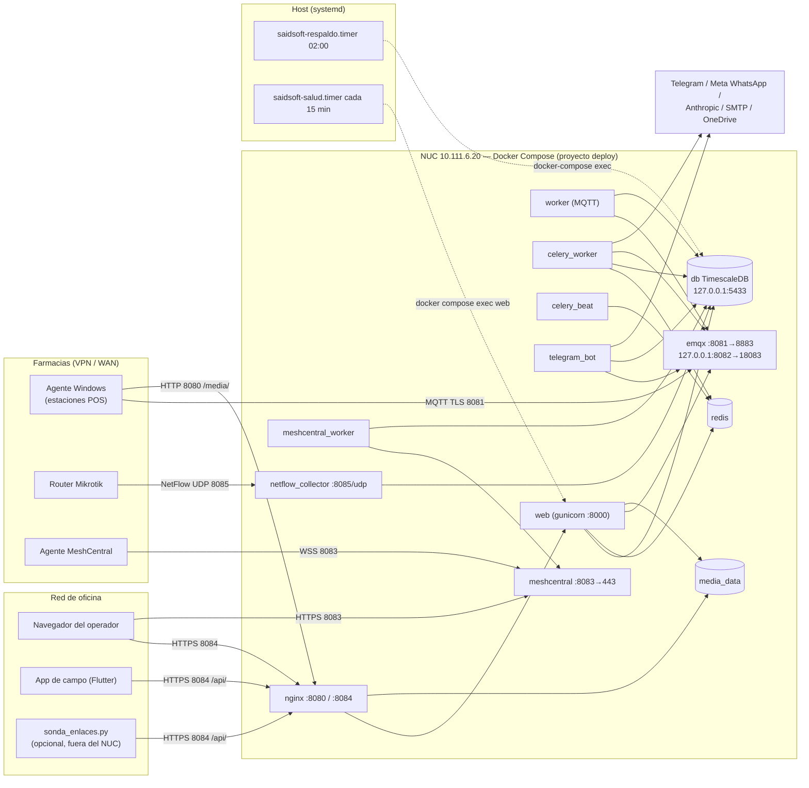

### 11. Componentes auxiliares de `deploy/`

| Ruta | Qué es | Dónde corre | Observaciones |
|---|---|---|---|
| `deploy/lab/emqx-cola-lab.sh` | EMQX de **laboratorio** (`saidsoft-lab-emqx`, misma versión 5.8.3 y misma autenticación/autorización que producción) para `apps/catalogo/tests_integracion_emqx.py` | Máquina de desarrollo | Solo loopback: `127.0.0.1:21883` (MQTT sin TLS) y `127.0.0.1:28083` (API). Volumen desechable `saidsoft-lab-emqx-data`. Clave de dashboard de laboratorio escrita en el script (no es de producción). Subcomandos `arrancar`, `reiniciar`, `detener`. |
| `deploy/meshcentral/` | `config.json.example` (plantilla versionada) y `config.json` real (no versionado) | NUC | En la copia local de este repositorio `config.json` aparece como **directorio**, señal de un bind mount hecho sin el archivo; no afecta a producción. |
| `deploy/nginx/nginx.conf` | Dos `server`: 80 (solo `/media/`, el resto 301 a `https://$host:8084`) y 443 (TLS 1.2/1.3, `client_max_body_size 512m`, `proxy_read_timeout 600s`) | Contenedor `nginx` | Sin cabeceras de seguridad propias y sin `server_tokens off` (ver [seguridad](#s14)). |
| `deploy/db/init-timescaledb.sql` | Habilita la extensión TimescaleDB | Primer arranque de `db` | La conversión a hypertable la intenta una migración y hoy **no aplica** (la tabla `muestra_metrica` sigue como PostgreSQL normal; `README-produccion.md:195-230`). |
| `deploy/sonda-enlaces/sonda_enlaces.py` | Sonda opcional que hace ping a las farmacias y reporta por HTTPS a la API | Un host con ruta a las farmacias, **fuera** del NUC | Solo biblioteca estándar. Usa un token DRF de un usuario con **solo** `monitoreo.registrar_sondeo_enlace`. Opción `--inseguro` desactiva la verificación TLS (`_contexto_ssl`). |
| `deploy/certs/` | `cert.pem`, `key.pem` (no versionados) y `generar-certs-dev.sh` | NUC | Certificado autofirmado `CN=saidsof-mqtt`, RSA 2048, 825 días. Ver [02 §6](#6-certificados). |

### 12. Hallazgos de infraestructura (hechos) y recomendaciones

Los hallazgos de seguridad están en [`../seguridad/01-auditoria-tecnica.md`](#s14).
Aquí solo los operativos. **Ninguno se aplicó.**

| # | Hecho | Evidencia | Recomendación | Riesgo de cambiarlo |
|---|---|---|---|---|
| I-1 | Sin UPS confirmada; varios cortes con el servidor ciego horas | §8; `PLAN_MODERNIZACION.md` §AF | UPS con apagado ordenado y confirmar "Restore on AC Power Loss" en BIOS | Bajo (hardware) |
| I-2 | `/app/staticfiles` en la capa del contenedor | `base.py:199`; `.dockerignore` | Mantener la defensa de `9c9405b`; evaluar generar estáticos en el build | Medio: cambia el arranque de `web` |
| I-3 | Sin rotación de logs declarada | §9 | Verificar `daemon.json`; si falta, `logging` con `max-size`/`max-file` | Requiere recrear contenedores |
| I-4 | Sin límites de memoria/CPU | §9 | Medir consumo real (`docker stats`) antes de fijar límites | Alto si se fijan a ciegas (OOM) |
| I-5 | `meshcentral:latest` y huérfano con hash | §2, §3 | Fijar versión tras leer la que corre; normalizar el nombre en ventana planificada | Medio: recrea MeshCentral |
| I-6 | `netflow_collector` y `meshcentral` sin healthcheck, y `desplegar.sh` no verifica `netflow_collector` | `docker-compose.yml:399-424, 629-653`; `desplegar.sh:126,150` | Agregar chequeos acordes y sumarlo a la verificación | Bajo |
| I-7 | Bind mount de archivo suelto para `nginx.conf` | §6.2 | Montar el directorio `./nginx` en vez del archivo | Requiere recrear nginx |
| I-8 | Monitoreo del propio servidor sin aviso activo | §8 | `OnFailure=` o un canal externo (Telegram/correo) para `saidsoft-salud` | Bajo |
| I-9 | Redis con RDB cada 60 s y sin AOF | `docker-compose.yml:480` | Aceptable para colas; documentar que se pierden tareas en vuelo | — |

### 13. Pendientes de verificar en el NUC (solo lectura)

```sh
cd ~/Documentos/Said/saidsoft-core/deploy
docker compose --env-file .env ps --format 'table {{.Name}}\t{{.Service}}\t{{.Image}}\t{{.State}}\t{{.Health}}'
docker network ls --filter name=deploy
docker volume ls --filter name=deploy_
docker info --format '{{.LoggingDriver}}'; cat /etc/docker/daemon.json 2>/dev/null
docker inspect --format '{{.Name}} {{.Config.User}}' $(docker compose --env-file .env ps -q)
docker compose --env-file .env exec -T meshcentral sh -c 'cat /opt/meshcentral/meshcentral/package.json 2>/dev/null | grep "\"version\""'
docker stats --no-stream
ss -tulnp | grep -E ':(808[0-5]|5433)\b'
```

---

<a id="s12"></a>

## 12. Despliegue, configuración y recuperación

| Campo | Valor |
|---|---|
| **Fecha** | 26-oct-2026 |
| **Commit analizado** | `1fa16d6` (rama `master`) |
| **Alcance** | `deploy/Dockerfile`, `deploy/entrypoint.sh`, `deploy/desplegar.sh`, `deploy/esperar-stack.sh`, `deploy/bootstrap-emqx.sh` (y los dos scripts de ACL), certificados, unidades systemd (`saidsoft-respaldo`, `saidsoft-salud`), `deploy/backup.sh`, `deploy/restaurar-backup.sh`, `deploy/MIGRACION_SERVIDOR.md`, `config/settings/*.py` y variables de entorno. |
| **Evidencias** | Código y documentos citados por ruta y línea; mediciones de producción marcadas **[PROD, reportado …]**. |
| **Supuestos** | El NUC usa Compose v2 (`docker compose`) para el stack desde el 4-sep-2026 (`README-produccion.md:155-163`) y conserva instalado el binario v1 (`docker-compose`), que siguen usando `backup.sh`, `esperar-stack.sh` y `restaurar-backup.sh`. |
| **Limitaciones** | No se leyó `deploy/.env` ni ningún secreto: la tabla de variables muestra **solo nombres y finalidad**. No se ejecutó ningún script. |
| **Hallazgos pendientes** | Valores efectivos de `SECURE_SSL_REDIRECT`, `COOKIES_SOLO_HTTPS`, `MFA_OBLIGATORIO`, `MESHCENTRAL_API_VERIFICAR_TLS`; si `BACKUP_OFFSITE_DESTINO`/`BACKUP_ONEDRIVE_REMOTO` están definidos; si el binario v1 sigue instalado; estado de los timers. Ver §12. |
| **Estado de validación** | Procedimientos: **verificados contra el código**. Ejecución en producción: según lo reportado; el resto **pendiente de verificar**. |

Documentos relacionados: [01 — Contenedores y servicios](#s11) ·
[03 — Operación y diagnóstico](#s13) ·
[Seguridad](#s14) · guías para desarrolladores en
[`../desarrolladores/`](#s19) · calidad y pruebas en [`../calidad/`](#s15).

---

### 1. Flujo de despliegue en una línea

`git pull` (actualiza el **disco**) → `docker compose --env-file .env build` (**las siete**
imágenes de la app) → `docker compose --env-file .env up -d` (recrea lo que cambió) → el
`entrypoint` de `web` migra y corre `collectstatic` → verificación. Todo eso lo hace
`deploy/desplegar.sh`.

```sh
cd ~/Documentos/Said/saidsoft-core && sh deploy/desplegar.sh
```

El script se ubica a sí mismo (`REPO="$(cd "$(dirname "$0")/.." && pwd)"`, `desplegar.sh:20`),
hace `cd "$REPO"` para el `git pull` y `cd "$REPO/deploy"` para los `docker compose`: por eso
los comandos de Compose del stack se ejecutan **siempre desde `deploy/`** con `--env-file .env`.
Debe vivir en `deploy/`; copiado a otro lado aborta (`desplegar.sh:25-29`).

### 2. Dockerfile

`deploy/Dockerfile` (47 líneas):

| Líneas | Qué hace | Por qué importa |
|---|---|---|
| 3 | `FROM python:3.13-slim` | El CI prueba con 3.14 (`.github/workflows/pruebas.yml:59`); `CLAUDE.md:5` dice "Python 3.14". Diferencia a vigilar. |
| 5-7 | `PYTHONUNBUFFERED`, `PYTHONDONTWRITEBYTECODE`, `DJANGO_SETTINGS_MODULE=config.settings.produccion` | Sin búfer, los logs llegan a `docker compose logs` al instante. |
| 20-23 | `libpq5`, `iputils-ping` | Sin `ping` el sondeo de enlaces reportaba toda la flota caída. |
| 25-26 | `pip install -r requirements.txt` | Dependencias con `>=`: el build no es reproducible. |
| 28 | `COPY . .` | El contexto lo filtra `.dockerignore` (excluye `.env`, `.env.*`, `deploy/.env*`, `deploy/certs/key.pem`, respaldos, `/media/`, `/staticfiles/`). |
| 34-35 | `useradd appuser`, `mkdir /app/media`, `chown -R`, `USER appuser` | Contenedores sin root; el volumen `media_data` hereda el dueño al montarse vacío. |
| 37-42 | Copia y `chmod +x` del entrypoint | Defensa contra el bit de ejecución perdido al editar en Windows. |
| 45-47 | `ENTRYPOINT ["/entrypoint.sh"]`; `CMD` gunicorn con `--timeout 120` | En producción el compose sobrescribe el comando (`--timeout 600`, access log). |

Lecciones registradas en `.dockerignore`: el 31-jul-2026 un `.env` de desarrollo terminó dentro de
la imagen; el **13-oct-2026 se encontraron tres copias del `.env` de producción**
(`deploy/.env.bak-*`, 117 variables con valor) **dentro de cada imagen**, y respaldos de 3,6 GB
también horneados. Hoy el patrón excluye `.env.*` por prefijo. Ver
[seguridad](#s14) sobre la rotación pendiente.

### 3. `entrypoint.sh`

`deploy/entrypoint.sh` (45 líneas), con `set -e`:

1. **Espera a la base** (líneas 4-20): hasta 30 intentos de `psycopg.connect` con 2 s entre
   intentos; si no responde, sale con error y Docker reinicia el contenedor.
2. **Solo si `RUN_MIGRATIONS=1`** (únicamente `web`, `docker-compose.yml:161`; el resto tiene
   `"0"`):
   - `python manage.py migrate --noinput`;
   - **descarte de `staticfiles.json` dañado** (líneas 27-41, commit `9c9405b`, 25-oct-2026): si
     `/app/staticfiles/staticfiles.json` existe y no se puede leer como JSON
     (`ValueError`, `UnicodeDecodeError`, `OSError`), lo borra e imprime
     `staticfiles.json dañado (...): se descarta y se regenera.`;
   - `python manage.py collectstatic --noinput`.
3. `exec "$@"`: reemplaza el shell por el comando del servicio (gunicorn, worker, celery…).

Consecuencias operativas:

- Las migraciones corren **en el arranque de `web`**, no en `desplegar.sh`. Correr `migrate` a
  mano en paralelo ya causó `column ... already exists` (17-sep-2026, `desplegar.sh:61-75`).
- Un fallo en `migrate` o en `collectstatic` deja `web` en **bucle de reinicio** y el panel en 502.
- Antes de `9c9405b`, un `staticfiles.json` truncado por un corte de luz producía exactamente
  eso (incidente del 25-oct, [01 §8](#8-lección-del-25-oct-2026-502-por-staticfilesjson-dañado)).

### 4. Settings de producción

| Archivo | Rol |
|---|---|
| `config/settings/base.py` (716 líneas) | Todo lo común. `environ.Env(DEBUG=(bool, False))` y `read_env(BASE_DIR / '.env')` (líneas 11-15): dentro del contenedor no hay `/app/.env` (lo excluye `.dockerignore`), así que **solo cuentan las variables que el compose pasa explícitamente**. |
| `config/settings/produccion.py` (64 líneas) | `DEBUG = False`; WhiteNoise con `CompressedManifestStaticFilesStorage`; `SECURE_SSL_REDIRECT` y cookies `Secure` por variable (por defecto `True`); HSTS 7 días con `includeSubDomains` y `preload`; `SECURE_PROXY_SSL_HEADER`; `CSRF_TRUSTED_ORIGINS`; `CONFIAR_X_REAL_IP = True`; `SERVIR_MEDIA_CON_NGINX` (por defecto `True`); SMTP con `EMAIL_TIMEOUT`; lectura de temperatura; `PANEL_MODULOS_DIFERIDOS` por defecto `viaticos, aperturas, cumplimiento, netflow, mesa, scripts` (corte RMM 1.0). |
| `config/settings/desarrollo.py` (13 líneas) | `DEBUG = True`, `ALLOWED_HOSTS = ['*']`, correo a consola, Celery en modo *eager*. |

Puntos a conocer:

- **El compose no usa `env_file`**: una variable que está en `deploy/.env` pero no en el bloque
  `environment:` del servicio **no llega al contenedor**. Ejemplos en la plantilla que hoy no
  tienen efecto en los contenedores: `MIKROTIK_SNMP_PUERTO` (queda siempre en 161) y
  `MQTT_HOST/PORT/USE_TLS/CA_CERT` (fijas en el compose; la plantilla lo aclara en
  `.env.prod.example:77-84`).
- **`docker compose` pasa cadena vacía, no "ausente"**, cuando una variable referenciada no está
  en `.env`; `django-environ` no aplica su default a una variable presente y vacía. Por eso el
  compose repite defaults con `${VAR:-valor}` (`docker-compose.yml:204-216`).
- Variables **obligatorias** sin default (Django no arranca sin ellas): `SECRET_KEY`,
  `COMANDO_HMAC_SECRET`, `BITLOCKER_ENCRYPTION_KEY` (`base.py:17, 240, 251`).
- `LOGGING` manda todo a la consola en INFO, sin el filtro `require_debug_true`
  (`base.py:686-713`).

### 5. Variables de entorno (solo nombres y finalidad)

Fuentes: `deploy/.env.prod.example`, `deploy/docker-compose.yml`, `config/settings/base.py`,
`config/settings/produccion.py`, `os.environ` en `run_netflow_collector.py:65` y
`generar_script_instalacion.py:56`, y los scripts del host. **No se incluye ningún valor.**

Leyenda de la columna "Llega a": W=`web`, K=`worker`, CW=`celery_worker`, CB=`celery_beat`,
MW=`meshcentral_worker`, TB=`telegram_bot`, NF=`netflow_collector`; *app* = los siete;
*host* = scripts del host (`backup.sh`, `bootstrap-emqx.sh`, etc.); *—* = no la pasa el compose
(se usa el default del código).

#### 5.1 Django y panel

| Variable | Finalidad | Llega a | Sensible |
|---|---|---|---|
| `SECRET_KEY` | Firma de sesiones, CSRF y tokens de Django | app | **Sí** |
| `ALLOWED_HOSTS` | Hosts aceptados; el primero lo usan el healthcheck de `web` y `desplegar.sh` | app | No |
| `CSRF_TRUSTED_ORIGINS` | Orígenes HTTPS confiables para CSRF (incluye el puerto 8084) | W | No |
| `DEBUG` | Modo depuración (en producción lo fuerza `produccion.py` a `False`) | — | No |
| `DJANGO_SETTINGS_MODULE` | Módulo de settings; fijo en el compose | app (fijo) | No |
| `RUN_MIGRATIONS` | `1` solo en `web`: migrar y `collectstatic` en el arranque | app (fijo) | No |
| `DATABASE_URL` | Conexión a PostgreSQL; el compose la arma con `POSTGRES_*` | app (armada) | **Sí** (contiene contraseña) |
| `CONN_MAX_AGE` | Segundos de conexión persistente (60 por defecto) | — | No |
| `SECURE_SSL_REDIRECT` | Redirigir HTTP→HTTPS en Django | W | No |
| `COOKIES_SOLO_HTTPS` | Cookies de sesión y CSRF con `Secure` | W | No |
| `SERVIR_MEDIA_CON_NGINX` | Entregar archivos protegidos por `X-Accel-Redirect` | — (True en prod) | No |
| `SALUD_LEER_TEMPERATURA` | Mostrar la temperatura del servidor como componente de salud | — | No |
| `PANEL_MODULOS_DIFERIDOS` | Módulos ocultos (404) en RMM 1.0 | — (lista de `produccion.py`) | No |
| `ARCHIVOS_BASE_URL` | URL base de descarga para los agentes (`http://<ip>:8080`, sin barra final) | W | No |
| `MFA_OBLIGATORIO` | Exigir MFA a toda cuenta | W | No |
| `MFA_PLAZO_ENROLAMIENTO` | Fecha límite (AAAA-MM-DD) para enrolarse entrando solo con contraseña | W | No |
| `API_TOKEN_DIAS` | Vida de los tokens de la API (30 por defecto) | W | No |

#### 5.2 Criptografía y firma

| Variable | Finalidad | Llega a | Sensible |
|---|---|---|---|
| `COMANDO_HMAC_SECRET` | Secreto HMAC compartido: firma comandos a agentes anteriores a 0.21 y la firma HMAC de catálogos | app | **Sí — no regenerable sin redistribuir** |
| `BITLOCKER_ENCRYPTION_KEY` | Clave Fernet de las claves de recuperación de BitLocker en reposo | app | **Sí — si se pierde, las claves guardadas quedan ilegibles** |
| `CATALOGO_FIRMA_PRIVADA` | Clave privada Ed25519 de firma de catálogos (agente 0.38) | W | **Sí — perderla obliga a redistribuir el agente** |
| `BACKUP_ENCRYPTION_PASSPHRASE` | Passphrase GPG de los respaldos | host | **Sí — sin ella los respaldos no se abren** |

#### 5.3 PostgreSQL

| Variable | Finalidad | Llega a | Sensible |
|---|---|---|---|
| `POSTGRES_DB` | Nombre de la base | `db`, host | No |
| `POSTGRES_USER` | Usuario de la base | `db`, host | No |
| `POSTGRES_PASSWORD` | Contraseña de la base | `db`, host | **Sí** |

#### 5.4 EMQX y MQTT

| Variable | Finalidad | Llega a | Sensible |
|---|---|---|---|
| `EMQX_COOKIE` | Cookie del nodo Erlang | `emqx` | **Sí** |
| `EMQX_DASHBOARD_PASSWORD` | Contraseña inicial del usuario `admin` del dashboard; la usan los scripts del host | `emqx`, host | **Sí** |
| `EMQX_API_URL` | URL de la API de EMQX desde la red interna (`http://emqx:18083/api/v5`) | W, K | No |
| `EMQX_API_KEY` / `EMQX_API_SECRET` | API Key `saidsoft-provisioning` para aprovisionar credenciales por estación; **salta las ACL** | W, K | **Sí** |
| `EMQX_API` | Opcional: sobrescribe la URL de la API en `bootstrap-emqx.sh` (por defecto `http://127.0.0.1:8082/api/v5`) | host | No |
| `MQTT_USERNAME_PANEL` / `MQTT_PASSWORD_PANEL` | Credencial que **publica** comandos y catálogos | W, TB, CW, host | **Sí** (contraseña) |
| `MQTT_USERNAME_WORKER` / `MQTT_PASSWORD_WORKER` | Credencial que consume la telemetría | K, host | **Sí** (contraseña) |
| `MQTT_USERNAME_AGENTE` / `MQTT_PASSWORD_AGENTE` | Credencial **compartida** de enrolamiento; `web` la usa para el enlace de un solo uso del instalador | W (contraseña), host | **Sí** |
| `MQTT_HOST`, `MQTT_PORT`, `MQTT_USE_TLS`, `MQTT_CA_CERT` | Conexión al broker; fijas en el compose (`emqx`, `8883`, `True`, `/app/deploy/certs/cert.pem`) | W, K, TB, CW (fijas) | No |
| `MQTT_USERNAME` / `MQTT_PASSWORD` | Nombres que lee Django; el compose las arma desde las de arriba | W, K, TB, CW | **Sí** |
| `MQTT_CLIENT_ID_PANEL` / `MQTT_CLIENT_ID_WORKER` | Client ID MQTT | — | No |

#### 5.5 MeshCentral

| Variable | Finalidad | Llega a | Sensible |
|---|---|---|---|
| `MESHCENTRAL_SERVER_URL` | URL pública para los enlaces de escritorio/terminal | W | No |
| `MESHCENTRAL_MESH_ID` | Device group donde se instalan los agentes | W | Bajo |
| `MESHCENTRAL_AGENT_ARCH_ID`, `MESHCENTRAL_INSTALL_FLAGS` | Arquitectura y modo de instalación del agente | W | No |
| `MESHCENTRAL_VIEWMODE_ESCRITORIO`, `MESHCENTRAL_VIEWMODE_TERMINAL` | Vista que abre cada botón (10 y 12 verificados) | W | No |
| `MESHCENTRAL_API_WS_URL` | WebSocket `control.ashx` | MW, CW | No |
| `MESHCENTRAL_API_USUARIO` / `MESHCENTRAL_API_PASSWORD` | Cuenta de servicio de MeshCentral | MW, CW | **Sí** (contraseña) |
| `MESHCENTRAL_API_CA_CERT` | CA para validar el certificado de MeshCentral | MW, CW | No |
| `MESHCENTRAL_API_VERIFICAR_TLS` | Validar TLS contra MeshCentral (`True` por defecto) | MW, CW | No |

#### 5.6 Notificaciones, WhatsApp e IA

| Variable | Finalidad | Llega a | Sensible |
|---|---|---|---|
| `EMAIL_HOST`, `EMAIL_PORT` | Servidor SMTP | W, K, CW | No |
| `EMAIL_HOST_USER` / `EMAIL_HOST_PASSWORD` | Cuenta SMTP (vacía = no sale correo; estado al 28-sep-2026 según la plantilla) | W, K, CW | **Sí** (contraseña) |
| `EMAIL_TIMEOUT` | Tiempo máximo del socket SMTP (10 s) | — | No |
| `ENLACES_NOTIFICAR_A` | Destinatarios de avisos de enlaces | CW | Datos personales |
| `TELEGRAM_BOT_TOKEN` | Token del bot | W, K, TB, CW | **Sí** |
| `TELEGRAM_CHAT_IDS_AUTORIZADOS` | Lista blanca de chats que pueden consultar al bot | TB, CW | Bajo |
| `ENLACES_TELEGRAM_CHAT_ID`, `MESA_AYUDA_TELEGRAM_CHAT_ID` | Chats de resumen de enlaces y de mesa de ayuda | CW | Bajo |
| `WHATSAPP_APP_SECRET` / `WHATSAPP_VERIFY_TOKEN` | Validación de la firma del webhook de Meta y alta del webhook | W | **Sí** |
| `WHATSAPP_TOKEN`, `WHATSAPP_PHONE_NUMBER_ID` | Envío por la API de Meta | CW | **Sí** (token) |
| `WHATSAPP_MODO`, `WHATSAPP_FARMACIAS_PILOTO`, `WHATSAPP_REDIRIGIR_A`, `WHATSAPP_PLANTILLA_CAIDA`, `WHATSAPP_PLANTILLA_ESTACION` | Modo (apagado/piloto/activo), piloto, redirección de pruebas y plantillas | CW | Bajo |
| `WHATSAPP_API_VERSION`, `WHATSAPP_IDIOMA_PLANTILLA` | Versión de la API de Meta e idioma | — | No |
| `ANTHROPIC_API_KEY` | Diagnóstico automático de alertas críticas con IA (envía contexto de la alerta a un servicio externo) | W, K, CW | **Sí** |
| `ANTHROPIC_MODELO_DIAGNOSTICO`, `ANTHROPIC_MAX_TOKENS_DIAGNOSTICO` | Modelo y tope de tokens | — | No |

#### 5.7 Red, Celery y respaldos

| Variable | Finalidad | Llega a | Sensible |
|---|---|---|---|
| `MIKROTIK_SNMP_PUERTO` | Puerto SNMP de los Mikrotik | — (**no la pasa el compose**) | No |
| `NETFLOW_EXPORTADORES` | Mapa `ip=CODIGO` para routers que exportan desde otra IP | NF | No |
| `DESPLIEGUE_UMBRAL_ERROR_PCT_DEFAULT`, `DESPLIEGUE_USAR_CACHE` | Umbral de error de despliegues y caché por farmacia | — | No |
| `CELERY_BROKER_URL`, `CELERY_RESULT_BACKEND` | Redis de Celery; fijas en el compose (`redis://redis:6379/0`) | W, K, CW, CB, MW, TB | No |
| `BACKUP_OFFSITE_DESTINO` | Destino `rsync` sobre SSH de la copia externa (**no figura en `.env.prod.example`**) | host | Bajo |
| `BACKUP_ONEDRIVE_REMOTO` | Remoto `rclone` (`remoto:carpeta`) | host | Bajo |
| `BACKUP_ONEDRIVE_RETENCION_DIAS` | Retención en OneDrive (30 por defecto) | host | No |

### 6. Certificados

- **Generación**: `deploy/certs/generar-certs-dev.sh [SAN]` crea un autofirmado RSA 2048,
  825 días, `CN=saidsof-mqtt`, SAN `DNS:emqx, DNS:localhost, IP:127.0.0.1` más el que se pase
  (en producción `IP:10.111.6.20`). Escribe `cert.pem` y `key.pem` en `deploy/certs/` (no
  versionados).
- **Consumidores** (`README-produccion.md:606-618`; `verificar-certificado.sh`): nginx (8084),
  EMQX (8883), los clientes MQTT del backend (`MQTT_CA_CERT`), el instalador del agente (copia el
  `cert.pem` a cada estación, que lo **fija**) y la app de campo, que lo **empaqueta dentro del
  APK**.
- **Vencimiento**: según `README-produccion.md:638`, el certificado de la app vence el
  **8-nov-2028** (**No verificado** contra el del servidor).
- **Comprobación de solo lectura**: `sh deploy/verificar-certificado.sh [host:puerto|archivo]`
  compara huellas SHA-256 y avisa con menos de 90 días.
- **Rotación**: primero el APK, después el servidor (recreando nginx), luego rearmar el paquete
  del agente, y repetir la verificación. Al revés deja la flota de teléfonos fuera de servicio.
  Para la migración a subdominio ver `MIGRACION_SERVIDOR.md` Etapa B (reemitir con la **misma
  clave** o una CA interna; ambas a probar en laboratorio).
- MeshCentral usa **su propio** certificado, guardado en `meshcentral_data` (no se respalda).

### 7. Scripts de EMQX

#### 7.1 `bootstrap-emqx.sh`

Se corre desde el host con el stack arriba: `sh deploy/bootstrap-emqx.sh`. Hace `. deploy/.env`,
obtiene un token del dashboard (`admin` + `EMQX_DASHBOARD_PASSWORD`) contra
`http://127.0.0.1:8082/api/v5`, crea o actualiza (POST, y PUT ante 409) los usuarios `panel`,
`worker` y `agente`, define las ACL por usuario (PUT por usuario) y crea la API Key
`saidsoft-provisioning` con `expired_at: infinity` si no existe (líneas 175-187).

> **Advertencia (hecho verificado en código).** La ACL que define para la credencial compartida
> del agente es `{"topic": "/saidsof/#", "permission": "allow", "action": "all"}`
> (`bootstrap-emqx.sh:121`). Desde el 12-oct-2026 esa credencial está **angostada** a solo
> enrolamiento (`emqx-narrow-acl-agente.sh`; `CLAUDE.md:103-108`). **Volver a correr el
> bootstrap reabre en silencio el acceso total** de esa credencial. `README-produccion.md`
> todavía lo describe como "reentrante, seguro de repetir" (líneas 381-388 y 413-416).
> Antes de cualquier reconstrucción o rotación hay que corregir esa regla o correr
> `emqx-narrow-acl-agente.sh` inmediatamente después. Requiere autorización.

#### 7.2 Otros scripts de ACL

- `emqx-narrow-acl-agente.sh`: deja a la credencial compartida solo `publish
  /saidsof/enrolamiento/solicitar/` y `subscribe /saidsof/enrolamiento/respuesta/+/`. Se corrió
  el 12-oct-2026.
- `emqx-acl-agente-sin-comandos.sh`: paso intermedio histórico (4-sep-2026); **no** niega
  `catalogo/#` ni `/pausa/` (según `docs/auditoria/verificacion-seguridad-p0.md`). No debe volver
  a usarse.
- `manage.py reaplicar_acls_mqtt` (simula; `--aplicar` escribe): reescribe la ACL de cada
  estación con credencial propia sin rotar contraseñas.

### 8. Timers de systemd

| Unidad | Disparo | Qué ejecuta | Usuario | Salida |
|---|---|---|---|---|
| `saidsoft-respaldo.timer` → `.service` | `OnCalendar=*-*-* 02:00:00`, **`Persistent=true`** (recupera la corrida perdida tras un apagado) | `ExecStartPre=/bin/sh deploy/esperar-stack.sh` y `ExecStart=/bin/sh deploy/backup.sh /home/glpi/backups/saidsoft`; `TimeoutStartSec=2h`; `Requires/After=docker.service` | `glpi` | journal (`journalctl -u saidsoft-respaldo`) |
| `saidsoft-salud.timer` → `.service` | `OnBootSec=10min`, `OnUnitActiveSec=15min`, sin `Persistent` | `docker compose --env-file .env exec -T web python manage.py verificar_salud --silencioso` | `glpi` | journal. **Sin `OnFailure=`**: no avisa a nadie |

Instalación (de los comentarios de cada unidad):
`sudo cp deploy/saidsoft-<nombre>.{service,timer} /etc/systemd/system/ && sudo systemctl daemon-reload && sudo systemctl enable --now saidsoft-<nombre>.timer`.

`esperar-stack.sh`: hasta 60 intentos × 5 s (por defecto) esperando que el contenedor `db` esté
`healthy`; usa `docker-compose` (v1) y `docker inspect`. Existe porque `After=docker.service`
solo garantiza el demonio, no los contenedores.

### 9. Respaldo y restauración

#### 9.1 `backup.sh`

1. `umask 077`; carga `deploy/.env`; exige `BACKUP_ENCRYPTION_PASSPHRASE`.
2. `pg_dump` (SQL plano) de la base por `docker-compose exec -T db`, `gzip`, cifrado GPG AES256
   simétrico y borrado del intermedio.
3. `tar czf - -C /app/media .` desde `web`, cifrado igual.
4. `emqx ctl data export` (usuarios, credenciales por estación, ACL), copia del archivo, borrado
   del export dentro del volumen y cifrado.
5. Retención local: borra `*.gpg` de más de 14 días.
6. `registrar_latido respaldo` (el panel avisa si pasan más de 26 h).
7. Si existe `BACKUP_OFFSITE_DESTINO`: `rsync` sobre SSH (`StrictHostKeyChecking=accept-new`);
   un fallo no hace fallar el respaldo.
8. Si existe `BACKUP_ONEDRIVE_REMOTO` y `rclone`: sube base y EMQX a diario y media si no hay una
   de los últimos 7 días; retención remota de 30 días solo tras una subida completa; registra
   `respaldo_externo`.

**Lo que no cubre**: `meshcentral_data` y `meshcentral_files`, `deploy/.env`, `deploy/certs/`
(`key.pem`), el estado de Redis y la configuración del host (timers, `daemon.json`, `rclone`).
`[PROD, reportado 20/21-oct-2026]`: OneDrive **no** está configurado (pospuesto); `.env` y
`certs/` están guardados fuera del NUC en un paquete GPG dentro de KeePass y en USB; existe una
copia **manual** de un respaldo en un disco externo, y un disco montado en `/mnt/respaldos`
**dentro del mismo NUC** (no protege de robo, incendio, sobretensión ni ransomware).

#### 9.2 `restaurar-backup.sh`

`sh deploy/restaurar-backup.sh <db_FECHA.sql.gz.gpg> [base_destino]`. Por defecto restaura en
`restore_test` (la borra y la recrea). Si el destino es `POSTGRES_DB`, pide escribir el nombre
de la base para confirmar. Descifra a un temporal (borrado por `trap`), hace `DROP/CREATE
DATABASE` y restaura con `psql`.

Observaciones: la restauración con `psql` no usa `ON_ERROR_STOP` ni `--single-transaction`, así
que un error a mitad puede dejar una base parcial sin que el script falle; restaura **solo la
base** (media y EMQX se restauran a mano, ver `MIGRACION_SERVIDOR.md` A3-A4). `[PROD, reportado
21-oct-2026]`: se restauró `db_20261021_155240` en `restore_test` con resultado idéntico.

### 10. `MIGRACION_SERVIDOR.md` (resumen)

Procedimiento escrito el 22-oct-2026 para mover el stack a otro servidor:

- **Qué viaja**: base, EMQX y media (por `backup.sh`); MeshCentral (a mano, `docker run ... tar`);
  `deploy/.env` y `deploy/certs/` (por `scp`, nunca por chat).
- **Variables no regenerables**: `BITLOCKER_ENCRYPTION_KEY`, `CATALOGO_FIRMA_PRIVADA`,
  `COMANDO_HMAC_SECRET`, `BACKUP_ENCRYPTION_PASSPHRASE`.
- **Etapa A** (misma IP): ensayo con otra IP, corte fuera de horario (`docker compose stop` de la
  app, respaldo final, `docker compose stop`), restauración (A2-A4), apagar el NUC **antes** de
  asignar la IP al nuevo, levantar, verificar (A6), reactivar timers. Vuelta atrás: NUC intacto
  una semana.
- **Etapa B** (subdominio `saidsoft.elipsys.ec`, **sin confirmar**): requiere agente 0.39
  (conexión por nombre y orden "cambiar servidor"), certificado con el subdominio y la IP, APK
  nuevo y verificación de MeshCentral.

### 11. Procedimientos

#### 11.1 Actualización normal

1. Revisar qué cambia (`git log` y `git diff` contra lo desplegado) y si hay migraciones.
2. Si hay migraciones, confirmar que existe un respaldo reciente
   (`journalctl -u saidsoft-respaldo -n 20 --no-pager`).
3. `cd ~/Documentos/Said/saidsoft-core && sh deploy/desplegar.sh`.
4. El script: `git pull`; `build` de todas las imágenes; `up -d` (tolera el error de nombres con
   hash); muestra las migraciones aplicadas por el entrypoint; espera hasta 2 min a que no queden
   migraciones pendientes; verifica que 11 servicios estén `running` (no incluye
   `netflow_collector`); espera hasta 2 min los healthchecks; pide `https://<primer
   ALLOWED_HOSTS>:8084/login/` hasta 10 veces. Sale con 1 ante cualquier fallo.
5. Comprobar que ninguna imagen quedó con código viejo:
   `docker exec deploy-worker-1 cat /app/apps/monitoreo/services.py | diff -q - ../apps/monitoreo/services.py`
   (desde `deploy/`).

#### 11.2 Casos especiales

| Cambio | Qué hacer | Riesgo |
|---|---|---|
| `deploy/nginx/nginx.conf` | Recrear nginx (`docker compose --env-file .env up -d --force-recreate nginx`); confirmar con `docker exec deploy-nginx-1 grep resolver /etc/nginx/conf.d/default.conf` | Corte de segundos del panel |
| Sección `emqx:` del compose | Ventana planificada: recrea EMQX y desconecta la flota unos segundos. No tocar `EMQX_NODE__NAME`. Si el contenedor tiene nombre con hash, renombrar antes (`[PROD, 22-oct]` un `--force-recreate` causó 6 min de caída) | Alto |
| Variable nueva en `.env` | Agregarla también al `environment:` del servicio que la lee; si no, no llega | Fallo silencioso |
| Catálogos firmados tras cambios | `publicar_catalogo_servicios_pos --aplicar` y `publicar_catalogo_eventos_sistema --aplicar` (simulan sin `--aplicar`) | Bajo |

#### 11.3 Vuelta atrás de código

No hay un script de vuelta atrás. El orden importa cuando hay migraciones: **revertir primero
la migración y después el código** (`docs/consolidacion/CHECKLIST_PILOTO_COLA.md` §8). Luego
`git checkout <commit>` en el NUC y `build` + `up -d` desde `deploy/`. Requiere autorización.

#### 11.4 Recuperación

| Escenario | Procedimiento |
|---|---|
| Panel en 502 con `web` reiniciándose | Diagnóstico en [03 §11](#11-panel-en-502). Si el log muestra `Couldn't load manifest` o `staticfiles.json dañado`: `docker compose --env-file .env up -d --force-recreate web` |
| Tras un corte de luz | Checklist de [03 §12](#12-después-de-un-corte-de-luz) |
| EMQX arranca sin usuarios ("Not authorized" en worker y agentes) | Confirmar `EMQX_NODE__NAME`; importar el último `emqx_*.tar.gz.gpg` (`emqx ctl data import`, `MIGRACION_SERVIDOR.md` A4). **No** correr `bootstrap-emqx.sh` sin corregir la regla del agente (§7.1) |
| Base dañada | Restaurar primero en `restore_test`, validar, y solo entonces sobre la real con `restaurar-backup.sh <archivo> <POSTGRES_DB>` (confirmación interactiva) |
| Pérdida total del NUC | `MIGRACION_SERVIDOR.md` Etapa A con el último respaldo disponible fuera del NUC. Hoy no hay copia automática fuera del servidor |

### 12. Contradicciones con `deploy/README-produccion.md` y otros documentos

| # | Documento y líneas | Dice | Realidad en el código | Impacto |
|---|---|---|---|---|
| C-1 | `README-produccion.md:80-95` ("Actualizar un despliegue existente") | `sudo docker-compose down` y `up -d --build` con v1 | Desde el 4-sep-2026 se usa v2 y `desplegar.sh`; `down` recrea la red y es la operación que más incidentes causó (EMQX en blanco, nombres con hash) | **Alto**: quien siga esa sección baja todo el stack |
| C-2 | `README-produccion.md:70-75` (paso 7) y `:394-398` | Respaldo por **cron**; "sigue sin copia fuera del servidor" | `saidsoft-respaldo.timer` desde el 7-sep-2026; `backup.sh` soporta `rsync` y OneDrive (sin configurar) | Medio |
| C-3 | `README-produccion.md:184-193` (tabla de servicios) | 8 servicios; `timescaledb:pg16`, `emqx:5.8` | 12 servicios (faltan `nginx`, `meshcentral_worker`, `telegram_bot`, `netflow_collector`); `2.17.2-pg16`, `5.8.3` | Medio |
| C-4 | `README-produccion.md:424` y `:442-447` | "los diez servicios"; "los cinco servicios comparten el Dockerfile" | `desplegar.sh` verifica 11; 7 imágenes de la app (`CLAUDE.md:31-35`); el comentario de `desplegar.sh:45-50` dice "SEIS" | Bajo |
| C-5 | `README-produccion.md:6-17` | "No se ejecutó `docker compose up` del stack completo" | El stack corre en producción desde agosto de 2026 | Bajo (confunde) |
| C-6 | `README-produccion.md:329` | Los agentes apuntan a `emqx:8883` | Publicado al host como **8081** (`docker-compose.yml:120`; `MIGRACION_SERVIDOR.md:21`) | Medio |
| C-7 | `docker-compose.yml:627-628` frente a `README-produccion.md:232` | MeshCentral "NO validado end-to-end" frente a "validado end-to-end (6-ago-2026)" | No resoluble desde el código | Bajo |
| C-8 | `README-produccion.md:56, 67-68, 246, 256, 362` | Comandos con `docker-compose` (v1) y `deploy_web_1` | Contenedores v2: `deploy-web-1` | Medio |
| C-9 | `README-produccion.md:381-388, 413-416` | `bootstrap-emqx.sh` es "reentrante, seguro de repetir" | Reabre `/saidsof/#` para la credencial compartida (`bootstrap-emqx.sh:121`) | **Alto** |
| C-10 | `README-local.md`, "Promover a producción" | `docker compose --env-file .env build web` | `build web` deja las otras seis imágenes con código viejo (`desplegar.sh:40-50`, `CLAUDE.md:29-38`) | **Alto** |
| C-11 | `README-produccion.md:434` frente a `desplegar.sh:38` | `git pull --ff-only` | El script hace `git pull` sin `--ff-only` | Bajo |
| C-12 | `backup.sh:6` | Menciona `deploy/scheduler.sh` | El archivo no existe | Bajo |
| C-13 | `.env.prod.example` frente a `docker-compose.yml` | Lista `MIKROTIK_SNMP_PUERTO`; no lista `BACKUP_OFFSITE_DESTINO` | La primera no llega a ningún contenedor; la segunda la usa `backup.sh` | Bajo |
| C-14 | `Dockerfile:3` frente a `CLAUDE.md:5` y CI | Python 3.13 | `CLAUDE.md` y el CI dicen 3.14 | Bajo |
| C-15 | `backup.sh`, `esperar-stack.sh`, `restaurar-backup.sh` frente a `saidsoft-salud.service` y `desplegar.sh` | `docker-compose` (v1) | El stack se opera con v2; si se desinstala v1, el respaldo deja de correr (el panel lo marcaría a las 26 h) | Medio |
| C-16 | `CLAUDE.md:61-75` frente a la evidencia de producción | El NUC alcanza las farmacias | [PROD] el NUC no alcanza los nodos POS Linux (decisión de seguridad); `CLAUDE.md` habla de gateways | Bajo, aclarar alcance |

### 13. Pendientes de verificar en el NUC (solo lectura)

```sh
cd ~/Documentos/Said/saidsoft-core/deploy
systemctl list-timers 'saidsoft-*' --no-pager
systemctl cat saidsoft-salud.service saidsoft-respaldo.service | grep -E 'OnFailure|ExecStart'
journalctl -u saidsoft-respaldo -n 30 --no-pager
ls -lt /home/glpi/backups/saidsoft | head
command -v docker-compose rclone; docker-compose version 2>/dev/null
docker compose --env-file .env exec -T web python manage.py shell -c "from django.conf import settings as s; print(s.SECURE_SSL_REDIRECT, s.SESSION_COOKIE_SECURE, s.MFA_OBLIGATORIO, s.MESHCENTRAL_API_CONFIG['VERIFICAR_TLS'], bool(s.CATALOGO_FIRMA_PRIVADA))"
openssl x509 -in certs/cert.pem -noout -subject -enddate -ext subjectAltName
stat -c '%a %U %n' .env certs/key.pem
git -C .. status --short | head
```

---

<a id="s13"></a>

## 13. Operación y diagnóstico

| Campo | Valor |
|---|---|
| **Fecha** | 26-oct-2026 |
| **Commit analizado** | `1fa16d6` |
| **Alcance** | Procedimientos para diagnosticar el stack de producción (NUC `glpi@10.111.6.20`). |
| **Evidencias** | `deploy/docker-compose.yml`, `deploy/README-produccion.md`, `CLAUDE.md`, scripts de `deploy/`, comandos de management de `apps/*/management/commands/`. |
| **Supuestos** | Compose v2; contenedores `deploy-<servicio>-1` (algunos pueden tener prefijo de hash: usar siempre el **nombre de servicio** con `docker compose`). |
| **Limitaciones** | Ningún comando se ejecutó durante esta auditoría. Los comandos salen del código y la documentación. |
| **Hallazgos pendientes** | Rotación de logs del demonio; aviso activo de `saidsoft-salud`. |
| **Estado de validación** | Comandos **verificados contra el código**; no probados en el NUC. |

Relacionados: [01](#s11) · [02](#s12) ·
[Seguridad](#s14) · [`../workers/`](#s5).

### 0. Reglas

- **Nunca** `docker compose down`, `down -v`, `docker system/volume/image prune`, ni
  `bootstrap-emqx.sh` sin corregir (reabre la ACL del agente, ver [02 §7.1](#71-bootstrap-emqxsh)).
- Primero el bloque **Diagnóstico (solo lectura)**. El bloque **Acciones** reinicia o modifica:
  requiere autorización explícita y anotar hora y motivo.
- No imprimir secretos (`cat .env`, `env`, `docker inspect` completo de un servicio de la app).
- Convención: todos los comandos se ejecutan desde `deploy/`:

```sh
cd ~/Documentos/Said/saidsoft-core/deploy
DC="docker compose --env-file .env"
```

- `exec web python manage.py ...` ejecuta código dentro del contenedor. Los comandos listados en
  Diagnóstico son de solo lectura según su código (`verificar_salud`, `estado_mfa`,
  `estado_catalogos`, `revisar_credenciales_mqtt`, `showmigrations`); los que escriben simulan sin
  `--aplicar`.
- Para `psql`, forzar solo lectura: `PGOPTIONS='-c default_transaction_read_only=on'`.

```sh
PSQL() { $DC exec -T -e PGOPTIONS='-c default_transaction_read_only=on' db sh -c 'psql -U "$POSTGRES_USER" -d "$POSTGRES_DB" -c "$0"' "$1"; }
```

### 1. Estado general

**Diagnóstico (solo lectura)**

```sh
$DC ps --format 'table {{.Service}}\t{{.Name}}\t{{.State}}\t{{.Health}}\t{{.Status}}'
$DC exec -T web python manage.py verificar_salud          # 0 = sano, 1 = problema
systemctl list-timers 'saidsoft-*' --no-pager
journalctl -u saidsoft-salud.service --since today --no-pager
df -h / /var/lib/docker; free -h; uptime
curl -sk -o /dev/null -w '%{http_code}\n' https://10.111.6.20:8084/login/   # esperado 200
```

| Señal | Interpretación |
|---|---|
| 12 servicios `running`, los que tienen chequeo `healthy` | Sano. `netflow_collector` y `meshcentral` no tienen healthcheck. |
| `restarting` | El proceso muere al arrancar → §2 y logs. |
| `unhealthy` sin reinicios | Proceso vivo pero no funcional; Docker **no** lo reinicia solo. |
| `uptime` corto | Hubo reinicio del NUC (¿corte de luz?) → §12. |

### 2. Contenedores caídos, reiniciándose o unhealthy

**Diagnóstico (solo lectura)**

```sh
$DC ps -a
docker inspect --format '{{.Name}} restarts={{.RestartCount}} exit={{.State.ExitCode}} oom={{.State.OOMKilled}}' $($DC ps -aq)
docker inspect --format '{{json .State.Health.Log}}' $($DC ps -q web)
$DC logs --tail 80 <servicio>
docker ps -a --format '{{.Names}}' | grep -E '^[0-9a-f]{12}_deploy-'   # huérfanos con hash
```

**Acciones que reinician o modifican (requieren autorización)**

```sh
$DC restart <servicio>                         # mantiene la capa del contenedor
$DC up -d --force-recreate <servicio>          # contenedor nuevo (capa limpia)
```

No recrear `emqx` fuera de ventana: desconecta la flota y, si su contenedor tiene nombre con hash,
puede chocar ([PROD, 22-oct-2026]: 6 min de caída).

### 3. Logs

**Diagnóstico (solo lectura)**

```sh
$DC logs --since 1h --tail 200 web          # incluye access log de gunicorn
$DC logs --since 1h worker | grep -Ei 'error|exception|not authorized|token inv'
$DC logs --since 1h celery_worker | grep -E 'ERROR|Task .* (failed|raised)'
$DC logs --since 1h celery_beat | tail -50
$DC logs --since 1h nginx | grep -E '" (5[0-9]{2}) '
$DC logs --since 1h emqx | tail -100
journalctl -u saidsoft-respaldo -n 40 --no-pager
docker info --format '{{.LoggingDriver}}'; cat /etc/docker/daemon.json 2>/dev/null
```

Los logs de Docker se pierden al **recrear** un contenedor; no hay agregación central. Las URLs
del enlace de instalador llevan un token de un solo uso en la ruta y quedan en el access log.

### 4. PostgreSQL

**Diagnóstico (solo lectura)**

```sh
$DC exec -T db pg_isready
PSQL "select now(), pg_postmaster_start_time();"
PSQL "select count(*), state from pg_stat_activity group by state;"     # max_connections ~100
PSQL "select pg_size_pretty(pg_database_size(current_database()));"
PSQL "select relname, pg_size_pretty(pg_total_relation_size(relid)) from pg_statio_user_tables order by pg_total_relation_size(relid) desc limit 10;"
$DC exec -T web python manage.py showmigrations --plan | grep '^\[ \]'  # vacío = sin pendientes
$DC logs --since 2h db | grep -Ei 'recovery|fatal|panic|corrupt'
```

Tras un corte, `database system was not properly shut down; automatic recovery in progress`
seguido de `ready to accept connections` es normal. `[PROD, 25-oct]` la base se recuperó limpia.

**Acciones (requieren autorización)**: restauración solo con `sh restaurar-backup.sh` contra
`restore_test` primero ([02 §9.2](#92-restaurar-backupsh)).

### 5. Redis

**Diagnóstico (solo lectura)**

```sh
$DC exec -T redis redis-cli ping                       # PONG
$DC exec -T redis redis-cli llen celery                # tareas en cola (cola por defecto)
$DC exec -T redis redis-cli info persistence | grep -E 'rdb_last_bgsave_status|rdb_last_save_time'
$DC exec -T redis redis-cli info memory | grep used_memory_human
```

Cola creciendo de forma sostenida = `celery_worker` no consume (§7).

### 6. EMQX

**Diagnóstico (solo lectura)**

```sh
$DC exec -T emqx emqx ctl status
$DC exec -T emqx emqx ctl listeners          # ssl:default 8883, max_conns 6000; tcp/wss apagados
$DC exec -T emqx emqx ctl broker stats | grep -E 'connections.count|retained.count|subscriptions.count'
$DC exec -T emqx emqx ctl retainer info
$DC exec -T emqx sh -c 'cat /proc/$(pgrep beam.smp)/limits | grep "open files"'   # 65536
$DC exec -T web python manage.py revisar_credenciales_mqtt   # 2 GET por estación, sin escrituras
ss -tlnp | grep -E ':(8081|8082)\b'                            # 8082 solo en 127.0.0.1
```

Dashboard desde otra PC: `ssh -L 8082:127.0.0.1:8082 glpi@10.111.6.20` y `http://localhost:8082`.

| Síntoma | Causa conocida |
|---|---|
| `Not authorized` en worker y agentes tras recrear | Nodo arrancó sin su base (cambió `EMQX_NODE__NAME`) → importar el export del respaldo |
| Publish "exitoso" que no llega | ACL deniega en silencio (`deny_action=ignore`); el PUBACK no implica autorización |
| Conexiones topan en ~1024 | `nofile`/`max_conns` sin aplicar |

**Acciones (requieren autorización)**: `manage.py reaplicar_acls_mqtt --aplicar`;
`emqx ctl data import <archivo>`; publicar catálogos (`publicar_catalogo_* --aplicar`).

### 7. Workers y tareas periódicas

**Diagnóstico (solo lectura)**

```sh
PSQL "select nombre, ultimo_latido, now()-ultimo_latido as atraso, conectado, mensajes_procesados from worker_heartbeat order by nombre;"
$DC exec -T celery_worker celery -A config inspect ping
$DC exec -T celery_worker celery -A config inspect active
$DC exec -T celery_worker celery -A config inspect scheduled
$DC exec -T celery_worker celery -A config inspect registered | head -60
$DC logs --since 30m celery_beat | grep -c 'Scheduler: Sending'
$DC exec -T web python manage.py verificar_salud --solo mqtt_worker
$DC exec -T web python manage.py verificar_salud --solo 'celery beat'
```

| Latido (`worker_heartbeat.nombre`) | Lo escribe | Umbral |
|---|---|---|
| `mqtt_worker` | `worker` | 90 s (según `saidsoft-salud.timer`) |
| `meshcentral_worker` | `meshcentral_worker` | ver `apps/monitoreo/umbrales.py` |
| `telegram_bot` | `telegram_bot` | 3 min (healthcheck) |
| `respaldo` / `respaldo_externo` | `backup.sh` | 26 h |
| Beat | se infiere de tareas que escriben | 20 min (`verificar_salud.py`, `BEAT_UMBRAL_MINUTOS`) |

Firma de fallo silencioso ya vista: tarea que devuelve "0 estación(es)…" en milisegundos = le
falta una variable de entorno en su servicio (`docker-compose.yml:511-538`). Detalle de tareas en
[`../workers/`](#s5).

**Acciones (requieren autorización)**: `$DC restart celery_beat` / `celery_worker` / `worker`.

### 8. Errores del agente

**Diagnóstico (solo lectura)**

```sh
$DC logs --since 2h worker | grep -E 'token inv[aá]lido|desconocid|Firma|rechaz' | tail -40
PSQL "select topico, left(error,120), timestamp from mensaje_mqtt_fallido where not revisado order by timestamp desc limit 20;"
PSQL "select codigo_recibido, hostname, motivo, intentos, ultimo_intento from enrolamiento_rechazado where not revisado order by ultimo_intento desc limit 20;"
PSQL "select version_agente, count(*) from estacion group by 1 order by 2 desc;"
$DC exec -T web python manage.py estado_catalogos
```

En la estación (vía MeshCentral): estado del servicio, `identidad.json` y el log del agente.
Caso conocido: agente congelado por un instalador que no termina (0.35); se destraba con
`taskkill /F /T` del proceso del agente y `Start-Service` (acción, requiere autorización).

### 9. Recepción de métricas

**Diagnóstico (solo lectura)**

```sh
PSQL "select max(timestamp), now()-max(timestamp) as atraso, count(*) filter (where timestamp > now()-interval '15 min') as ultimos_15min from muestra_metrica;"
PSQL "select count(*) filter (where ultimo_heartbeat > now()-interval '10 min') as en_linea, count(*) as total from estacion;"
$DC logs --since 15m worker | tail -30
```

Si `atraso` crece: worker (§7) → EMQX (§6) → red de farmacias (enlaces) → agente (§8).

### 10. Estado de una farmacia

**Diagnóstico (solo lectura)** — reemplazar `ML006`:

```sh
PSQL "select f.codigo, f.nombre, f.ip_router from farmacia f where f.codigo='ML006';"
PSQL "select e.codigo, e.estado_conexion, e.ultimo_heartbeat, e.version_agente from estacion e join farmacia f on f.id=e.farmacia_id where f.codigo='ML006' order by e.codigo;"
PSQL "select e.codigo, max(m.timestamp) from muestra_metrica m join estacion e on e.id=m.estacion_id join farmacia f on f.id=e.farmacia_id where f.codigo='ML006' group by 1;"
```

En el panel: ficha de la farmacia (enlace, alertas, servicios del POS). Nombres de columnas
según `db_table` de `apps/catalogo/models.py` y `apps/monitoreo/models.py` (columnas de FK con
sufijo `_id` por convención de Django; **no verificado** contra la base).

### 11. Panel en 502

**Diagnóstico (solo lectura)**

```sh
$DC ps web nginx
docker inspect --format 'restarts={{.RestartCount}} exit={{.State.ExitCode}}' $($DC ps -q web)
$DC logs --tail 80 web | grep -Ei "manifest|staticfiles|migrat|Traceback|Error"
$DC logs --tail 30 nginx | grep -E 'upstream|502'
$DC exec -T web python -c "import json;json.load(open('/app/staticfiles/staticfiles.json'))" && echo manifiesto_ok
```

| Causa | Señal | Acción (requiere autorización) |
|---|---|---|
| `staticfiles.json` dañado (25-oct-2026) | `Couldn't load manifest` / `staticfiles.json dañado`, `web` reiniciando | `$DC up -d --force-recreate web` |
| Error de migración | Traceback en `migrate` | No recrear en bucle; analizar la migración |
| `web` recreado y nginx con IP vieja | 502 tras desplegar | Se resuelve solo en ~10 s (`resolver valid=10s`); si no, `$DC up -d --force-recreate nginx` |
| gunicorn arrancando | 502 los primeros segundos | Esperar `start_period` (60 s) |

**Lección del 25-oct-2026** ([PROD]): corte de luz → `staticfiles.json` a medias en la capa del
contenedor → `collectstatic` fallaba antes de reescribirlo → bucle de reinicio → **502 de 04:21 a
11:53 sin que nadie fuera avisado**. Recuperación: `docker compose up -d --force-recreate web`.
Prevención en código: `9c9405b` (`deploy/entrypoint.sh:27-41`).

### 12. Después de un corte de luz

**Diagnóstico (solo lectura)**, en orden:

1. `uptime`; `journalctl --list-boots | tail -5` (ventanas sin servidor).
2. §1 (estado general) y §11 si el panel no responde 200.
3. §4: log de `db` (recuperación terminada).
4. §6: `emqx ctl status`, `broker stats` (conexiones vuelven en 5–10 min), `retainer info`.
5. §7: latidos de workers y Beat.
6. `systemctl list-timers saidsoft-respaldo.timer` y `journalctl -u saidsoft-respaldo -n 30`
   (`Persistent=true` debería correr el respaldo perdido).
7. `df -h` y logs de error de disco: `journalctl -k -p err --since -2h`.

Contexto [PROD, 24/25-oct-2026]: NUC ciego 22:04–23:50, 23:56–00:36, 02:24–04:21; cuarto corte a
las 12:33; **sin UPS confirmada**. La caída de `pg_central` (00:36–01:09, 01:32–02:19) es de la
base central del POS, **externa** a SaidSoft; SaidSoft solo la observa vía agentes.

### 13. Respaldos

**Diagnóstico (solo lectura)**

```sh
ls -lt /home/glpi/backups/saidsoft | head -8
PSQL "select nombre, ultimo_latido from worker_heartbeat where nombre like 'respaldo%';"
journalctl -u saidsoft-respaldo --since '-2 days' --no-pager | grep -E 'Listo|ERROR|AVISO'
```

**Acciones (requieren autorización)**: respaldo manual
`sudo systemctl start saidsoft-respaldo.service`; prueba de restauración en `restore_test`.

---

<a id="s14"></a>

## 14. Auditoría técnica

| Campo | Valor |
|---|---|
| **Fecha** | 26-oct-2026 |
| **Commit analizado** | `1fa16d6` |
| **Alcance** | Autenticación, autorización, MFA, sesiones, secretos, settings Django, API, MQTT/EMQX, TLS, puertos, PostgreSQL/Redis, Docker, nginx, dependencias, logs, auditoría, respaldos y continuidad. |
| **Evidencias** | Código y configuración (ruta:línea); `docs/gobernanza/*.md`; `PLAN_MODERNIZACION.md`; `CLAUDE.md`; `docs/auditoria/verificacion-seguridad-p0.md` (**local, no versionado**: solo referencia histórica, 19-oct-2026); hechos de producción marcados **[PROD, reportado …]**. |
| **Supuestos** | Producción corre este commit con el compose del repositorio. |
| **Limitaciones** | Sin escaneo de red ni de dependencias, sin acceso al NUC, sin leer `.env`, `deploy/.env`, claves ni `Instalar-Saidsoft.ps1`. No se proponen cambios de ACL de producción, solo hallazgos. |
| **Hallazgos pendientes** | Rotación de secretos expuestos, firewall perimetral, API Keys activas en EMQX, versión real de MeshCentral, rotación de logs, CVE de dependencias (**pendiente de escaneo**). |
| **Estado de validación** | Cada hallazgo indica **vulnerabilidad confirmada** (verificada en código o medida en producción) o **configuración a revisar** (depende de un valor o estado no verificado). |

Relacionados: [infraestructura 01](#s11) ·
[02](#s12) ·
[03](#s13) · [`../calidad/`](#s15) ·
[`../arquitectura/`](#s1).

### 1. Resumen de hallazgos

| ID | Severidad | Tipo | Título | Componente |
|---|---|---|---|---|
| S-01 | **Alto** | Configuración a revisar | Secretos de la flota expuestos en el pasado sin rotación evidenciada | Secretos |
| S-02 | **Alto** | Vulnerabilidad confirmada [PROD 22-oct] | Ninguna cuenta con MFA; MFA obligatorio apagado | Autenticación |
| S-03 | **Alto** | Vulnerabilidad confirmada | Continuidad: sin UPS, respaldos solo en el NUC, MeshCentral fuera del respaldo | Respaldos / DR |
| S-04 | **Alto** | Vulnerabilidad confirmada (código, 19-oct) | Enrolamiento (P0-2): respuesta legible por comodín y aceptada sin solicitud | MQTT / agente |
| S-05 | **Alto** | Vulnerabilidad confirmada (código) | `bootstrap-emqx.sh` reabre `/saidsof/#` para la credencial compartida | EMQX |
| S-06 | **Alto** | Configuración a revisar | Catálogos (P0-1): agentes < 0.38 aceptan firma HMAC compartida o ninguna | Agente |
| S-07 | Medio | Configuración a revisar | Puertos publicados en todas las interfaces sin filtrado del host; MeshCentral expuesto con `:latest` | Red / Docker |
| S-08 | Medio | Vulnerabilidad confirmada (código) | Facturas de viáticos servidas sin autenticación en `/media/` | nginx / Django |
| S-09 | Medio | Configuración a revisar | API Key de EMQX sin vencimiento y por encima de las ACL | EMQX |
| S-10 | Medio | Configuración a revisar | Panel con certificado autofirmado: usuarios acostumbrados a aceptar advertencias | TLS |
| S-11 | Medio | Configuración a revisar | Dependencias sin fijar, sin escaneo; imágenes flotantes | Cadena de suministro |
| S-12 | Medio | Configuración a revisar | Secretos en variables de entorno de todos los contenedores; `glpi` en grupo `docker` | Docker / host |
| S-13 | Medio | Vulnerabilidad confirmada (código) | Auditoría "inmutable" solo a nivel de instancia; cambios de usuarios/permisos fuera de `EventoAuditoria` | Auditoría |
| S-14 | Medio | Configuración a revisar | Monitoreo del propio servidor sin aviso (502 de 7,5 h sin alerta) | Operación |
| S-15 | Medio | Configuración a revisar | Community SNMP predecible (código de farmacia) | Red de farmacias |
| S-16 | Bajo | Vulnerabilidad confirmada (código) | Token FCM en logs; token del instalador en la URL | Logs |
| S-17 | Bajo | Vulnerabilidad confirmada [PROD 19-oct] | Listener `ws:default` de EMQX activo (no publicado) | EMQX |
| S-18 | Bajo | Configuración a revisar | Sin *throttling* en la API; subidas de 512 MB con 3 workers | API |
| S-19 | Bajo | Configuración a revisar | nginx sin `server_tokens off` ni cabeceras propias en `/media/` | nginx |
| S-20 | Bajo | Configuración a revisar | Opciones que desactivan TLS (`--inseguro`, `MESHCENTRAL_API_VERIFICAR_TLS`) | TLS |
| S-21 | Bajo | Configuración a revisar | Restauración sin `ON_ERROR_STOP`; scripts dependen de Compose v1 | Respaldos |
| S-22 | Informativo | — | Datos enviados a terceros (Anthropic, Telegram, Meta, OneDrive) vs. SoA 5.23 | Gobernanza |
| S-23 | Informativo | — | Archivos con secretos o datos en la copia de trabajo local | Estación de desarrollo |
| S-24 | Informativo | — | Redis sin contraseña y PostgreSQL en loopback (aceptable) | Datos |

### 2. Controles existentes (verificados en código)

| Control | Evidencia |
|---|---|
| `DEBUG=False`, `ALLOWED_HOSTS` y `CSRF_TRUSTED_ORIGINS` por entorno | `produccion.py:3, 25`; `base.py:19` |
| HTTPS forzado, cookies `Secure`, HSTS, `SECURE_PROXY_SSL_HEADER` | `produccion.py:15-24` |
| Bloqueo por fuerza bruta (axes, 5 intentos, 1 h, por usuario) | `base.py:146-165` |
| Contraseñas ≥ 12 + validadores | `base.py:134-140` |
| Sesión 8 h por inactividad y al cerrar el navegador | `base.py:173-175` |
| MFA TOTP en panel, admin (`/admin/login/` redirige al login del panel) y API | `apps/cuentas/forms.py`, `views.py`, `api_auth.py`; `config/urls.py:13` |
| Tokens API con vencimiento (30 días) | `apps/cuentas/autenticacion_api.py` |
| Permisos de API declarados y *fail-closed* | `apps/cuentas/api_permissions.py` |
| Aislamiento por unidad de negocio | `apps/cuentas/services.py` (`scope_por_unidad_negocio`, `verificar_acceso`) |
| Cuatro ojos en despliegues y scripts | `docs/gobernanza/matriz-riesgos.md` R-04/R-05 |
| IP real por `X-Real-IP` solo detrás de nginx | `produccion.py:31`; `apps/auditoria/models.py` (`ip_cliente`) |
| Webhook de WhatsApp con HMAC y `compare_digest` | `apps/whatsapp/views.py:30-48` |
| MQTT solo TLS; TCP y WSS apagados; `no_match=deny`; dashboard EMQX en loopback; retenidos en disco | `docker-compose.yml:84-129` |
| Comandos firmados (HMAC por estación desde 0.21) y catálogos con Ed25519 (0.38) | `base.py:240-245`; commits `0c4267b`, `ac657c2` |
| BitLocker cifrado con Fernet | `base.py:251` |
| Contenedores de la app sin root, sin socket de Docker, sin `privileged` | `Dockerfile:34-35`; compose |
| PostgreSQL y dashboard EMQX solo en 127.0.0.1; Redis sin publicar | `docker-compose.yml:28, 129, 477-487` |
| `.dockerignore` excluye `.env*` y `key.pem` | `.dockerignore` |
| Respaldos cifrados GPG AES256 con `umask 077` | `deploy/backup.sh` |
| `/media/mantenimiento/` solo por `X-Accel-Redirect` y vista con permiso | `nginx.conf:23, 62`; `config/urls.py:40` |
| CORS: no hay `django-cors-headers` → sin cabeceras CORS (solo mismo origen) | `requirements.txt`, `INSTALLED_APPS` |

### 3. Hallazgos detallados

Formato: **Evidencia** · **Impacto** · **Probabilidad** · **Prioridad** · **Recomendación** ·
**Complejidad** · **Riesgo de modificarlo** · **Prueba de confirmación**.

#### S-01 — Secretos de la flota expuestos sin rotación evidenciada (Alto, configuración a revisar)

- **Evidencia**: 4-sep-2026, `agente-instalador.zip` con `MqttPassword` y `ComandoHmacSecret`
  publicado sin autenticación por HTTP (`PLAN_MODERNIZACION.md:1680-1729`); la rotación se
  pospuso (líneas 1724-1728). 13-oct-2026, tres copias del `.env` de producción (117 variables:
  `SECRET_KEY`, `POSTGRES_PASSWORD`, `MQTT_PASSWORD_AGENTE`, `TELEGRAM_BOT_TOKEN`,
  `MESHCENTRAL_API_PASSWORD`, `EMQX_DASHBOARD_PASSWORD`…) dentro de cada imagen (`.dockerignore`,
  comentario). No se encontró registro de rotación posterior (la única rotación registrada es la
  del 11-ago, `PLAN_MODERNIZACION.md:967`).
- **Impacto**: con `COMANDO_HMAC_SECRET` se firman comandos válidos para agentes que aún lo usan y
  la firma HMAC de catálogos; con `SECRET_KEY`, falsificación de sesiones; con las demás, acceso a
  la base, MeshCentral, bot.
- **Probabilidad**: Media (imágenes locales del NUC; exposición HTTP pública en LAN/VPN confirmada).
- **Prioridad**: P0.
- **Recomendación**: confirmar si se rotaron; si no, plan de rotación ordenado (primero lo que no
  rompe la flota: `SECRET_KEY`, base, Telegram, MeshCentral, dashboard; luego
  `MQTT_PASSWORD_AGENTE` y `COMANDO_HMAC_SECRET` cuando toda la flota tenga secreto propio).
  Purgar imágenes viejas que contengan `.env.bak`.
- **Complejidad**: Media. **Riesgo**: Alto para `COMANDO_HMAC_SECRET` (agentes viejos dejan de
  aceptar órdenes y catálogos).
- **Prueba**: `docker image ls` + `docker history`/búsqueda de `.env.bak` en imágenes antiguas;
  confirmación del responsable con fechas de rotación en KeePass.

#### S-02 — Sin MFA en ninguna cuenta (Alto, vulnerabilidad confirmada)

- **Evidencia**: `MFA_OBLIGATORIO` por defecto `False` (`base.py:187`, `docker-compose.yml:171`).
  [PROD, reportado 22-oct-2026, `estado_mfa`]: 12 cuentas activas, **ninguna** con MFA, incluidos
  2 superusuarios (uno llamado `prueba`) y una cuenta posiblemente compartida.
  `matriz-riesgos.md` R-13b lo deja abierto.
- **Impacto**: una contraseña filtrada da control del RMM (scripts y despliegues en farmacias).
- **Probabilidad**: Media. **Prioridad**: P1.
- **Recomendación**: desactivar cuentas de prueba/compartidas; MFA en superusuarios; encender
  `MFA_OBLIGATORIO` con `MFA_PLAZO_ENROLAMIENTO` corto.
- **Complejidad**: Baja. **Riesgo**: Bajo (bloqueo de usuarios que no se enrolen; hay ventana
  individual `mfa_enrolar_hasta`).
- **Prueba**: `$DC exec -T web python manage.py estado_mfa`.

#### S-03 — Continuidad y recuperación ante desastres (Alto, vulnerabilidad confirmada)

- **Evidencia**: sin UPS (`PLAN_MODERNIZACION.md:2028-2079`); [PROD] cortes 24/25-oct con el
  NUC ciego tres veces y el panel en 502 7,5 h; respaldos en `/home/glpi/backups/saidsoft`
  (mismo disco) con 14 días (`saidsoft-respaldo.service`, `backup.sh`); OneDrive no configurado y
  copia externa solo manual [PROD 20/21-oct]; `backup.sh` no incluye `meshcentral_data`,
  `meshcentral_files`, `.env` ni `certs/`; `matriz-riesgos.md` R-17, R-20, R-21 abiertos.
- **Impacto**: pérdida de disco/robo/ransomware = pérdida de base, de las credenciales MQTT de
  todas las estaciones (reinstalar agente equipo por equipo) y del certificado fijado.
- **Probabilidad**: Media (cortes recurrentes). **Prioridad**: P0.
- **Recomendación**: UPS con apagado ordenado; destino externo automático (`BACKUP_ONEDRIVE_REMOTO`
  o `BACKUP_OFFSITE_DESTINO`) con prueba de restauración desde el destino; incluir MeshCentral;
  `.env`/`certs` y passphrase fuera del NUC (ya en KeePass según [PROD]).
- **Complejidad**: Media. **Riesgo**: Bajo.
- **Prueba**: `rclone lsf <remoto>`; restauración en `restore_test` desde la copia externa.

#### S-04 — Enrolamiento P0-2 (Alto, vulnerabilidad confirmada en código y broker, 19-oct)

- **Evidencia**: la credencial compartida conserva `subscribe /saidsof/enrolamiento/respuesta/+/`
  (comodín) donde viajan token, `hmac_secret` y contraseña MQTT (`CLAUDE.md:109-114`;
  `emqx-narrow-acl-agente.sh:63-64`); el agente acepta respuestas no solicitadas, sin nonce ni
  firma (`verificacion-seguridad-p0.md`, Resumen punto 4, agente 0.36). No hay commit posterior
  que cierre P0-2a/P0-2b (`git log`).
- **Impacto**: quien tenga la credencial compartida (expuesta, S-01) lee secretos de estaciones
  que se enrolan, o inyecta respuestas.
- **Probabilidad**: Baja-Media. **Prioridad**: P1.
- **Recomendación**: implementar P0-2a (nonce, solicitud pendiente, campos permitidos) y decidir
  P0-2b (cifrado de la respuesta o credencial de bootstrap por instalación).
- **Complejidad**: Alta (agente + servidor + rollout). **Riesgo**: Alto (enrolamiento de toda la flota).
- **Prueba**: en laboratorio (`deploy/lab/emqx-cola-lab.sh`), suscribirse con la credencial
  compartida y observar respuestas; inyectar una respuesta no solicitada a un agente 0.38.

#### S-05 — `bootstrap-emqx.sh` reabre la credencial compartida (Alto, confirmada en código)

- **Evidencia**: `deploy/bootstrap-emqx.sh:121` (`/saidsof/#`, `allow`, `all`); angostada en
  producción desde el 12-oct (`CLAUDE.md:103-108`); `README-produccion.md:381-388, 413-416` lo
  llama "seguro de repetir".
- **Impacto**: una re-ejecución (reconstrucción, migración, rotación) deja publicar comandos y
  catálogos a toda la flota con la credencial compartida.
- **Probabilidad**: Media (el README lo recomienda). **Prioridad**: P1.
- **Recomendación**: que el script siembre la ACL angosta; corregir el README.
- **Complejidad**: Baja. **Riesgo**: Bajo en el repo (no toca producción hasta ejecutarlo).
- **Prueba**: leer la regla en el script; en producción, GET de reglas del usuario compartido por
  la API (túnel SSH).

#### S-06 — Catálogos P0-1 con agentes antiguos (Alto, configuración a revisar)

- **Evidencia**: P0-1 parcial (`01f982b`); firma Ed25519 desde 0.38 (`0c4267b`); [PROD 19-oct]
  85 estaciones en 0.29–0.35, 11 en versiones que no verifican firma; [PROD 22-oct] 0.38
  compilado sin canario. Los catálogos HMAC usan el secreto compartido de S-01
  (`.env.prod.example:32-37`).
- **Impacto**: un catálogo forjado ejecuta PowerShell como SYSTEM en la flota (C-1 de la auditoría
  de gestión remota).
- **Probabilidad**: Baja (requiere publicar en el tópico de catálogo, hoy limitado por ACL).
  **Prioridad**: P1.
- **Recomendación**: canario y rollout de 0.38; medir con `estado_catalogos`.
- **Complejidad**: Media. **Riesgo**: Medio (actualización de agentes en farmacias).
- **Prueba**: `$DC exec -T web python manage.py estado_catalogos`; versiones por estación (§8 de infra 03).

#### S-07 — Exposición de puertos y MeshCentral (Medio, configuración a revisar)

- **Evidencia**: 8080, 8081, 8083, 8084, 8085/udp en `0.0.0.0` (`docker-compose.yml:120, 286-287,
  421, 649`); [PROD 20-oct] `DOCKER-USER` vacía y `ufw` inactivo (`docker-compose.yml:122-123`);
  [PROD 19-oct] 8083 accesible desde la estación de trabajo; `meshcentral:latest`
  (`docker-compose.yml:630`); MeshCentral fuera del alcance RMM 1.0 pero activo.
- **Impacto**: consola de acceso remoto (control total de estaciones) expuesta a toda red con
  ruta; versión desconocida.
- **Probabilidad**: Media. **Prioridad**: P1.
- **Recomendación**: filtrar por origen (`DOCKER-USER`) o firewall perimetral documentado;
  decidir si MeshCentral sigue en 1.0; fijar su versión; MFA en MeshCentral (no verificado).
- **Complejidad**: Media. **Riesgo**: Medio (cortar agentes o técnicos legítimos).
- **Prueba**: `sudo iptables -S DOCKER-USER`, `sudo ufw status`, `ss -tulnp`; desde una red de
  farmacia, `Test-NetConnection 10.111.6.20 -Port 8083`.

#### S-08 — Facturas de viáticos públicas en `/media/` (Medio, confirmada en código)

- **Evidencia**: `upload_to='viaticos/facturas/%Y/%m/'` (`apps/viaticos/models.py:126`);
  enlace directo `reporte.factura_adjunta.url` (`templates/panel/viatico_detalle.html:53`); solo
  `mantenimiento/` está protegido (`config/urls.py:40`; `nginx.conf:23, 62`); `/media/` público
  incluso por HTTP 8080 (`nginx.conf:31`).
- **Impacto**: facturas (posibles datos personales/tributarios) descargables sin sesión con rutas
  adivinables (año/mes/nombre original).
- **Probabilidad**: Baja (módulo diferido en RMM 1.0; datos en producción **no verificados**).
  **Prioridad**: P2.
- **Recomendación**: agregar `viaticos/` a los prefijos protegidos y a `internal` en nginx,
  sirviéndolo por la vista con permiso.
- **Complejidad**: Baja. **Riesgo**: Bajo.
- **Prueba**: `$DC exec -T web sh -c 'find /app/media/viaticos -type f | wc -l'`; si hay
  archivos, `curl -I http://10.111.6.20:8080/media/viaticos/...` sin sesión.

#### S-09 — API Key de EMQX sin vencimiento (Medio, configuración a revisar)

- **Evidencia**: `expired_at: infinity` (`bootstrap-emqx.sh:187`); la API REST no pasa por las
  ACL (`README-produccion.md:543-544`); limitada a `web` y `worker` desde R-8 (`c89310b`);
  `saidsof_django_admin` desactivada, no borrada [PROD 20-oct].
- **Impacto**: compromiso de `web` o `worker` = control total del broker.
- **Probabilidad**: Baja. **Prioridad**: P2.
- **Recomendación**: fecha de vencimiento y rotación; listar y depurar claves.
- **Complejidad**: Baja. **Riesgo**: Medio (aprovisionamiento de estaciones si vence sin renovar).
- **Prueba**: listar API Keys desde el dashboard (túnel SSH).

#### S-10 — Certificado autofirmado en el panel (Medio, configuración a revisar)

- **Evidencia**: `generar-certs-dev.sh` (RSA 2048, 825 días, `CN=saidsof-mqtt`); mismo par para
  nginx y EMQX (`docker-compose.yml:118, 281`); el README indica aceptar la advertencia
  (`README-produccion.md:53-55`); HSTS no aplica a hosts IP.
- **Impacto**: usuarios entrenados a aceptar advertencias → MITM de credenciales en la red interna.
- **Probabilidad**: Baja. **Prioridad**: P2.
- **Recomendación**: distribuir el `cert.pem` como confiable en los equipos de operadores o CA
  interna / Let's Encrypt por DNS (`MIGRACION_SERVIDOR.md` Etapa B).
- **Complejidad**: Media. **Riesgo**: Alto si se rota el certificado sin seguir el orden APK→servidor.
- **Prueba**: `sh deploy/verificar-certificado.sh`.

#### S-11 — Dependencias e imágenes (Medio, configuración a revisar; **pendiente de escaneo**)

- **Evidencia**: `requirements.txt` con `>=` (Django>=5.2.8, djangorestframework>=3.15,
  paho-mqtt>=2.1, psycopg>=3.2, gunicorn>=23.0, cryptography>=42, celery>=5.4, xhtml2pdf>=0.2.16,
  pysnmp>=7.1, django-axes>=8.3, django-otp>=1.5, anthropic>=0.40…); `netflow==0.12.2` sin
  publicaciones desde 2022; sin lock file; CI sin `pip-audit`/escáner (`.github/workflows/pruebas.yml`);
  imágenes `redis:7-alpine`, `nginx:1.27-alpine`, `meshcentral:latest`.
- **Impacto**: builds no reproducibles; CVE no detectadas; `xhtml2pdf` procesa HTML (históricamente con CVE).
- **Probabilidad**: Media. **Prioridad**: P2.
- **Recomendación**: lock con hashes; `pip-audit` y escaneo de imágenes en CI; fijar imágenes por versión.
- **Complejidad**: Baja-Media. **Riesgo**: Bajo.
- **Prueba**: `$DC exec -T web pip freeze` y `pip-audit` sobre esa lista.

#### S-12 — Secretos y acceso al host (Medio, configuración a revisar)

- **Evidencia**: `SECRET_KEY`, `COMANDO_HMAC_SECRET`, `BITLOCKER_ENCRYPTION_KEY` llegan a los siete
  contenedores de la app, incluido `netflow_collector` (`docker-compose.yml:409-413`); visibles con
  `docker inspect` para cualquier miembro del grupo `docker`; `glpi` está en ese grupo
  (`saidsoft-respaldo.service`, comentario), lo que equivale a root en el host; `deploy/.env` en
  texto plano.
- **Impacto**: compromiso de `glpi` = todos los secretos y la base.
- **Probabilidad**: Baja. **Prioridad**: P2.
- **Recomendación**: mínimo privilegio por servicio donde el código lo permita; permisos `600`
  en `.env`/`key.pem`; SSH por clave y lista de quién accede.
- **Complejidad**: Media. **Riesgo**: Medio (un servicio que necesite la variable no arranca).
- **Prueba**: `stat -c '%a %U' deploy/.env deploy/certs/key.pem`; `getent group docker`.

#### S-13 — Auditoría de acciones (Medio, confirmada en código)

- **Evidencia**: `EventoAuditoria.delete()` lanza error (`apps/auditoria/models.py:47`), pero
  `QuerySet.delete()`/`update()` y SQL no pasan por ahí (una prueba usa `.update()`,
  `apps/panel/tests.py:6040`); el admin es de solo lectura; los cambios de usuarios, grupos y
  permisos por `/admin/` no llaman a `registrar_evento` (solo quedan en el `LogEntry` de Django,
  **pendiente de verificar** cobertura); logs de contenedor sin retención definida.
  `soa.md` 5.33 lo describe como "append-only en la práctica".
- **Impacto**: un administrador o atacante con acceso a la base puede borrar rastros; altas de
  privilegios sin registro propio.
- **Probabilidad**: Baja. **Prioridad**: P2.
- **Recomendación**: revocar `DELETE/UPDATE` sobre `evento_auditoria` al usuario de la app o
  trigger; auditar cambios de `auth.User`/grupos; exportar logs fuera del NUC.
- **Complejidad**: Media. **Riesgo**: Medio (migraciones que tocan la tabla).
- **Prueba**: revisar `apps/panel/views/personas.py` y señales sobre `User`; `\dp evento_auditoria` en psql.

#### S-14 — Sin aviso cuando el servidor falla (Medio, configuración a revisar)

- **Evidencia**: `saidsoft-salud.service` sin `OnFailure=`; solo journal; [PROD 25-oct] 502 de
  04:21 a 11:53 sin aviso.
- **Impacto**: disponibilidad; el RMM ciego sin que nadie lo sepa.
- **Probabilidad**: Alta. **Prioridad**: P1.
- **Recomendación**: `OnFailure=` hacia Telegram/correo, o monitor externo desde otra máquina.
- **Complejidad**: Baja. **Riesgo**: Bajo.
- **Prueba**: `systemctl cat saidsoft-salud.service`.

#### S-15 — Community SNMP predecible (Medio, configuración a revisar)

- **Evidencia**: "la community es el código de la farmacia en minúscula" (`.env.prod.example:139-141`).
- **Impacto**: lectura SNMP de routers (topología, ARP) por quien conozca el código; si alguna
  community tuviera escritura, reconfiguración (**no verificado**).
- **Probabilidad**: Media en la red de farmacias. **Prioridad**: P2.
- **Recomendación**: SNMPv3 o communities aleatorias cifradas con `apps/catalogo/crypto.py`;
  confirmar que son de solo lectura y filtradas por IP de origen.
- **Complejidad**: Media. **Riesgo**: Medio (sondeo de ~700 routers).
- **Prueba**: revisar la configuración SNMP de un Mikrotik de muestra.

#### S-16 a S-21 — Bajos

| ID | Evidencia | Recomendación | Prueba |
|---|---|---|---|
| S-16 | `fcm_token` en log INFO (`apps/cuentas/services.py:22-25`); token de un solo uso del instalador en la ruta `instalador/<token>/` (`apps/panel/urls.py:38`), registrado por los access logs de gunicorn y nginx (30 min, un uso) | No loguear tokens; truncar | `grep "Push simulado"` en logs de `web` |
| S-17 | `ws:default` no desactivado (`docker-compose.yml:101-108`); [PROD 19-oct] activo dentro del contenedor | `EMQX_LISTENERS__WS__DEFAULT__ENABLE=false` en ventana planificada | `emqx ctl listeners` |
| S-18 | `REST_FRAMEWORK` sin `DEFAULT_THROTTLE_*` (`base.py:401-410`); `client_max_body_size 512m` y `--timeout 600` con 3 workers | *Throttling* por usuario; límite por vista | Revisión de código |
| S-19 | `nginx.conf` sin `server_tokens off` ni `add_header`; `/media/` sin `X-Content-Type-Options` | Agregar ambos | `curl -I http://10.111.6.20:8080/media/` |
| S-20 | `sonda_enlaces.py --inseguro` desactiva verificación TLS; `MESHCENTRAL_API_VERIFICAR_TLS` puede ponerse en `False` (`.env.prod.example:128-135`) | Usar CA fijada (`MESHCENTRAL_API_CA_CERT`) | Valor efectivo por `manage.py shell -c` (infra 02 §13) |
| S-21 | `restaurar-backup.sh` restaura con `psql` sin `ON_ERROR_STOP`; `backup.sh`/`esperar-stack.sh`/`restaurar-backup.sh` usan `docker-compose` v1 | `-v ON_ERROR_STOP=1 --single-transaction`; pasar a v2 | `command -v docker-compose` en el NUC |

#### S-22 a S-24 — Informativos

- **S-22**: `ANTHROPIC_API_KEY` envía contexto de alertas a un servicio externo
  (`apps/monitoreo/diagnostico_ia.py`); Telegram, WhatsApp (Meta) y OneDrive son servicios en la
  nube. `soa.md` 5.23 dice "no se usan servicios en la nube". Actualizar SoA y evaluar datos enviados.
- **S-23**: en la copia de trabajo local existen `Instalar-Saidsoft.ps1` (según `.gitignore`
  lleva `MQTT_PASSWORD_AGENTE`; **no leído**), `.env`, `db.sqlite3` y otras `*.sqlite3`. Ignorados
  por git; riesgo de la estación de desarrollo. Borrar el instalador tras usarlo, como indica `.gitignore`.
- **S-24**: Redis sin `requirepass` pero no publicado; PostgreSQL solo en `127.0.0.1:5433`; red
  Docker única sin segmentación entre servicios. Aceptable hoy.

### 4. Contraste con `docs/gobernanza/`

| Documento | Afirma | Hallazgo |
|---|---|---|
| `matriz-riesgos.md` R-01 | Respaldo por cron | Hoy timer systemd (`Persistent=true`) |
| `matriz-riesgos.md` R-13b | MFA no obligatorio (abierto) | Sigue abierto: 0 cuentas con MFA [PROD 22-oct] (S-02) |
| `matriz-riesgos.md` R-17 | Sin copia fuera del servidor (abierto) | Sigue abierto; OneDrive sin configurar (S-03) |
| `matriz-riesgos.md` R-19 | Credencial compartida con `/saidsof/#` | Angostada el 12-oct; el riesgo actual es el bootstrap (S-05) y el comodín de respuesta (S-04) |
| `matriz-riesgos.md` R-20 | Seguridad física no evaluada | Cortes de luz sin UPS demuestran el riesgo (S-03) |
| `matriz-riesgos.md` (fecha) | Última actualización 22-ago-2026 | Falta registrar S-01, S-04, S-05, S-07, S-08 y P0-1/P0-2 |
| `soa.md` 5.23 | Sin servicios en la nube | Anthropic, Telegram, Meta, OneDrive (S-22) |
| `soa.md` 5.33 / 5.28 | `EventoAuditoria` append-only | Solo a nivel de instancia (S-13) |
| `soa.md` 8.13 | Respaldo cifrado nocturno, restauración probada | Cierto, pero sin copia externa ni MeshCentral |
| `soa.md` 8.20 | Sin segmentación más allá de EMQX/Docker | Confirmado: host sin filtrado (S-07) |
| `politica-seguridad-informacion.md:76-80` | MFA disponible, no obligatorio | Código listo (`MFA_OBLIGATORIO`), apagado |

### 5. Referencias a P0-1 / P0-2 (verificación del 19-oct-2026)

| Ítem | Estado 19-oct (`verificacion-seguridad-p0.md`, local) | Estado en el repo hoy |
|---|---|---|
| Dashboard EMQX en `0.0.0.0` (Alto) | Confirmado accesible | **Corregido**: `127.0.0.1:8082` (`f670fb4`) |
| Retenidos en RAM (Alto) | Confirmado | **Corregido**: `disc` (`688e104`) [PROD 20-oct] |
| `max_conns` 1024 | Confirmado | **Corregido**: 6000 + `nofile` 65536 [PROD 22-oct] |
| API Key en 5 contenedores | Solo en código | **Corregido**: solo `web` y `worker` (`c89310b`) |
| Bootstrap reabre ACL compartida | Confirmado en código | **Abierto** (S-05) |
| P0-1 catálogo/inyección PowerShell | Diseño listo | **Parcial**: `01f982b` + Ed25519 0.38; rollout pendiente (S-06) |
| P0-2a/P0-2b enrolamiento | Pendiente de decisión | **Abierto** (S-04) |
| MeshCentral 8083 expuesto y huérfano | Confirmado | **Abierto** (S-07) |
| `ws:default` activo | Confirmado | **Abierto** (S-17) |
| Firewall | Sin verificar (sin `sudo`) | **Pendiente** |

### 6. Pendientes de verificar en el NUC (solo lectura)

```sh
cd ~/Documentos/Said/saidsoft-core/deploy; DC="docker compose --env-file .env"
$DC exec -T web python manage.py estado_mfa
$DC exec -T web python manage.py estado_catalogos
sudo iptables -S DOCKER-USER; sudo ufw status verbose; ss -tulnp
docker image ls --format '{{.Repository}}:{{.Tag}} {{.CreatedSince}}' | sort
stat -c '%a %U %n' .env certs/key.pem; getent group docker
$DC exec -T web sh -c 'find /app/media/viaticos -type f 2>/dev/null | wc -l'
$DC exec -T emqx emqx ctl listeners
systemctl cat saidsoft-salud.service | grep -c OnFailure
$DC exec -T web pip freeze > /tmp/freeze.txt   # para pip-audit fuera del NUC
```

---

<a id="s15"></a>

## 15. Pruebas y calidad de SaidSoft

| Campo | Valor |
|---|---|
| **Fecha** | 26-oct-2026 |
| **Commit auditado** | `1fa16d6` (`master`) |
| **Alcance** | Suite de pruebas del backend Django (`apps/*/test*.py`), runner de pruebas, CI (`.github/workflows/pruebas.yml`), pruebas de integración con EMQX de laboratorio, pruebas del agente Windows y de la app móvil, cobertura y huecos. Estrategia propuesta para validar cambios antes de desplegar. |
| **Evidencias** | Lectura de `CLAUDE.md`, `README.md`, `deploy/README-local.md`, `deploy/README-produccion.md`, `config/settings/{base,desarrollo}.py`, `config/test_runner.py`, `.github/workflows/pruebas.yml`, `requirements*.txt`, `deploy/lab/emqx-cola-lab.sh`, `apps/catalogo/tests_integracion_emqx.py`, `docs/consolidacion/CHECKLIST_PILOTO_COLA.md`, `docs/auditoria/fase_c1_laboratorio.md`. Conteo estático (AST de Python y `grep "def test_"`) de los 44 archivos de prueba. |
| **Supuestos** | El conteo estático de métodos `test*` aproxima el número de pruebas que descubre el runner (todas las clases heredan de `TestCase`, `SimpleTestCase`, `TransactionTestCase` o de bases propias que a su vez heredan de ellas). |
| **Limitaciones** | **No se ejecutó ninguna prueba** en esta auditoría (regla de la auditoría y bloqueo de `python manage.py test*` en `.claude/settings.json`). No hay herramienta de cobertura configurada, así que no hay porcentajes de cobertura: lo que se dice sobre "áreas sin pruebas" sale de cruzar nombres de funciones, tareas y comandos contra los archivos de prueba, no de una medición. |
| **Hallazgos pendientes** | Diferencia sin explicar entre el conteo estático (3.224 métodos) y las corridas reportadas (2.242, 2.447, 2.717); ver §8. |
| **Estado de validación** | Hechos de código: verificados por lectura. Resultado de la suite: **[reportado, 25-oct-2026, no reejecutado en esta auditoría]**. Estado del CI en GitHub: **Pendiente de verificar** (no se consultó GitHub). |

Documentos relacionados (escritos en paralelo): arquitectura en [`../arquitectura/`](#s1),
workers y tareas en [`../workers/`](#s5), infraestructura en
[`../infraestructura/`](#s11), seguridad en
[`../seguridad/01-auditoria-tecnica.md`](#s14), producto en
[`../producto/`](#s9). Guías del desarrollador:
[`../desarrolladores/01-guia-de-instalacion.md`](#s19) y
[`../desarrolladores/02-guia-de-desarrollo.md`](#s20).

---

### 1. Framework y herramientas

**Hechos**

- **Runner:** el *test runner* de Django (`unittest`), no pytest. `config/settings/base.py`
  fija `TEST_RUNNER = 'config.test_runner.RunnerSinJobsDeTimescale'`, una subclase de
  `django.test.runner.DiscoverRunner` que, al crear la base de pruebas, desagenda los jobs de
  retención y compresión de TimescaleDB (`_desagendar_jobs_de_timescale`). Existe por un
  *deadlock* intermitente del 6-oct-2026 entre una prueba y el planificador de TimescaleDB
  (docstring de `config/test_runner.py`).
- **Sin pytest, coverage ni linters declarados.** `requirements-dev.txt` solo agrega `amqtt`
  sobre `requirements.txt`; no hay `pytest`, `coverage`, `ruff`, `flake8`, `black`, `mypy`,
  `pre-commit`, `setup.cfg`, `pyproject.toml` ni `.coveragerc` versionados
  (`git ls-files`). La única herramienta de análisis estático mencionada es
  `python -m pyflakes`, permitida en `.claude/settings.json` pero no instalada por
  `requirements*.txt` (**Pendiente de verificar** si está en el `.venv`).
- **Ajustes de prueba:** no hay un `settings` específico de pruebas. `manage.py` usa por
  defecto `config.settings.desarrollo`, que pone `CELERY_TASK_ALWAYS_EAGER = True` y
  `CELERY_TASK_EAGER_PROPAGATES = True`: **las tareas Celery se ejecutan en el mismo proceso,
  de forma síncrona**, sin Redis. El propio comentario de `config/settings/desarrollo.py` lo
  advierte: eso "no prueba el comportamiento real de cola/reintentos".
- **Base de datos:** `DATABASE_URL` (default SQLite, `config/settings/base.py`). `CLAUDE.md`
  exige correr la suite contra PostgreSQL+TimescaleDB, no SQLite: 125 pruebas que pasaban en
  SQLite fallaban en PostgreSQL.
- **Variables obligatorias para siquiera importar los settings:** `SECRET_KEY`, `DEBUG`,
  `COMANDO_HMAC_SECRET`, `BITLOCKER_ENCRYPTION_KEY` (esta última debe ser una clave Fernet
  válida; el CI la genera con `cryptography.fernet.Fernet.generate_key()`).
- **Sin `--parallel`.** Con TimescaleDB, clonar la base de pruebas falla porque el
  *Background Worker Scheduler* mantiene una sesión abierta (`CLAUDE.md`, sección
  "Verificación antes de dar por terminado un cambio"). La suite secuencial tarda ~17 min
  según `CLAUDE.md`.

### 2. Integración continua

**Hechos** (`.github/workflows/pruebas.yml`)

| Job | Qué hace |
|---|---|
| `django` | En cada `push` a `master`/`main` y en cada *pull request*. Servicio `timescale/timescaledb:2.17.2-pg16` (la misma imagen que `deploy/docker-compose.yml`). Python **3.14**. Pasos: `pip install -r requirements-dev.txt` → genera `BITLOCKER_ENCRYPTION_KEY` → `python manage.py check` → `python manage.py makemigrations --check --dry-run` → `python manage.py test --noinput --verbosity 2`. Usa `DJANGO_SETTINGS_MODULE=config.settings.desarrollo` y `DEBUG=False`. |
| `movil` | `flutter pub get`, `flutter analyze`, `flutter test` en `movil-campo/`. |

- El agente Windows (`agente-prueba/`) **no tiene job propio**; parte de su código se prueba
  desde la suite de Django (ver §4.7).
- No hay *gate* de despliegue: `deploy/desplegar.sh` hace `git pull` y `build` sin consultar
  el estado del CI.
- Lección registrada en `CLAUDE.md`: el CI estuvo 38 días en rojo (hasta el 21-sep-2026)
  porque una prueba leía `deploy/certs/cert.pem`, archivo ignorado por git. "Una prueba que
  lee algo ignorado por git no puede pasar en CI". Hoy `apps/catalogo/tests.py` (≈ línea
  1886) documenta y evita esa dependencia.

### 3. Organización y volumen

Las pruebas viven junto a cada app, en `tests.py` y en archivos temáticos `tests_*.py`
(los descubre el patrón `test*.py` del runner). Conteo estático al commit `1fa16d6`:

| App | Archivos | Clases | Métodos `test*` | Archivos de prueba |
|---|---:|---:|---:|---|
| `panel` | 7 | 155 | 857 | `tests.py` (773, 11.674 líneas), `tests_alcance_rmm`, `tests_ficha_estacion`, `tests_paginas_relacionadas`, `tests_paleta`, `tests_seguimiento`, `tests_servidores_enlaces` |
| `monitoreo` | 5 | 110 | 783 | `tests.py` (708, 10.694 líneas), `tests_alertas_concurrencia`, `tests_firma_catalogo`, `tests_salud`, `tests_version_catalogo` |
| `catalogo` | 13 | 118 | 590 | `tests.py` (349), `tests_agente_eventos`, `tests_agente_instalador`, `tests_api_rmm`, `tests_carga_ordenes`, `tests_cierre`, `tests_equivalencia`, `tests_integracion_emqx`, `tests_orden_uid`, `tests_ordenes`, `tests_ordenes_concurrencia`, `tests_reportes_qos1`, `tests_reversion_0039` |
| `activos` | 4 | 38 | 251 | `tests.py`, `tests_alta_formulario`, `tests_identificacion_desde_estacion`, `tests_pedir_hardware` |
| `mantenimiento` | 1 | 43 | 231 | `tests.py` |
| `mqtt_worker` | 2 | 36 | 179 | `tests.py`, `tests_retiro_retenidos` |
| `despliegues` | 1 | 16 | 54 | `tests.py` |
| `cuentas` | 3 | 14 | 49 | `tests.py`, `tests_api_token`, `tests_mfa` |
| `aperturas` | 1 | 11 | 46 | `tests.py` |
| `scripts` | 1 | 8 | 40 | `tests.py` |
| `viaticos` | 1 | 11 | 39 | `tests.py` |
| `whatsapp` | 1 | 6 | 39 | `tests.py` |
| `software` | 1 | 11 | 34 | `tests.py` |
| `auditoria` | 1 | 4 | 14 | `tests.py` |
| `cumplimiento` | 1 | 2 | 12 | `tests.py` |
| `facturacion` | 1 | 2 | 6 | `tests.py` |
| **Total** | **44** | **≈ 580** | **3.224** | — |

Notas del conteo:

- "Clases" incluye bases auxiliares sin pruebas propias (p. ej. `CargaAgenteRealMixin`,
  `EstacionSimulada` en `apps/catalogo/tests.py`). No hay clases ni métodos duplicados en un
  mismo módulo (verificado por AST).
- Por clase base: 2.631 métodos en subclases directas de `django.test.TestCase`, 32 en
  `SimpleTestCase`, 10 en `TransactionTestCase` y el resto en bases propias (`BaseCola`,
  `_AgenteReal`, `_BaseDespliegueTests`, `BaseViaticos`, `SondeoSnmpBase`, `BaseMFA`, …).
- **13 pruebas se saltean salvo que se definan variables de entorno** (`unittest.skipUnless`):
  9 en `tests_integracion_emqx.py` (`EMQX_LAB_*`), 3 en `tests_carga_ordenes.py`
  (`CARGA_ORDENES=1000,3000,5000`) y 1 en `tests_reversion_0039.py` (`ENSAYO_REVERSION=1`).
  Coincide con lo que dice `docs/consolidacion/CHECKLIST_PILOTO_COLA.md` §0: "13 dependen de
  variables de entorno y se corrieron aparte".
- App móvil: 13 archivos versionados en `movil-campo/test/`, ≈ 76 llamadas a
  `test(`/`testWidgets(` (conteo por `grep`, aproximado).

**Evidencia de ejecución:** última corrida completa: **2.242 pruebas OK
[reportado, 25-oct-2026, no reejecutado en esta auditoría]**. Ver §8 para la discrepancia con
el conteo estático.

### 4. Tipos de prueba presentes

#### 4.1 Unitarias y de servicio

La mayoría de las pruebas son `TestCase` con base de datos que llaman directamente a
`apps/<app>/services.py` (la regla del proyecto es que la lógica viva ahí, `CLAUDE.md`).
Ejemplos: reglas de viáticos (`BaseViaticos` en `apps/viaticos/tests.py`), reglas de alertas,
retención de series (`RetencionDeSeriesPorChunksTests`, citada en `config/test_runner.py`),
lógica de mantenimiento con conflictos de cierre (`_BaseConflictoTests`).

#### 4.2 Vistas, panel y API

- `apps/panel/tests*.py` (857 métodos) ejercitan las vistas HTMX con el cliente de pruebas de
  Django, incluidos permisos y el alcance por unidad de negocio (`tests_alcance_rmm.py`).
- API REST: `apps/mantenimiento/tests.py` hace ≈ 122 referencias a rutas `/api/v1/`;
  `apps/catalogo/tests_api_rmm.py` (`ApiRmmBase`, 20 métodos) cubre la API de integración RMM
  de solo lectura; `apps/cuentas/tests_api_token.py` (`BaseToken`) cubre emisión y
  vencimiento de tokens con MFA.

#### 4.3 Workers (Celery y procesos de larga duración)

- Las tareas se prueban en modo *eager* (§1). Se prueba la **lógica**, no la cola real
  (reintentos, `acks`, concurrencia entre procesos de Celery).
- Concurrencia de base de datos: `apps/catalogo/tests_ordenes_concurrencia.py`
  (`ReservaConcurrenteTests`, `PasadaPeriodicaTests`, con `TransactionTestCase`) y
  `apps/monitoreo/tests_alertas_concurrencia.py`.
- Carga: `apps/catalogo/tests_carga_ordenes.py`, opt-in con `CARGA_ORDENES`.
- Detalle de cada tarea y proceso: ver [`../workers/`](#s5).

#### 4.4 MQTT

- **Unitarias del worker MQTT**: `apps/mqtt_worker/tests.py` (163) y
  `tests_retiro_retenidos.py` (16), sobre los manejadores (`manejar_estado_instalacion`, etc.)
  sin broker.
- **Integración con EMQX real de laboratorio**: `apps/catalogo/tests_integracion_emqx.py`
  (9 métodos). Usa un EMQX 5.8.3 en *loopback* levantado por `deploy/lab/emqx-cola-lab.sh`
  (`built_in_database`, `no_match=deny`, retainer en disco, sin TLS, puertos
  `127.0.0.1:21883` y `127.0.0.1:28083`). Las ACL del panel y del worker se leen de
  `deploy/bootstrap-emqx.sh` y las de la estación de `apps.mqtt_worker.emqx_admin._reglas_para`,
  es decir, las reglas reales. Dos pruebas además congelan y reinician el broker
  (`EMQX_LAB_CONTENEDOR`). Sin las variables `EMQX_LAB_*` se saltean.
- **Reportes con QoS 1**: `apps/catalogo/tests_reportes_qos1.py`.
- Antecedente: `docs/auditoria/fase_c1_laboratorio.md` (19-oct-2026) demostró en laboratorio
  que una publicación denegada por ACL con MQTT 3.1.1 no da señal al cliente; la cola de
  órdenes pasó a MQTT 5 con PUBACK (commits `b99fa53`, `8c42efc`).

#### 4.5 Seguridad

Cruce por palabras clave en archivos de prueba (aproximado):

| Tema | Archivos de prueba que lo mencionan | Ejemplos |
|---|---:|---|
| Firma HMAC / Ed25519 | 28 | `apps/monitoreo/tests_firma_catalogo.py`, `PublicarDespliegueFirmaTests` en `apps/despliegues/tests.py` |
| Unidad de negocio (multi-cliente) | 35 | `apps/panel/tests_alcance_rmm.py` |
| Bloqueo por intentos (`axes`) | 15 | — |
| MFA/TOTP | 4 | `apps/cuentas/tests_mfa.py` (`BaseMFA`, `LoginDelAdminTests`) |
| Respuestas 403 | 10 | — |
| CSRF | 1 | — |

El análisis de seguridad completo está en
[`../seguridad/01-auditoria-tecnica.md`](#s14).

#### 4.6 Migraciones

- `makemigrations --check --dry-run` en el CI detecta *drift* de modelos.
- `apps/catalogo/tests_reversion_0039.py` es un **ensayo de reversión** de la migración 0039
  (opt-in con `ENSAYO_REVERSION=1`), ligado al procedimiento de reversión de la cola de
  órdenes (commit `3a93a86`).

#### 4.7 Agente Windows (`agente-prueba/`)

- **No hay pruebas dentro de `agente-prueba/`** (ningún `test*.py` versionado) ni job de CI.
- Sí hay pruebas **desde la suite de Django** que cargan el código fuente del agente por ruta
  con `importlib.util.spec_from_file_location` (`apps/catalogo/tests.py`, ≈ líneas 2222 y
  2306; `CargaAgenteRealMixin`, `_AgenteReal`, 77 + 23 métodos) o que leen
  `agente-prueba/agente_prueba.py` como texto para verificar invariantes. Once archivos de
  prueba mencionan el agente (`apps/aperturas`, `catalogo`, `despliegues`, `monitoreo`,
  `mqtt_worker`, `panel`, `software`).
- Lo que **no** se puede probar en Linux/CI: `servicio_windows.py` (pywin32), la compilación
  con PyInstaller (`build.ps1`, `agente_prueba.spec`), PowerShell/CIM real y el instalador.
  Eso se valida solo en una PC Windows real (piloto).

### 5. Dependencias externas para correr las pruebas

| Dependencia | ¿Necesaria? | Cómo se obtiene (comando real del repo) |
|---|---|---|
| PostgreSQL + TimescaleDB 2.17.2-pg16 | **Sí** (regla de `CLAUDE.md`) | `docker compose -f deploy/docker-compose.yml --env-file deploy/.env up -d db redis` (`deploy/README-local.md`); base en `127.0.0.1:5433`. |
| Redis | **No** para la suite (Celery *eager*) | El mismo comando lo levanta, pero el servicio `redis` **no publica puerto al host** en `deploy/docker-compose.yml`. |
| EMQX de laboratorio | Solo para `tests_integracion_emqx.py` | `sh deploy/lab/emqx-cola-lab.sh arrancar` / `reiniciar` / `detener`. |
| Variables de entorno | Sí | `SECRET_KEY`, `DEBUG`, `COMANDO_HMAC_SECRET`, `BITLOCKER_ENCRYPTION_KEY`, `DATABASE_URL`. |
| Flutter (stable) | Solo para `movil-campo` | Ver job `movil` del CI. |

Comando de la suite (de `CLAUDE.md`, `deploy/README-local.md` y el CI):

```sh
python manage.py check
python manage.py makemigrations --check --dry-run
python manage.py test --noinput
```

En Windows, con el intérprete del entorno virtual: `.venv/Scripts/python.exe manage.py test --noinput`.
Integración EMQX (del docstring de `apps/catalogo/tests_integracion_emqx.py`):

```sh
sh deploy/lab/emqx-cola-lab.sh arrancar
EMQX_LAB_HOST=127.0.0.1 EMQX_LAB_PUERTO=21883 EMQX_LAB_API=http://127.0.0.1:28083/api/v5 \
EMQX_LAB_ADMIN_PASSWORD=saidsoft-lab-admin-1 EMQX_LAB_CONTENEDOR=saidsoft-lab-emqx \
    python manage.py test apps.catalogo.tests_integracion_emqx --noinput
sh deploy/lab/emqx-cola-lab.sh detener
```

(La clave `saidsoft-lab-admin-1` es del laboratorio en *loopback*, versionada a propósito en
`deploy/lab/emqx-cola-lab.sh`; no es de producción.)

### 6. Cobertura

**Hecho:** no hay medición de cobertura (sin `coverage` en dependencias ni en el CI). Toda
afirmación de "cubierto" en este documento es por referencia de nombres, no por líneas
ejecutadas.

**Recomendación:** agregar `coverage` a `requirements-dev.txt` y un paso informativo (sin
umbral al principio) en el CI: `coverage run manage.py test --noinput` + `coverage report`.
Fijar un umbral solo después de conocer la línea base, para no forzar pruebas de relleno.

### 7. Áreas críticas sin pruebas o con cobertura débil

Método: se cruzaron las 28 tareas de `CELERY_BEAT_SCHEDULE`
(`config/settings/base.py`), los 68 comandos de management, los módulos de servicio y los
scripts de `deploy/` contra los archivos de prueba.

**Hechos**

1. **Tareas Celery:** 9 de las 28 tareas periódicas no se nombran en ninguna prueba
   (`notificar_mantenimientos_vencimiento_task`, `purgar_muestras_enlace_task`,
   `sincronizar_ancho_banda_farmacias_task`, `solicitar_sondeo_red_farmacias_via_agente_task`,
   `sondear_enlaces_farmacias_task`, `sondear_identidad_equipos_task`,
   `caducar_resultados_vencidos_task`, `generar_escaneos_programados_task`,
   `evaluar_whatsapp_task`). **Pero** todas son envoltorios finos de una función de servicio
   que **sí** tiene pruebas (p. ej. `sondear_enlaces_farmacias`, `caducar_resultados_vencidos`,
   `apps.whatsapp.reglas.evaluar`). El riesgo real es el *cableado* (nombre de la tarea en el
   *schedule*, argumentos como `dias=30`), no la lógica.
2. **Procesos de larga duración sin prueba de su bucle:** `run_netflow_collector` (0
   referencias) y `run_telegram_bot` (sin prueba del comando). `run_mqtt_worker` y
   `run_meshcentral_worker` sí se mencionan en pruebas. La lógica de `apps/monitoreo/netflow.py`
   sí se prueba (≈ 38 menciones en `apps/monitoreo/tests.py`).
3. **Comandos de management sin prueba** (17): `crear_activos_desde_rmm`,
   `vincular_activos_por_serie`, `sincronizar_aperturas`, `backfill_unidad_negocio`,
   `generar_script_instalacion`, `generar_mantenimientos_programados`,
   `notificar_mantenimientos_vencimiento`, `purgar_metricas`, `run_netflow_collector`,
   `run_telegram_bot`, `generar_escaneos_programados`, y los de siembra (`seed_demo`,
   `seed_activos`, `seed_mantenimiento`, `seed_scripts_migracion_mqtt`,
   `seed_scripts_parcheo`, `sembrar_escenarios_prueba`). Varios escriben en masa
   (`crear_activos_desde_rmm`, `backfill_unidad_negocio`): justo los que `CLAUDE.md` pide
   que simulen por defecto y exijan `--aplicar`, y nada comprueba ese contrato.
4. **Scripts de despliegue y operación sin prueba automática:** `deploy/desplegar.sh`,
   `deploy/restaurar-backup.sh`, `deploy/entrypoint.sh` (incluida la recuperación de un
   `staticfiles.json` dañado, commit `9c9405b`), `deploy/esperar-stack.sh`,
   `deploy/nginx/nginx.conf`, `deploy/sonda-enlaces/`. (`backup.sh`, `bootstrap-emqx.sh`,
   `emqx-narrow-acl-agente.sh` y `docker-compose.yml` sí son leídos por alguna prueba.)
5. **Cola real de Celery, Redis y Beat:** no se prueban (modo *eager*).
6. **TLS de MQTT y agente real:** el laboratorio EMQX corre **sin TLS**; el agente real solo se
   prueba en el piloto (`CHECKLIST_PILOTO_COLA.md` §0: "El agente real y TLS se prueban recién
   en este piloto").
7. **Parte Windows del agente** (servicio, instalador, PyInstaller): sin pruebas (§4.7).
8. **Rotación de credencial EMQX contra el broker real**: `CLAUDE.md` dice que el arreglo del
   `PUT` tiene prueba unitaria pero "falta comprobarlo contra el broker real". **Pendiente de
   verificar** si ya se hizo.

Módulos que ninguna prueba importa por nombre (candidatos a revisar, **no** necesariamente sin
cobertura, porque las vistas se prueban por HTTP): `apps/catalogo/api_views.py`,
`apps/catalogo/serializers.py`, `apps/cuentas/{api_permissions,autenticacion_api,middleware}.py`,
`apps/mantenimiento/api_views.py` (715 líneas, pero ejercitada por ≈ 122 llamadas a
`/api/v1/`), `apps/monitoreo/{api_rmm,serializers}.py`, `apps/monitoreo/adapters/base.py`.

### 8. Discrepancias sobre el número de pruebas

| Fuente | Cifra |
|---|---:|
| `PLAN_MODERNIZACION.md` (≈ líneas 4390 y 4548) | 2.135 / 2.143 |
| Corrida reportada de esta sesión | 2.242 OK **[reportado, 25-oct-2026, no reejecutado en esta auditoría]** |
| `docs/consolidacion/CHECKLIST_PILOTO_COLA.md` §0 | 2.447 OK (+13 aparte) |
| `CLAUDE.md` (cabecera, cifra "corregida el 5-oct-2026") | 2.717 |
| Conteo estático, commit `1fa16d6` | 3.224 métodos `test*` |
| Comentario de `.github/workflows/pruebas.yml` | "~800" |

La diferencia entre 3.224 métodos y 2.242 pruebas ejecutadas (≈ 980) no se explica con las 13
que se saltean. Hipótesis sin verificar: la corrida del 25-oct fue parcial (algunas apps), o el
"OK" se tomó de otra línea del resumen. **Pendiente de verificar** con
`python manage.py test --noinput --verbosity 2` y el contador "Ran N tests" del final.

### 9. Estrategia propuesta para validar cambios antes de desplegar

**Regla del proyecto:** no debilitar las pruebas existentes para que pasen. Si una prueba
falla tras un cambio, se corrige el código o se justifica por escrito por qué cambió el
comportamiento esperado; no se borra, no se marca `skip` ni se relaja la aserción para
"ponerla en verde".

Las etapas son acumulativas: no se pasa a la siguiente con la anterior en rojo.

#### Etapa 1 — Local (PC del desarrollador)

1. Base PostgreSQL+TimescaleDB en Docker (§5) y `DATABASE_URL` apuntando a ella.
2. `python manage.py check`
3. `python manage.py makemigrations --check --dry-run`
4. Pruebas dirigidas de la app tocada (`python manage.py test apps.<app> --noinput`) durante el
   desarrollo, y **suite completa** sin `--parallel` antes del *push*.
5. Si se tocó CSS/plantillas: recompilar `static/css/app.css` (ver guía de instalación).
6. Si el cambio toca código que una prueba lee del disco: confirmar que el archivo **está
   versionado** (`git ls-files <ruta>`).
7. *Push* a `master` (o rama) y esperar el CI en verde.

#### Etapa 2 — Laboratorio (PC del desarrollador, aislado)

Obligatoria si el cambio toca MQTT, ACL de EMQX, cola de órdenes, retenidos o el worker:

1. `sh deploy/lab/emqx-cola-lab.sh arrancar`, correr `tests_integracion_emqx` con las variables
   `EMQX_LAB_*`, `sh deploy/lab/emqx-cola-lab.sh detener`.
2. Si hay migraciones con reversión delicada: ensayo tipo `tests_reversion_0039`
   (`ENSAYO_REVERSION=1`).
3. Si el cambio afecta volumen (órdenes, alertas): `CARGA_ORDENES=1000,3000,5000`.
4. Patrón de recursos con prefijo y eliminación al terminar, como en
   `docs/auditoria/fase_c1_laboratorio.md` (prefijo `lab-c1-`, credenciales ficticias).

**Vacío:** no hay staging con agente real y EMQX con TLS (`CHECKLIST_PILOTO_COLA.md`: "hoy no
hay un entorno de staging"). Recomendación: un stack paralelo con `-p <otro-nombre>`
(advertencia de `deploy/README-local.md` sobre el nombre de proyecto) en una máquina que no sea
el NUC, con certificado autofirmado y una PC Windows de prueba.

#### Etapa 3 — Piloto en producción con una PC

- Solo con **autorización explícita del responsable**.
- Despliegue con `sh deploy/desplegar.sh` (ver
  [`../desarrolladores/02-guia-de-desarrollo.md`](#s20)).
- Una sola PC de prueba enrolada y aprobada que **no sea una caja que atienda público**;
  checklist con casillas y "NO PROBADO" explícito para lo que no se pudo verificar
  (modelo: `docs/consolidacion/CHECKLIST_PILOTO_COLA.md`).
- Comprobaciones de solo lectura: `verificar_salud`, `revisar_credenciales_mqtt`, código del
  contenedor contra el *checkout* (`docker exec deploy-worker-1 cat /app/apps/monitoreo/services.py | diff -q - apps/monitoreo/services.py`, de `CLAUDE.md`).
- Procedimiento de reversión escrito **antes** del piloto.

#### Etapa 4 — Producción (flota)

- Nueva autorización con el resultado del piloto a la vista. Sin campañas masivas de software
  ni despliegues del POS a muchas farmacias sin ella.
- Para el agente: *rollout* por tandas con canario obligatorio (commit `4791804`, sección
  "Desplegar una versión nueva del agente" de `README.md`).

### 10. Recomendaciones (separadas de los hechos)

| Prioridad | Recomendación | Motivo |
|---|---|---|
| P1 | Reejecutar la suite completa y fijar la cifra real en `CLAUDE.md` | Cinco cifras distintas en la documentación (§8). |
| P1 | Prueba de "cableado" de `CELERY_BEAT_SCHEDULE`: que cada `task` exista en el registro de Celery | 9 tareas no se nombran en ninguna prueba (§7.1). |
| P1 | Pruebas de contrato "simula por defecto / exige `--aplicar`" para los comandos que escriben en masa | Regla de `CLAUDE.md` sin verificación automática (§7.3). |
| P2 | Medición de cobertura informativa en el CI | Hoy no hay medición (§6). |
| P2 | Job de CI que haga `py_compile` + `pyflakes` sobre `agente-prueba/` | El agente no tiene job propio. |
| P2 | Laboratorio EMQX con TLS | El único lugar donde hoy se prueba TLS es producción. |
| P3 | Separar `config/settings/pruebas.py` del de desarrollo | Hoy las pruebas heredan `ALLOWED_HOSTS=['*']` y `DEBUG` de desarrollo; separar evita sorpresas. |

---

<a id="s16"></a>

## 16. 0: alcance real según el código

| Campo | Valor |
|---|---|
| **Fecha** | 26-oct-2026 |
| **Base revisada** | `HEAD` = `1fa16d6` (rama local; los commits citados son de `git log`) |
| **Alcance** | Qué módulos forman SaidSoft 1.0, cuáles existen pero falta confirmar su uso y cuáles quedan fuera. Contraste con `SAIDSOFT_RMM_1_0_ALCANCE.md` (retirado, ver [RETIRADOS.md](RETIRADOS.md)) (20-oct-2026). Es un documento descriptivo: **no propone eliminar ni ocultar nada**. |
| **Evidencias** | Código en `apps/`, `config/settings/`, `templates/panel/base.html`, `deploy/docker-compose.yml`, `agente-prueba/agente_prueba.py`. Documentos: `CLAUDE.md`, `docs/modulos.md`, `PLAN_MODERNIZACION.md`, `docs/consolidacion/PROPUESTA_AGENTE_HTTPS.md`. Datos de operación marcados **[PROD, reportado …]**: no se midieron en esta revisión. |
| **Supuestos** | La lista efectiva de módulos diferidos en producción es la predeterminada de `config/settings/produccion.py`. El `.env` del servidor puede cambiarla y **no se leyó** (regla del proyecto). |
| **Limitaciones** | Sin acceso a la base de producción, al broker ni al servidor. No se ejecutaron pruebas. Las cifras de uso real (estaciones, reglas activas, canales) vienen de reportes de operación, no de una consulta hecha aquí. |
| **Hallazgos pendientes** | Ver §5. Los principales: cifra oficial de farmacias (~600 frente a ~700), valor real de `PANEL_MODULOS_DIFERIDOS`, `ENLACES_TELEGRAM_CHAT_ID` y `EMAIL_HOST_USER` en producción, y si los despliegues del POS siguen funcionando con la cola de órdenes. |
| **Estado de validación** | Revisión de código en solo lectura. Nada se marca como confirmado en producción salvo lo etiquetado **[PROD]**. |

Documentos relacionados: [flujos de negocio](#s17) ·
[despliegues del POS](#s9) ·
[escalabilidad y capacidad](#s18) ·
arquitectura ([`../arquitectura/`](#s1)) · workers ([`../workers/`](#s5)) ·
infraestructura ([`../infraestructura/`](#s11)) · seguridad
([`../seguridad/`](#s14)) · calidad ([`../calidad/`](#s15)) · guía para
desarrolladores ([`../desarrolladores/`](#s19)).

---

### 1. Resumen en diez líneas

1. SaidSoft 1.0 es, en la práctica, **un sistema de monitoreo de farmacias**: sondeo del enlace de
   cada sitio por ping, latidos y recursos de las estaciones con agente, alertas por Telegram y un
   panel NOC (`centro_monitoreo`).
2. El monitoreo de enlaces cubre **todos los sitios con `ip_router`** sin necesitar agente
   (`apps/monitoreo/enlaces.py`, `sondear_enlaces_farmacias`). El monitoreo de estaciones cubre
   solo las que tienen agente: **~92 [PROD, reportado 26-oct-2026]**, de ~1.800 estimadas.
3. Las 15 apps Django siguen instaladas (`INSTALLED_APPS` en `config/settings/base.py`). "Fuera
   del alcance" significa hoy **pantallas que devuelven 404 y no aparecen en el menú**, no código
   apagado: sus tareas periódicas, APIs y modelos siguen activos.
4. El mecanismo es `apps/panel/modulos.py` (`diferido`, `MODULOS_DIFERIBLES`) más
   `PANEL_MODULOS_DIFERIDOS` en `config/settings/produccion.py`. Cubre 6 módulos y **39 rutas**.
5. `activos` y `mantenimiento` **no están diferidos**: su menú completo es visible en producción,
   aunque el documento de alcance del 20-oct los envía a otro proyecto.
6. `facturacion` no tiene pantalla propia pero **escribe en cada latido** de cada estación
   (`apps/facturacion/services.py`, `registrar_actividad_mensual`). Según operación, no hay
   cobro entre unidades [PROD, reportado 20-oct-2026].
7. Las alertas de enlace **no usan** el motor `ReglaAlerta`/`Alerta`: son un circuito propio
   (`EventoEnlaceFarmacia` y `notificar_cambios_enlaces`), con su propio chat de Telegram
   (`ENLACES_TELEGRAM_CHAT_ID`).
8. De las reglas de alerta de estación, solo CPU, RAM y disco están activas [PROD, reportado
   26-oct-2026]; `servicio_pos_caido`, `agente_caido_red_viva`, `sin_heartbeat`, `desfase_reloj`,
   `bitlocker` y `pos_errores` existen en código pero están inactivas.
9. Los despliegues del POS son núcleo en el documento previo, pero su validación es de **una
   estación** y anterior a la cola de órdenes (`3a93a86`). Se tratan aparte (§3.4).
10. No hay contradicción grave entre el documento del 20-oct y el código en el mecanismo de
    ocultación; sí en **qué significa "diferido"** y en varios estados de uso (ver §4).

---

### 2. Cómo se "oculta" un módulo hoy

| Capa | Qué hace | Evidencia | Qué **no** cubre |
|---|---|---|---|
| Ajuste | `PANEL_MODULOS_DIFERIDOS` vacío en desarrollo y CI; en producción, por defecto `['viaticos', 'aperturas', 'cumplimiento', 'netflow', 'mesa', 'scripts']`, sobrescribible por variable de entorno | `config/settings/base.py:716`, `config/settings/produccion.py:61-64` | El valor real del `.env` del servidor (no se leyó) |
| URLs del panel | `diferido(modulo, vista)` envuelve la vista y lanza `Http404` si el módulo está en la lista. Conteo actual: viáticos 11, aperturas 10, scripts 11, cumplimiento 4, mesa 2, NetFlow 1 = **39** | `apps/panel/modulos.py` (`diferido`), `apps/panel/urls.py` | URLs fuera del panel: `/admin/`, `/api/v1/`, `/whatsapp/webhook/` (`config/urls.py`) |
| Menú y enlaces | El *context processor* `modulos_diferidos_contexto` expone la lista; `base.html` la consulta en aperturas, mesa, scripts, viáticos y cumplimiento; también el botón NetFlow y el botón "Instalar agente ahora (vía Scripts RMM)" | `templates/panel/base.html:51,81,88,186,212-213`, `templates/panel/enlaces_farmacias_lista.html:19`, `templates/panel/estacion_info_modal.html:592` | Los reportes CSV de Reportes, que siguen visibles (facturación y cumplimiento) |
| Permisos | No se usan para ocultar (el rol Administrador tiene todos) | Docstring de `apps/panel/modulos.py` | — |
| Admin de Django | Sin cambios: los modelos de los módulos diferidos siguen registrados (viáticos 2, aperturas 3, cumplimiento 1, WhatsApp 3, scripts 3) | `apps/*/admin.py` | Es la "tanda 2" pendiente del documento previo (§9) |
| Tareas periódicas | Sin cambios: `CELERY_BEAT_SCHEDULE` tiene **30 entradas**, entre ellas `evaluar-whatsapp` (cada 5 min), `caducar-resultados-de-script` (10 min), `generar-ejecuciones-programadas` (06:00), `generar-mantenimientos-programados` (06:15) | `config/settings/base.py:430-689` | — |
| Contenedores | Sin cambios: `netflow_collector` y `telegram_bot` siguen en el compose | `deploy/docker-compose.yml` | — |
| Pruebas | Existe `apps/panel/tests_alcance_rmm.py` | — | No se ejecutó en esta revisión |

**Conclusión factual:** "diferido" quiere decir *invisible en el panel*, no *inactivo*. Es lo que
el documento previo declara en su anexo, pero conviene que quien opere el sistema lo sepa:
un módulo diferido puede seguir escribiendo en la base, recibiendo peticiones y consumiendo
ranuras del worker de Celery.

---

### 3. Matriz de alcance

Columnas: **Estado real** (qué se sabe de su uso), **Evidencia** (ruta y símbolo), **Dependencias**
(qué otras apps necesita o lo necesitan), **Alcance 1.0** (A, B, C o caso aparte), **Riesgos**,
**Decisión pendiente**.

#### 3.1 Grupo A — Núcleo 1.0

| Módulo | Estado real | Evidencia | Dependencias | Alcance 1.0 | Riesgos | Decisión pendiente |
|---|---|---|---|---|---|---|
| Sitios (farmacias, tiendas, oficinas) | En uso. ~700 sitios modelados según código y documentos (`CLAUDE.md`: 701; `nombre_proveedor` documenta 579 TELCONET + 109 PUNTO NET + 5 FIBROMARK + 4 ETAPA + 3 sueltas); los documentos de grupo hablan de ~600 | `apps/catalogo/models.py` (`Farmacia`, `Farmacia.Tipo`, `ip_router`, `administrador`, `telefono`, `extension_telefonica`, `tecnico_asignado`); `apps/monitoreo/enlaces.py` (`nombre_proveedor`) | `UnidadNegocio`, `Grupo` (nodo del POS); `tecnico_asignado` → `activos.Colaborador` | A | `tecnico_asignado` ata el núcleo a `activos`. `importar_red_farmacias_xlsx` **escribe por defecto** (usa `--dry-run`, al revés de la convención `--aplicar` del proyecto) | Cifra oficial de sitios activos para planificar capacidad |
| Estaciones y enrolamiento | En uso: ~92 estaciones con agente, versiones 0.29–0.38, 22 sin conexión el 26-oct [PROD, reportado 26-oct-2026] | `apps/mqtt_worker/services.py` (`manejar_enrolamiento`, `_respuesta_aceptado`); `apps/catalogo/services.py` (`aprobar_estacion`, `rechazar_estacion`); `apps/panel/views/estaciones_aprobacion.py` | EMQX (`apps/mqtt_worker/emqx_admin.py`); `aperturas` (enrolamiento con token) | A | La respuesta de enrolamiento viaja por un tópico al que la credencial compartida puede suscribirse con comodín (docstring de `_respuesta_aceptado`) | Si el enrolamiento con token de apertura se usa o se separa de `aperturas` |
| Agente Windows | En uso; flota mixta 0.29–0.38 [PROD] | `agente-prueba/agente_prueba.py` (`VERSION_AGENTE_PRUEBA = 'agente-prueba-0.38'`), `servicio_windows.py` | Broker MQTT, `/media/` por HTTP | A | Versiones mezcladas: el comportamiento (firma de catálogos, QoS 1, vigilante del servicio) depende de la versión de cada caja | Plan de homogeneización de versiones |
| Comunicación MQTT e ingesta | En uso. Un único proceso monohilo consume toda la telemetría | `apps/mqtt_worker/management/commands/run_mqtt_worker.py` (`Command._on_message`); `deploy/docker-compose.yml` (servicios `emqx`, `worker`) | EMQX 5.8.3, PostgreSQL | A | Techo de ingesta de un núcleo (ver [capacidad](#s18)) | — |
| Latido y estado de conexión | En uso: latido cada 60 s; OFFLINE a los 5 min sin latido; "en línea" en pantallas a 10 min | `agente_prueba.py` (`bucle_heartbeat`, `--intervalo-heartbeat` 60); `apps/catalogo/services.py` (`marcar_estaciones_offline`); `apps/monitoreo/umbrales.py` (`ALERTA_SIN_LATIDO_UMBRAL_MINUTOS = 5`, `ONLINE_UMBRAL_MINUTOS = 10`) | Celery Beat (`marcar-estaciones-offline`, 60 s) | A | Una laptop fuera de la red se ve igual que una caída (`docs/modulos.md`) | Activar `sin_heartbeat` por unidad (no global) |
| Monitoreo de enlaces por ping | En uso: barrido cada 2 min, 3 paquetes por sitio, caída tras 3 fallos seguidos | `apps/monitoreo/enlaces.py` (`sondear_enlaces_farmacias`, `sondear_enlace`, `registrar_sondeo`, `UMBRAL_BARRIDO_SOSPECHOSO_PCT = 80`); `apps/monitoreo/models.py` (`EstadoEnlaceFarmacia`, `EventoEnlaceFarmacia`, `MuestraEnlaceFarmacia`, `ConfiguracionMonitoreo.fallas_consecutivas_enlace`) | Ruta del NUC a los routers Mikrotik; `ping` en la imagen (`deploy/Dockerfile`) | A | Un solo servidor: si el NUC cae, no hay quien avise (cortes del 24–25 oct [PROD]) | Monitoreo externo del propio NUC |
| Ancho de banda SNMP del Mikrotik | En uso: era la fuente de 252 de 270 farmacias con muestras (medido 5-oct según comentario) | `apps/monitoreo/mikrotik.py`; `config/settings/base.py` (`sincronizar-ancho-banda-farmacias`, 5 min) | SNMP hacia `ip_router`; comunidad = código de farmacia | A (parte de enlaces) | Un solo task con `Semaphore(25)`: "a 700 funciona", no cierra el ciclo cerca de 1.000 destinos muertos (`apps/monitoreo/snmp/sondeo.py`) | — |
| Avisos de enlace caído/recuperado | En uso por Telegram; incluye contacto en sitio y técnico desde `93be80a` | `apps/monitoreo/enlaces.py` (`notificar_cambios_enlaces`, `lineas_de_contacto`, `avisar_reanudacion_monitoreo`); `apps/monitoreo/tasks.py` (`notificar_cambios_enlaces_task`, 5 min) | `ENLACES_TELEGRAM_CHAT_ID`, `ENLACES_NOTIFICAR_A`, `ConfiguracionMonitoreo.minutos_minimos_aviso_enlace` (10) | A | **No pasa por `ReglaAlerta`**: no se reconoce ni se escala como una alerta | Si el chat de enlaces es el mismo que el canal global [Pendiente de verificar] |
| Métricas de estación (CPU/RAM/disco) | En uso solo en estaciones con `monitorear_recursos=True` (por defecto `False`); reglas CPU/RAM/disco activas [PROD] | `apps/catalogo/models.py` (`Estacion.monitorear_recursos`); `agente_prueba.py` (`bucle_metricas`, 300 s); `apps/monitoreo/services.py` (`registrar_muestra_metricas`, `evaluar_reglas_metricas`) | `MuestraMetrica` (hypertable) | A | Cuántas estaciones lo tienen activo [Pendiente de verificar] | Qué estaciones deben reportar recursos |
| Alertas de estación y notificación | En uso por Telegram (canal global activo [PROD]). El correo depende de `EMAIL_HOST_USER`, documentado vacío (`docs/modulos.md`) | `apps/monitoreo/services.py` (`abrir_o_mantener_alerta`, `encolar_notificacion_alerta`, `notificar_alerta`, `escalar_alertas_abiertas`, `canales_telegram_para`); `ReglaAlerta`, `Alerta`, `CanalNotificacion` | Celery (`notificar_alerta_task`), `TELEGRAM_BOT_TOKEN` | A | Sin reintento ante un error de Telegram (`_enviar_telegram` devuelve `False`) | Activar las 6 reglas inactivas |
| Panel NOC y tablero | En uso. Refresco cada 60 s | `apps/panel/views/monitoreo.py` (`centro_monitoreo`, `SEGUNDOS_REFRESCO_CENTRO = 60`); `apps/panel/views/dashboard.py` (`SEGUNDOS_REFRESCO_TABLERO = 60`); `apps/monitoreo/services.py` (`resumen_operacion`) | Todas las series | A | — | — |
| Historial y disponibilidad | En uso: franja de 24 h por sitio, historial de caídas hasta 400 días, curvas de 24 h/7 d/30 d | `apps/panel/disponibilidad.py`; `apps/monitoreo/historial_enlaces.py`; `apps/panel/views/enlaces_historial.py` (`DIAS_MAXIMOS = 400`); `apps/panel/series_rango.py` (`RANGOS`) | `EventoEnlaceFarmacia` (sin purga), series con retención de 30 días | A | Las muestras (latencia, recursos) duran 30 días; las caídas no se purgan | — |
| Salud de la plataforma | En uso | `apps/monitoreo/salud.py`; `WorkerHeartbeat`; `deploy/saidsoft-salud.timer` (cada 15 min) | — | A | Corre en el mismo NUC que vigila | — |
| Usuarios, roles y alcance | En uso. MFA disponible pero **no obligatorio** (`MFA_OBLIGATORIO=False` por defecto); bloqueo por intentos (`AXES_FAILURE_LIMIT = 5`) | `apps/cuentas/services.py` (`scope_por_unidad_negocio`, `verificar_acceso`); `apps/activos/management/commands/seed_permisos.py` (`ROLES`); `config/settings/base.py:153-188` | `activos` (comando de roles; `PerfilUsuario.colaborador`) | A | 12 cuentas activas sin MFA [PROD, reportado 22-oct-2026] | Fecha para encender MFA |
| Auditoría | En uso para acciones humanas del panel (más de 80 acciones distintas, p. ej. `estacion.aprobar`, `despliegue.publicar`, `alerta.reconocer`) | `apps/auditoria/models.py` (`EventoAuditoria`, `registrar_evento`) | — | A | No registra los inicios de sesión ni lo que hace el sistema por su cuenta | Política de retención |
| Bot de Telegram (consultas y botones) | En uso; es la vía para reconocer alertas desde el teléfono | `apps/monitoreo/telegram_bot.py`; servicio `telegram_bot` del compose | `scripts` ("sincronizar hora"), `whatsapp` (respuestas de la mesa) | A (el documento previo lo llama secundario) | Arrastra dos módulos diferidos | — |

#### 3.2 Grupo B — Requiere validación (existe en código; uso operativo no confirmado)

| Módulo | Estado real | Evidencia | Dependencias | Alcance 1.0 | Riesgos | Decisión pendiente |
|---|---|---|---|---|---|---|
| Servicios del POS, errores del POS y eventos de Windows | Se recolectan (agente cada 300 s y 900 s); reglas `servicio_pos_caido` y `pos_errores` **inactivas** [PROD]. 20 de 63 cajas seguían con el catálogo viejo el 22-oct [PROD, memoria de operación] | `agente_prueba.py` (`bucle_servicios_pos`, `bucle_log_pos`, `bucle_eventos_sistema`); `apps/monitoreo/services.py` (`registrar_servicios_pos`, `registrar_errores_pos`, `registrar_eventos_sistema`); `apps/monitoreo/servicios_pos.py` | Catálogos firmados publicados por MQTT | B | `muestra_servicio_pos` es la serie que más crece | Activar reglas y con qué umbral |
| Reglas `sin_heartbeat`, `agente_caido_red_viva`, `desfase_reloj`, `bitlocker` | Inactivas [PROD] | `ReglaAlerta` (docstring); `evaluar_reglas_sin_heartbeat`, `evaluar_cruce_monitoreo`, `evaluar_regla_reloj`, `evaluar_regla_bitlocker` | MeshCentral para `agente_caido_red_viva` | B | Una `sin_heartbeat` **global** abriría ~100 alertas cada noche por las oficinas (`docs/modulos.md`) | Activación por unidad |
| MeshCentral | Contenedor activo; uso operativo como vía de recuperación (diagnóstico de ML008-A [PROD, 22-oct]) | `apps/monitoreo/adapters/meshcentral.py`; `sincronizar_meshcentral_task` (15 min); `apps/catalogo/services.py` (`url_escritorio_remoto_meshcentral`) | Imagen `meshcentral:latest` sin versión fija | B | No está en el respaldo (`backup.sh`, según memoria de operación) | — |
| Cola de órdenes al agente | Piloto en una estación (ML006-A) desde el 21-oct [PROD, memoria de operación] | `apps/catalogo/ordenes.py` (`encolar_y_publicar`, `procesar`); `OrdenAgente`; `procesar_ordenes_task` (60 s) | MQTT 5 con PUBACK | B | Campañas grandes no autorizadas todavía | Cuándo ampliar |
| Software (catálogo e instalaciones) | Piloto: Firefox en ML006-A completado; campañas reales borradas el 22-oct [PROD, memoria] | `apps/software/`; `apps/panel/views/software.py` | Cola de órdenes, `/media/` | B (el documento previo lo pone en el núcleo) | Instalaciones que no terminan congelaban el agente ≤0.36 | Qué aplicaciones entran en 1.0 |
| Actualización del agente por tandas e instalador de un solo uso | Existe; la flota mixta 0.29–0.38 indica uso parcial | `apps/panel/views/agente_flota.py`; `apps/catalogo/instalador.py`; `VersionAgente`; `enviar_actualizacion_agente` (retenido) | `/media/` | B | — | Calendario de actualización |
| API de integración `/api/v1/rmm/` | Desplegada; sin usuario de integración [PROD, reportado 20-oct] | `apps/catalogo/api_urls.py`, `apps/catalogo/api_views.py`, `apps/monitoreo/api_rmm.py` | Tokens DRF con vencimiento | B | — | Quién la consume |
| Inventario (`activos`) | Menú completo visible; 22 activos (medido 5-oct según `CLAUDE.md`) | `apps/activos/`; `templates/panel/base.html:124-160` | FK desde `catalogo`, `monitoreo`, `mantenimiento`, `cuentas` | B (el documento previo lo manda a otro proyecto) | Visible sin uso | Si se muestra en 1.0 |
| Mantenimiento y app móvil | Menú visible; API `/api/v1/` activa; la app **no se usa** [PROD, reportado 20-oct] | `apps/mantenimiento/`; `config/urls.py` (`api/v1/`); `Alerta.mantenimiento`, `abrir_mantenimiento_desde_alerta` | `activos`, `monitoreo` | B | API expuesta sin usuarios | Si se muestra en 1.0 |
| SNMP genérico (impresoras, UPS) | Tareas activas (5 min, 1 h, diaria); objetivos cargados [Pendiente de verificar] | `apps/monitoreo/snmp/`; `ObjetivoSnmp`; `repartir_sondeo_snmp_task` | `activos.Activo` | B | — | — |
| Windows Update (solo escaneo) | Existe | Agente `escanear_actualizaciones`; vista `estacion_windows_update_solicitar` | — | B | No aplica parches (no existe en código) | — |
| Diagnóstico con IA | Activo solo si hay `ANTHROPIC_API_KEY` [Pendiente de verificar] | `apps/monitoreo/services.py` (`_pedir_diagnostico_ia`), `apps/monitoreo/diagnostico_ia.py` | Variable en `celery_worker` | B | Envía datos a un servicio externo | Mantener o no |
| Ventanas de mantenimiento, saturación de enlaces, reportes CSV | Existen; uso no medido | `VentanaMantenimiento`, `apps/monitoreo/saturacion.py`, `apps/panel/views/reportes.py` | — | B | — | — |

#### 3.3 Grupo C — Fuera del alcance inicial

Verificado contra el código, no asumido. La columna "Estado real" separa lo que se oculta de lo
que sigue corriendo.

| Módulo | Estado real | Evidencia | Dependencias | Alcance 1.0 | Riesgos | Decisión pendiente |
|---|---|---|---|---|---|---|
| Viáticos | Diferido (11 rutas con 404, sin menú). 0 zonas cargadas (5-oct) | `diferido('viaticos', …)` en `apps/panel/urls.py`; `apps/viaticos/` | `activos` | C | Admin aún expone sus modelos | — |
| Aperturas | Pantallas diferidas (10 rutas). **El enrolamiento con token sigue activo** | `apps/mqtt_worker/services.py` (`consumir_token`, `enrolar_estacion_de_apertura`) | Núcleo de enrolamiento | C (UI) | Quitarla rompe el enrolamiento con token | Separar el token antes de retirar |
| Cumplimiento (campañas) | Diferido (4 rutas). Su permiso protege un reporte del núcleo | `apps/panel/views/reportes.py` (`reporte_cumplimiento_csv`, permiso `cumplimiento.view_actividadcumplimiento`) | Reporte de versión del POS | C | Acoplamiento por permiso | — |
| NetFlow | Diferido (1 ruta). El contenedor `netflow_collector` sigue y publica `8085/udp` | `deploy/docker-compose.yml` (`netflow_collector`); `apps/monitoreo/netflow.py` (`DIAS_RETENCION = 14`) | — | C | Consume recursos del NUC | — |
| Mesa por WhatsApp | Diferida (2 rutas). **Webhook público activo** y tarea `evaluar-whatsapp` cada 5 min; chatbot en `WHATSAPP_MODO='apagado'` por defecto | `config/urls.py` (`whatsapp/webhook/`); `config/settings/base.py` (`evaluar-whatsapp`, `WHATSAPP_MODO`) | `telegram_bot.py`, `historial_enlaces.py` (causa "luz") | C | Superficie pública sin uso | — |
| Scripts PowerShell/BAT | Diferido (11 rutas). Sigue en uso indirecto: "sincronizar hora" del bot, `cambiar_nodo_pos`, estados del worker | `apps/scripts/`; `caducar-resultados-de-script`, `generar-ejecuciones-programadas` en Beat | Bot de Telegram, worker | C (UI) | El rol "Operador RMM" conserva permisos de scripts | — |
| Facturación por estación | **No está diferida ni tiene menú.** Escribe en cada latido; su CSV está en Reportes. Sin cobro entre unidades [PROD, reportado 20-oct] | `apps/mqtt_worker/services.py` (`manejar_heartbeat` → `registrar_actividad_mensual`); `apps/panel/views/reportes.py` (`reporte_facturacion_csv`) | Ruta caliente del latido | C de hecho; el código la trata como activa | Una consulta por latido sin uso de negocio | Retirarla o darle uso |

#### 3.4 Caso aparte — Despliegues del POS Farmamia/Elipsys

| Módulo | Estado real | Evidencia | Dependencias | Alcance 1.0 | Riesgos | Decisión pendiente |
|---|---|---|---|---|---|---|
| Despliegues del POS | **Visible** (no es diferible: no está en `MODULOS_DIFERIBLES`) y en el menú (`perms.despliegues.view_despliegue`). Ciclo completo validado en **una** estación (ML016-A) antes de la cola de órdenes; tras `3a93a86` **no se probó** en producción; los 8 despliegues de prueba se borraron el 22-oct [PROD, memoria de operación] | `apps/despliegues/services.py` (`publicar_despliegue`, `pausar_despliegue`, `evaluar_freno_automatico`); `agente_prueba.py` (`_detener_pos`, `_restaurar_carpeta`) | Cola de órdenes, `/media/`, agente con `--pos-carpeta-instalacion` | Caso aparte: núcleo según el documento previo, **sin validación operativa vigente** | Siguen en el código tres de los cuatro defectos de §11 del documento previo: `taskkill /F` en `_detener_pos`, `copytree(..., dirs_exist_ok=True)` en `_restaurar_carpeta`, y `pausar_despliegue` que solo cambia el estado | Criterio de salida del piloto; ver [03-despliegues-pos.md](#s9) |

---

### 4. Contradicciones con `SAIDSOFT_RMM_1_0_ALCANCE.md` (20-oct-2026)

| # | El documento dice | El código o la operación dicen | Evidencia | Impacto |
|---|---|---|---|---|
| 1 | Los módulos diferidos tienen "código, modelos y servicios intactos" (anexo) y las tareas periódicas son "del núcleo" (§2) | Correcto en lo primero, pero `CELERY_BEAT_SCHEDULE` mezcla tareas del núcleo con las de módulos diferidos (WhatsApp, scripts, mantenimiento). "Diferido" no apaga nada | `config/settings/base.py:430-689` | Un operador puede creer que un módulo diferido no corre |
| 2 | Alertas "por correo, Teams y Telegram" como núcleo (§2) | Solo Telegram funciona; el correo depende de `EMAIL_HOST_USER`, documentado vacío. El §3 del mismo documento lo reconoce | `docs/modulos.md` (sección `monitoreo`); `deploy/docker-compose.yml` (`EMAIL_HOST_USER: ${EMAIL_HOST_USER:-}`) | Promesa de canal que no existe [Pendiente de verificar en el `.env`] |
| 3 | Enlaces y alertas aparecen como un único bloque de alertas | Las caídas de enlace no generan `Alerta`: no se reconocen, no escalan y no pasan por `CanalNotificacion` | `apps/monitoreo/enlaces.py` (`notificar_cambios_enlaces`) | Dos circuitos de aviso con reglas distintas |
| 4 | Software en el núcleo (§2) | Validado en una estación, con campañas reales borradas | Memoria de operación del 21–22 oct | El alcance declarado supera al validado |
| 5 | Despliegues "llegó a Confirmado OK" en ML016-A (§4) | Validación anterior a la cola de órdenes, que cambió la publicación (PUBACK MQTT 5, `orden_agente`); no hay despliegues en la base desde el 22-oct | `apps/catalogo/ordenes.py`; memoria de operación | La validación no cubre el código vigente |
| 6 | `activos` y `mantenimiento` "sin cambios" y destinados a otro proyecto (§7, §10) | Siguen con menú completo; la app móvil no se usa | `templates/panel/base.html:124-182` | Pantallas visibles fuera del foco 1.0 |
| 7 | `facturacion` como secundario "por confirmar" (§3) | Operación ya respondió que no hay cobro (20-oct), y sigue escribiendo en cada latido | `apps/facturacion/services.py` | Decisión tomada en operación y no reflejada en el documento |
| 8 | §8: el documento no menciona la carga de "diferido" sobre el webhook público | `/whatsapp/webhook/` sigue en `config/urls.py` | `config/urls.py` | Superficie pública activa (el §5 la lista como candidata a retiro) |
| 9 | Anexo: "Si el `.env` del servidor todavía nombra `despliegues`… no tiene efecto" | Correcto: `diferido` lanza `ValueError` solo al construir rutas; un nombre ajeno en la lista no tiene efecto porque ninguna ruta lo consulta | `apps/panel/modulos.py` (`diferido`, `modulos_diferidos`) | Sin contradicción; se deja constancia |
| 10 | No da cifra de farmacias | `PLAN_MODERNIZACION.md` línea 4 dice "~600 farmacias"; `CLAUDE.md` y los comentarios del código, ~700 (701 modeladas) | `PLAN_MODERNIZACION.md:4`, `CLAUDE.md`, `apps/monitoreo/enlaces.py` (`nombre_proveedor`) | La capacidad se calcula con ~700 sitios [Pendiente de verificar cuántos activos con `ip_router`] |

Contradicciones entre otros documentos y el código, útiles para la reunión:

- `docs/consolidacion/PROPUESTA_AGENTE_HTTPS.md` (20-oct) usa "unas 11 consultas por latido";
  `PLAN_MODERNIZACION.md` §10-BA midió **6** desde el 5-oct. El comentario de
  `manejar_heartbeat` en `apps/mqtt_worker/services.py` también sigue diciendo 11.
- `docs/modulos.md` dice "Celery Beat — 21 tareas periódicas"; hoy hay **30 entradas**.
- `apps/monitoreo/migrations/0040_compresion_hypertables.py` dice que "el agente tiene cola
  offline"; el agente solo conserva en memoria los mensajes QoS 1 (reportes de instalaciones,
  despliegues y scripts). Latidos y métricas a QoS 0 se pierden mientras no hay conexión
  (`agente_prueba.py`, `_publicar`).
- `apps/panel/series_rango.py` habla de "equipos midiendo cada minuto"; el agente mide recursos
  cada 300 s por defecto (`--intervalo-metricas`).

---

### 5. Decisiones y verificaciones pendientes

| Prioridad | Pregunta | Por qué importa |
|---|---|---|
| P0 | ¿Cuántos sitios están activos con `ip_router` cargada (≈600 o ≈700)? | Es el dato base del dimensionamiento y del SLA hacia los proveedores |
| P0 | ¿Quién avisa cuando el NUC se cae? | Los cortes del 24–25 oct dejaron el monitoreo ciego horas; la verificación de salud corre en el mismo equipo |
| P1 | ¿Se activan `sin_heartbeat` (por unidad) y `servicio_pos_caido`? | Sin ellas, una caja muda o un POS caído no generan aviso |
| P1 | ¿Los despliegues del POS entran en 1.0 con los defectos de §11 abiertos? | Riesgo directo sobre la venta (cierre forzado del POS) |
| P1 | ¿`ENLACES_TELEGRAM_CHAT_ID` está cargado y es el chat que mira la operación? | Si está vacío, las caídas de enlace no se avisan por Telegram |
| P2 | ¿`activos` y `mantenimiento` se muestran en 1.0? | Hoy están visibles sin uso |
| P2 | ¿Qué se hace con `facturacion`? | Escribe en cada latido sin uso de negocio |
| P3 | ¿Se mantiene el diagnóstico con IA? | Dependencia externa con datos de la operación |

**Verificación de solo lectura sugerida** (sin leer secretos):

```sh
# En el NUC: lista efectiva de módulos diferidos (no es un secreto)
docker exec deploy-web-1 python manage.py shell -c "from django.conf import settings; print(settings.PANEL_MODULOS_DIFERIDOS)"
# Sitios con enlace monitoreado
docker exec deploy-web-1 python manage.py shell -c "from apps.catalogo.models import Farmacia; print(Farmacia.objects.filter(activa=True, ip_router__isnull=False).count())"
# Reglas activas por métrica
docker exec deploy-web-1 python manage.py shell -c "from apps.monitoreo.models import ReglaAlerta; print(list(ReglaAlerta.objects.filter(activo=True).values_list('metrica','unidad_negocio_id')))"
```

> Nota: `manage.py shell` es de solo lectura con estas órdenes, pero las reglas de los agentes
> de auditoría del proyecto (`CLAUDE.md`) no les permiten ejecutarlo; lo corre una persona.

---

<a id="s17"></a>

## 17. 0: flujos de negocio de principio a fin

| Campo | Valor |
|---|---|
| **Fecha** | 26-oct-2026 |
| **Base revisada** | `HEAD` = `1fa16d6` |
| **Alcance** | 13 flujos: alta de farmacia, enrolamiento, comunicación agente↔backend, latido, monitoreo de enlaces, caída, alertas, recuperación, historial, órdenes al agente, despliegue del POS (resumen), auditoría, usuarios y permisos. |
| **Evidencias** | Rutas y símbolos citados en cada tabla. Producción: **[PROD, reportado …]**. |
| **Supuestos** | Intervalos por defecto del agente (`agente-prueba/agente_prueba.py`, `main`) e instalador (`instalar-servicio.ps1`, `$IntervaloHeartbeat = 60`); `ConfiguracionMonitoreo` con sus valores por defecto. |
| **Limitaciones** | Lectura de código; sin ejecutar pruebas ni consultar la base. Los valores reales de `ConfiguracionMonitoreo` y del `.env` en producción no se conocen. |
| **Hallazgos pendientes** | Al final (§14). |
| **Estado de validación** | Descriptivo; ningún flujo se reprodujo en esta revisión. |

Relacionados: [alcance 1.0](#s16) · [despliegues del POS](#s9) ·
[capacidad](#s18) · [`../workers/`](#s5) ·
[`../seguridad/`](#s14).

Tópicos MQTT usados abajo (prefijo `/saidsof/`): `enrolamiento/solicitar/`,
`enrolamiento/respuesta/<código>/`, `agente/<código>/{heartbeat,metricas,servicios_pos,pos_errores,eventos_sistema,info_equipo,software_estado,despliegue_estado,script_estado,…}/`
(subida) y `agente/<código>/{comando,pausa,actualizar_agente,software,despliegue}/`,
`catalogo/{servicios_pos,eventos_sistema}/` (bajada). Fuente: `run_mqtt_worker.py`
(constantes `TOPICO_*`) y `agente_prueba.py` (`_on_connect`).

---

### 1. Registro de farmacia (sitio)

| Aspecto | Detalle |
|---|---|
| Evento inicial | Planilla de operaciones o de RRHH con sitios nuevos o datos faltantes |
| Componentes | `importar_red_farmacias_xlsx` → `apps/catalogo/services.py` (`importar_farmacias_desde_csv`); `importar_directorio_sucursales`; admin y panel (`farmacia.editar`) |
| Secuencia | 1) `importar_red_farmacias_xlsx "DATOS DE FARMACIAS.xlsx"` crea `Farmacia` y `Grupo` (nodo POS); unidad por prefijo (M→MIA, G→SG, dígito→7DIAS). 2) `crear_tecnicos_soporte` crea los `Colaborador`. 3) `importar_directorio_sucursales <xlsx|json> [--solo-vacios] [--aplicar]` completa administrador, teléfono, extensión, coordenadas, horario y `tecnico_asignado` |
| Datos | `Farmacia.codigo`, `tipo`, `grupo`, `unidad_negocio`, `ip_router`, `tipo_enlace` (ISP), `circuito_proveedor`, `administrador`, `telefono`, `extension_telefonica`, `tecnico_asignado` (FK `activos.Colaborador`), `activa` |
| Resultado | Sitio listo para el sondeo de enlace (si tiene `ip_router`) y para recibir estaciones (código de estación `<farmacia>-<letra>`) |
| Errores | Código inexistente en el directorio: se reporta, no se crea. Coordenada no numérica: se ignora (`_a_numero`). `--solo-vacios` no pisa datos cargados. El JSON de data.cresio.com no trae técnico |
| Evidencias | Simulacro lista cada cambio por farmacia; auditoría `farmacia.crear_desde_planilla`, `farmacia.editar` (vistas del panel) |
| Recuperación | Reimportar; las bajas se hacen con `activa=False` y `dar_de_baja_enlace` (`apps/monitoreo/enlaces.py`) |
| Ojo | `importar_red_farmacias_xlsx` **escribe por defecto** (`--dry-run` opcional), al revés que `importar_directorio_sucursales` (`--aplicar`). El mapeo de técnicos usa cédulas fijas en código (`NOMBRE_DIRECTORIO_A_CEDULA`) |

### 2. Registro y enrolamiento de estación

| Aspecto | Detalle |
|---|---|
| Evento inicial | Se instala el agente (`instalar-servicio.ps1` o instalador de un solo uso `apps/catalogo/instalador.py`) y el servicio conecta al broker sin `token` en `identidad.json` |
| Componentes | Agente (`_on_connect`, `_enrolar`); EMQX; worker (`run_mqtt_worker.py` → `manejar_enrolamiento`); `emqx_admin.aprovisionar_credencial_estacion`; panel (`estacion_aprobar`, `estaciones_aprobar_lote` → `catalogo.services.aprobar_estacion`) |
| Datos | Solicitud: `codigo`, `hardware_id` (MachineGuid), `hostname`, `numero_serie`, SO, `version_agente`, `token_apertura` opcional. Respuesta (`_respuesta_aceptado`): `token`, `estado_aprobacion`, `farmacia`, `grupo`, `monitorear_recursos`, `soy_cache`, `mqtt_username/password`, `hmac_secret` |
| Resultado | `Estacion` en `PENDIENTE`; tras la aprobación humana, sus latidos se procesan |
| Errores | Farmacia inexistente → rechazo + bandeja `_registrar_enrolamiento_rechazado`. `hardware_id` distinto → rechazo (posible suplantación). Estación `RECHAZADA` → rechazo. Sin `hardware_id` y ya usada → rechazo. `ConfiguracionMonitoreo.enrolamiento_habilitado=False` → solo se atienden reenrolamientos |
| Evidencias | Fila `Estacion`, bandeja de rechazos, auditoría `estacion.aprobar`/`estacion.rechazar`, log del worker |
| Recuperación | Reenrolamiento con el mismo `hardware_id`; no rota la credencial si hay latido fresco (`_tiene_latido_fresco`, 10 min) |

```mermaid
sequenceDiagram
    participant A as Agente (caja)
    participant B as EMQX
    participant W as Worker MQTT
    participant DB as PostgreSQL
    participant E as API de EMQX
    participant P as Panel (operador)
    A->>B: CONNECT TLS 8883 (credencial de enrolamiento)
    A->>B: SUB enrolamiento/respuesta/<código>/
    A->>B: PUB enrolamiento/solicitar/ {codigo, hardware_id, …}
    B->>W: entrega
    W->>DB: busca Estacion / Farmacia (prefijo del código)
    alt farmacia inexistente o hardware distinto
        W->>DB: registra rechazo en la bandeja
        W->>B: PUB respuesta {aceptado: false, motivo}
    else estación nueva
        W->>DB: crea Estacion (PENDIENTE)
        W->>E: crea o rota credencial MQTT propia
        W->>B: PUB respuesta {token, hmac_secret, mqtt_username/password}
    end
    B->>A: respuesta; guarda identidad.json y reconecta con su credencial
    P->>DB: aprobar_estacion (APROBADA) + auditoría estacion.aprobar
    A->>B: latidos cada 60 s (se ignoran hasta APROBADA)
```

### 3. Comunicación agente ↔ backend

| Sentido | Mecanismo | QoS / retención | Evidencia |
|---|---|---|---|
| Agente → servidor (telemetría) | Publicación a `agente/<código>/<tipo>/`; un solo consumidor (`run_mqtt_worker`, monohilo) despacha por sufijo del tópico a `manejar_*` | QoS 0 (latido, métricas, POS, eventos); QoS 1 en reportes de software, despliegue y scripts (agente 0.38) | `run_mqtt_worker.py` (`_on_message`), `agente_prueba.py` (`_publicar`) |
| Servidor → agente (órdenes) | Publicación firmada HMAC desde web o Celery con credencial del panel | `comando/` no retenido; `pausa/`, `actualizar_agente/`, ranuras de software y despliegue, catálogos: retenidos | `apps/catalogo/services.py` (`enviar_comando`, `enviar_pausa`, `enviar_actualizacion_agente`), `apps/catalogo/ordenes.py` |
| Archivos | HTTP sin autenticación a `/media/` servido por nginx; integridad por SHA-256 en la orden | — | `config/urls.py` (`servir_media_publico`), `deploy/nginx/nginx.conf` |
| Validación en el agente | Firma HMAC por estación y ventana de 120 s | — | `agente_prueba.py` (`_firma_valida`, `VENTANA_TIMESTAMP_SEGUNDOS = 120`) |
| Reconexión | Agente: `loop_forever(retry_first_connection=True)`, keepalive 60 s, espera por defecto de paho. Worker: `reconnect_delay_set(1, 30)` | Sin sesión persistente declarada (valor por defecto de paho) [Pendiente de verificar en EMQX] | `agente_prueba.py` (`correr`), `run_mqtt_worker.py` (`handle`) |

Errores de transporte: EMQX deniega por ACL **en silencio** (`docs/modulos.md`); un mensaje que no
se puede procesar va a `MensajeMqttFallido` (`registrar_mensaje_fallido`).

### 4. Latido (heartbeat)

| Aspecto | Detalle |
|---|---|
| Evento inicial | Cada 60 s (`bucle_heartbeat`; duerme primero, luego publica) |
| Componentes | Agente → EMQX → `manejar_heartbeat` (`apps/mqtt_worker/services.py`) |
| Secuencia | Valida `codigo`+`token`; si no está `APROBADA`, descarta. Si venía OFFLINE, resuelve `sin_heartbeat` y `agente_caido_red_viva`. Actualiza versión, SO, POS, reloj, IP/MAC, pausa, catálogos; `estado_conexion=ONLINE`, `ultimo_heartbeat=now`; `save()` completo. Luego `registrar_actividad_mensual` (facturación), `registrar_estado_dispositivo`, `evaluar_regla_reloj`, `evaluar_regla_autocorrecciones_reloj`. Si cambió la versión, encola `limpiar_actualizacion_pendiente_task` |
| Datos | ~60 columnas de `Estacion`; `EstadoDispositivo`; `EventoMonitoreo` solo en transiciones |
| Costo | 6 consultas en régimen estable (medido 5-oct, `PLAN_MODERNIZACION.md` §10-BA) |
| Errores | Token inválido → log y descarte. IP ilegible → se ignora (`_ip_lan_valida`) |
| Recuperación | Sin cola: un latido perdido (QoS 0) no se reenvía; el siguiente lo reemplaza |

### 5. Monitoreo de conectividad (sonda de enlaces)

| Aspecto | Detalle |
|---|---|
| Evento inicial | Celery Beat `sondear-enlaces-farmacias` cada 120 s |
| Componentes | `sondear_enlaces_farmacias_task` → `apps/monitoreo/enlaces.py` (`sondear_enlaces_farmacias`, `sondear_enlace`, `registrar_sondeo`, `guardar_muestras_de_enlace`) |
| Objetivo | **El router Mikrotik** de cada sitio activo con `ip_router` (no las cajas). El NUC no llega a los nodos POS Linux por diseño de seguridad [PROD, reportado] |
| Secuencia | `verificar_ping_disponible` → `ThreadPoolExecutor(50)` con `ping -c 3 -W 2` → si ≥80 % falla, **aborta sin registrar** (problema del sondeador) → `_registrar_reanudacion_si_hubo_hueco` → `registrar_sondeo` por sitio → un `bulk_create` de `MuestraEnlaceFarmacia` → `_marcar_barrido_completo` |
| Datos | `EstadoEnlaceFarmacia` (alcanzable, fallas, latencia, `primer_fallo`), `MuestraEnlaceFarmacia` (latencia media/máx, pérdida %) |
| Errores | `PingNoDisponible`, `RecursosDelHostAgotados` abortan el barrido (fallo local, no caída) |
| Complemento | Ancho de banda por SNMP cada 5 min (`apps/monitoreo/mikrotik.py`) |

### 6. Detección de caída · 7. Notificación · 8. Recuperación de enlace

| Paso | Regla | Evidencia |
|---|---|---|
| Caída | 3 sondeos fallidos seguidos (`fallas_consecutivas_enlace`, por defecto 3 ≈ 6 min). El inicio de la caída es el **primer** fallo (`primer_fallo`) | `registrar_sondeo`, `ConfiguracionMonitoreo` |
| Registro | `EventoEnlaceFarmacia(inicio, circuito_proveedor)` | `registrar_sondeo` |
| Aviso | Cada 5 min, caídas abiertas con más de `minutos_minimos_aviso_enlace` (10) y sitios que respondieron alguna vez, agrupadas por ISP, con `lineas_de_contacto` (administrador, teléfono, extensión, técnico sin cédula) | `notificar_cambios_enlaces`, `notificar_cambios_enlaces_task` |
| Canales | Correo a `ENLACES_NOTIFICAR_A` y Telegram a `ENLACES_TELEGRAM_CHAT_ID` con botones por farmacia. **No** usa `ReglaAlerta` ni `CanalNotificacion` | `config/settings/base.py:351-374` |
| Recuperación | Inmediata al primer sondeo bueno: cierra **todas** las caídas abiertas del sitio (`fin=now`); se avisa solo si la caída se había avisado | `registrar_sondeo`, filtro `notificado_en__isnull=False` |
| Ceguera del monitoreo | Hueco ≥15 min sin barrido completo → `ReanudacionMonitoreo`; un aviso a los 15 min con los sitios que no volvieron | `_registrar_reanudacion_si_hubo_hueco`, `avisar_reanudacion_monitoreo` |
| Evidencias | `EventoEnlaceFarmacia.notificado_en`, `recuperacion_notificada_en`; las caídas **no se purgan** (base del SLA) | `apps/monitoreo/models.py` |
| Fallo de envío | Se marca avisado igual (decisión explícita: no acumular) | Comentario al final de `notificar_cambios_enlaces` |

```mermaid
sequenceDiagram
    participant Beat as Celery Beat
    participant C as celery_worker
    participant R as Router Mikrotik
    participant DB as PostgreSQL
    participant T as Telegram
    loop cada 120 s
        Beat->>C: sondear_enlaces_farmacias_task
        C->>R: ping -c 3 (50 en paralelo)
        R--xC: sin respuesta (fallo 1, 2, 3)
        C->>DB: EstadoEnlace.fallas++ ; al 3.º: EventoEnlaceFarmacia(inicio=primer_fallo)
    end
    loop cada 300 s
        Beat->>C: notificar_cambios_enlaces_task
        C->>DB: caídas abiertas >10 min sin avisar
        C->>T: "[Enlaces] N caído(s)" por ISP + contacto en sitio + técnico
        C->>DB: notificado_en = ahora
    end
    C->>R: ping (siguiente barrido)
    R-->>C: responde
    C->>DB: fin = ahora (cierra todas las abiertas)
    C->>T: "[Enlaces] N recuperado(s)" (solo si se había avisado)
```

**Alertas de estación (flujo 7, rama de estaciones):** `evaluar_reglas_metricas` /
`evaluar_regla_*` → `abrir_o_mantener_alerta` (silenciada por `VentanaMantenimiento`; una sola
activa por regla y estación por índice único) → `encolar_notificacion_alerta` →
`notificar_alerta_task` (Celery) → correo a usuarios con acceso a la unidad, Teams y Telegram
(`canales_telegram_para`: global + unidad) con botones *Reconocer* y ficha. Escalamiento: sin
reconocer a los 30 min (`minutos_escalamiento_alerta`) se reenvía una vez
(`escalar_alertas_abiertas`, cada 10 min). Crítica → diagnóstico IA si hay clave. Regla con
`abre_mantenimiento` → `abrir_mantenimiento_desde_alerta`. Reglas activas hoy: CPU/RAM/disco
[PROD].

### 9. Consulta de historial

| Vista | Fuente | Ventana | Evidencia |
|---|---|---|---|
| Lista de enlaces con franja de 24 h (48 bloques de 30 min: caído, degradado, sin sondeo) | `EventoEnlaceFarmacia` (toda la flota del alcance) + `MuestraEnlaceFarmacia` (solo los 25 de la página, ~720 filas c/u) | 24 h | `apps/panel/disponibilidad.py` (`intervalos_24h`, `muestras_24h`, `franja`), `apps/panel/views/enlaces.py` |
| Historial de caídas por sitio/ISP, CSV; excluye "ceguera" y "luz" del SLA | `EventoEnlaceFarmacia` | 30 días por defecto, máx. 400 | `apps/monitoreo/historial_enlaces.py`, `apps/panel/views/enlaces_historial.py` |
| Curvas CPU/RAM/disco por estación | `MuestraMetrica` agregada en la base | 24 h (144 puntos), 7 d (168), 30 d (120) | `apps/panel/series_rango.py` (`RANGOS`, `series_en_rango`) |
| Retención | Series: 30 días (`add_retention_policy`), compresión a 7 días | — | migraciones `monitoreo/0035`, `0040`, `0052` |

### 10. Órdenes al agente

| Tipo | Camino | Garantía | Evidencia |
|---|---|---|---|
| Comando puntual (reiniciar, consultar info, periféricos, software instalado, Windows Update) | `enviar_comando` → `comando/` no retenido | Ninguna: si la caja está apagada se pierde; reloj >120 s → descartado en silencio | `apps/catalogo/services.py` |
| Pausa (freno) y actualización del agente | Tópicos retenidos, firmados | Llega al reconectar; la pausa se confirma en el latido (`pausado`, `pausa_confirmada_en`) | `enviar_pausa`, `enviar_actualizacion_agente` |
| Software, despliegue, script | Cola `OrdenAgente` (`encolar_y_publicar`), MQTT 5 con PUBACK, ranura retenida por estación (software/despliegue) | Estados `pendiente→publicando→entregada→recibida→en_ejecucion→completada/fallida`; `procesar` cada 60 s con *advisory lock* (caducar 14 d, reentregar hasta 3 veces, interrumpidas) | `apps/catalogo/ordenes.py`, `procesar_ordenes_task` |
| Reportes del agente | QoS 1 → `manejar_estado_*` → `_registrar_en_cola` → `ordenes.registrar_reporte` (por `orden_uid`) | Evidencia del agente manda sobre la inferencia del servidor | `apps/mqtt_worker/services.py` |

```mermaid
sequenceDiagram
    participant P as Panel (operador)
    participant DB as PostgreSQL (orden_agente)
    participant B as EMQX
    participant A as Agente
    participant W as Worker MQTT
    participant C as Celery (procesar cada 60 s)
    P->>DB: encolar_y_publicar → OrdenAgente(pendiente) → reservar_ranura(publicando)
    P->>B: PUBLISH MQTT 5 retenido, firmado HMAC
    alt PUBACK éxito
        B-->>P: aceptado → entregada
    else PUBACK error (ACL)
        B-->>P: rechazado → cancelada / no_entregable
    else sin respuesta
        Note over DB: queda publicando (incierto)
    end
    B->>A: entrega (al conectar si estaba apagada)
    A->>A: _firma_valida (HMAC + ventana 120 s), deduplica por id+timestamp
    A->>B: estado QoS 1 (recibido, descargado, …, ok/error) con orden_uid
    B->>W: entrega
    W->>DB: registrar_reporte → recibida / en_ejecucion / completada / fallida
    C->>DB: caducar, revisar_publicando (republica mismo payload), revisar_entregadas, despachar
```

### 11. Despliegue de actualización del POS (resumen)

Paquete `.zip` subido al panel → aprobación de cuatro ojos (`aprobar_despliegue`) → publicación
por la cola de órdenes (`publicar_despliegue`) por anillos (cadena, grupos, farmacias, estaciones)
→ el agente descarga de `/media/`, verifica SHA-256, respalda, detiene el POS, aplica, relanza y
confirma (`ResultadoDespliegue`/`EventoDespliegue`: `descargado`, `hash_verificado`,
`pos_cerrado`, `aplicado`, `pos_relanzado`, `ok` / `error` / `rollback`) → freno automático por
porcentaje de error (`evaluar_freno_automatico`, `DESPLIEGUE_UMBRAL_ERROR_PCT_DEFAULT = 10`).
Modos: inmediato, ventana, al cerrar el POS. Riesgos abiertos: `taskkill /F`, rollback sin borrar
archivos nuevos, pausa que solo cambia estado. Detalle: [03-despliegues-pos.md](#s9).

### 12. Auditoría

| Aspecto | Detalle |
|---|---|
| Evento | Acción humana en el panel o la API (aprobar, pausar, reiniciar, ver clave BitLocker, publicar despliegue, reconocer alerta, resolver orden…) |
| Mecanismo | `registrar_evento(usuario, accion, objeto, detalle, request)` (`apps/auditoria/models.py`) |
| Datos | `EventoAuditoria`: usuario, unidad de negocio (resuelta del objeto), acción, modelo, `objeto_id`, `objeto_repr`, `detalle` JSON, IP, fecha |
| Consulta | `auditoria_lista`, `reporte_auditoria_csv` |
| No cubre | Inicios de sesión (los intentos fallidos los cuenta `django-axes`, aparte); acciones del sistema (worker, Celery); `pausar_despliegue` no audita en el servicio (lo hace quien llama). Sin purga |

### 13. Usuarios y permisos

| Aspecto | Detalle |
|---|---|
| Identidad | `auth.User` + `PerfilUsuario` (unidades visibles, `acceso_todas_unidades`, `telegram_chat_id`) |
| Roles | Grupos de `seed_permisos` (`ROLES`): Administrador (todos), Técnico, Soporte Técnico, Bodeguero, Auditor, Operador RMM, Mesa de Ayuda (diagnóstico, no interviene), Coordinador de Viáticos |
| Alcance por cliente | `scope_por_unidad_negocio` en listados; `verificar_acceso` tras `get_object_or_404` (403) |
| Autenticación | Login del panel con TOTP opcional (`django-otp`; `MFA_OBLIGATORIO=False`); `/admin/` pasa por el login del panel; `django-axes` 5 intentos, 1 h, por usuario; tokens de API con MFA y vencimiento de 30 días (`ObtenerTokenConMFA`, `TokenConVencimiento`) |
| Estado | 12 cuentas activas sin MFA [PROD, reportado 22-oct-2026] |

---

### 14. Hallazgos y pendientes de estos flujos

| Prioridad | Hallazgo | Evidencia |
|---|---|---|
| P0 | Los avisos de enlace dependen de `ENLACES_TELEGRAM_CHAT_ID`/`ENLACES_NOTIFICAR_A`; si están vacíos, las caídas solo quedan en la base [Pendiente de verificar en el `.env`] | `notificar_cambios_enlaces` |
| P1 | Un aviso que falla al enviarse se marca como enviado y no se reintenta (enlaces y alertas) | `notificar_cambios_enlaces`, `_enviar_telegram` |
| P1 | Comandos puntuales sin retención ni acuse: "no llegó" es indistinguible de "no se ejecutó" | `enviar_comando` |
| P2 | Telemetría a QoS 0 sin cola local: se pierde durante cortes | `agente_prueba.py` (`_publicar`) |
| P2 | `importar_red_farmacias_xlsx` escribe por defecto | `add_arguments` (`--dry-run`) |
| P3 | Auditoría sin inicios de sesión ni retención definida | `apps/auditoria/models.py` |

---

<a id="s18"></a>

## 18. Escalabilidad y capacidad: 700, 1.300 y 2.000 farmacias

| Campo | Valor |
|---|---|
| **Fecha** | 26-oct-2026 |
| **Base revisada** | `HEAD` = `1fa16d6` |
| **Alcance** | Cálculo de carga para 700 / 1.300 / 2.000 farmacias y varios miles de estaciones: conexiones MQTT, mensajes/s, consultas y escrituras/s, crecimiento de tablas, sondeo de enlaces, consultas del panel, concurrencia, CPU/RAM, ancho de banda, retención, alertas y recuperación tras caída. |
| **Evidencias** | Intervalos del agente (`agente-prueba/agente_prueba.py`, `main`), `CELERY_BEAT_SCHEDULE` (`config/settings/base.py`), `deploy/docker-compose.yml`, migraciones `apps/monitoreo/migrations/0035`, `0040`, `0052`, mediciones citadas en `PLAN_MODERNIZACION.md` y `docs/modulos.md`. |
| **Supuestos** | Todo número de escenario es **ESTIMACIÓN** (aritmética, no prueba de carga). Supuestos etiquetados S1–S8 en §2. |
| **Limitaciones** | No se midió nada en esta revisión. Hardware del NUC conocido solo en parte (8 núcleos, `PLAN_MODERNIZACION.md`); RAM, disco y configuración de PostgreSQL **pendientes de verificar**. |
| **Hallazgos pendientes** | §8. |
| **Estado de validación** | Ningún escenario está desplegado. Hoy: ~92 estaciones con agente y ~700 sitios sondeados por ping [PROD, reportado 26-oct-2026]. |

Relacionados: [alcance 1.0](#s16) ·
[flujos](#s17) · [`../workers/`](#s5) ·
[`../infraestructura/`](#s11).

---

### 1. Parámetros reales del código

| Parámetro | Valor | Evidencia |
|---|---|---|
| Latido del agente | 60 s | `--intervalo-heartbeat` (agente), `$IntervaloHeartbeat = 60` (`instalar-servicio.ps1`) |
| Métricas CPU/RAM/disco | 300 s, solo si `monitorear_recursos=True` (por defecto `False`) | `--intervalo-metricas`; `Estacion.monitorear_recursos` |
| Servicios del POS / log del POS | 300 s / 300 s (solo con POS configurado; el log se publica en cada ciclo legible) | `--intervalo-servicios-pos`, `--intervalo-log-pos`, `bucle_log_pos` |
| Eventos de Windows | 900 s, solo si hay eventos nuevos | `--intervalo-eventos-sistema`, `_reportar_eventos_sistema` |
| Keepalive MQTT | 60 s (agente y worker) | `connect_async(..., keepalive=60)` |
| Sondeo de enlaces | 120 s; 3 paquetes; timeout 2 s; 50 en paralelo | `enlaces.py` (`PAQUETES_POR_SONDEO`, `TIMEOUT_SEGUNDOS`, `MAX_SONDEOS_CONCURRENTES`) |
| SNMP ancho de banda | 300 s, `Semaphore(25)` | `mikrotik.py` (`_MAX_SONDEOS_CONCURRENTES = 25`) |
| Cola de órdenes / offline | 60 s / 60 s | Beat `procesar-ordenes-agente`, `marcar-estaciones-offline` |
| Retención series | 30 días, compresión a 7 días; chunk 1 día (`muestra_metrica`, `muestra_servicio_pos`, `muestra_enlace_farmacia`), 7 días (`evento_monitoreo`, `muestra_red_farmacia`) | `0035_hypertables_de_verdad`, `0040_compresion_hypertables`, `0052_hypertable_muestra_enlace_farmacia` |
| Sin purga | `EventoEnlaceFarmacia`, `Alerta`, `EventoAuditoria`, `ActividadMensualEstacion`, `OrdenAgente` [Pendiente de verificar purga de órdenes] | Ausencia de tarea de purga en Beat |
| Procesos | gunicorn 3 *workers* síncronos, timeout 600 s; Celery `--concurrency=2` (una cola); worker MQTT 1 proceso monohilo; Beat; bot; MeshCentral; NetFlow | `deploy/docker-compose.yml` |
| Límites de contenedor | **Ninguno** (sin `mem_limit`, `cpus` ni `deploy.resources`) | `deploy/docker-compose.yml` |
| EMQX | `MAX_CONNECTIONS` 6000, `nofile` 65536, retenidos en disco | `docker-compose.yml` (servicio `emqx`); verificado 22-oct [PROD, memoria de operación] |
| Costo medido | Latido: 6 consultas (5-oct); métricas: 4; worker: ~9 ms por latido, techo ~111 msg/s | `PLAN_MODERNIZACION.md` §10-AZ/§10-BA; `docs/modulos.md` (`mqtt_worker`) |

### 2. Supuestos (ESTIMACIÓN)

| Id | Supuesto | Base |
|---|---|---|
| S1 | 2,57 estaciones por farmacia | 1.800/700 (`CLAUDE.md`) y 3.343/1.300 (`PLAN_MODERNIZACION.md` §10-AZ) |
| S2 | Todas las cajas con POS configurado (`f_pos = 1`) | Peor caso |
| S3 | 10 % con `monitorear_recursos` (`f_rec = 0,1`); cota superior `f_rec = 1` | Valor por defecto `False`; servidores y algunas cajas |
| S4 | 3 servicios del POS por caja (`k = 3`) | Catálogo con 3 servicios activos [PROD, memoria 20-oct]; el plan usó 4 |
| S5 | ~9 ms de proceso por mensaje en el worker | Medición del latido; los reportes de servicios del POS son más caros |
| S6 | ~200 B por fila con índices, sin comprimir; compresión ≥10× | 129 MB / 665.280 filas medido en `0040`; ratios 10,7×–110× |
| S7 | Ping: ~2,1 s a un destino vivo, ~4 s a uno muerto | `ping -c 3` con intervalo de 1 s y `-W 2` |
| S8 | Latido ~1,5 KB, otros reportes ~0,5–1 KB | Sin medir |

Escenarios (S = estaciones con agente, F = sitios sondeados):

| Escenario | F | S |
|---|---|---|
| Hoy [PROD] | ~700 | ~92 |
| E1 | 700 | 1.800 |
| E2 | 1.300 | 3.343 |
| E3 | 2.000 | 5.140 |

### 3. Carga MQTT y del worker de ingesta

**Fórmula:** `msg/s = S × (1/60 + f_rec/300 + f_pos/300 + f_pos/300 + 1/900)` = `S × 0,0248`
(cota superior `S × 0,0278`). **Utilización del worker** `U = msg/s × 9 ms`.

| Métrica (ESTIMACIÓN) | Hoy | E1 | E2 | E3 | Límite / referencia |
|---|---|---|---|---|---|
| Conexiones MQTT (S + worker + publicadores efímeros) | ~92 | ~1.800 | ~3.350 | ~5.150 | `MAX_CONNECTIONS` 6000 → E3 al **86 %** |
| Latidos/s | 1,5 | 30 | 56 | 86 | — |
| Mensajes/s totales | 2,3 | 45 (50) | 83 (93) | 127 (143) | Techo medido ~111 msg/s |
| Utilización del worker monohilo | 2 % | 40 % (45 %) | 75 % (84 %) | **115 % (129 %)** | >70 % sin margen para picos |

Lectura: el worker satura hacia **S ≈ 111 / 0,0248 ≈ 4.500 estaciones (~1.740 farmacias)**, o
~4.000 con `f_rec = 1`. Con margen del 50 % para picos (aperturas de la mañana, alertas en
cadena), el límite práctico ronda **2.200–3.000 estaciones**. Al superar el techo, la cola crece
en EMQX y los mensajes QoS 0 pueden descartarse.

### 4. Base de datos

**Consultas/s de ingesta** `≈ S × (q_hb/60 + 12/300 + 3/300 + f_rec·4/300 + 3/900)` con
`q_hb = 6` (rango 6–9). **Escrituras/s** `≈ S × (2/60 + 2k/300 + f_rec/300)` (latido: `UPDATE
estacion` + `UPDATE estado_dispositivo`; POS: estado + muestra por servicio).

| Métrica (ESTIMACIÓN) | E1 | E2 | E3 |
|---|---|---|---|
| Consultas/s de ingesta (q_hb 6–9) | 280–370 | 520–680 | 800–1.050 |
| Escrituras/s de ingesta | ~97 | ~180 | ~276 |
| Escrituras del sondeo de enlaces (ráfaga cada 120 s) | 700 `UPDATE` + 1 `bulk_create` | 1.300 + 1 | 2.000 + 1 |

Filas nuevas por día y retención de 30 días:

| Tabla (hypertable) | Fórmula/día | E1 | E2 | E3 |
|---|---|---|---|---|
| `muestra_servicio_pos` | S × k × 288 | 1,56 M (30 d: 47 M) | 2,89 M (87 M) | 4,44 M (133 M) |
| `muestra_enlace_farmacia` | F × 720 | 0,50 M (15 M) | 0,94 M (28 M) | 1,44 M (43 M) |
| `muestra_red_farmacia` | F × 288 | 0,20 M (6 M) | 0,37 M (11 M) | 0,58 M (17 M) |
| `muestra_metrica` | S × f_rec × 288 | 0,05 M (1,6 M) | 0,10 M (2,9 M) | 0,15 M (4,4 M) |
| **Total** | — | **2,3 M/día** | **4,3 M/día** | **6,6 M/día** |
| Disco aprox. (7 d sin comprimir + 23 d a ≥10×, S6) | — | ~4,3 GB | ~8 GB | ~12,3 GB |
| Chunk diario caliente de `muestra_servicio_pos` | S × k × 288 × 200 B | ~310 MB | ~580 MB | ~890 MB |

Referencia: la base pesaba 31 MB el 19-sep-2026 (medido). `evento_monitoreo` solo crece con
transiciones (despreciable). Las tablas sin purga crecen sin tope pero en órdenes de magnitud
menores (`EventoEnlaceFarmacia`: 196 caídas en 24 h sobre 700 sitios, medido 17-sep →
~72.000/año).

### 5. Sondeo de enlaces y SNMP (celery_worker, concurrencia 2)

**Fórmula:** `T_barrido ≈ F / (50 / t̄) + F × 5 ms`, con `t̄ = (1−m)·2,1 s + m·4 s` (m = fracción
muerta).

| Escenario | m = 10 % | m = 30 % | m = 50 % | Ciclo |
|---|---|---|---|---|
| E1 (700) | ~36 s | ~41 s | ~46 s | 120 s |
| E2 (1.300) | ~66 s | ~76 s | ~86 s | 120 s |
| E3 (2.000) | ~102 s | ~117 s | **~132 s** | 120 s |

- En E3 el barrido se acerca al ciclo o lo supera; Beat no impide solapes (sin cerrojo en
  `sondear_enlaces_farmacias_task`) y **las dos ranuras de Celery quedan ocupadas**, retrasando
  notificaciones, cola de órdenes y marcado de estaciones sin conexión.
- SNMP de ancho de banda: el propio código estima `1.000 × 3 viajes × timeout / 25 = 360 s` con
  destinos muertos, frente a un ciclo de 300 s (`apps/monitoreo/snmp/sondeo.py`). En E2–E3 no
  cierra de noche.

### 6. Panel, alertas, ancho de banda y recursos

| Tema | Hecho | Estimación / riesgo |
|---|---|---|
| Centro de Monitoreo | Refresco cada 60 s por operador (`SEGUNDOS_REFRESCO_CENTRO`), consultas agregadas (`resumen_operacion`) | Bajo: O operadores → O/60 renders/s |
| Lista de enlaces | `intervalos_24h` sobre todo el alcance; `muestras_24h` solo 25 sitios × ~720 filas | ~18.000 filas por render, independiente de F |
| Curvas 30 d | `series_en_rango` agrupa en la base; >7 días lee chunks comprimidos | Más lento con más datos [Pendiente de medir] |
| gunicorn | 3 *workers* síncronos; una subida de paquete de varios minutos ocupa uno | 1 subida = −33 % de capacidad del panel |
| Telegram | Alertas de estación: un mensaje por alerta y canal; enlaces: un mensaje agrupado partido en trozos de 3.800 caracteres | Límite publicado por Telegram ~20 mensajes/min por grupo (externo, no verificado aquí). Una caída masiva de 700 sitios con 3 líneas c/u ≈ 140 KB ≈ **~37 trozos**: excede el límite y `_enviar_telegram` no reintenta |
| Telemetría entrante | S × ~1,9 KB/min (S8) | E1 ≈ 0,5 Mbps; E3 ≈ 1,4 Mbps: bajo |
| Paquetes del POS | Paquete de referencia 32 MB (comentario de `web` en el compose); con `es_cache_farmacia` baja por sitio | E2: 1.300 × 32 MB ≈ **42 GB** por campaña (sin caché: 107 GB). El NUC sale por WiFi (`wlo1`, `CLAUDE.md`): a 30–100 Mbps efectivos, 1–3 h |
| CPU/RAM | 8 núcleos (medido, carga 0,32); RAM [Pendiente]; sin límites por contenedor; sugerencia de `deploy/README-produccion.md`: 8 vCPU / 16 GB para ~1.800 equipos | El worker usa **un** núcleo; agregar núcleos no sube el techo de ingesta |

### 7. Recuperación tras caída (tormenta de reconexión)

| Situación | Qué pasa según el código | Estimación |
|---|---|---|
| Reinicio de EMQX o del NUC | Los S agentes reconectan con la espera por defecto de paho (sin variación aleatoria configurada); cada uno se resuscribe (~14 tópicos) y recibe los retenidos (hoy 2 catálogos; hasta ~10 si hay pausa, actualización y ranuras) | E2: ~3.350 handshakes TLS y ~7.000–33.000 entregas retenidas en segundos [no medido] |
| Latidos tras la reconexión | El temporizador del latido es independiente de la conexión: **no se alinean** por un reinicio del broker; sí por un arranque simultáneo de PCs (vuelta de la luz, apertura) | Pico ≈ S latidos en el primer minuto (E3: ~86/s, cerca del techo) |
| Mensajes durante el corte | QoS 0 del agente se pierden; QoS 1 (reportes) quedan en memoria del agente; el worker no declara sesión persistente | Huecos en las series durante el corte |
| Estado tras el corte | `marcar_estaciones_offline` pasa a OFFLINE todas las que no latieron (S filas + S `EventoMonitoreo`), y el siguiente latido las vuelve a ONLINE | Ráfaga de 2S escrituras; sin alertas porque `sin_heartbeat` está inactiva [PROD] |
| Enlaces | Hueco ≥15 min → `ReanudacionMonitoreo` y un único aviso de "no volvieron" | Diseño correcto para el caso del 24–25 oct |
| El NUC apagado | Nadie avisa: `saidsoft-salud.timer` corre en el mismo equipo | Ceguera total (24–25 oct [PROD]) |

### 8. Contraste con estimaciones previas

| Fuente | Dice | Contraste |
|---|---|---|
| `PROPUESTA_AGENTE_HTTPS.md` §7 | 11 consultas por latido; 5.000 agentes → ~920 consultas/s | Desde el 5-oct son 6 (§10-BA): ~500 consultas/s solo de latidos a 5.000 |
| `PROPUESTA_AGENTE_HTTPS.md` §0 | El techo de 1.024 conexiones es configuración | Ya se subió a 6.000 (22-oct); a ~5.150 estaciones queda al 86 % |
| `docs/modulos.md` | 1.800 estaciones → ~44 msg/s; techo ~111 msg/s | Coincide con este cálculo (45 msg/s) |
| `PLAN_MODERNIZACION.md` | 1.500 estaciones → ~42 msg/s, 350–400 consultas/s, 30–50 % del núcleo | Coincide en orden de magnitud |
| `docs/modulos.md` (`facturacion`) | 1.800 estaciones → ~30 escrituras/s por `get_or_create` | Es ~30 **consultas**/s (lectura); inserta solo una vez al mes |

### 9. Riesgos ordenados (hechos + ESTIMACIÓN)

| Prioridad | Riesgo | Umbral aproximado |
|---|---|---|
| P0 | Un solo servidor sin vigilancia externa | Ya ocurre |
| P1 | Worker MQTT monohilo | Satura hacia ~4.000–4.500 estaciones; sin margen desde ~2.500 |
| P1 | Celery con 2 ranuras compartidas por sondeo, SNMP, avisos y cola de órdenes | Barrido de enlaces ≈ ciclo en E3 |
| P2 | Telegram: avisos masivos en trozos sin reintento | Caídas de >~100 sitios a la vez |
| P2 | `MAX_CONNECTIONS` 6000 | ~2.300 farmacias con S1 |
| P2 | Distribución de paquetes del POS por WiFi del NUC | Campañas >~500 sitios |
| P3 | Disco y RAM de PostgreSQL sin dimensionar | E2–E3 [Pendiente de verificar] |

### 10. Recomendaciones (separadas de los hechos)

1. Vigilancia externa del NUC (otro equipo o servicio que reciba un latido del servidor).
2. Medir antes de crecer: `msg/s` y latencia de proceso del worker, duración real del barrido de
   enlaces y tamaño de los chunks (comandos abajo).
3. Ingesta: separar el consumo (suscripciones compartidas de EMQX con varios procesos) o reducir
   costo por mensaje (`save(update_fields=…)`, facturación una vez al día), antes de E2.
4. Celery: colas separadas (sondeo/SNMP frente a avisos/órdenes), cerrojo en el barrido de
   enlaces y concurrencia según medición.
5. Agente: variación aleatoria en la reconexión y en el primer latido.
6. Telegram: un resumen por tanda con tope de líneas y enlace al panel, con reintento ante 429.
7. Fijar límites de memoria por contenedor y revisar `shared_buffers` frente al chunk caliente.
8. Distribución de paquetes: usar `es_cache_farmacia` y valorar sacar `/media/` por un enlace
   cableado o un CDN interno.

### 11. Verificación de solo lectura (la ejecuta una persona en el NUC)

```sh
docker stats --no-stream                                   # CPU/RAM por contenedor
nproc; free -h; df -h /var/lib/docker                      # hardware
docker exec deploy-emqx-1 emqx ctl listeners               # conexiones actuales y máximo
docker exec deploy-emqx-1 emqx ctl retainer info           # retenidos
docker compose -f deploy/docker-compose.yml logs --since 1h celery_worker | grep "enlace(s)"   # duración de barridos
docker exec deploy-db-1 psql -U "$POSTGRES_USER" -d "$POSTGRES_DB" -c "SELECT hypertable_name, pg_size_pretty(hypertable_size(format('%I',hypertable_name)::regclass)) FROM timescaledb_information.hypertables;"
docker exec deploy-db-1 psql -U "$POSTGRES_USER" -d "$POSTGRES_DB" -c "SHOW shared_buffers;"
```

---

<a id="s19"></a>

## 19. Guía de instalación del entorno de desarrollo

| Campo | Valor |
|---|---|
| **Fecha** | 26-oct-2026 |
| **Commit auditado** | `1fa16d6` (`master`) |
| **Alcance** | Requisitos, dependencias, variables de entorno (solo nombres), entorno local con PostgreSQL+TimescaleDB en Docker, migraciones, datos de prueba, arranque del backend y procesos auxiliares, CSS, MQTT de laboratorio, pruebas, logs y depuración. |
| **Evidencias** | `README.md` ("Arrancar en local", "Modificar estilos", "Probar el flujo completo sin el agente C#"), `deploy/README-local.md`, `deploy/README-produccion.md`, `CLAUDE.md`, `.env.example`, `deploy/.env.prod.example` (solo nombres de variables), `config/settings/{base,desarrollo}.py`, `deploy/docker-compose.yml`, `deploy/lab/emqx-cola-lab.sh`, `.github/workflows/pruebas.yml`, `requirements*.txt`. |
| **Supuestos** | Estación de trabajo Windows con Git Bash y Docker Desktop (así lo describen `README.md` y `docs/auditoria/fase_c1_laboratorio.md`). |
| **Limitaciones** | **Ningún comando de esta guía se ejecutó** en la auditoría. No se leyó ningún `.env`. Los comandos se copian de archivos del repo; donde el repo no trae un procedimiento reproducible se indica **Vacío**. |
| **Hallazgos pendientes** | Dos procedimientos de arranque contradictorios (SQLite + `amqtt` en `README.md` frente a PostgreSQL en `deploy/README-local.md`/`CLAUDE.md`); Redis sin puerto al host; versión de Python distinta entre CI (3.14) y Docker (3.13). |
| **Estado de validación** | Por lectura. **Pendiente de verificar** en una máquina limpia. |

Relacionados: [`../calidad/01-pruebas-y-calidad.md`](#s15),
[`02-guia-de-desarrollo.md`](#s20),
[`../infraestructura/`](#s11), [`../workers/`](#s5).

---

### 1. Requisitos

| Elemento | Valor | Evidencia |
|---|---|---|
| Python | **3.14** (desarrollo y CI); la imagen Docker usa **3.13** | `README.md` línea 5; `.github/workflows/pruebas.yml` (`python-version: "3.14"`); `deploy/Dockerfile` (`FROM python:3.13-slim`) |
| Django | `>=5.2.8,<6.0` | `requirements.txt` |
| Docker + Docker Compose v2 | Para PostgreSQL/TimescaleDB, Redis y EMQX de laboratorio | `deploy/README-local.md`, `CLAUDE.md` |
| Git (Git Bash en Windows) | — | `README.md` (`source .venv/Scripts/activate # Windows/git-bash`) |
| Tailwind CLI *standalone* | `tools/tailwindcss.exe`, no versionado (~110 MB) | `README.md` §"Modificar estilos" |
| Flutter (stable) | Solo para `movil-campo/` | job `movil` del CI |
| Hardware de desarrollo | **Vacío**: no documentado. (Servidor: 8 vCPU / 16 GB / SSD sugeridos para ~1.800 equipos, `deploy/README-produccion.md`.) | — |

Dependencias Python (`requirements.txt`): Django, djangorestframework, django-environ,
paho-mqtt, websocket-client, psycopg[binary], gunicorn, whitenoise, cryptography, celery,
redis, xhtml2pdf, pysnmp, netflow, django-axes, django-otp, qrcode[pil], openpyxl, anthropic.
`requirements-dev.txt` agrega `amqtt` (broker MQTT embebido, solo desarrollo).
Agente Windows (`agente-prueba/requirements.txt`): paho-mqtt, pyinstaller, pywin32, pysnmp,
psycopg2-binary, cryptography.

### 2. Variables de entorno (solo nombres)

`config/settings/base.py` lee `.env` de la raíz con `django-environ`. **Obligatorias** (sin
*default*): `SECRET_KEY`, `DEBUG`, `COMANDO_HMAC_SECRET`, `BITLOCKER_ENCRYPTION_KEY` (clave
Fernet válida).

| Grupo | Variables (`.env.example` = desarrollo; `deploy/.env.prod.example` = producción) |
|---|---|
| Django | `DJANGO_SETTINGS_MODULE`, `SECRET_KEY`, `DEBUG`, `ALLOWED_HOSTS`, `CSRF_TRUSTED_ORIGINS`*, `DATABASE_URL` (default `sqlite:///db.sqlite3`), `ARCHIVOS_BASE_URL`, `SECURE_SSL_REDIRECT`*, `COOKIES_SOLO_HTTPS`* |
| Seguridad | `COMANDO_HMAC_SECRET`, `BITLOCKER_ENCRYPTION_KEY`, `CATALOGO_FIRMA_PRIVADA`*, `MFA_OBLIGATORIO`*, `MFA_PLAZO_ENROLAMIENTO`*, `API_TOKEN_DIAS`* |
| Base de datos (compose) | `POSTGRES_DB`*, `POSTGRES_USER`*, `POSTGRES_PASSWORD`* |
| MQTT / EMQX | `MQTT_HOST`, `MQTT_PORT`, `MQTT_USERNAME`, `MQTT_PASSWORD`, `MQTT_USE_TLS`, `MQTT_CA_CERT`*, `EMQX_API_URL`, `EMQX_API_KEY`, `EMQX_API_SECRET`; en prod además `MQTT_USERNAME_PANEL/WORKER/AGENTE`, `MQTT_PASSWORD_PANEL/WORKER/AGENTE`, `EMQX_COOKIE`, `EMQX_DASHBOARD_PASSWORD` |
| Celery | `CELERY_BROKER_URL`, `CELERY_RESULT_BACKEND` (default `redis://localhost:6379/0`; solo en `base.py`) |
| MeshCentral | `MESHCENTRAL_SERVER_URL`, `MESHCENTRAL_MESH_ID`, `MESHCENTRAL_AGENT_ARCH_ID`, `MESHCENTRAL_INSTALL_FLAGS`, `MESHCENTRAL_VIEWMODE_ESCRITORIO`, `MESHCENTRAL_VIEWMODE_TERMINAL`, `MESHCENTRAL_API_WS_URL`, `MESHCENTRAL_API_USUARIO`, `MESHCENTRAL_API_PASSWORD`, `MESHCENTRAL_API_CA_CERT`, `MESHCENTRAL_API_VERIFICAR_TLS` |
| Notificaciones | `TELEGRAM_BOT_TOKEN`, `TELEGRAM_CHAT_IDS_AUTORIZADOS`, `ENLACES_TELEGRAM_CHAT_ID`, `MESA_AYUDA_TELEGRAM_CHAT_ID`*, `EMAIL_HOST`*, `EMAIL_PORT`*, `EMAIL_HOST_USER`*, `EMAIL_HOST_PASSWORD`*, `ENLACES_NOTIFICAR_A`* |
| WhatsApp | `WHATSAPP_MODO`*, `WHATSAPP_TOKEN`*, `WHATSAPP_PHONE_NUMBER_ID`*, `WHATSAPP_APP_SECRET`*, `WHATSAPP_VERIFY_TOKEN`*, `WHATSAPP_FARMACIAS_PILOTO`*, `WHATSAPP_REDIRIGIR_A`*, `WHATSAPP_PLANTILLA_CAIDA`*, `WHATSAPP_PLANTILLA_ESTACION`* |
| IA | `ANTHROPIC_API_KEY` (y `ANTHROPIC_MODELO_DIAGNOSTICO` en `base.py`) |
| Respaldo | `BACKUP_ENCRYPTION_PASSPHRASE`*, `BACKUP_ONEDRIVE_REMOTO`*, `BACKUP_ONEDRIVE_RETENCION_DIAS`* |
| Red | `MIKROTIK_SNMP_PUERTO`*, `NETFLOW_EXPORTADORES`* |
| Despliegues | `DESPLIEGUE_UMBRAL_ERROR_PCT_DEFAULT` (solo `.env.example`) |

`*` = solo en `deploy/.env.prod.example`. **Hallazgo:** `.env.example` no incluye
`CATALOGO_FIRMA_PRIVADA`, `MFA_*` ni `CELERY_*`; un desarrollador que copie la plantilla
no sabrá que existen.

### 3. Entorno local recomendado (PostgreSQL + TimescaleDB)

Fuente: `deploy/README-local.md` y `CLAUDE.md` ("base y Redis en Docker con el **mismo motor que
producción**, Django nativo con `runserver`").

```sh
# 1. Entorno virtual y dependencias (README.md)
python -m venv .venv
source .venv/Scripts/activate        # Windows/git-bash
pip install -r requirements-dev.txt
cp .env.example .env                 # completar SECRET_KEY, etc.

# 2. Base y Redis en Docker (deploy/README-local.md)
docker compose -f deploy/docker-compose.yml --env-file deploy/.env up -d db redis
```

Agregar al `.env` de la raíz (`deploy/README-local.md`):
`DATABASE_URL=postgres://<POSTGRES_USER>:<POSTGRES_PASSWORD>@127.0.0.1:5433/<POSTGRES_DB>`.
La extensión TimescaleDB la crea `deploy/db/init-timescaledb.sql` al inicializar el volumen.

**Vacíos / cuidados**

- El comando usa `deploy/.env`. En una PC nueva **no existe**: hay que crearlo desde
  `deploy/.env.prod.example` con valores **locales inventados** (nunca los de producción).
  No está escrito en ningún archivo; se recomienda documentarlo en `deploy/README-local.md`.
- El servicio `redis` **no publica puerto al host** (`deploy/docker-compose.yml`), así que
  un Celery nativo no lo alcanza en `localhost:6379`. Con `config.settings.desarrollo` no hace
  falta: `CELERY_TASK_ALWAYS_EAGER = True`.
- Compose toma el nombre de proyecto `deploy`; para un stack paralelo usar `-p <otro-nombre>`
  (`deploy/README-local.md`).

Alternativa rápida (`README.md`): sin `DATABASE_URL` se usa SQLite (`db.sqlite3`). Sirve para
una prueba suelta; **lo que va a producción se prueba en PostgreSQL** (`CLAUDE.md`).

### 4. Base de datos, migraciones y datos de prueba

```sh
python manage.py migrate             # siembra SG/MIA (UnidadNegocio) en la migración de catalogo
python manage.py seed_demo           # TRX001/ML001 (MIA) y TRX004/MAM01 (SG) con estaciones
python manage.py createsuperuser
python manage.py seed_permisos       # grupos (Administrador, Técnico, Operador RMM, ...)
python manage.py seed_activos        # bodegas, colaboradores, una OC y activos (exige superusuario)
python manage.py seed_scripts_parcheo  # scripts winget compartidos
```

Otros: `seed_mantenimiento` (exige superusuario), `seed_plantilla_apertura --unidad SG --cajas 3 --aplicar`,
`sembrar_escenarios_prueba [--aplicar] [--limpiar --aplicar]` (crea usuarios reales con
prefijo `prueba.` y contraseña aleatoria mostrada una vez; **simula por defecto**).
Un usuario nuevo no ve datos hasta asignarle `PerfilUsuario.unidades_negocio` o
`acceso_todas_unidades=True` (`README.md`).

Datos reales: `deploy/README-local.md` §"Traer datos de producción" (respaldo GPG con
`scp` + `gpg --decrypt` + `psql`). Requiere la *passphrase* del servidor y **borrar el
descifrado al terminar**; usarlo solo con autorización (contiene datos de 700 farmacias).

### 5. Arranque de procesos

| Proceso | Comando local | En producción (`deploy/docker-compose.yml`) |
|---|---|---|
| Broker MQTT de desarrollo | `amqtt` | `emqx` (EMQX 5.8.3, TLS en 8883 → host 8081) |
| Panel web | `python manage.py runserver --noreload` → `http://localhost:8000/` | `web`: `gunicorn config.wsgi:application ...` detrás de `nginx` (8084 HTTPS) |
| Worker MQTT | `python manage.py run_mqtt_worker` | `worker` |
| Worker Celery | **Vacío** en la doc local (tareas *eager*) | `celery -A config worker --loglevel=INFO --concurrency=2` |
| Beat | **Vacío** en la doc local | `celery -A config beat --loglevel=INFO` |
| Otros | — | `meshcentral_worker` (`run_meshcentral_worker`), `telegram_bot` (`run_telegram_bot`), `netflow_collector` (`run_netflow_collector`) |
| Simulador de agente | `python manage.py simular_agente ML001-A` (`--forzar-error` prueba el *rollback*) | — |

`--noreload` evita procesos huérfanos en Windows/Git Bash (`README.md`). Para correr
Celery/Beat reales en local habría que publicar el puerto de Redis o correrlos en Docker:
**no hay procedimiento escrito**.

### 6. Compilación de CSS (Tailwind v4)

```sh
curl -sL -o tools/tailwindcss.exe \
  https://github.com/tailwindlabs/tailwindcss/releases/latest/download/tailwindcss-windows-x64.exe
./tools/tailwindcss.exe -i static_src/input.css -o static/css/app.css --minify
```

`static/css/app.css` **sí se versiona**; producción no necesita Node ni Tailwind. Recompilar
tras tocar plantillas o `static_src/input.css`. Nota: la URL usa `latest`, así que la versión
del binario no está fijada (recomendación: fijar la versión).

### 7. MQTT y EMQX de laboratorio

```sh
sh deploy/lab/emqx-cola-lab.sh arrancar    # EMQX 5.8.3 en 127.0.0.1:21883 (MQTT) y :28083 (API)
sh deploy/lab/emqx-cola-lab.sh reiniciar
sh deploy/lab/emqx-cola-lab.sh detener     # borra contenedor y volumen de laboratorio
```

Misma autenticación/ACL que producción, **sin TLS**, credenciales de laboratorio. Certificado
autofirmado para pruebas con TLS: `sh deploy/certs/generar-certs-dev.sh [SAN]`
(`deploy/certs/*.pem` está en `.gitignore`).

### 8. Pruebas

```sh
python manage.py check
python manage.py makemigrations --check --dry-run
python manage.py test --noinput            # en Windows: .venv/Scripts/python.exe manage.py test --noinput
```

Sin `--parallel` (TimescaleDB). ~17 min. Integración EMQX y pruebas opt-in: ver
[`../calidad/01-pruebas-y-calidad.md`](#s15) §5.

### 9. Logs y depuración

| Dónde | Cómo | Evidencia |
|---|---|---|
| Local | Consola de `runserver` / `run_mqtt_worker`; `LOGGING` manda todo a `StreamHandler` nivel INFO | `config/settings/base.py` (`LOGGING`) |
| Agente local | `agente-prueba/agente_prueba.log` | archivo presente en el árbol |
| Producción | `docker compose logs --tail 60 web` (desde `deploy/`) | `deploy/desplegar.sh` |
| Health checks | `docker inspect <contenedor> --format '{{json .State.Health.Log}}'` | `deploy/desplegar.sh` |
| Código desplegado vs. *checkout* | `docker exec deploy-worker-1 cat /app/apps/monitoreo/services.py \| diff -q - apps/monitoreo/services.py` | `CLAUDE.md` |
| Salud del stack | `manage.py verificar_salud`; credenciales MQTT: `manage.py revisar_credenciales_mqtt` (solo lectura) | `apps/monitoreo/management/commands/verificar_salud.py`, `CLAUDE.md` |

`DEBUG=True` en `config/settings/desarrollo.py`. No hay *debug toolbar* ni configuración de
depurador versionada (`.vscode/settings.json` existe; `launch.json` no). **Vacío:** guía de
depuración paso a paso.

### 10. Vacíos de procedimiento y recomendaciones

| # | Vacío | Recomendación |
|---|---|---|
| 1 | `README.md` "Arrancar en local" usa SQLite + `amqtt`; `CLAUDE.md`/`deploy/README-local.md` exigen PostgreSQL | Unificar en un solo procedimiento con PostgreSQL. |
| 2 | Cómo crear `deploy/.env` local desde cero | Documentar un `deploy/.env` de desarrollo con valores ficticios. |
| 3 | Redis sin puerto al host; Celery/Beat locales sin procedimiento | Agregar un *override* de compose de desarrollo o documentar correr `celery_worker`/`celery_beat` en Docker. |
| 4 | Python 3.14 (CI/README) frente a 3.13 (Dockerfile) | Alinear versiones; probar lo que se despliega. |
| 5 | `.env.example` incompleto (§2) | Completar nombres. |
| 6 | Tailwind sin versión fijada | Fijar la versión del binario. |
| 7 | Requisitos de hardware de la estación de desarrollo | Documentar (la suite tarda ~17 min y usa Docker). |
| 8 | `README.md` §"Probar el flujo completo sin el agente C#" cita `C:\Proyectos\saidsoft-agente` | El agente vigente es Python en `agente-prueba/` (`agente-prueba/README.md`); actualizar. |

---

<a id="s20"></a>

## 20. Guía de desarrollo

| Campo | Valor |
|---|---|
| **Fecha** | 26-oct-2026 |
| **Commit auditado** | `1fa16d6` (`master`, igual a `origin/master`) |
| **Alcance** | Convenciones de código, ramas y commits, documentación viva, revisión de código, procedimiento de cambio y despliegue, reglas operativas. |
| **Evidencias** | `CLAUDE.md` (fuente principal), `README.md`, `PLAN_MODERNIZACION.md`, `docs/RETIRADOS.md`, `.claude/agents/*.md`, `.claude/settings.json`, `deploy/desplegar.sh`, `deploy/README-produccion.md`, `docs/consolidacion/CHECKLIST_PILOTO_COLA.md`, `git log --oneline -60`, `git log --merges`, `git reflog`, `git branch -a`. |
| **Supuestos** | Equipo de un solo desarrollador hasta hoy (508 commits, un único autor). |
| **Limitaciones** | No se revisó GitHub (protecciones de rama, PR). Evidencia de producción **[PROD, reportado 2x-oct-2026]**, no verificada en esta auditoría. |
| **Hallazgos pendientes** | Inconsistencias entre `deploy/desplegar.sh`, `deploy/README-produccion.md`, `deploy/README-local.md` y `CLAUDE.md` (§6). |
| **Estado de validación** | Por lectura del repo e historial git. |

Relacionados: [`01-guia-de-instalacion.md`](#s19),
[`../calidad/01-pruebas-y-calidad.md`](#s15),
[`../infraestructura/`](#s11), [`../seguridad/01-auditoria-tecnica.md`](#s14),
[`../arquitectura/`](#s1).

---

### 1. Convenciones de código (de `CLAUDE.md`)

| Regla | Detalle |
|---|---|
| Lógica de negocio | En `apps/<app>/services.py`, nunca en vistas. `apps/panel` es presentación y no tiene modelos. |
| Reutilizar antes de crear | Buscar implementación existente; "No crear arquitecturas paralelas". Tabla de reutilización: SNMP de borde `apps/monitoreo/mikrotik.py`; otro SNMP `apps/monitoreo/snmp/` (una entrada en `catalogo.py`); alertas por estación `apps/monitoreo/services.py`; por enlace `apps/monitoreo/enlaces.py`; cifrado `apps/catalogo/crypto.py`; auditoría `apps.auditoria.registrar_evento()`; tareas periódicas `CELERY_BEAT_SCHEDULE` en `config/settings/base.py`. |
| Comandos masivos | Simulan por defecto y exigen `--aplicar` (p. ej. `importar_circuitos_proveedor`, `crear_activos_desde_rmm`). |
| Dominio | `Activo` es la entidad central y nunca se elimina (`delete()` lanza `NotImplementedError`); declarado (`Activo`) ≠ observado (`DispositivoDetectado`, `EquipoBordeFarmacia`); IP única vía `Activo.ip_efectiva`; estados de inventario y de conexión separados; tres niveles de ubicación separados. |
| Secretos | No se versionan ni se leen ni se imprimen (`deploy/.env`, `key.properties`, `.jks`). Para conocer la configuración: `.env.example`, `deploy/.env.prod.example`. |
| Antes de borrar | Mirar los datos/archivos primero. |
| Idioma | Código, comentarios, mensajes y documentación en español. |
| Verificación de cierre | `python manage.py check`, `makemigrations --check --dry-run`, `python manage.py test --noinput` (sin `--parallel`), contra PostgreSQL. |
| Pruebas | No debilitar las existentes para que pasen; una prueba no puede leer archivos ignorados por git. |

### 2. Ramas y commits (patrón real)

**Hechos**

- Rama principal: `master` (única rama local y remota hoy; `origin/HEAD -> origin/master`).
- Ramas de trabajo **cortas**, fusionadas *fast-forward* o con *rebase* y luego borradas
  (`git reflog`): `fase1/cola-ordenes` (FF en `3a93a86`), `seguridad/f1-api-keys`,
  `seguridad/f1-dashboard-emqx`, `producto/rmm-1.0-consolidacion`. Patrón:
  `<área>/<tema>`. Un único *merge commit* en la historia (`e28d581`).
- Commits recientes (últimos 60): **asunto en español, sin prefijo convencional**, con forma
  `<Área>: <qué cambia>` o frase descriptiva (p. ej. "Panel: …", "Agente 0.38: …",
  "Cola de órdenes: …", "Docs: …", códigos de hallazgo "R-8: …", "T-4: …", "CR-2"). 59 de 60
  llevan el *trailer* `Co-Authored-By: Claude Opus 5.5 <noreply@anthropic.com>`.
- Commits antiguos (desde 17-jul-2026) usan `feat:`, `fix:`, `docs:`, `chore:`
  (≈ 100 commits); el estilo cambió con el tiempo.
- Un solo autor en los 508 commits.

**Recomendación:** fijar por escrito el formato vigente (`<Área>: <qué>` en español) y abrir
rama `<área>/<tema>` para todo cambio que vaya a piloto, como se hizo con
`fase1/cola-ordenes`.

### 3. Documentación viva

| Documento | Cuándo se actualiza | Evidencia |
|---|---|---|
| `PLAN_MODERNIZACION.md` | Al cerrar un cambio de alcance real, **en el mismo turno de trabajo**: tablas §7 (fases originales), §9 (RMM), §10 (pendientes) | `CLAUDE.md` §"Mantener la documentación al día" |
| `README.md` | Si cambia cómo se arranca, qué apps existen o cómo se usa una función del panel | ídem |
| Docstrings | Corregirlos si quedan desactualizados por el cambio | ídem |
| `docs/RETIRADOS.md` | Al retirar documentos que ya no describen el sistema; siguen en git (`git show 72d01f1:<ruta>`) | `docs/RETIRADOS.md`, commits `17135d4`, `1fa16d6` |
| `docs/auditoria/fase1-descubrimiento.md` | Mapa completo (stack, modelos, flujos) referido por `CLAUDE.md` | `CLAUDE.md` §"Arquitectura" |

### 4. Revisión de código

**Hechos:** no hay PR ni revisión humana registrada (un autor; *fast-forward* a `master`). El
CI (`.github/workflows/pruebas.yml`) corre en cada *push* y PR. Hay subagentes de revisión en
`.claude/agents/`, que **auditan y no corrigen** (`CLAUDE.md` §"Límites de los agentes"):

| Agente | Uso | Escribe |
|---|---|---|
| `cazador-bugs` | Bugs lógicos, carreras, idempotencia, transacciones, seguridad | No |
| `revisor-arquitectura` | Acoplamiento, duplicación, desvíos frente a la arquitectura documentada | No |
| `revisor-bd` | Modelos, migraciones, índices, N+1, integridad | No |
| `revisor-inventario` | Lógica de `Activo`/`Estacion`/`Farmacia`/IP/MAC/SNMP/ARP | No |
| `revisor-navegacion` | 404/403, permisos, alcance por unidad de negocio, parciales HTMX | No |
| `consultor` | Preguntas sobre el código y la documentación | No |
| `arquitecto` | Diseña alternativas antes de programar | No |
| `disenador` | Interfaz: `templates/**`, `static_src/*.css`, `movil-campo/lib/` | **Sí** (única excepción) |

**Flujo recomendado** (propuesta):
1. Cambio en rama `<área>/<tema>`.
2. Verificación local completa (§1) + CI en verde.
3. Revisión con los subagentes pertinentes según lo tocado (p. ej. migraciones → `revisor-bd`;
   vistas → `revisor-navegacion`; concurrencia/MQTT → `cazador-bugs`) y, si hay un segundo
   desarrollador, revisión humana del diff.
4. Hallazgos sin evidencia ejecutable se marcan "pendiente de reproducción", no "confirmado".
5. Fusión a `master` y actualización de `README.md`/`PLAN_MODERNIZACION.md` en el mismo
   cambio.

### 5. Procedimiento de cambio y despliegue

**Nada se despliega sin autorización explícita del responsable.**

```sh
# PC del desarrollador
git push origin master

# NUC (glpi@10.111.6.20) — desde la RAÍZ del repo
cd ~/Documentos/Said/saidsoft-core && sh deploy/desplegar.sh
```

`deploy/desplegar.sh`: `git pull` → `docker compose --env-file .env build` (todas las
imágenes; **`build web` no alcanza**) → `up -d` → muestra las migraciones que aplicó el
*entrypoint* (`RUN_MIGRATIONS=1` solo en `web`) → espera hasta 2 min a que no queden
migraciones pendientes → verifica servicios corriendo y *health checks* → `curl` a
`https://<ALLOWED_HOSTS>:8084/login/` esperando 200 → imprime el commit desplegado.

**[PROD, reportado 2x-oct-2026]:** `docker compose` se ejecuta desde `deploy/`;
`desplegar.sh` debe ejecutarse desde la raíz del repo (ejecutarlo dentro de `deploy/` falla).
Nota: el propio script dice "Ejecutar desde cualquier lado" y calcula la raíz con
`dirname "$0"` — contradicción con lo observado en producción, **Pendiente de verificar** la causa.

Casos especiales (`CLAUDE.md`, `deploy/README-produccion.md`):
- Cambio en `deploy/nginx/nginx.conf` → **recrear** el contenedor, no recargarlo (bind mount
  de archivo, §10-AA).
- Cambio de permisos → `seed_permisos` **antes** del código (`README.md`).
- No borrar ni cambiar `EMQX_NODE__NAME` del compose (pierde usuarios/ACL).
- Rotación de certificado: primero el APK, después el servidor.
- Cambios que afectan la flota (agente, cola de órdenes): piloto con **una PC** que no sea caja
  (`docs/consolidacion/CHECKLIST_PILOTO_COLA.md`) y *rollout* por tandas con canario.

### 6. Contradicciones detectadas en la documentación de despliegue

| Tema | Fuente A | Fuente B |
|---|---|---|
| Comando de build | `deploy/README-local.md` §"Promover a producción": `docker compose --env-file .env build web` | `CLAUDE.md`, `deploy/desplegar.sh`: `build web` **no alcanza** |
| Número de imágenes | `deploy/desplegar.sh`: "SEIS imágenes"; `deploy/README-produccion.md`: "cinco servicios" | `CLAUDE.md`: **siete** (incluye `netflow_collector`) |
| Servicios verificados | `deploy/README-produccion.md`: "los diez servicios" | `deploy/desplegar.sh` verifica 11; omite `netflow_collector` (12 servicios en el compose) |
| `git pull` | `deploy/desplegar.sh`: `git pull` | `deploy/README-produccion.md` y `README-local.md`: `git pull --ff-only` |
| Agente | `README.md`: "agente C#" en `C:\Proyectos\saidsoft-agente` | `agente-prueba/README.md`: el agente vigente es Python |

### 7. Reglas operativas

| Regla | Fuente |
|---|---|
| No desplegar sin autorización explícita del responsable | Encargo de auditoría; `CHECKLIST_PILOTO_COLA.md` |
| No alterar ACL de EMQX de producción (`deploy/emqx-*.sh`, `bootstrap-emqx.sh`) sin autorización | `CLAUDE.md` (estado de ACL al 12-oct-2026) |
| No lanzar campañas masivas de software ni despliegues del POS a muchas farmacias sin autorización | `CHECKLIST_PILOTO_COLA.md` "Alcance autorizado" |
| No `docker compose down` ni `docker ... prune` en el NUC (volúmenes de BD, EMQX, MeshCentral) | Encargo de auditoría; `deploy/README-local.md` §"Cuidado con el nombre del proyecto" |
| No leer, imprimir ni versionar `.env`/`deploy/.env`, claves ni `.jks` | `CLAUDE.md`; `.claude/settings.json` (`deny`) |
| Comandos masivos: simular primero, `--aplicar` después | `CLAUDE.md` |
| Datos de producción en local: borrar el volcado descifrado al terminar | `deploy/README-local.md` |
| `sembrar_escenarios_prueba` en producción: terminar con `--limpiar --aplicar` | docstring del comando |

`.claude/settings.json` bloquea para los agentes de Claude Code: `manage.py migrate|test|shell|…`,
`pip install`, `git commit|push|reset|checkout|…`, `rm`, `sed -i`, `cp`, y edición de
`apps/`, `config/`, `agente-prueba/`, `deploy/`. Es una lista negra, no un *sandbox*
(`CLAUDE.md`).

---
